# Dante, guida all'uso

Aggiornata all'11 novembre 2026.

Ogni capitolo della guida ha due parti. **Come si fa** spiega in pochi passi come usare una funzione, senza termini tecnici. **Approfondimento** spiega cosa succede nei file del romanzo, per chi vuole capire meglio o lavorare anche fuori da Dante. Per iniziare basta leggere le prime parti dei capitoli 1-6, oppure la pagina [Primi passi](primi-passi.md), che si apre anche dentro Dante con l'icona **Aiuto** (capitolo 5).

Le immagini e gli esempi vengono dal **progetto di esempio**, che si apre dalla schermata iniziale con **Prova il progetto di esempio**: sono i primi capitoli dei *Promessi sposi*, con le schede dei personaggi e dei luoghi, alcune viste, un commento e una revisione di una coautrice, Anna. Aprilo e prova ogni passo mentre leggi: le modifiche non vengono salvate da nessuna parte. Le scorciatoie sono scritte prima come su Mac e poi come su Windows e Linux, per esempio Cmd+F / Ctrl+F; quelle uguali ovunque, come Alt+Invio, sono scritte una volta sola.

## Indice

1. [Cos'è Dante](#1-cosè-dante)
2. [Installazione e primo avvio](#2-installazione-e-primo-avvio)
3. [Importare un romanzo da Word o Scrivener](#3-importare-un-romanzo-da-word-o-scrivener)
4. [L'area di lavoro](#4-larea-di-lavoro)
5. [Aiuto dentro Dante](#5-aiuto-dentro-dante)
6. [Scrivere](#6-scrivere)
7. [Pannelli affiancati](#7-pannelli-affiancati)
8. [Aspetto e ortografia](#8-aspetto-e-ortografia)
9. [Scorciatoie da tastiera](#9-scorciatoie-da-tastiera)
10. [Organizzare il manoscritto](#10-organizzare-il-manoscritto)
11. [Proprietà, titolo e sinossi](#11-proprietà-titolo-e-sinossi)
12. [Bibbia e Note](#12-bibbia-e-note)
13. [Tabelle e bacheche](#13-tabelle-e-bacheche)
14. [Statistiche e obiettivi](#14-statistiche-e-obiettivi)
15. [Istantanee](#15-istantanee)
16. [Scrivere in più persone](#16-scrivere-in-più-persone)
17. [Esportare in Word, PDF ed EPUB](#17-esportare-in-word-pdf-ed-epub)
18. [Libri game](#18-libri-game)
19. [Copie di sicurezza](#19-copie-di-sicurezza)
20. [Aggiornamenti](#20-aggiornamenti)
21. [Dante nel browser](#21-dante-nel-browser)
22. [Aprire il progetto in Obsidian](#22-aprire-il-progetto-in-obsidian)

## 1. Cos'è Dante

### Come si fa

Dante ha un solo obiettivo: aiutarti a scrivere il tuo romanzo.

Il romanzo è diviso in scene, raccolte in capitoli e, se vuoi, in parti: puoi scrivere una scena alla volta o leggere tutto il libro di fila. Accanto al testo hai le schede dei personaggi e dei luoghi, le ricerche e gli appunti. Quando hai finito, Dante prepara il libro in Word, PDF o ebook.

Tutto quello che scrivi viene salvato in automatico senza dover usare un pulsante Salva. Anche chiudendo la finestra subito dopo aver scritto, Dante salva prima le ultime parole. Se non riesce a scrivere un file (una cartella scollegata o in sola lettura), lo dice sopra il testo, tiene quello che hai scritto e riprova ogni pochi secondi.

**Un esempio.** Nel progetto di esempio il romanzo è diviso così: un'**Introduzione** (che Dante tratta come un prologo), il **Capitolo 1: I bravi** con quattro scene (*La passeggiata*, *L'incontro*, *Un vaso di terra cotta*, *Perpetua*) e il **Capitolo 2: Renzo**, con altre quattro. Nella Bibbia ci sono le schede di Renzo, Lucia, don Abbondio, Perpetua, don Rodrigo e Agnese, e quelle dei luoghi.

### Approfondimento

Un progetto di Dante è una normale cartella sul computer. Ogni scena è un file di testo in formato Markdown, ossia un semplice file di testo con alcuni caratteri per impostare la formattazione, leggibile anche con il semplice Blocco Note. Ciò ti assicura il pieno controllo sui tuoi file senza essere legato a un programma specifico.

Ogni capitolo (o parte) è una cartella, e le impostazioni del romanzo sono raccolte nel file `dante.yaml`.

Per questo lo stesso progetto si apre anche in Obsidian o in qualsiasi editor di testo, si sincronizza con Dropbox o Google Drive e si può salvare con qualunque sistema di backup. Se un altro utente modifica un file, Dante se ne accorge e mostra la versione nuova.

## 2. Installazione e primo avvio

### Come si fa

1. Installa Dante (vedi l'approfondimento per il tuo sistema), oppure aprilo nel browser senza installare nulla (capitolo 21). Chi prova Dante per la prima volta trova i passi uno per uno nella pagina [Provare Dante](beta.md).
2. All'apertura scegli una di queste strade:
   - **Nuovo progetto**: scrivi il titolo, scegli dove salvarlo e premi Crea. Dante crea una cartella con il titolo del romanzo.
   - **Apri cartella…**: apre un progetto già esistente, anche creato su un altro computer.
   - **Importa da altro formato…**: crea un progetto da un romanzo già scritto altrove. Scegli poi da cosa: un documento Word, OpenDocument, RTF, Markdown o di testo, oppure un progetto Scrivener con le sue sinossi (capitolo 3).
   - **Prova il progetto di esempio**: i primi capitoli dei *Promessi sposi* (di *Pride and Prejudice* se l'interfaccia è in inglese), per fare pratica senza rischi. Le modifiche restano in memoria e spariscono quando chiudi il progetto.

   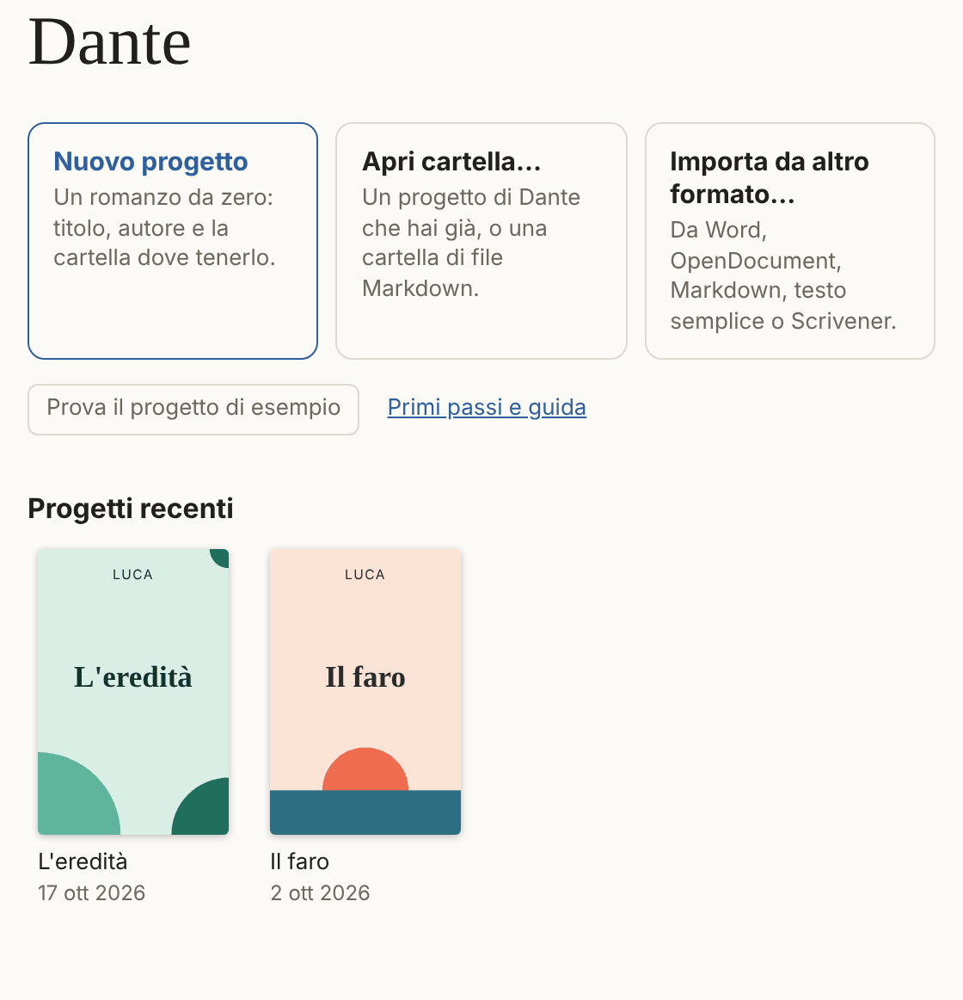

   Con **Nuovo progetto** compare questo modulo: titolo, **sottotitolo** (se c'è), autori, lingua e copertina. La copertina è un disegno semplice che Dante prepara con il titolo e gli autori: scegli una forma e dei colori, lasciala com'è, oppure premi **Usa una tua immagine…** e scegli una foto o un disegno dal computer. Tutto si può cambiare più tardi in **Impostazioni** (capitolo 17).

   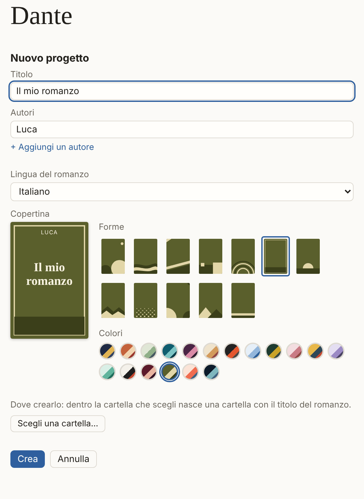
3. Apri le **Impostazioni** (l'ingranaggio nella barra a sinistra). A sinistra c'è l'elenco delle pagine, in due gruppi: **Questo romanzo**, con le scelte salvate nel progetto, e **Dante su questo computer**, con quelle che valgono per tutti i progetti; la casella **Cerca nelle impostazioni** in cima trova la pagina giusta da una parola. Nella pagina **Tu** del secondo gruppo scrivi **il tuo nome**: serve a firmare commenti e revisioni e a contare le parole che scrivi ogni giorno. Non c'è un pulsante per salvare: ogni modifica si salva da sola dopo un istante.
4. Nella scheda **Questo romanzo** controlla **titolo**, **autore** e **lingua del romanzo** (italiano, inglese, spagnolo o francese, da un menu): la lingua decide, per esempio, la sillabazione e i nomi delle cartelle.

Un progetto nuovo ha già la proprietà **stato** per le scene (idea, bozza, rivista, finita), il **punto di vista** collegato ai personaggi e due viste pronte nella sezione **Tabelle e bacheche**: una bacheca delle scene per stato e una tabella delle scene (capitolo 13). La prima scena, vuota, mostra in grigio tre righe su come cominciare, che spariscono appena scrivi.

I progetti aperti di recente restano elencati nella schermata iniziale. Per tornarci, usa **Chiudi progetto** nella barra a sinistra, oppure Cmd+W / Ctrl+W con il cursore nel testo. Dante ricorda la dimensione e la posizione della finestra e la riapre com'era.

Ogni progetto contiene anche un file con il titolo del romanzo e l'estensione **.dante** (per esempio `Il mio romanzo.dante`). Un **doppio clic** su quel file apre Dante con il romanzo già caricato; se Dante è già aperto, passa a quel romanzo dopo aver salvato il testo. Il file si può rinominare, ma deve restare nella cartella principale del progetto. Funziona con Dante installato, non con la copia portatile.

### Approfondimento

- **Dove si scarica**: l'installatore e la copia portatile per Windows, i pacchetti per Linux e il .dmg per Mac sono nella sezione Download di [dante.lucadj.eu](https://dante.lucadj.eu), che porta all'ultima versione pubblicata. I file hanno il numero della versione nel nome, per esempio `Dante-setup-1.2.0.exe`.
- **macOS**: ci sono due file: `Dante-<versione>-mac-apple-silicon.dmg` per i Mac con chip M1 o successivi (dal 2020) e `Dante-<versione>-mac-intel.dmg` per quelli precedenti. Per sapere quale hai, apri il menu Apple > Informazioni su questo Mac: se vedi "Chip Apple" scegli apple-silicon, se vedi "Intel" scegli intel. Serve macOS 10.15 (Catalina) o successivo; su Catalina installa prima gli aggiornamenti di Safari fino alla 15.6 (Preferenze di Sistema > Aggiornamento Software). Il motore che Catalina dà alle app è rimasto quello di Safari 13, troppo vecchio per Dante: su Catalina Dante si riavvia da solo all'apertura per usare quello di Safari aggiornato (una soluzione ancora in prova). Se Dante non riesce ad avviarsi, al posto della finestra vuota mostra un rapporto da copiare e mandare a chi segue Dante, con la versione di macOS e di Safari aggiunte in fondo; lo stesso rapporto si copia in qualunque momento da Impostazioni > Aggiornamenti e assistenza > Segnalare un problema. Apri il .dmg e trascina Dante nella cartella Applicazioni. L'app non è firmata da Apple, quindi la prima volta macOS la blocca: chiudi l'avviso, poi vai in Impostazioni di Sistema > Privacy e sicurezza e premi **Apri comunque** accanto al messaggio su Dante. Sulle versioni di macOS precedenti a Sequoia basta anche tasto destro sull'app > Apri. Serve una volta sola per ogni .dmg scaricato; le versioni successive arrivano con l'aggiornamento automatico (capitolo 20). Con Dante in Applicazioni funziona il doppio clic sui file .dante.
- Le impostazioni si dividono in due gruppi. Quelle del **romanzo** (titolo, struttura, numerazione, tipi, obiettivi, esportazione) sono salvate in `dante.yaml` dentro il progetto e viaggiano con lui. Quelle dell'**applicazione** (lingua dell'interfaccia, tema, dimensione dell'interfaccia, aspetto del testo nell'editor, correttore, il tuo nome) restano sul computer e valgono per tutti i progetti.
- Un nuovo progetto nasce con le cartelle principali già pronte, chiamate nella lingua del romanzo (capitolo 10).
- **File di avvio**: Dante scrive `Titolo.dante` nella cartella principale quando crea o apre un progetto che non ne ha uno (lo riconosce da qualunque nome con quell'estensione, quindi un file rinominato non viene duplicato). Il contenuto è solo una nota: conta la cartella in cui si trova. Gli installatori registrano l'estensione: tipo di documento sul Mac, registro su Windows, tipo MIME `application/x-dante-project` con i pacchetti .deb e .rpm su Linux. Con la copia portatile e l'AppImage l'associazione manca, ma *Apri con* sul file funziona. Una seconda copia di Dante avviata dal doppio clic passa il file a quella già aperta e si chiude. Obsidian non mostra il file, perché non è un formato che conosce.

## 3. Importare un romanzo da Word o Scrivener

### Come si fa

1. Nella schermata iniziale scegli **Importa da altro formato…**, poi **Word, OpenDocument, RTF, Markdown o testo**, e seleziona il file (`.docx`, `.odt`, `.rtf`, `.md` o `.txt`).
2. Si apre l'anteprima: in alto quante parti, capitoli, scene, parole e caratteri spazi inclusi ha trovato Dante; a sinistra il documento come lo legge, con un'etichetta sulle righe che diventano parte, capitolo o scena e sui punti in cui comincia una nuova scena; a destra il risultato, capitolo per capitolo. Un clic su un capitolo o una scena a destra mostra a sinistra dove comincia.
3. In alto, accanto a ogni livello di titolo del documento, scegli cosa diventa: parti, capitoli, scene con titolo, oppure titoli lasciati nel testo. Accanto a **Righe vuote** scegli se una riga vuota (o due di fila) separa le scene. Se nel documento le scene sono separate da `***` non serve cambiare niente; se Dante divide in scene paragrafi che stanno insieme, scegli **Non aprono scene** (le righe vuote spariscono) oppure **Restano righe vuote, senza nuove scene** (ogni riga vuota tra due paragrafi resta una riga vuota del testo, capitolo 6).
4. Se una riga è letta male, fai clic su di essa e scegli cos'è: **Titolo di parte**, **Titolo di capitolo**, **Titolo di scena**, **Separatore di scene**, **Testo** oppure **Ometti**. Con **Anche le righe simili** spuntata la scelta vale per tutte le righe dello stesso tipo: per esempio tutte quelle con solo un numero, o tutte quelle che iniziano con "Capitolo" seguito da un numero. **Come la legge Dante** annulla la scelta. Le righe che hai scelto tu hanno un pallino accanto all'etichetta. Anche una riga vuota, che nell'anteprima è una sottile striscia tra due paragrafi, si può scegliere con un clic: segnata come **Testo** resta una riga vuota del testo, senza aprire una scena.
5. Premi **Continua**, scegli titolo, autori e dove creare il progetto, e premi **Importa**. **Torna all'anteprima** riapre l'anteprima con le scelte fatte.

Il file Word non viene modificato: Dante ne legge una copia.

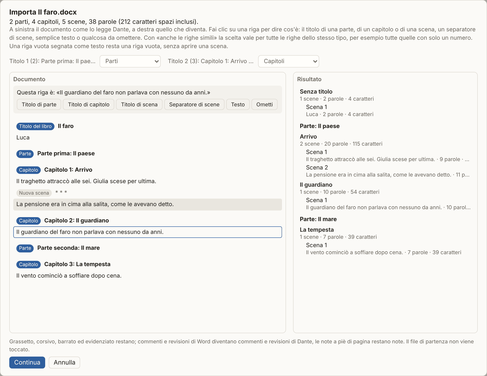

**Un esempio.** Nel documento qui sopra i titoli con lo stile Titolo 1 sono «Parte prima: Il paese» e «Parte seconda: Il mare», quelli con lo stile Titolo 2 sono «Capitolo 1: Arrivo» e così via. Dante propone **Parti** per il primo livello e **Capitoli** per il secondo. Dentro il Capitolo 1 una riga con `***` separa due scene, quindi il capitolo diventa due scene. Se invece i capitoli del tuo documento fossero scritti con lo stile Titolo 1, sceglieresti **Capitoli** nel primo menu.

**Aggiungere un file Word a un progetto già iniziato.** Se il romanzo è diviso in più file Word, crea il progetto dal primo e poi aggiungi gli altri uno alla volta: nel manoscritto premi **Importa**, nel gruppo **Aggiungi** sopra l'albero, e scegli il file. Si apre la stessa anteprima; sotto puoi scegliere **Dove va** (in fondo al manoscritto o in fondo a una parte, se il progetto ne ha) e, se il file comincia con del testo prima del primo titolo, spuntare **Il testo prima del primo titolo continua il capitolo…**: quel testo diventa altre scene dell'ultimo capitolo invece di un capitolo nuovo, utile quando un capitolo comincia in un file e finisce nel successivo. Premi **Importa**: quello che c'era resta com'era, il nuovo testo arriva dopo.

**Da Scrivener.** Nella schermata iniziale scegli **Importa da altro formato…**, poi **Scrivener**, e seleziona il progetto `.scriv`. Se il Mac non lo lascia scegliere (succede quando Scrivener non è installato) apri la cartella del progetto e scegli il file `.scrivx` che contiene; su Windows scegli sempre il file `.scrivx`. Nel browser scegli uno zip del progetto (sul Mac: tasto destro sul progetto > Comprimi). Va bene anche un backup zip fatto da Scrivener (nel suo comando di backup, con l'opzione per comprimere in zip). Se Dante dice che il file è vuoto, quel `.scriv` è una copia senza contenuto, spesso lasciata da Dropbox, iCloud o Drive: cerca il progetto vero, per esempio tra i progetti recenti di Scrivener.

Si apre la stessa anteprima del Word: le cartelle della **Bozza** (*Draft*) diventano capitoli, o parti e capitoli se sono una dentro l'altra, e i testi diventano scene con il loro titolo. La sinossi di ogni testo e di ogni cartella diventa la sinossi della scena o del capitolo.

Anche il resto del progetto entra in Dante. Nella schermata del nuovo progetto, sotto **Dove vanno le altre cartelle di Scrivener**, scegli per ogni cartella se metterla nella **Bibbia** (e con quale tipo: Personaggi, Luoghi…), tra le **Note** in Ricerca o in Laboratorio, oppure se non importarla. Dante propone già una scelta: una cartella che si chiama come un tipo della Bibbia (per esempio *Characters* o *Personaggi*, *Places* o *Luoghi*) va nella cartella di quel tipo, e così i personaggi diventano schede. Tutto il resto va in Ricerca. Le sottocartelle restano quelle di Scrivener: i testi diventano note con la loro sinossi, mentre PDF e immagini vengono copiati così come sono. Il Cestino, le note laterali dei documenti, le etichette e gli stati non si importano, e il progetto Scrivener non viene modificato.

*Esempio:* un progetto Scrivener con la Bozza divisa in cartelle «Capitolo 1», «Capitolo 2»… e, dentro ognuna, un testo per scena. Nell'anteprima le cartelle sono **Titolo 1** e i testi **Titolo 2**: Dante propone **Capitoli** e **Scene con titolo**, quindi basta premere **Continua**.

*Esempio:* un file in cui il testo scorre senza titoli e le sezioni sono divise da un numero su una riga da solo ("1", "2", "3"…). Dante riconosce i numeri che crescono e ne fa dei capitoli; nell'anteprima compaiono come **Titolo 2**. Se quelle sezioni per te sono scene, scegli **Scene con titolo** accanto a **Titolo 2**; se vuoi tenerle come capitoli senza il numero come titolo, lasciale così e rinominale poi nell'albero.

### Approfondimento

- La struttura viene dagli stili Titolo 1, Titolo 2, Titolo 3 di Word. Dante propone da solo una divisione: con tre livelli, parti, capitoli e scene; con due, parti e capitoli se il primo livello si chiama "Parte…", altrimenti capitoli e scene; con uno, capitoli. Riconosce anche capitoli scritti senza stile, come "Capitolo primo", oppure un numero centrato ("1", "IV") con il titolo sotto: in quel caso il numero si toglie, perché lo aggiunge Dante. Senza stili né numeri centrati, le righe con solo un numero (in cifre o romano, anche con il punto o in grassetto) diventano capitoli quando contano in avanti: ognuna segue la precedente o ricomincia da 1, con al massimo un'eccezione ogni cinque. Il conteggio può partire da qualsiasi numero, perché un file può essere il seguito di un altro.
- Le scelte riga per riga dell'anteprima valgono più delle regole generali: una riga segnata come titolo diventa titolo qualunque sia il suo stile, una segnata come testo resta nel testo anche se è un titolo di Word o una riga di `***`. Le righe simili sono quelle corte (fino a 80 caratteri) uguali a parte i numeri e l'eventuale titolo dopo il numero ("Capitolo 3" e "Capitolo IV: La casa").
- Aggiungendo un file a un progetto, i nuovi capitoli e le nuove parti prendono numeri d'ordine dopo quelli esistenti; un nome già usato riceve un numero ("Capitolo 2"). Se il file ha delle parti e il progetto no, Dante attiva le parti e scrive `kind: chapter` nella nota cartella dei capitoli che c'erano, perché restino capitoli.
- Quando le righe vuote separano le scene, una riga vuota che lascerebbe una scena di uno o due paragrafi (prima o dopo di sé) non apre una scena: resta una riga vuota del testo, perché quasi sempre è solo uno stacco. Se invece è davvero una scena, fai clic sulla riga vuota nell'anteprima e scegli **Separatore di scene**.
- Dentro un capitolo, una riga con soli simboli (`***`, `* * *`, `#`, `§` e simili) apre una nuova scena.
- Le righe vuote dentro uno stesso paragrafo di Word (due a capo di fila) non lo dividono: il paragrafo resta uno, anche quando è centrato.
- "Capitolo 3: Casa" diventa un capitolo con titolo "Casa", perché i numeri li aggiunge Dante (capitolo 10).
- Grassetto, corsivo, barrato ed evidenziato restano. I commenti di Word diventano commenti di Dante e le revisioni diventano revisioni da accettare o rifiutare, firmate col nome di chi le aveva fatte (capitolo 16). Le note a piè di pagina e le note di chiusura di Word diventano note a piè di pagina (`^[testo]`).
- Lo stile Titolo e le proprietà del documento danno titolo e autore del romanzo. **Altri formati**: un file OpenDocument (`.odt`, quello di LibreOffice) si legge come un Word, con titoli, grassetto, corsivo, barrato, evidenziato, paragrafi centrati o a destra e note a piè di pagina, ma senza commenti e revisioni. Un file RTF dà i paragrafi con la loro formattazione, senza titoli: le righe «Capitolo 3» sono riconosciute lo stesso. Un file Markdown dà i suoi titoli (`#`, `##`…) e il testo com'è scritto; un file di testo una riga per paragrafo. Anche **Importa** nel manoscritto accetta tutti questi formati.
- **Scrivener**: Dante legge l'indice del progetto nel file `.scrivx` e il testo di ogni documento dal suo file RTF (`Files/Data/<id>/content.rtf` in Scrivener 3, `Files/Docs/<id>.rtf` nelle versioni precedenti), con grassetto, corsivo, barrato, evidenziato e paragrafi centrati o a destra. Le sinossi vengono da `synopsis.txt` e finiscono nella proprietà `synopsis`. Gli elementi fuori dalla Bozza (tranne il Cestino) diventano file `.md`, raggruppati per elemento in cima al binder. Ogni gruppo va dove sceglie l'utente: `Bibbia/<tipo>/`, `Ricerca/<gruppo>/` o `Laboratorio/<gruppo>/`. La Ricerca di Scrivener va direttamente in `Ricerca/`. La scelta proposta è la Bibbia quando il nome del gruppo è quello di un tipo, o della sua cartella, in una delle lingue di Dante; PDF e immagini vengono copiati con la loro estensione (`content.<ext>`). Se un nome è già usato, il nuovo file prende un numero. I commenti e le note a piè di pagina di Scrivener non si importano. Ogni elemento della Bozza diventa un titolo, un livello più in basso a ogni cartella: con più di tre livelli quelli in più restano titoli nel testo.

## 4. L'area di lavoro

### Come si fa

La finestra ha quattro zone, da sinistra a destra:

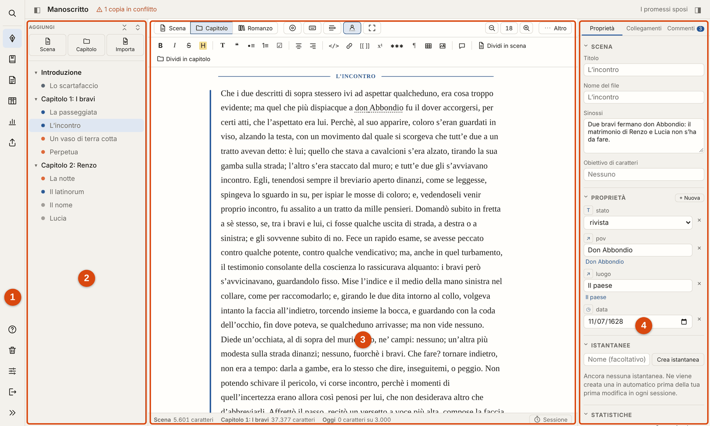

1. **La barra delle sezioni**, con un'icona per ciascuna: Manoscritto, Bibbia, Note, Tabelle e bacheche, Statistiche, Esportazione, Impostazioni, oltre a Cerca, Aiuto, Cestino e Chiudi progetto. In una finestra larga accanto a ogni icona c'è il nome; **Nascondi i nomi**, in fondo alla barra, la stringe alle sole icone (nelle immagini di questa guida è così, e così parte in una finestra stretta), e allora il nome compare passando col mouse. **Mostra i nomi** li riporta.
2. **Il pannello a sinistra**: nel Manoscritto è l'albero di parti, capitoli e scene; nelle altre sezioni è l'elenco di note e file.
3. **L'editor** al centro, dove scrivi.
4. **Il pannello a destra**, con tre schede: **Proprietà** (dati della scena o nota, istantanee, statistiche), **Collegamenti** (le note che rimandano a questa e viceversa) e **Commenti**.

In alto, accanto al nome della sezione, compaiono gli avvisi (nell'immagine, **1 copia in conflitto**, capitolo 16); a destra c'è il titolo del romanzo.

I due pannelli laterali si nascondono e si riaprono dai pulsanti in alto; si allargano trascinandone il bordo, e un doppio clic sul bordo li riporta alla larghezza normale. Cmd+ e Cmd− (Ctrl+ e Ctrl− su Windows e Linux) ingrandiscono e riducono il testo, Cmd+0 / Ctrl+0 lo riporta come prima.

### Approfondimento

Ogni sezione corrisponde a una cartella del progetto: Manoscritto, Bibbia, Viste per **Tabelle e bacheche** e, per **Note**, le due cartelle Ricerca e Laboratorio, che restano separate su disco e in Obsidian; Statistiche, Esportazione e Impostazioni leggono e scrivono `dante.yaml` e i dati in `.dante/`. Lo stato dell'albero (rami aperti o chiusi) è ricordato dal computer, non dal progetto.

## 5. Aiuto dentro Dante

### Come si fa

L'icona **Aiuto** (il punto di domanda nella barra a sinistra, sopra il cestino) apre una finestra con tre schede:

- **Primi passi**: sette passi per cominciare, dalla creazione del progetto all'esportazione.
- **Guida completa**: questa guida, con l'elenco dei capitoli a sinistra. Un clic su un rimando («capitolo 15») porta al capitolo. Un piccolo **?** nella tipografia dell'esportazione, nelle impostazioni di una vista e nella sezione Libro game apre questa scheda al capitolo che ne parla.

  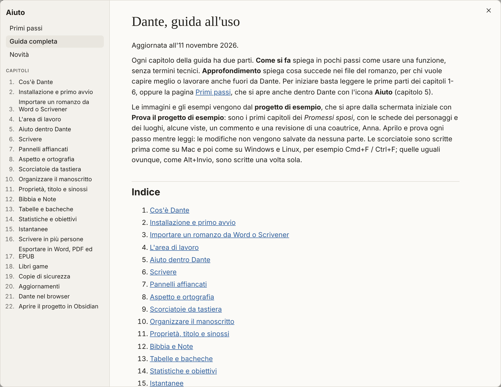

- **Novità**: cosa cambia in ogni versione.

Si legge anche senza connessione, perché è dentro Dante. Dalla schermata iniziale ci si arriva con **Primi passi e guida**; sul Mac anche dal menu **Aiuto** > **Aiuto di Dante** (Cmd+?). Esc chiude la finestra.

### Approfondimento

- Le pagine viaggiano dentro l'app: la guida dentro Dante è quella della versione installata.
- Con l'interfaccia in italiano le schede mostrano le pagine in italiano; con qualsiasi altra lingua, quelle in inglese.
- I link ad altre pagine del repository (per esempio [Provare Dante](beta.md)) si aprono su GitHub nel browser.
- **Messaggi di errore**: quando qualcosa non riesce (un file che non si può scrivere, un disco pieno, una cartella sparita, la connessione assente) Dante lo dice con una frase semplice. Il messaggio tecnico resta nascosto dietro **Dettagli**, da copiare se segnali il problema.

## 6. Scrivere

### Come si fa

- **Cosa vedere**: in alto a sinistra scegli se vedere solo la **Scena** selezionata, tutto il **Capitolo**, tutta la **Parte** o tutto il **Romanzo**, una scena dopo l'altra. Con le frecce passi da una scena alla successiva.
- **La barra in alto**: dopo la scelta di cosa vedere ci sono le modalità di scrittura (Focus, Macchina da scrivere, Riga, Schermo intero), lo zoom e il menu **Altro**. **Altro** accende e spegne la **barra di formattazione**, le **schede della scena** accanto al testo (capitolo 7), le **revisioni** (capitolo 16) e il **testo com'è nel file**, con i simboli Markdown. Quando le revisioni o il testo com'è nel file sono accesi, nella barra compare un'etichetta che lo ricorda; un clic la spegne. Con una finestra stretta le etichette dei pulsanti si nascondono e restano le icone: passando col mouse si legge il nome.
- **Formattare**: seleziona il testo e usa la barra che compare sopra la selezione (grassetto, corsivo, evidenziato, commento…), oppure le scorciatoie (capitolo 9). La **barra di formattazione** fissa si mostra o nasconde dal menu **Altro**. Per una **nota a piè di pagina** premi il pulsante **x¹** della barra fissa e scrivi la nota tra le quadre, lì dove va il richiamo: `^[testo della nota]`. Nel testo resta in piccolo e in grigio; nel libro esportato diventa un numero con la nota a piè di pagina.

  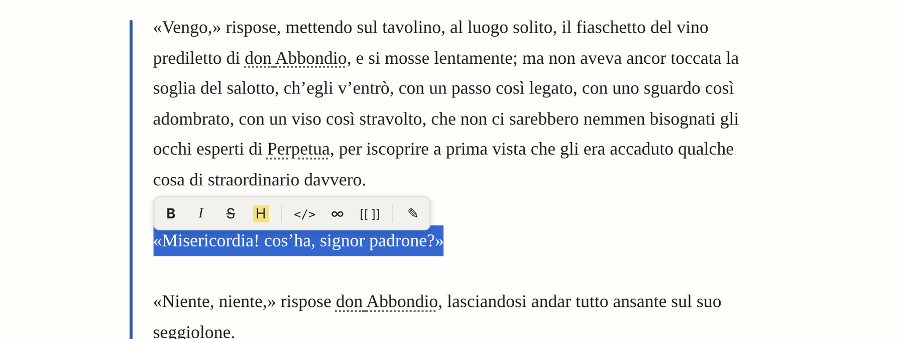

  *Prova:* apri la scena **Perpetua**, seleziona «Misericordia! cos'ha, signor padrone?» e premi **I** nella barra: la frase diventa corsiva. Cmd+Z / Ctrl+Z la riporta com'era.
- **Allineare un paragrafo**: metti il cursore nel paragrafo e usa i pulsanti di allineamento della barra di formattazione (centrato o a destra), oppure Cmd+Maiusc+E / Ctrl+Maiusc+E e Cmd+Maiusc+R / Ctrl+Maiusc+R. Un secondo clic sullo stesso pulsante lo riporta all'allineamento di base: a sinistra mentre scrivi, giustificato o a sinistra in esportazione secondo il profilo. Su una riga vuota il pulsante apre un paragrafo già allineato. Invio alla fine di un paragrafo allineato ne apre uno normale; Backspace all'inizio toglie l'allineamento. L'allineamento si vede nell'editor ed è rispettato in Word, PDF, EPUB e Markdown; dall'importazione da Word restano i paragrafi centrati e a destra. Nel file il paragrafo è racchiuso in `<span style="display:block;text-align:center">…</span>` (o `text-align:right`): Dante nasconde il tag, la vista Markdown lo mostra, e Obsidian mostra il paragrafo allineato con corsivi e grassetti intatti.
- **Andare a capo**: Invio inizia un nuovo paragrafo. Tra un paragrafo e l'altro vedi solo lo spazio, non una riga in più su cui fermarti: le frecce passano direttamente da un paragrafo all'altro e Backspace all'inizio di un paragrafo lo unisce a quello prima. Premendo Invio due volte di seguito (o Invio all'inizio di un paragrafo) lasci un paragrafo vuoto, che nel libro è una riga bianca e nell'editor si vede come un **¶** chiaro. Maiusc+Invio va a capo restando nello stesso paragrafo, per esempio nei versi di una poesia. Nelle liste, nelle citazioni e nelle tabelle Invio fa quello che fa sempre: una nuova voce, una nuova riga. Se preferisci vedere le righe vuote come sono nel file, togli la spunta a **Invio singolo per iniziare un nuovo paragrafo** in **Impostazioni → Scrittura**; la vista Markdown le mostra sempre.

  *Prova:* alla fine di un paragrafo premi Invio e scrivi: il nuovo paragrafo comincia sotto, separato dallo spazio di sempre. Ora premi Invio due volte e scrivi ancora: tra i due compare un **¶**, la riga bianca che vedrai nel libro.
- **Righe vuote**: in Markdown due o più righe vuote tra due paragrafi valgono come una sola, quindi una riga vuota in più nel file sparisce in esportazione e in Obsidian (per questo Dante non la mostra). Per lasciare davvero una riga vuota, senza aprire una nuova scena, premi il pulsante **¶** della barra di formattazione o Alt+Invio: dopo il paragrafo in cui sei compare una riga con un **¶** chiaro, che nel libro sarà una riga vuota. Il **¶** non si stampa; per toglierla, metti il cursore sulla riga e cancellala come una riga qualsiasi.

  *Esempio:* alla fine di un paragrafo («…e la porta si chiuse.») premi Alt+Invio e continua a scrivere il paragrafo successivo. In Word, PDF ed EPUB tra i due paragrafi c'è una riga bianca e la scena resta una. Per una pausa più forte, con il separatore (per esempio `* * *`), usa invece il pulsante **Separatore di scena**.
- **Cercare nella scena**: Cmd+F / Ctrl+F apre una barra sopra il testo. Scrivi la parola: Invio (o Cmd+G / Ctrl+G) passa alla successiva, Maiusc+Invio (o Maiusc+Cmd+G / Ctrl+Maiusc+G) torna alla precedente, **tutte** le seleziona tutte. Le caselle limitano la ricerca alle maiuscole scritte così o alle parole intere. Il campo **Sostituisci con** cambia la parola solo in questa scena; per cambiarla in tutto il romanzo usa **Sostituisci** (capitolo 12). Esc chiude la barra.

  *Prova:* apri la scena **Perpetua**, premi Cmd+F / Ctrl+F e scrivi «padrone»: la prima volta che compare è evidenziata, Invio passa alla seguente.
- **Dividere**: con il cursore nel punto giusto, **Dividi in scena** (Cmd+Invio / Ctrl+Invio) sposta il testo che segue in una nuova scena; **Dividi in capitolo** (Cmd+Maiusc+Invio / Ctrl+Maiusc+Invio) apre un nuovo capitolo da quel punto, con le scene che seguono.
- **Modalità di scrittura**:
  - **Macchina da scrivere**: la riga su cui scrivi resta al centro della finestra.
  - **Focus**: tutto è attenuato tranne il paragrafo che stai scrivendo.

    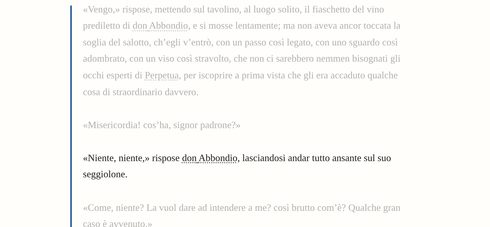
  - **Riga**: ombreggia leggermente la riga su cui si trova il cursore, così l'occhio la ritrova subito. Si accende e si spegne con il suo tasto, e la scelta resta per le volte successive.
  - **Schermo intero**: resta solo il testo. Porta il mouse al bordo in alto per far uscire le barre (modalità e formattazione), al bordo sinistro per l'albero, al bordo destro per il pannello laterale; si nascondono di nuovo quando il mouse se ne va, ma restano aperti mentre scrivi in un loro campo. I pannelli affiancati tornano quando esci. Esc per uscire.
- **Elenchi**: i pulsanti della barra di formattazione (o Cmd+Maiusc+8 / Ctrl+Maiusc+8, Cmd+Maiusc+7 / Ctrl+Maiusc+7 e Cmd+Maiusc+9 / Ctrl+Maiusc+9) iniziano un elenco puntato, numerato o di caselle di spunta. Il testo di ogni voce rientra dopo il punto, il numero o la casella, e le righe che vanno a capo si allineano sotto la prima, non sotto il punto. Una voce che inizia con qualche spazio in più (quattro vanno sempre bene) sta dentro la precedente e rientra di un livello. In Word, PDF ed EPUB gli elenchi hanno lo stesso rientro; in Markdown restano elenchi Markdown.
- **Tabelle**: il pulsante **Tabella** della barra di formattazione inserisce una tabella di tre colonne. Scrivi nella prima cella; **Tab** passa alla cella successiva (dopo l'ultima aggiunge una riga), **Maiusc+Tab** torna indietro, **Invio** aggiunge una riga sotto e, su una riga vuota alla fine, esce dalla tabella. Mentre il cursore è nella tabella compare sopra una barra: **Riga** aggiunge una riga sopra o sotto quella del cursore o la elimina, **Colonna** fa lo stesso con le colonne (a sinistra, a destra, elimina), **Allinea** allinea la colonna del cursore a sinistra, al centro o a destra (premuto di nuovo, toglie l'allineamento). **+ Didascalia** scrive `Tabella: ` sotto la tabella e ci porta il cursore, oppure porta il cursore alla didascalia che c'è già. Mentre la modifichi la tabella è scritta con lettere tutte della stessa larghezza, e le colonne si rimettono in fila da sole a ogni Tab, Invio, comando della barra e quando il cursore esce dalla tabella.

  *Esempio:* premi **Tabella** e scrivi «Personaggio», Tab, «Chi è», Tab, «Prima scena», Tab, «Renzo», Tab, «filatore di seta», e così via. Mentre scrivi la vedi così, con la barra sopra:

  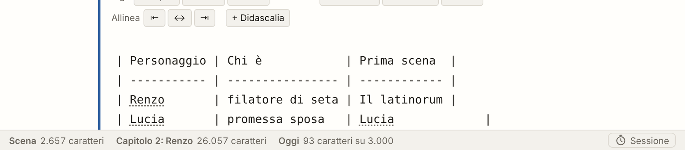

  Quando il cursore esce dalla tabella, la vedi come sarà nel libro, con la didascalia sotto:

  
- **Immagini**: premi il pulsante **Immagine** della barra di formattazione e scegli il file, oppure incolla un'immagine (Cmd+V / Ctrl+V) o trascinala nel testo. Dante la copia nella cartella **Allegati** dentro **Ricerca** e la mostra nel punto in cui si trova il cursore. Porta il mouse sull'immagine per cambiarne la larghezza (**200**, **400**, **600** pixel o **1:1**, la dimensione originale) e l'allineamento (a sinistra, al centro, a destra). Un clic sull'immagine mostra il testo che la inserisce, per modificarlo a mano.
- **Barra di stato**: sotto il testo una riga mostra le parole della scena con il cursore (con il suo obiettivo, se ne ha uno), quelle del testo selezionato, del capitolo o di ciò che è a schermo, e quelle scritte oggi rispetto all'obiettivo del giorno. Se il progetto misura in caratteri (capitolo 14), la barra conta caratteri spazi inclusi invece di parole. Si nasconde da **Altro** > **Barra di stato**.
- **Sessione di scrittura**: premi **Sessione** a destra nella barra di stato, scegli quanti minuti (da 10 a 90) e, se vuoi, quante parole raggiungere, poi **Inizia**. Nella barra scorrono il tempo che resta e le parole scritte da quando hai cominciato; alla fine Dante dice quante parole hai scritto. **Termina** la chiude prima. Contano le parole aggiunte, tolte quelle cancellate, come nelle statistiche; in un progetto che misura in caratteri, la sessione chiede e conta caratteri.

  *Esempio:* una sessione da 25 minuti con 500 parole da raggiungere. Mentre scrivi la barra mostra «18:42 · 312 parole su 500»; allo scadere compare «Obiettivo raggiunto: 534 parole in 25 min.», oppure «Sessione finita» se non ci sei arrivato.
- **Dialoghi e tipografia**: se attivi la correzione mentre scrivi, Dante mette da solo le virgolette o le lineette del dialogo, l'apostrofo tipografico e i puntini di sospensione. Cmd+Z / Ctrl+Z annulla una correzione che non volevi.

### Approfondimento

- Il testo è Markdown: `*corsivo*`, `**grassetto**`, `==evidenziato==`, `~~barrato~~`. L'editor nasconde questi simboli tranne dove si trova il cursore, come in Obsidian. **Altro** > **Testo com'è nel file** mostra il file com'è, simboli e proprietà comprese.
- Un'immagine si scrive come in Obsidian: `![[foto.jpg]]`, oppure `![[foto.jpg|300]]` per una larghezza di 300 pixel (`|300x200` fissa anche l'altezza); funziona anche ``. L'immagine può stare in qualsiasi cartella del progetto: con `![[nome.jpg]]` Dante la cerca per nome, come Obsidian. Se incolli o trascini nel testo l'indirizzo web di un'immagine, Dante la scarica in **Ricerca/Allegati** e la inserisce da lì. Un indirizzo scritto a mano (``) si vede nell'editor ma non passa nell'esportazione finché non premi **⤓** sulla barra dell'immagine, che la scarica nel progetto; un file fuori dal progetto non si vede, perché chi apre il progetto da un altro computer non lo avrebbe: va copiato nel progetto, come fa il pulsante **Immagine**. L'allineamento usa lo stesso tag dei paragrafi allineati. In esportazione un'immagine da sola in un paragrafo diventa una figura, con il suo allineamento; un'immagine dentro una frase resta nella riga, centrata sulle lettere come nell'editor. Un'immagine più larga della pagina viene ridotta alla larghezza del testo; un'immagine che non si trova viene saltata. Le immagini non contano nelle parole e nei caratteri.
- **Didascalie**, come le scrive Pandoc: la descrizione di un'immagine che sta da sola nel suo paragrafo (`![[casa.png|La casa al mare|300]]`) è la sua didascalia e compare sotto l'immagine. Per una tabella premi **+ Didascalia** nella barra sopra la tabella, oppure scrivi tu, dopo una riga vuota sotto la tabella, una riga che inizia con `Tabella:` (oppure solo `:`), per esempio `Tabella: Le fasi del romanzo`; nell'editor si vede centrata sotto la tabella, senza la parola iniziale. Le didascalie passano in Word, PDF ed EPUB sotto la figura o la tabella, in corsivo, e contano nelle parole dell'esportazione.
- **Note incorporate**, come in Obsidian: `![[Nota]]` su una riga da sola mostra il testo della nota in un riquadro, in sola lettura; `![[Nota#Titolo]]` mostra solo quella sezione (con le sue sottosezioni), `![[Nota#^id]]` solo il paragrafo che finisce con `^id`. Un clic sul nome in alto apre la nota, un clic nel testo mostra la riga com'è scritta. In esportazione il testo della nota prende il posto della riga, comprese le note che incorpora a sua volta; una nota che incorpora sé stessa viene saltata. Dentro una frase `![[Nota]]` resta un collegamento. Le parole delle note incorporate contano nell'esportazione, non nelle statistiche della scena.
- **Quando lasci più righe vuote del solito** (solo se hai tolto la spunta a **Invio singolo per iniziare un nuovo paragrafo**): se tra due capoversi lasci più righe vuote di quelle che usi di solito (per esempio due invece di una), appena cominci a scrivere il capoverso nuovo compare un riquadro: **Vuoi una riga vuota vera?** Spiega che nel libro esportato le righe in più sparirebbero. **Inserisci riga vuota** la trasforma in una riga vuota vera (come Alt+Invio), **No** lascia tutto com'è, **Non chiedere più** spegne la domanda; si riaccende in **Impostazioni → Dante su questo computer**. Dante capisce la tua abitudine da tutte le scene del romanzo: finché sono troppo poche per capirla, non chiede.
- Nel file i paragrafi restano separati da una riga vuota, come vuole Markdown: Invio la scrive per te e l'editor la nasconde. Le righe vuote in più che un file avesse già (scritte in un'altra app) sono nascoste allo stesso modo, perché nel libro non contano. Una riga vuota all'inizio o alla fine della scena e quelle dentro un blocco di codice restano visibili.
- Una riga vuota è scritta nel file come un paragrafo che contiene solo `&nbsp;` (uno spazio che non va a capo), con una riga vuota sopra e una sotto. Obsidian, Pandoc e i browser la mostrano come una riga vuota. Dante legge allo stesso modo una riga con solo `<br>` o con solo uno spazio non separabile, come li scrivono altre app. In esportazione diventa un paragrafo vuoto in Word, uno spazio di una riga in PDF ed EPUB, e resta `&nbsp;` in Markdown; non conta nelle parole né nei caratteri. Un separatore di scena (`***`, `---`) dentro una scena, invece, nel libro è stampato come separatore.
- Le citazioni (righe che iniziano con `>`) si vedono con una linea a sinistra, senza il `>`. Le tabelle (`| A | B |` con sotto una riga `|---|---|`) si vedono come tabelle; un clic in una cella mostra la tabella com'è scritta, per modificarla. Dentro una tabella un collegamento con alias si scrive `[[nota\|alias]]`, come in Obsidian. Le tabelle passano in Word, PDF, EPUB e Markdown, con l'allineamento delle colonne. Una citazione che comincia con `> [!note] Titolo` (un callout) nell'editor ha il nome in una pillola colorata e nel libro esportato diventa un riquadro colorato con il titolo in grassetto.
- La correzione tipografica si imposta in **Impostazioni → Tipografia** oppure in **Esportazione → Tipografia** (sono le stesse scelte), perché vale sia per il testo esportato sia, se vuoi, mentre scrivi. Ci sono gli stili di dialogo di diversi paesi: «caporali» italiani, « spaziati » francesi, “virgolette alte” americane, „ basse“ tedesche, lineetta italiana (— Vieni — disse), raya spagnola (—Ven —dijo—) e altri. Nell'elenco quello comune nella lingua del romanzo è segnato come tale. Un nuovo progetto parte sempre con **Come scritti nel testo**, anche se per un altro romanzo avevi scelto uno stile: i dialoghi escono come li hai scritti, finché non scegli uno stile per questo romanzo.
- Qualunque sia il modo in cui hai scritto i dialoghi, lo stile scelto li converte: le battute scritte con caporali o virgolette diventano lineette, e quelle aperte da una lineetta o da un trattino a inizio paragrafo diventano virgolette. Per esempio `- Vieni - disse lui - è tardi.` diventa «Vieni» disse lui «è tardi.».
- Trattini e lineette nella narrazione restano come li hai scritti, così come i trattini dentro le parole (socio-economico) e le lineette fra numeri (1990–2000). In una battuta aperta da una lineetta contano come chiusura e riapertura solo le lineette dello stesso tipo: un inciso fra trattini dentro una battuta aperta da lineetta resta com'è.
- Se una scena viene cambiata da un altro programma mentre la stai modificando, la tua versione resta e un avviso propone di ricaricare l'altra.

## 7. Pannelli affiancati

### Come si fa

Accanto al testo puoi tenere aperte fino a due cose in più: un'altra scena, un capitolo, la scheda di un personaggio, una nota, un'immagine o una vista come la linea del tempo. Ogni pannello si può modificare, e resta aperto anche quando cambi sezione.

- **Aprire a fianco.** Tieni premuto **Alt** (Option su Mac) mentre fai clic: su un link `[[Lucia Mondella]]` nel testo, su una scena nell'albero, su una scheda della Bibbia, su una nota, su una vista o su un risultato della ricerca. Puoi anche usare la voce **Apri a fianco** del menu del tasto destro, il pulsante ⧉ nella scheda Collegamenti, oppure trascinare una voce sul bordo destro della finestra.
- **Schede della scena.** **Altro** > **Schede della scena** nella barra del Manoscritto apre un pannello che mostra le schede della Bibbia nominate nella scena che stai scrivendo (per nome o alias) o collegate con `[[…]]`. Scrivi «Agnese» e la sua scheda compare tra le linguette in alto; passando a un'altra scena le linguette cambiano.

  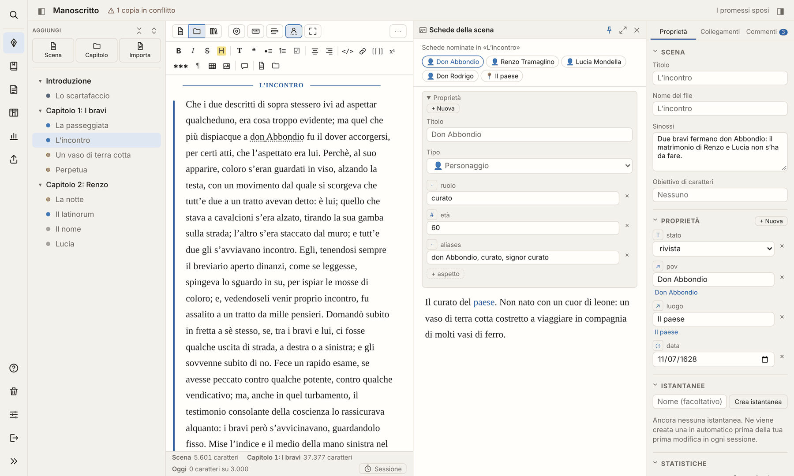

  *Esempio:* nella scena **L'incontro** il pannello mostra le linguette di don Abbondio, Renzo, Lucia, don Rodrigo e del paese: sono le schede nominate nel testo o nelle proprietà. Un clic su una linguetta mostra quella scheda, che puoi anche modificare.
- **Il pannello successivo.** La prossima cosa aperta a fianco prende il posto del pannello non fissato. Con la puntina 📌 il pannello resta e il nuovo se ne apre accanto.
- **I pulsanti del pannello.** ⤢ porta il contenuto al centro, nella sua sezione; ⇄ lo scambia con ciò che c'è al centro; × chiude il pannello. Trascina il bordo sinistro per allargarlo, doppio clic per dare al testo e ai pannelli la stessa larghezza.
- **Il pannello a destra** (Proprietà, Collegamenti, Commenti) mostra ciò che ha il cursore: la scena al centro o il contenuto del pannello in cui hai fatto clic.
- **Le viste a fianco** evidenziano la scena che stai scrivendo, e un clic su una voce la apre al centro.

La stessa scena può stare al centro e in un pannello: ciò che scrivi in uno compare subito nell'altro.

### Approfondimento

- Ogni file aperto ha un solo documento in memoria, condiviso da tutti gli editor che lo mostrano: il salvataggio, le istantanee automatiche e il ricaricamento dopo una modifica sul disco passano da lì, quindi due editor dello stesso file non si sovrascrivono.
- Prima di rinominare o spostare file, Dante scrive ciò che gli editor hanno ancora in memoria; i pannelli seguono le voci rinominate e si chiudono da soli se la voce viene eliminata.
- La disposizione dei pannelli è salvata su questo computer, per ogni progetto, e non nella cartella del romanzo: lo schermo di un coautore non cambia.
- Su Mac Cmd+W non chiude la finestra: il menu dell'app lo usa per chiudere il pannello o, se il cursore non è in un pannello, il progetto. Prima di chiudere, Dante scrive tutto ciò che hai scritto e, se le impostazioni lo chiedono, fa il backup, come con il pulsante per chiudere il progetto.
- Fanno eccezione Esporta, Impostazioni e Statistiche, che usano tutta la larghezza: lì i pannelli sono nascosti, non chiusi.

## 8. Aspetto e ortografia

Come appaiono Dante e il testo mentre scrivi. Sono scelte di questo computer: valgono per tutti i progetti, a meno che tu non dia a un romanzo un aspetto suo, e non cambiano i file né l'esportazione, che ha le sue impostazioni (capitolo 17).

### Come si fa

Apri **Impostazioni**: nell'elenco a sinistra, sotto **Dante su questo computer**, ci sono le pagine **Aspetto**, **Il testo nell'editor** e **Scrittura**.

- **Tema** (pagina **Aspetto**): si sceglie da cinque piccoli disegni della finestra, ognuno con i suoi colori. **Di sistema** (chiaro o scuro come il computer, e cambia con lui), **Chiaro (carta)**, **Seppia** (carta calda, per scrivere a lungo di giorno), **Scuro**, **Notte** (quasi nero con il testo più tenue, per scrivere al buio).

  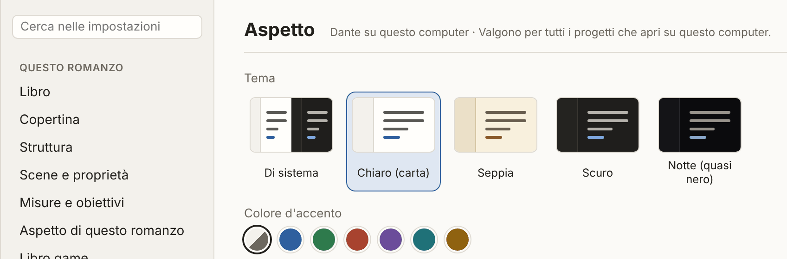

- **Colore d'accento**: il colore di pulsanti attivi, collegamenti e selezioni. Il primo cerchio lascia quello del tema; gli altri sono blu, verde, rosso mattone, viola, verde acqua e ambra, in una versione più chiara nei temi scuri.
- **Dimensione dell'interfaccia**: ingrandisce o rimpicciolisce tutta la finestra di Dante, da 80% a 200%: menu, albero, pannelli, pulsanti, finestre e il loro testo. È utile se ci vedi poco o lavori su uno schermo molto grande. Il testo nell'editor cresce nella stessa misura, oltre alla sua **Dimensione del font** (che resta separata e si cambia anche con Cmd/Ctrl + e −).
- **Il testo nell'editor** (la pagina con questo nome):
  - **Font dell'editor**: cinque scelte pronte, oppure **Un altro font installato…**, che elenca i font da libro presenti sul computer e con **Altro…** accetta il nome di qualsiasi font installato.
  - **Dimensione del font** e **Larghezza della riga** (in caratteri).
  - **Interlinea**: lo spazio tra le righe di un paragrafo, da 1,4 a 2,4; 1,7 è quella abituale.
  - **Spazio tra i paragrafi**: una riga vuota (come finora), mezza riga o poco. Nel file tra due paragrafi resta comunque una riga vuota: cambia solo quanto è alta sullo schermo.
- **Invio singolo per iniziare un nuovo paragrafo** (pagina **Scrittura**): acceso di base. La riga vuota che nel file separa i paragrafi è scritta da Dante e non si vede (capitolo 6). Spento, l'editor mostra le righe vuote come sono nel file, e compare **Chiedi delle righe vuote in più**.
  - **Rientro della prima riga**: nessuno, piccolo, medio o grande, come nei libri stampati.
  - **Testo giustificato, come in un libro**: allinea i paragrafi anche a destra e va a capo con la sillabazione.
- A fianco c'è un **esempio** del testo, che cambia a ogni scelta.
- **Ortografia** (pagina **Scrittura**): **Sottolinea le parole che il correttore non conosce** accende o spegne il correttore mentre scrivi.
- **Un aspetto diverso per un romanzo**: in **Impostazioni** > **Aspetto di questo romanzo** spunta **Usa un aspetto diverso per questo romanzo**. Tema, colore d'accento, font e resa del testo che scegli lì valgono solo quando apri quel romanzo; gli altri tengono l'aspetto del computer. Togliendo la spunta il romanzo torna all'aspetto del computer. Dimensione dell'interfaccia, lingua e ortografia restano uguali per tutti i romanzi.

*Esempio:* se i menu e le scritte dei pannelli ti sembrano piccoli, scegli **Dimensione dell'interfaccia: 125%**. Tutto cresce subito; se poi il testo dell'editor ti sembra troppo grande, abbassa la sua **Dimensione del font**.

*Esempio:* per una pagina simile a quella di un romanzo stampato scegli **Seppia**, **Spazio tra i paragrafi: Poco**, **Rientro: Medio** e **Testo giustificato**. I paragrafi si stringono, ognuno comincia rientrato e i margini sono dritti.

### Approfondimento

- **Dimensione dell'interfaccia**: Dante ingrandisce la sua finestra come fa un browser con lo zoom, quindi tutto mantiene le proporzioni. Nella versione nel browser l'impostazione non c'è: si usa lo zoom del browser (in Chrome e in Edge la voce **Zoom** del menu ⋮ o ···), che il browser ricorda per il sito. Su macOS 10.15 (Catalina) e precedenti il sistema non permette alle app di ingrandire la loro finestra: serve macOS 11 o successivo; lì resta lo zoom dello schermo di macOS (Preferenze di Sistema > Accessibilità > Zoom). Non ci sono scorciatoie da tastiera: Cmd/Ctrl + e − cambiano già il testo dell'editor, e Opzione+Cmd + e − sono quelle dello zoom dello schermo di macOS.
- Rientro e spazio tra i paragrafi riguardano solo i paragrafi di testo: titoli, elenchi, citazioni, tabelle e paragrafi centrati o a destra restano come sono.
- La sillabazione del testo giustificato usa la lingua del romanzo; dove il sistema non ha le regole di quella lingua, le righe giustificate possono avere spazi più larghi.
- **Correttore**: è quello del sistema (macOS, Windows, Linux o il browser), con i suoi dizionari e le parole che gli hai insegnato; è il sistema a scegliere il dizionario. Dante segna il testo con la lingua del romanzo (impostazione **Lingua** del romanzo), che il sistema può usare per scegliere il dizionario giusto. Sul Mac il clic destro su una parola sottolineata dà i suggerimenti e **Impara ortografia**; le lingue si scelgono in Impostazioni di Sistema > Tastiera > Immissione testo > Modifica > Ortografia. Su Windows le lingue sono quelle installate in Impostazioni > Ora e lingua. Dante toglie dalla correzione i nomi e gli alias delle schede della Bibbia, e le **Parole di questo romanzo** aggiunte in Impostazioni > Scrittura: sono scritte in `dante.yaml` sotto `dictionary`, quindi uguali su tutti i computer e per chi scrive con te. Contano le maiuscole: «Renzo» non copre «renzo».
- **Aspetto di un romanzo**: le scelte restano su questo computer, insieme alle altre impostazioni di Dante, e non nel progetto: chi scrive con te sulla stessa cartella tiene il suo aspetto, e su un altro computer il romanzo si apre con l'aspetto di quel computer. Per riconoscere il romanzo anche se sposti o rinomini la cartella, Dante scrive nel progetto il file `.dante/id`, che contiene solo un codice casuale. Una copia della cartella fatta a mano ha lo stesso codice, quindi lo stesso aspetto. Anche ingrandire il testo con Cmd/Ctrl + e − cambia l'aspetto del romanzo, quando ne ha uno.
- Nel file delle impostazioni dell'app: `theme`, `accent`, `uiZoom` (1 = 100%), `fontFamily`, `fontSize`, `lineWidth`, `lineHeight`, `paragraphGap`, `indent`, `justify`, `spellcheck`.

## 9. Scorciatoie da tastiera

### Come si fa

Su Mac si usa Cmd, su Windows e Linux Ctrl; Alt è il tasto che sul Mac si chiama anche Option. Le tabelle danno le due versioni. Nell'app i suggerimenti dei pulsanti mostrano solo quella del sistema che stai usando. Passando col mouse su un pulsante, il suggerimento mostra la sua scorciatoia.

**Scrittura**

| Mac | Windows e Linux | Azione |
| --- | --- | --- |
| Cmd+Invio | Ctrl+Invio | Dividi in scena: il testo dopo il cursore va in una nuova scena (in un libro game: nuovo paragrafo, capitolo 18) |
| Alt+Invio (in un elenco di `[[`) | Alt+Invio (in un elenco di `[[`) | in un libro game, collega il paragrafo con un rimando nascosto |
| Cmd+Maiusc+Invio | Ctrl+Maiusc+Invio | Dividi in capitolo: apre un nuovo capitolo dal cursore |
| Invio | Invio | nuovo paragrafo; due volte di seguito, una riga vuota che si vede nel libro |
| Maiusc+Invio | Maiusc+Invio | a capo nello stesso paragrafo |
| Alt+Invio | Alt+Invio | riga vuota tra due paragrafi, senza nuova scena |
| Cmd+B | Ctrl+B | grassetto |
| Cmd+I | Ctrl+I | corsivo |
| Cmd+Maiusc+X | Ctrl+Maiusc+X | barrato |
| Cmd+Maiusc+H | Ctrl+Maiusc+H | evidenziato |
| Cmd+Alt+M | Ctrl+Alt+M | commento sul testo selezionato |
| Cmd+K | Ctrl+K | link |
| Cmd+E | Ctrl+E | codice |
| Cmd+Maiusc+7 | Ctrl+Maiusc+7 | elenco numerato |
| Cmd+Maiusc+8 | Ctrl+Maiusc+8 | elenco puntato |
| Cmd+Maiusc+9 | Ctrl+Maiusc+9 | casella di spunta |
| Cmd+Maiusc+. | Ctrl+Maiusc+. | citazione |
| Cmd+Maiusc+E | Ctrl+Maiusc+E | centra il paragrafo (di nuovo: torna a sinistra) |
| Cmd+Maiusc+R | Ctrl+Maiusc+R | allinea il paragrafo a destra (di nuovo: torna a sinistra) |
| Cmd+clic | Ctrl+clic | segue un collegamento sulla riga che stai modificando |
| Cmd+Z | Ctrl+Z | annulla, anche una correzione tipografica automatica |
| Cmd+Invio (in un commento) | Ctrl+Invio (in un commento) | aggiunge il commento o la risposta |

**Albero del manoscritto**

| Mac | Windows e Linux | Azione |
| --- | --- | --- |
| Invio | Invio | apre la scena; apre o chiude un capitolo |
| F2 o doppio clic | F2 o doppio clic | rinomina |
| Alt+Cmd+↑ / ↓ | Ctrl+Alt+↑ / ↓ | sposta su o giù di un posto |
| Freccia destra / sinistra | Freccia destra / sinistra | apre o chiude un capitolo o una parte |
| Cmd+clic | Ctrl+clic | aggiunge una scena alla scelta, per fonderle |
| Cmd+Backspace o Canc | Ctrl+Backspace o Canc | sposta nel cestino |

**Finestra**

| Mac | Windows e Linux | Azione |
| --- | --- | --- |
| Cmd+F | Ctrl+F | cerca nella scena o nella nota |
| Cmd+G / Maiusc+Cmd+G | Ctrl+G / Ctrl+Maiusc+G | occorrenza successiva / precedente |
| Cmd+Maiusc+F | Ctrl+Maiusc+F | apre e chiude la ricerca nel progetto |
| Cmd+Maiusc+F, poi `>` | Ctrl+Maiusc+F, poi `>` | elenco dei comandi: scrivi parte del nome e premi Invio |
| Alt+Cmd+F | Ctrl+Alt+F | trova e sostituisci in tutto il progetto |
| Cmd++ / Cmd+− / Cmd+0 | Ctrl++ / Ctrl+− / Ctrl+0 | ingrandisce, riduce, ripristina il testo |
| Esc | Esc | esce da schermo intero, chiude ricerca e finestre, annulla una modifica in corso |
| Cmd+\\ (tastiera italiana: Cmd+ù) | Ctrl+\\ (tastiera italiana: Ctrl+ù) | apre un pannello a fianco, scegliendo con la ricerca cosa mostrare |
| Alt+Cmd+\\ | Ctrl+Alt+\\ | scambia il pannello con ciò che mostra la sezione |
| Alt+Cmd+← / Alt+Cmd+→ | Ctrl+Alt+← / Ctrl+Alt+→ | sposta il cursore tra la sezione e i pannelli |
| Cmd+W | Ctrl+W | chiude il pannello che ha il cursore; se il cursore non è in un pannello, chiude il progetto e torna alla schermata iniziale |

### Approfondimento

Cmd+Maiusc+7/8/9 e Cmd+Maiusc+. (Ctrl+Maiusc+7/8/9 e Ctrl+Maiusc+.) funzionano anche con la tastiera italiana, dove Maiusc con quei tasti scrive altri caratteri (/, (, ) e :): Dante guarda il tasto premuto, non il carattere. Sul Mac Cmd+? apre l'aiuto (capitolo 5).

## 10. Organizzare il manoscritto

### Come si fa

Tutto si fa dall'albero nella sezione Manoscritto.

- **Aggiungere**: i pulsanti **Nuova scena**, **Nuovo capitolo** e **Nuova parte** aggiungono un elemento dopo quello selezionato (una nuova parte va in fondo al romanzo). Il clic destro su un elemento offre anche **Nuova scena dopo questa** e **Nuova scena dentro**.
- **Rinominare**: doppio clic sul nome, oppure F2.

  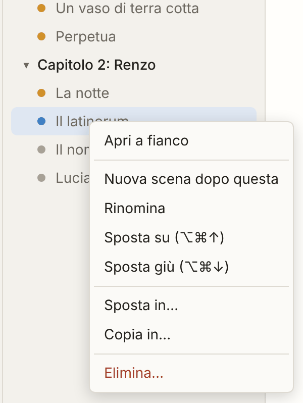
- **Spostare**: trascina scene e capitoli dove vuoi, anche da un capitolo all'altro. Con Alt+Cmd+↑ / Ctrl+Alt+↑ e Alt+Cmd+↓ / Ctrl+Alt+↓ sposti l'elemento selezionato di un posto. Dopo uno spostamento, una divisione o una fusione, in fondo all'albero compare **Annulla** (o Cmd+Z / Ctrl+Z con l'albero attivo): rimette scene, capitoli e testo com'erano. Resta finché non fai un'altra modifica alla struttura; una fusione non si annulla più se nel frattempo hai scritto nella scena fusa.
- **Spostare o copiare senza trascinare**: clic destro → **Sposta in…** o **Copia in…**. Si apre una finestra con le sezioni in alto (**Manoscritto**, **Bibbia**, **Ricerca**, **Laboratorio**) e sotto l'albero della destinazione, con una casella per cercare un capitolo o una scena per nome quando il manoscritto è lungo. Nel Manoscritto clicca una scena o un capitolo e scegli **Dove**: **Prima**, **Dopo**, **Dentro, all'inizio** o **Dentro, alla fine**; nelle altre sezioni scegli la cartella. Poi premi **Sposta** o **Copia** (oppure doppio clic sulla destinazione). Funziona anche con più scene scelte con Cmd+clic / Ctrl+clic, che restano nell'ordine di lettura, e con capitoli e parti interi.

  *Esempio:* per mettere da parte una scena che non ti convince, clic destro → **Sposta in…** → **Laboratorio** → **Sposta**. La ritrovi in **Note**, nel Laboratorio, senza il numero davanti al nome. Quando vuoi riprenderla, clic destro sulla nota → **Sposta in…** → **Manoscritto**, scrivi il nome del capitolo nella casella, cliccalo e scegli **Dentro, alla fine**.
- **Unire scene**: tieni premuto Cmd (su Windows e Linux Ctrl) e clicca le scene da unire, poi premi **Fondi** nella barra sopra l'albero (o dal clic destro). Il testo finisce nella prima scena, in ordine di lettura. Con più scene scelte il clic destro offre anche **Imposta una proprietà alle scene…**: scegli la proprietà e il valore (per esempio stato: rivista) e Dante lo scrive in tutte.
- **Eliminare**: clic destro → **Elimina…**, oppure Cmd+Backspace / Ctrl+Backspace. L'elemento va nel **Cestino** e si può recuperare.
- **Cestino**: si apre con l'icona del cestino in basso nella barra a sinistra, sopra le Impostazioni. Elenca ciò che è stato eliminato, dal più recente, con il posto da cui viene. **Rimetti a posto** lo riporta lì; se nel frattempo quel posto è stato preso, l'elemento torna accanto con un «2» nel nome. **Elimina per sempre** e **Svuota il cestino** lo cancellano davvero, dopo una conferma. Nel cestino finiscono anche le scene fuse in un'altra e le copie in conflitto scartate (capitolo 16).
- **Prologo, epilogo, interludio**: seleziona il capitolo e, nel pannello Proprietà, scegli il **Tipo** (prologo ed epilogo non hanno numero) oppure spunta **Senza numero (come un interludio)**. Nel progetto di esempio l'**Introduzione** è un prologo: per questo il primo capitolo vero si chiama «Capitolo 1».

  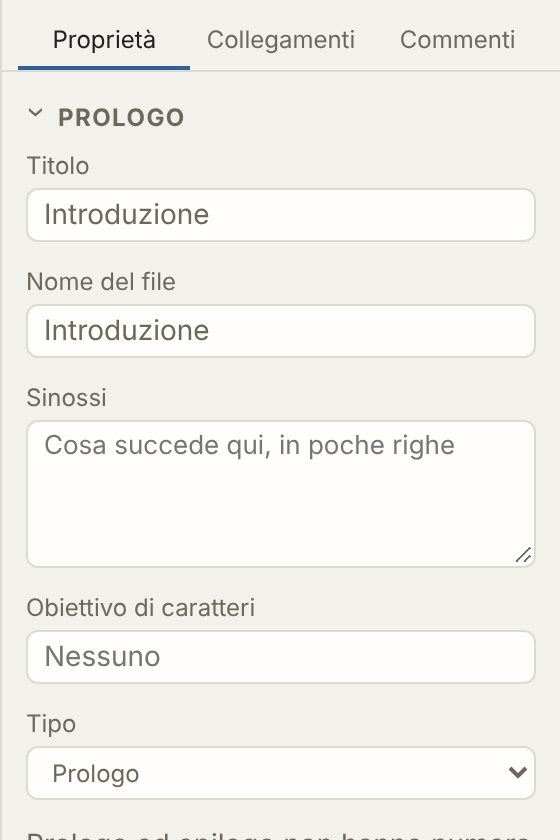
- **Numerazione e titoli dei capitoli**: in **Impostazioni → Struttura** scegli se raggruppare i capitoli in parti, l'etichetta ("Capitolo"), lo stile del numero (1, 2, 3 · I, II, III · Uno, due, tre · Primo, secondo, terzo · nessuno), cosa mettere tra numero e titolo e se ricominciare la numerazione in ogni parte. L'anteprima mostra il risultato.

  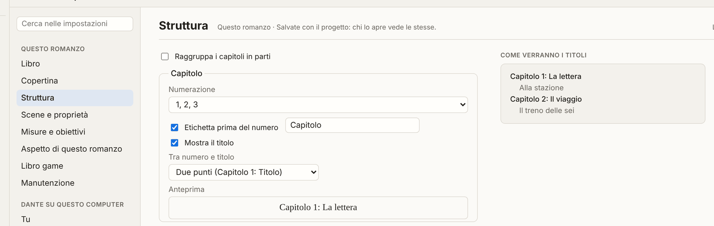

  *Esempio:* con numerazione **Primo, secondo, terzo** e **Tra numero e titolo** su «a capo», nell'albero e nel libro esportato il capitolo diventa «Capitolo primo» con «I bravi» sotto.

Una scena finita fuori da qualsiasi capitolo è segnata nell'albero come **fuori dai capitoli**: trascinala nel capitolo giusto.

- **Stato nell'albero**: accanto a ogni scena un pallino colorato dice a che punto è, secondo la proprietà **stato** (capitolo 11): grigio per idea, arancione per bozza, blu per rivista, verde per finita. Passando col mouse sul pallino compare «Stato: bozza» (o il valore che ha la scena). Un valore che non è tra quelli previsti ha un cerchio vuoto.
- **Colorare l'albero con un'altra proprietà**: in **Impostazioni** > **Scene e proprietà** > **Albero delle scene** scegli quale proprietà decide il colore del pallino, per esempio **pov** per vedere a colpo d'occhio di chi è il punto di vista di ogni scena. Ogni valore ha un suo colore (fino a otto, poi i colori si ripetono) e passando col mouse sul pallino si legge, per esempio, «Pov: Renzo». Le scene senza quella proprietà non hanno pallino. Per tornare allo stato scegli di nuovo **lo stato di lavorazione**.

  *Prova:* nel progetto di esempio scegli **pov**: le scene di don Abbondio e quelle di Renzo prendono due colori diversi.
- **Obiettivi di parole o di caratteri**: a una scena o a un capitolo puoi dare un **Obiettivo di parole** (o **di caratteri**, se il progetto misura in caratteri) nel pannello Proprietà. L'albero mostra allora una piccola barra a destra del nome, che diventa verde quando l'obiettivo è raggiunto; passando col mouse si leggono le parole scritte e quelle da raggiungere.
- **Modello delle nuove scene**: in **Impostazioni** > **Scene e proprietà** > **Nuove scene**, il pulsante **Modifica il modello delle nuove scene** apre il modello (lo crea la prima volta con lo stato «idea»). Ogni scena nuova parte da lì, con le stesse proprietà e lo stesso testo, per esempio qualche domanda da tenere presente. Le scene create dividendone una (Cmd+Invio / Ctrl+Invio) tengono invece il testo che segue il cursore.

  *Esempio:* nel modello scrivi le proprietà `stato: idea` e `pov:` e, nel testo, «Chi vuole cosa? Cosa lo ostacola?». Ogni scena nuova nasce con lo stato «idea», il campo del punto di vista pronto e le due domande, da cancellare quando cominci a scrivere.

### Approfondimento

Sul disco il manoscritto è fatto così:

```text
Il mio romanzo/
├── dante.yaml                  impostazioni del romanzo
├── Bibbia/  Ricerca/  Laboratorio/  Viste/  Modelli/
├── .dante/                     istantanee, presenze, registro di scrittura
├── .trash/                     elementi eliminati
└── Manoscritto/
    ├── 000 Prologo/
    │   ├── 000 Prologo.md      nota cartella: kind: prologue
    │   └── 010 La chiamata.md  scena
    ├── 010 Ritorno/            una parte (se le parti sono attive)
    │   ├── 010 Ritorno.md
    │   └── 010 Arrivo/         un capitolo
    │       ├── 010 Arrivo.md
    │       └── 020 La casa.md
    └── 900 Epilogo/
```

- **Pallino dell'albero**: la proprietà scelta è salvata in `dante.yaml` come `tree.dot` (vuota per lo stato), quindi vale per tutti quelli che lavorano al romanzo. I colori degli altri valori seguono l'ordine dei valori previsti per la proprietà, se ne ha (capitolo 11), poi l'ordine in cui compaiono nel manoscritto; maiuscole e minuscole non contano, e di un collegamento come `[[Renzo Tramaglino|Renzo]]` si legge il nome mostrato.
- **Prefissi numerici**: il numero all'inizio del nome (010, 020…) decide solo l'ordine e non compare nei titoli. I numeri vanno di 10 in 10 per lasciare spazio. Quando sposti qualcosa, Dante rinomina il minor numero possibile di file e aggiorna i collegamenti che puntavano a ciò che si è spostato. Se Dante viene chiuso a metà di un riordino, alla prossima apertura del progetto lo porta a termine o rimette tutto com'era, e dice quale delle due.
- **Nota cartella**: un capitolo o una parte tiene le sue proprietà in una nota con lo stesso nome della cartella (`010 Arrivo/010 Arrivo.md`). La proprietà `kind` vale `part`, `chapter`, `prologue` o `epilogue`; `numbered: false` toglie il numero. Per questo una scena non può avere lo stesso nome del suo capitolo.
- **Numeri visibili**: "Capitolo 3: La lettera" è calcolato al momento dalle impostazioni in `dante.yaml`, non dal prefisso né dal testo del file.
- **Cestino**: è la cartella `.trash` del progetto, la stessa che usa Obsidian. Dante annota in `.dante/trash.json` da dove viene ogni elemento, per poterlo rimettere a posto; un file messo nel cestino da Obsidian o a mano, di cui Dante non conosce l'origine, torna nel Laboratorio. Il cestino è nella cartella del romanzo, quindi lo vedono e lo svuotano anche i coautori.
- **Sposta in… e Copia in…**: una scena o un capitolo che esce dal manoscritto perde il prefisso numerico (`030 Arrivo.md` diventa `Arrivo.md`), uno che entra prende il numero del posto scelto, rinominando il minor numero possibile di altri file. Le proprietà restano. Se nella cartella c'è già un file con lo stesso nome, quello nuovo prende un «2». Spostando, i collegamenti si aggiornano e istantanee e cronologia dei commenti seguono la scena. Una copia ha testo e proprietà dell'originale ma non le sue istantanee né la sua cronologia, e i collegamenti esistenti continuano a portare all'originale. Copiando un capitolo si copia tutto ciò che contiene, con la nota cartella rinominata come la nuova cartella. Nel manoscritto vanno solo note e cartelle, non immagini o PDF. In un libro game i paragrafi seguono il loro numero, quindi nel Manoscritto si sceglie solo la cartella.
- **Fusione**: le scene unite oltre alla prima vanno nel cestino, e i collegamenti che puntavano a loro portano alla prima. Una scena con una copia in conflitto va sistemata prima (capitolo 16).
- **Scena fuori dai capitoli**: se resta lì, l'esportazione la aggiunge in coda al capitolo precedente.

## 11. Proprietà, titolo e sinossi

### Come si fa

Le proprietà sono le informazioni su una scena o una nota: punto di vista, data della storia, stato della revisione, luogo, e così via. Le vedi e le modifichi nel pannello **Proprietà** a destra.

Il pannello è diviso in sezioni: la scena (titolo, nome del file, sinossi, obiettivo), **Proprietà**, **Istantanee** e **Statistiche**. Un clic sul titolo di una sezione la chiude o la riapre, e Dante ricorda come l'hai lasciata.

- **Titolo e nome del file**: il **Titolo** è quello che compare ovunque (albero, intestazioni, esportazione); il **Nome del file** è il nome sul disco. Se il titolo è vuoto, vale il nome del file.
- **Sinossi**: poche righe su cosa succede nella scena o nel capitolo. Compare anche nelle viste (capitolo 13).
- **Obiettivo di parole** (o **di caratteri**): quante parole, o quanti caratteri spazi inclusi, deve avere la scena o il capitolo, secondo la misura scelta in Statistiche. Lascialo vuoto se non ti serve; con un obiettivo l'albero e la barra di stato mostrano a che punto sei (capitoli 6 e 10).

  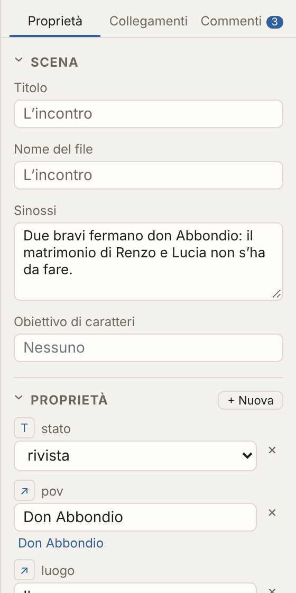

  Qui sopra le proprietà della scena **L'incontro**: lo **stato** è un menu (idea, bozza, rivista, finita), **pov** e **luogo** sono collegamenti alle schede di don Abbondio e del paese (il nome blu sotto il campo apre la scheda), la **data** è quella in cui si svolge la scena nella storia.
- **Aggiungere una proprietà**: premi **+ Nuova** accanto al titolo della sezione **Proprietà**. Si apre un riquadro: scrivi il nome (Dante suggerisce quelli già usati nel romanzo), scegli il tipo e, per una scena, **Solo per questa scena** oppure **Per tutte le scene del romanzo**, poi premi **Aggiungi proprietà**.
- **Per tutte le scene**: la proprietà entra nel modello delle nuove scene e compare, vuota, in ogni scena, con l'etichetta **tutte le scene**. Si scrive nel file di una scena solo quando le dai un valore, così le altre scene restano come sono.
- **Modificare una proprietà**: il riquadretto con il simbolo prima del nome (**T**, **#**, **↗**…) è un pulsante. Passandoci sopra il mouse leggi il tipo; con un clic si apre la definizione: tipo, valori ammessi, nome e, se è la proprietà che colora i pallini dell'indice, i loro colori. Puoi scegliere se è un testo, un numero, una data, una casella, un elenco o un collegamento a una nota. Per un testo o un elenco puoi indicare i valori ammessi: comparirà un menù a tendina. Da quel momento la proprietà funziona così in tutte le note del progetto.
- **Rinominare una proprietà in tutto il romanzo**: nella definizione, scrivi il nome nuovo in **Nome in tutto il romanzo** e premi **Rinomina**. Dante cambia il nome in tutte le scene e le note, nelle tabelle e bacheche e nelle impostazioni. Se una nota ha già una proprietà con il nome nuovo, lì le due restano separate e Dante te lo dice. Lo stato e le proprietà che Dante legge per nome (titolo, sinossi, obiettivo, tipo, alias) non si rinominano.
- **Colori dei pallini**: aprendo la definizione della proprietà che colora i pallini dell'albero (lo stato, o quella scelta in Impostazioni), sotto **Colori del pallino nell'albero** vedi ogni valore con il suo colore. Un clic sul quadratino del colore lo cambia; **Colore di base** torna a quello di prima.

  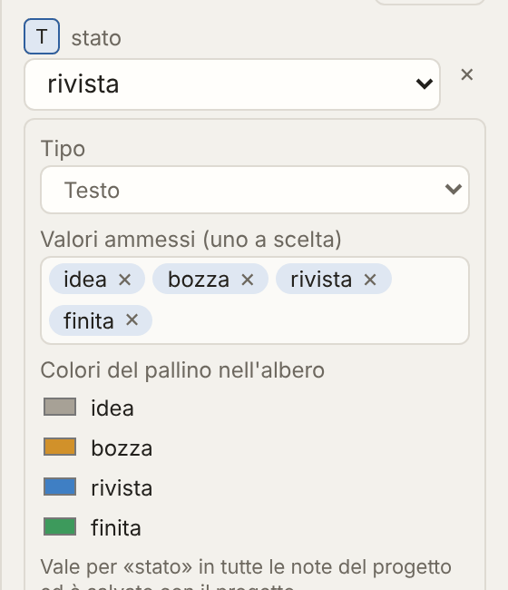

  *Esempio:* vuoi segnare in quale stagione si svolge ogni scena. Premi **+ Nuova**, scrivi «stagione», scegli **Testo** e **Per tutte le scene del romanzo**, poi **Aggiungi proprietà**. Clicca la **T** accanto al nome e scrivi nei valori ammessi «primavera, estate, autunno, inverno». Da quel momento, in ogni scena, «stagione» è un menu con quei quattro valori, e una vista può raggruppare le scene per stagione. Se poi preferisci chiamarla «periodo», la rinomini dalla stessa definizione.

Tutte le proprietà con un tipo sono elencate in **Impostazioni → Scene e proprietà**, sotto **Proprietà delle note**.

### Approfondimento

Le proprietà sono il frontmatter YAML in testa a ogni file, come in Obsidian. Per capitoli e parti stanno nella nota cartella (capitolo 10). L'obiettivo è la proprietà `goal` (per esempio `goal: 3000`), letta in parole o in caratteri secondo `goals.unit` di `dante.yaml`; lo stato mostrato nell'albero è la proprietà `stato` (`status` in un romanzo in inglese) e il colore dipende dalla posizione del valore tra quelli ammessi: il primo grigio, l'ultimo verde. Il modello delle nuove scene è il file `Modelli/Scena.md` (`Templates/Scene.md` in inglese); `{{title}}` e `{{date}}` diventano il titolo della scena e la data del giorno, come nei modelli della Bibbia.

```yaml
---
title: L’incontro
synopsis: "Due bravi fermano don Abbondio: il matrimonio di Renzo e Lucia non s’ha da fare."
stato: rivista
pov: "[[Don Abbondio]]"
luogo: "[[Il paese]]"
data: 1628-11-07
---
```

Una sinossi che contiene i due punti va tra virgolette, come qui sopra: altrimenti il file non si legge più correttamente, né in Dante né in Obsidian. Dante le aggiunge da solo quando scrivi la sinossi nel pannello.

Alcune proprietà hanno un significato per Dante e hanno nomi inglesi, uguali in ogni lingua:

| Proprietà | Dove | A cosa serve |
| --- | --- | --- |
| `title` | scena, nota cartella | titolo mostrato ovunque |
| `synopsis` | scena, nota cartella | sinossi |
| `kind` | nota cartella | `part`, `chapter`, `prologue` o `epilogue` |
| `numbered` | nota cartella | `false` toglie il numero |
| `published_title` | scena, nota cartella | titolo usato solo nell'esportazione |
| `type` | nota della Bibbia | tipo della nota; se manca, vale quello della cartella |
| `aliases` | qualsiasi nota | altri nomi per collegare la nota e contarla nelle statistiche |

Le proprietà con un tipo sono definite in `dante.yaml`:

```yaml
properties:
  stato:
    kind: text
    values: [idea, bozza, rivista, finita]
  pov:
    kind: link
    note_type: character
  data: date
```

| Tipo | Simbolo | Campo nel pannello | Scritto nel file come |
| --- | --- | --- | --- |
| testo (`text`) | T | testo, o menù se ha valori ammessi | testo |
| numero (`number`) | # | numero | `42` |
| data (`date`) | ◷ | calendario | `2026-10-15` |
| casella (`checkbox`) | ☑ | casella | `true` / `false` |
| elenco (`list`) | ≡ | interruttori per i valori ammessi | lista YAML |
| collegamento (`link`) | ↗ | suggerimenti, anche solo di un tipo di nota | `"[[Nome]]"` |

Un valore che non rispetta la definizione resta com'è ed è segnalato nel pannello.

Le proprietà **per tutte le scene** sono quelle del modello delle nuove scene (`Modelli/Scena.md`): il pannello mostra quelle che una scena non ha ancora. I colori scelti per i pallini stanno in `dante.yaml`, per proprietà e valore:

```yaml
tree:
  dot: pov
  colors:
    pov:
      lucia mondella: "#d064a6"
```

Rinominare una proprietà riscrive solo il suo nome in testa ai file, lasciando valore, posizione e commenti; nelle tabelle e bacheche cambiano filtri, ordinamento, raggruppamento, colonne e date. I nuovi progetti in italiano definiscono già età (numero), data (data), luogo (collegamento a un luogo) e proprietario (collegamento a un personaggio).

## 12. Bibbia e Note

### Come si fa

- **Bibbia**: le schede di personaggi, luoghi, oggetti, eventi, gruppi e trame, raggruppate per tipo. Premi **Nuovo: Personaggio** (o il tipo che ti serve), scrivi il nome e premi Crea: la scheda nasce già con le proprietà suggerite per quel tipo. Con **Filtra** trovi una scheda tra tante. Con il clic destro su una scheda, o con i pulsanti in alto nella scheda aperta, **Sposta in…** e **Copia in…** la portano in un'altra cartella della Bibbia, nella Ricerca, nel Laboratorio o nel manoscritto (capitolo 10). Ogni scheda mostra in alto la prima immagine della nota: quella di una proprietà (per esempio `ritratto: "[[Lucia.jpg]]"`) o, se non c'è, la prima nel testo. Togli la spunta a **Immagini** per vedere le schede senza. Con **Aspetto** accanto scegli come mostrarle: **In cima alla scheda** o **Accanto al titolo**; **Ritagliata per riempire lo spazio** o **Intera**; quale parte tenere quando è ritagliata (**In alto** va bene per i ritratti, che così non perdono la testa); e la **Grandezza**. Le scelte valgono per tutte le schede e restano su questo computer.

  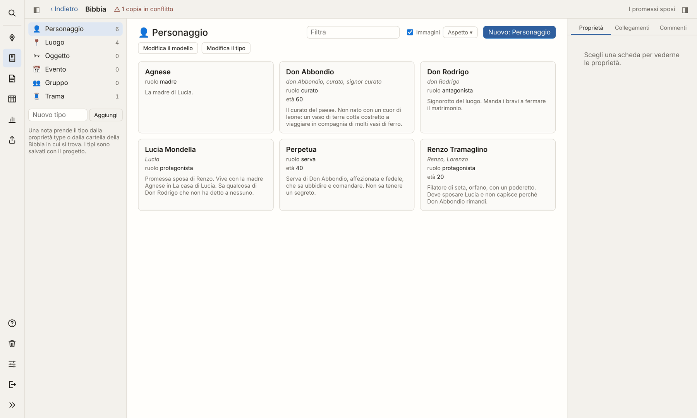
- **Tipi della Bibbia**: puoi aggiungerne di nuovi (per esempio "Creatura") e, per ogni tipo, **Modifica il tipo** (nome, icona, proprietà suggerite) e **Modifica il modello**, cioè il testo da cui parte ogni nuova scheda.
- **Note**: tutto quello che non è manoscritto né Bibbia, in due cartelle mostrate una sotto l'altra. **Ricerca** è l'archivio per note, immagini, PDF e pagine web raccolti per il romanzo; **Laboratorio** è lo spazio per bozze, scalette e idee. **Nuova nota** la crea nel Laboratorio, **Aggiungi file…** copia file dal computer nella Ricerca; per spostare una nota da una cartella all'altra trascinala, oppure usa il clic destro → **Sposta in…** o **Copia in…**, che portano note, file e cartelle anche nella Bibbia o in un punto preciso del manoscritto (capitolo 10). Immagini, PDF e HTML si aprono dentro Dante, gli altri file con il programma predefinito.
- **Collegamenti**: scrivi `[[` nel testo e Dante suggerisce le note del progetto, anche per alias. Funziona anche al contrario: se selezioni «Corrado» e lo chiudi tra `[[ ]]` (o scrivi `[[Corrado]]`) e Corrado è un alias di «Corrado Olivieri», Dante riconosce il personaggio e collega la sua scheda. Un collegamento a una nota che non esiste ancora appare più chiaro.
- **Clic su un collegamento**: si apre un piccolo menu con **Apri nell'editor**, **Apri nel pannello** e **Anteprima**.

  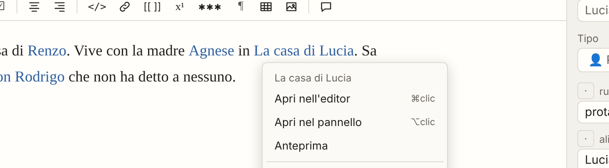

   L'anteprima è una finestrella sopra il testo che mostra la nota, per leggerla al volo senza lasciare la scena; si chiude con Esc o facendo clic altrove. **Modifica il collegamento** mette il cursore dentro le parentesi.

  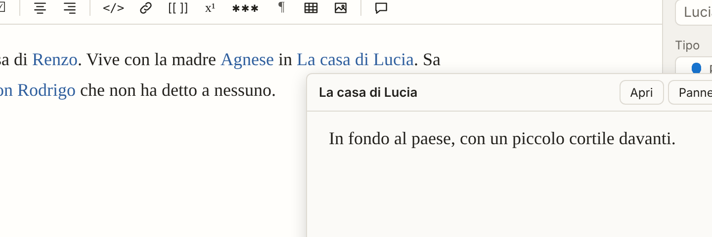

   Le scorciatoie restano: Cmd+clic / Ctrl+clic apre subito nell'editor, Alt+clic (Option su Mac) nel pannello.
- **Collegamento a una nota che non c'è**: il clic chiede se crearla e dove, come scheda di un tipo della Bibbia (personaggio, luogo…), nella Ricerca o nel Laboratorio. La nota nuova si apre nel pannello a fianco, così la scena resta sotto gli occhi.
- **Chi rimanda a chi**: la scheda **Collegamenti** del pannello destro mostra le note che rimandano a quella aperta (con la riga che le contiene) e quelle a cui rimanda.
- **Richiami alla Bibbia**: quando nel testo scrivi il nome o un alias di una scheda della Bibbia senza farne un collegamento (per esempio «Lucia»), Dante lo sottolinea a puntini. Con il clic destro sul nome si apre il menu della scheda riconosciuta: **Apri nell'editor**, **Apri nel pannello**, **Anteprima** e **Trasforma in collegamento**. Maiusc + clic destro apre il menu solito (taglia, copia, ortografia). Il pulsante **Richiami** nella barra in alto (l'icona con una persona sopra una riga a puntini) accende e spegne le sottolineature; lo ricorda anche una nota in fondo al menu. Anche la scheda **Collegamenti** ha una sezione in più: in una scena, **Nominati nel testo** elenca le schede nominate senza collegamento; in una scheda della Bibbia, **Nominata nelle scene** elenca le scene che la nominano.
- **Cercare**: Cmd+Maiusc+F / Ctrl+Maiusc+F (o la lente in alto a sinistra) cerca nei nomi, negli alias e nel testo di tutte le note, con un'anteprima di ogni risultato. Il menu sotto la casella limita la ricerca a una sezione. Se scrivi **>** all'inizio, al posto delle note compare l'**elenco dei comandi** (andare a una sezione, mostrare o nascondere barre e pannelli, aprire l'aiuto o il cestino, chiudere il progetto): scrivi parte del nome, per esempio `> esporta`, e Invio esegue il primo.

  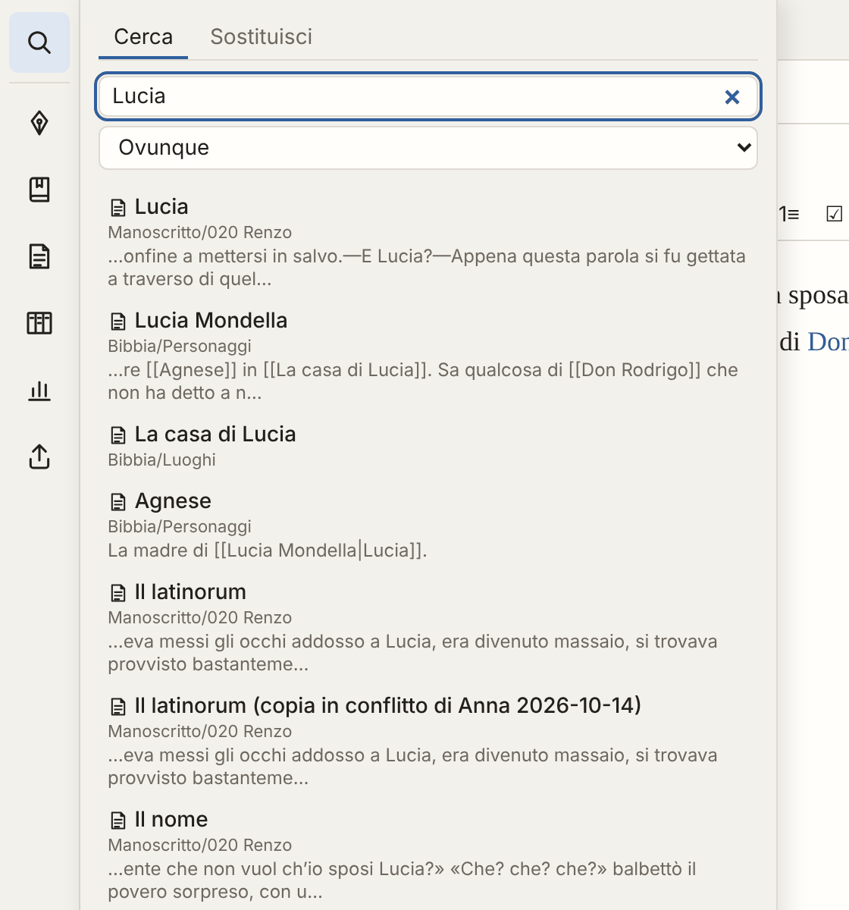
- **Trova e sostituisci in tutto il progetto**: Alt+Cmd+F / Ctrl+Alt+F, oppure la scheda **Sostituisci** in cima alla ricerca. Scrivi la parola da cercare e quella nuova: sotto compaiono tutte le occorrenze, nota per nota, con la parola vecchia barrata e la nuova accanto. Togli la spunta a quelle da lasciare come sono, oppure usa **Nessuna** e spunta solo quelle che ti servono. Un clic su una riga apre la nota con la parola selezionata. **Sostituisci** cambia quelle spuntate; subito dopo **Annulla la sostituzione** rimette tutto com'era. Con **Solo parole intere** «Renzo» non trova «Renzino»; senza **Maiuscole e minuscole** la parola nuova prende le maiuscole di quella vecchia («RENZO» diventa «LORENZO»). Il menu sotto limita la sostituzione a una sezione.

  *Esempio:* per cambiare nome a un personaggio, cerca «Renzo» e sostituisci con «Lorenzo» nel Manoscritto. Prima di cambiare una scena Dante ne salva un'istantanea chiamata «Prima di sostituire «Renzo»», da riprendere se serve (capitolo 15). Per cambiare anche il nome della scheda, rinominala: i collegamenti si aggiornano da soli.

**Un esempio completo.** Apri la scheda di **Lucia Mondella** nella Bibbia. Nel testo, «La casa di Lucia» è blu perché è un collegamento: un clic e scegli **Anteprima** per leggerla senza lasciare la scheda. Ora apri la scena **Lucia** nel Manoscritto e scrivi `[[Agn`: Dante suggerisce **Agnese**; premi Invio e il collegamento è fatto. Nella scheda di Agnese, la scheda **Collegamenti** del pannello destro ora elenca anche la scena **Lucia**.

### Approfondimento

- Il tipo di una nota viene dalla proprietà `type` oppure, se manca, dalla cartella della Bibbia in cui si trova (`Bibbia/Personaggi/`). I tipi sono definiti in `dante.yaml` sotto `types`, ognuno con nome, cartella, icona e proprietà suggerite.
- Il modello di un tipo è il file `Modelli/<nome del tipo>.md`; `{{title}}` e `{{date}}` vengono sostituiti con il nome della nota e la data del giorno.
- I collegamenti sono wikilink come in Obsidian: `[[Lucia Mondella]]` o `[[Lucia Mondella|la promessa sposa]]`. Quando rinomini o sposti una nota, Dante aggiorna tutti i collegamenti che la riguardano.
- Gli alias si scrivono nella proprietà `aliases` della nota: `[[` li suggerisce e le statistiche contano anche quelli.
- I richiami riconoscono parole intere, scritte con le stesse maiuscole del nome o dell'alias: «Marta» non si trova in «Martina», e un luogo chiamato «Casa» non sottolinea ogni «casa». Non contano i nomi dentro collegamenti, commenti e codice, né un nome che due schede hanno in comune. Il nome della scheda aperta non si sottolinea nella sua stessa scheda.
- L'immagine di una scheda viene da un'immagine incorporata (`![[foto.jpg]]` o ``) o da una proprietà che contiene un'immagine; l'estratto sotto il titolo salta immagini e collegamenti a indirizzi web.
- Un collegamento chiuso a mano su un alias viene riscritto come `[[Corrado Olivieri|Corrado]]`: nel testo si legge sempre «Corrado», e il collegamento funziona anche in Obsidian, che non risolve gli alias da solo. Succede solo quando l'alias appartiene a una sola nota e nessuna nota si chiama così; maiuscole e minuscole non contano. Cmd+Z / Ctrl+Z annulla la riscrittura insieme alle parentesi. Un `[[Corrado]]` scritto prima, o fuori da Dante, porta comunque alla scheda dentro Dante.
- Eliminare un tipo non cancella le sue note, che restano dove sono con le loro proprietà. Quello che si elimina dalle sezioni va in `.trash`.
- Le pagine HTML aperte in Dante non eseguono i loro script.
- **Sostituisci** cambia solo il testo delle note. Restano come sono le proprietà in testa al file, il nome della nota dentro un collegamento (`[[Renzo Tramaglino|Renzo]]` cambia solo l'alias dopo `|`), le immagini e i file incorporati, gli indirizzi dei link, i tag HTML, il testo dei commenti `{>>…<<}` e i blocchi di codice. Le revisioni (`{++…++}`, `{--…--}`) sono testo e vengono cambiate. Se una nota cambia tra la ricerca e la sostituzione, Dante cerca di nuovo e salta le occorrenze che non ci sono più. **Annulla la sostituzione** salta le note modificate dopo la sostituzione e le elenca.

## 13. Tabelle e bacheche

### Come si fa

Una vista mostra scene, capitoli o schede della Bibbia in un colpo d'occhio, come **Tabella**, **Lista**, **Schede**, **Bacheca** o **Linea del tempo**.

1. Nella sezione **Tabelle e bacheche** un progetto nuovo ha già una bacheca delle scene per stato e una tabella delle scene. In un progetto che non ne ha, premi **Crea le viste di partenza**; per un'altra vista premi **Nuova vista** e dalle un nome. Sotto il nome puoi scegliere **da che cosa partire**: una tabella da impostare, la bacheca delle scene per stato, la tabella dei personaggi, la linea del tempo delle scene o le schede dei capitoli; poi la cambi come vuoi dalle impostazioni della vista.
2. In alto scegli come mostrarla (tabella, lista, schede, bacheca, linea del tempo).
3. Con **⚙ Impostazioni** scegli cosa elencare (scene, capitoli e parti, tutte le note o un tipo della Bibbia), da quali cartelle, con quali condizioni (**Solo se**), come ordinare, come raggruppare e quali campi mostrare. In fondo c'è **Elimina questa vista**.

Il progetto di esempio ha già quattro viste. La **Bacheca** mette le scene in colonne secondo lo stato:

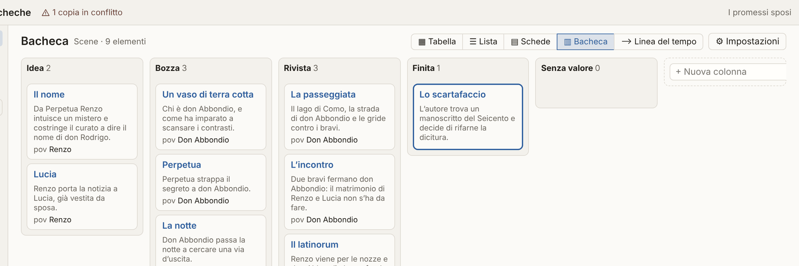

La tabella **Scene** elenca capitolo, stato, punto di vista, data e lunghezza di ogni scena (in parole o in caratteri spazi inclusi, secondo la misura del progetto; tra i campi ci sono sia **Parole** sia **Caratteri**); qui con le impostazioni aperte sopra:

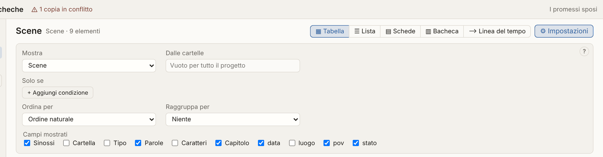

Il **Tempo della storia** mette le scene sulla linea del tempo secondo la proprietà «data»: si vede subito che il capitolo 1 si svolge il 7 novembre 1628 e il capitolo 2 il giorno dopo.

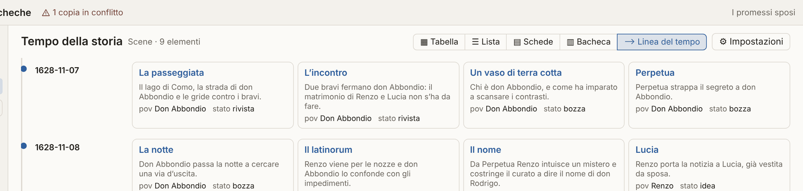

*Esempio:* vuoi vedere solo le scene raccontate da Renzo. Apri la tabella **Scene**, premi **⚙ Impostazioni**, poi **+ Aggiungi condizione**, scegli «pov» e scrivi «Renzo». Restano le tre scene del capitolo 2 in cui il punto di vista è il suo.

Dalla vista puoi anche modificare le note:

- **Tabella**: clic su un'intestazione per ordinare; clic su una cella per cambiare il valore nella nota. Trascina il bordo destro di un'intestazione per allargare o stringere la colonna; doppio clic sul bordo per tornare alle larghezze automatiche.
- **Bacheca**: trascina una scheda in un'altra colonna per cambiarne la proprietà (per esempio da "bozza" a "rivista"); **Nuova colonna** aggiunge un gruppo.
- **Linea del tempo**: trascina un elemento in un altro momento per cambiarne la data. Le note senza data sono elencate sotto. Se è raggruppata, trascina il bordo destro del titolo di una colonna per cambiare la larghezza di tutte le colonne; doppio clic sul bordo per tornare a quella automatica.

### Approfondimento

Ogni vista è un file YAML nella cartella `Viste/`, quindi si sincronizza con il progetto e si può scrivere a mano:

```yaml
type: kanban            # table, list, cards, kanban, timeline
items: scene            # scene, chapter, note, o un tipo come character
source: Manoscritto     # cartelle da cui prendere le note; vuoto = tutto il progetto
filter:
  pov: Renzo            # tutte le condizioni devono valere; una lista = uno qualsiasi dei valori
sort: -date             # il meno inverte l'ordine; vuoto = ordine del manoscritto
group_by: stato         # colonne della bacheca, o gruppi degli altri tipi
groups: [idea, bozza, rivista, finita]   # in quest'ordine, anche se vuoti
fields: [pov, words]    # campi mostrati; anche name, folder, type, words, characters, chapter
date: data              # solo linea del tempo: la proprietà con la data
end: fino_a             # solo linea del tempo: fine, facoltativa
widths: {name: 320, pov: 140, lane: 260}   # larghezze in pixel scelte trascinando; lane = colonne della linea del tempo
```

- Quando cambi le impostazioni dall'app il file viene riscritto subito, senza gli eventuali commenti scritti a mano.
- Le righe dei capitoli leggono e scrivono le proprietà della nota cartella e contano le parole e i caratteri delle loro scene. In una bacheca raggruppata per capitolo, spostare una scena la sposta davvero in quel capitolo.
- Se un raggruppamento usa una proprietà con valori ammessi, le colonne sono quei valori.
- Date ammesse nella linea del tempo: `1987`, `1987-03`, `1987-03-12`, anni negativi, oppure numeri semplici come il giorno della storia.
- Ogni elemento mostra la sinossi sotto il nome, a meno che il file della vista dica `synopsis: false`.
- Copie in conflitto, modelli e le viste stesse non compaiono mai.

## 14. Statistiche e obiettivi

### Come si fa

La sezione **Statistiche** mostra:

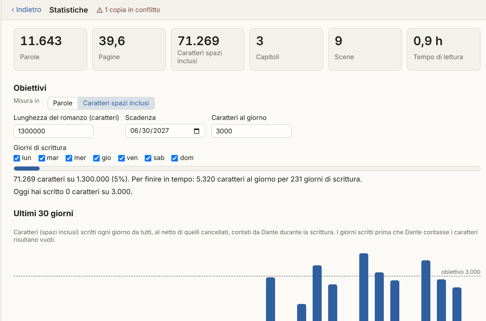

- **Totali**: parole, pagine, capitoli, scene e tempo di lettura del romanzo.
- **Misura in**: **Parole** o **Caratteri spazi inclusi**. È la misura di obiettivi, barra di stato, albero, pannello, sessioni e grafico degli ultimi 30 giorni, e vale per tutto il progetto. I nuovi progetti in italiano partono dai caratteri, come si usa nell'editoria italiana; quelli creati prima restano in parole finché non cambi. Al cambio, l'obiettivo del romanzo e quello del giorno sono convertiti con il rapporto tra caratteri e parole del tuo manoscritto (circa 6 caratteri per parola), arrotondati. Se scene o capitoli hanno un obiettivo proprio, Dante li elenca con il valore che avrebbero e li converte tutti con **Converti questi obiettivi**; **Lasciali come sono** li tiene scritti come prima.

  *Esempio:* un romanzo da 80.000 parole con 500 parole al giorno, passato a caratteri con un manoscritto da 6,1 caratteri per parola, diventa un romanzo da 488.000 caratteri con 3.050 caratteri al giorno.
- **Obiettivi**: qui, oppure in **Impostazioni → Misure e obiettivi**, scrivi la lunghezza che vuoi raggiungere, la scadenza, le parole (o i caratteri) al giorno e i tuoi giorni di scrittura. Dante dice a che punto sei, quante parole al giorno servono per finire in tempo, quante ne hai scritte oggi e da quanti giorni di fila raggiungi l'obiettivo. I giorni non spuntati sono di riposo e non interrompono la serie.
- **Ultimi 30 giorni**: un grafico delle parole scritte ogni giorno, e una tabella per ogni persona che lavora al progetto.
- **Lunghezza**: quanto è lunga ogni scena, ogni capitolo o ogni parte, con la quota sul totale, una barra, la media, la mediana, la più breve e la più lunga. Due gruppi di pulsanti sopra la tabella scelgono la misura (**Parole** o **Caratteri spazi inclusi**) e il livello (**Scene**, **Capitoli**, **Parti**; Parti compare solo se il romanzo ha parti). Finché non scegli, la misura è quella del progetto; poi la scelta resta per le volte successive.
- **Menzioni**: quante volte le scene nominano ogni personaggio, luogo o altra scheda della Bibbia, con la prima e l'ultima scena in cui compare, e le schede mai nominate.
- **Parole più usate**: senza articoli, preposizioni e altre parole comunissime.
- **Stile**: qualche numero su come è scritto il testo, per trovare i passi da rileggere: la lunghezza media delle frasi, le **frasi lunghe** (più di 40 parole), gli **avverbi** in -mente e i più usati, la parte di testo in **dialogo** e le **ripetizioni vicine**, cioè la stessa parola usata di nuovo entro 30 parole. Sotto ci sono le ripetizioni più vicine e le frasi più lunghe, con la scena: un clic apre la scena proprio in quel punto e seleziona il passo, dalla prima alla seconda volta che compare la parola ripetuta, o la frase lunga intera. Per una ripetizione si apre anche la barra di ricerca con la parola, così Invio passa alle altre volte in cui compare. Sono stime fatte sulle sole parole, non regole. Le soglie (frase lunga oltre 40 parole, ripetizione entro 30 parole) e la velocità di lettura (230 parole al minuto) si cambiano per ogni romanzo in **Impostazioni** > **Misure e obiettivi** > **Statistiche sullo stile**; in `dante.yaml` sono sotto `style`.

  *Esempio:* nel progetto di esempio la frase più lunga è nello *Scartafaccio* e supera le 130 parole: Manzoni imita lo stile del Seicento. Una ripetizione voluta, come «zitto, zitto» o «sempre e sempre», non viene contata.

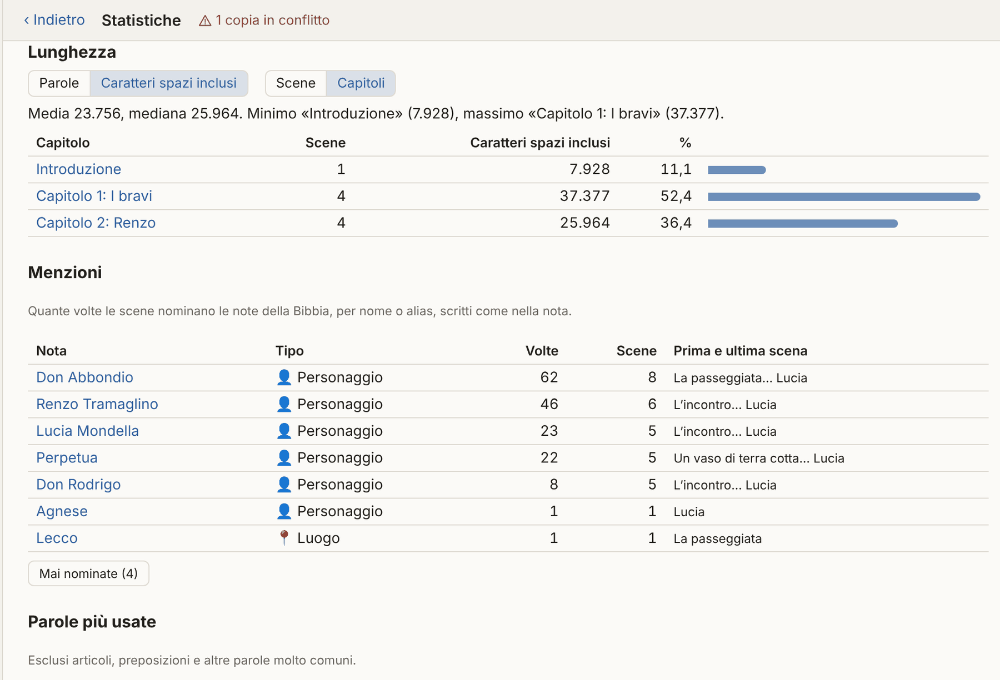

*Esempio:* nel progetto di esempio la tabella **Menzioni** dice che don Abbondio è nominato 62 volte in 8 scene, Lucia 23 volte, Agnese una sola volta, nella scena *Lucia*. **Lunghezza** al livello Capitoli mostra che il Capitolo 1 da solo è più della metà del testo (52%).

Le parole scritte oggi compaiono anche nel pannello a destra mentre scrivi. Per contarle, Dante ha bisogno del tuo nome nelle impostazioni.

Per le scene singole, il pannello **Proprietà** mostra parole, caratteri e tempo di lettura.

### Approfondimento

- **Pagine**: di base una pagina è una cartella editoriale da 1.800 caratteri spazi inclusi. In **Impostazioni → Misure e obiettivi** si può contare invece in parole (250 è un valore diffuso). In `dante.yaml`: `pages: {unit: characters, size: 1800}`.
- **Obiettivi** in `dante.yaml`: `goals: {unit, words, deadline, daily, days}`, dove `unit` è `words` o `characters` (senza `unit` si contano parole: è il caso dei progetti creati prima della scelta), `words` e `daily` sono nella misura scelta e `days` elenca i giorni di scrittura da 1 (lunedì) a 7 (domenica). Le parole o i caratteri necessari sono distribuiti solo su quei giorni.
- **Registro di scrittura**: Dante conta, mentre scrivi, le parole e i caratteri aggiunti e cancellati e i minuti passati a scrivere, giorno per giorno, in `.dante/sessions/<nome>.json`. Parole scritte con altri programmi non entrano nel registro, ma entrano nei totali. I caratteri si contano da questa versione: nei giorni precedenti il grafico in caratteri resta vuoto.
- **Menzioni**: contano il nome della scheda e i suoi alias scritti esattamente come nella nota, maiuscole comprese.
- **Stile**: le frasi finiscono a un punto, un punto di domanda o esclamativo o ai puntini; gli avverbi si riconoscono dalla desinenza (-mente in italiano e spagnolo, -ly in inglese, -ment in francese), lasciando fuori le parole comuni che finiscono allo stesso modo senza esserlo, come «mente» o «clemente». Il dialogo è il testo tra caporali o virgolette, o quello delle battute aperte da una lineetta, dove le lineette successive alternano battuta e narrazione. Le ripetizioni contano parole di almeno quattro lettere, senza le parole comunissime e senza quelle ripetute subito o con una sola parola in mezzo.
- **Andare al punto esatto**: le statistiche leggono il testo senza commenti e Markdown, quindi per ritrovare il passo nella scena Dante conta le parole: «la terza volta che compare *amico*, fino alla successiva». Se nel frattempo hai modificato la scena, o la parola compare anche dentro un commento, la selezione può cadere su un'altra occorrenza vicina; se la parola non c'è più, la scena si apre sulla prima.
- **Sessioni**: il timer della barra di stato non scrive niente nel progetto; le parole che conta sono quelle del registro di scrittura di oggi.
- **Lunghezza**: al livello Parti, prologo, epilogo e capitoli fuori dalle parti finiscono in un'unica riga "Fuori dalle parti", che non entra in media e mediana. Al livello Scene la colonna Dove indica il capitolo (o la parte) della scena. Misura e livello sono impostazioni del computer (`statsUnit`, `statsLevel`), non di `dante.yaml`: ognuno sceglie la sua.

## 15. Istantanee

### Come si fa

Un'istantanea è una copia di una scena com'era in un certo momento, da riprendere se una modifica non ti convince.

- Dante ne crea una da solo prima della tua prima modifica a una scena, ogni volta che apri il progetto.
- Per crearne una tu, apri il pannello **Proprietà**, scrivi un nome (facoltativo) sotto **Istantanee** e premi **Crea istantanea**.
- **Confronta** mostra cosa è cambiato tra l'istantanea e il testo attuale.

  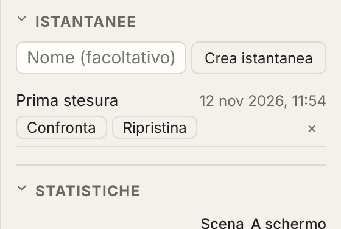

  *Esempio:* nella scena **Perpetua** crea un'istantanea chiamata «Prima stesura», poi aggiungi qualche parola dopo «La vita!». **Confronta** mostra in rosso barrato ciò che c'era solo nell'istantanea e in verde ciò che c'è solo ora:

  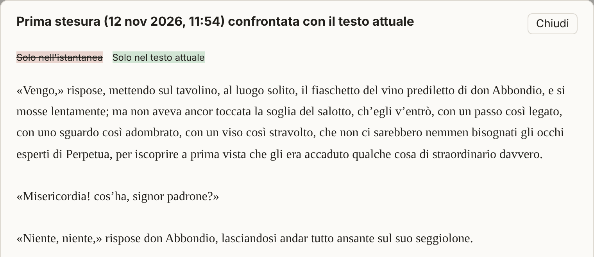
- **Ripristina** rimette l'istantanea al posto del testo. Il testo attuale viene salvato prima come istantanea, quindi non si perde niente.
- **Tutto il manoscritto in una volta**: in **Impostazioni** > **Manutenzione**, sotto **Istantanea di tutto il manoscritto**, scrivi un nome (per esempio «Prima stesura») e premi **Crea istantanea**. Ogni scena viene salvata com'è in quel momento: la ritrovi con quel nome tra le istantanee di ciascuna scena, per confrontarla, e dallo stesso elenco **Ripristina** riporta tutte le scene a quel punto. Il testo attuale delle scene che cambiano viene prima salvato; le scene scritte dopo restano come sono e quelle eliminate non tornano (sono nel cestino).
- Per fare pulizia, in **Impostazioni** > **Manutenzione**, **Elimina le istantanee vecchie** cancella quelle automatiche precedenti a una data; quelle con un nome restano sempre.

### Approfondimento

Le istantanee sono file in `.dante/snapshots/` e seguono la loro scena quando viene spostata o rinominata. Riguardano una scena alla volta: per conservare l'intero romanzo ci sono le copie di sicurezza (capitolo 19).

## 16. Scrivere in più persone

### Come si fa

1. **Condividere**: metti la cartella del progetto in Dropbox o Google Drive e condividila con chi lavora con te. Ognuno la apre con **Apri cartella…**.
2. **Firmarsi**: la prima volta che apri un progetto senza aver ancora detto il tuo nome, Dante te lo chiede; lo cambi in **Impostazioni → Tu**.
3. **Commentare**: seleziona il testo e premi il fumetto nella barra (o Cmd+Alt+M / Ctrl+Alt+M), scrivi il commento e premi Cmd+Invio / Ctrl+Invio. Nel testo il commento appare come una nuvoletta.
4. **Proporre modifiche**: scegli **Altro** > **Segna le modifiche come revisioni** nella barra in alto (serve il tuo nome nelle Impostazioni); finché sono attive nella barra resta l'etichetta **Revisioni attive**. Da quel momento quello che scrivi appare sottolineato e quello che cancelli barrato, con il tuo nome, finché qualcuno non decide.
5. **Decidere**: la scheda **Commenti** del pannello destro elenca commenti e modifiche del testo mostrato. Per ciascuno puoi **Rispondi**, **Risolvi** (chiude la discussione), **Accetta** o **Rifiuta**; in cima ci sono **Accetta tutte** e **Rifiuta tutte**.
6. **Rileggere cosa è stato deciso**: in cima alla scheda **Commenti**, **Cronologia** mostra cosa è successo a commenti e modifiche chiusi: chi ha accettato, rifiutato o risolto, quando, chi aveva proposto la modifica, il testo prima e dopo e la discussione. Di base vedi la scena aperta; **Tutto il romanzo** mostra tutto, e puoi filtrare per persona e per date. Un clic sul nome della scena la apre.

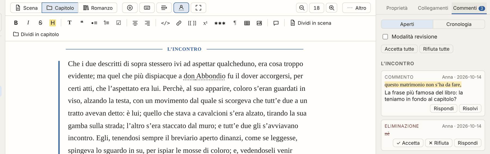

**Un esempio.** Nella scena **L'incontro** del progetto di esempio Anna ha lasciato un commento su «questo matrimonio non s'ha da fare» (il testo è evidenziato in giallo) e ha proposto di scrivere «né» al posto di «nè»: la vecchia parola è barrata in rosso, la nuova sottolineata in verde. Nella scheda **Commenti** premi **Accetta** sull'aggiunta e sull'eliminazione: nel testo resta solo «né». Al commento puoi rispondere con **Rispondi**, oppure chiuderlo con **Risolvi** quando la questione è decisa.

Se un'altra persona sta già lavorando su una scena, per te quella scena è in sola lettura e un avviso dice chi la sta modificando. **Modifica comunque** sblocca la scena, ma le modifiche rischiano di sovrapporsi.

Se Dropbox o Drive creano una **copia in conflitto** (succede quando due persone modificano lo stesso file nello stesso momento), in alto compare un avviso. Aprendolo vedi le due versioni a confronto e scegli: **Tieni il file**, **Usa la copia**, oppure **Unisci come revisioni** per decidere le differenze una per una.

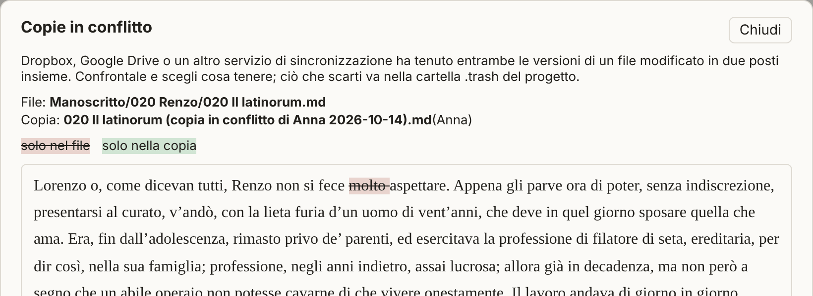

### Approfondimento

- Commenti e revisioni sono scritti nel testo con [CriticMarkup](https://github.com/CriticMarkup/CriticMarkup-toolkit), seguiti da una firma con nome e data:

```markdown
{==questo matrimonio non s’ha da fare,==}{>>@Anna 2026-10-14: La frase più famosa del libro: la teniamo in fondo al capitolo?<<}{>>@Luca 2026-10-15: sì<<}
{--nè--}{>>@Anna 2026-10-14<<}{++né++}{>>@Anna 2026-10-14<<} domani, nè mai.
```

Si legge così: `{== ==}` racchiude il testo commentato, `{>> <<}` contiene il commento (o la firma di una revisione), `{-- --}` è il testo da togliere e `{++ ++}` quello da aggiungere. Ogni risposta è un altro `{>> <<}` in coda.

- In Obsidian questi segni si vedono così come sono; Dante li nasconde e disegna il testo come un programma di videoscrittura. **Altro** > **Testo com'è nel file** li mostra.
- In modalità revisione, scrivere dentro una propria aggiunta la modifica direttamente; scrivere dentro l'aggiunta di un altro o in un testo evidenziato modifica il testo senza creare una nuova revisione.
- **Risolvi** toglie la discussione dal file. Nell'esportazione i commenti spariscono e le revisioni in sospeso vengono accettate o rifiutate, come scegli. Parole e caratteri si contano sempre come se le revisioni in sospeso fossero accettate.
- **Presenza**: ogni copia di Dante scrive in `.dante/presence/<nome>.json` cosa sta modificando, e lo aggiorna ogni minuto. Chi apre per primo una scena la tiene; una presenza non aggiornata da tre minuti (per esempio dopo che il computer si è spento) non conta più.
- **Copie in conflitto**: Dante riconosce i nomi usati da Dropbox ("copia in conflitto di Anna…"), Google Drive ("(1)" accanto all'originale), Syncthing e servizi simili, e le tiene fuori dall'albero. Quello che scarti va in `.trash`; prima di unire, un'istantanea conserva il file com'era. Le revisioni nate da un'unione sono firmate da chi ha scritto la copia.
- Il registro delle parole scritte è un file per persona, `.dante/sessions/<nome>.json`, così due persone non scrivono mai lo stesso file.
- Anche la **Cronologia** è un file per persona, `.dante/history/<nome>.jsonl`, una riga per ogni decisione. Si riempie da quando usi questa versione: le decisioni prese prima non ci sono. Se sposti o rinomini una scena, la sua cronologia la segue.

## 17. Esportare in Word, PDF ed EPUB

### Come si fa

1. Apri la sezione **Esportazione**. Le scelte sono divise in pagine, elencate a sinistra: **Formato**, **Pagina e copertina**, **Parti, capitoli e scene**, **Tipografia** e **Paratesto**. A destra di ogni pagina l'**Anteprima** mostra l'effetto delle scelte mentre le cambi: il foglio con margini, font e interlinea, i titoli e i separatori, il testo prima e dopo le correzioni tipografiche, l'ordine delle pagine del libro. Il tasto **Esporta** resta sempre in basso.
2. Scegli il **Formato**: **Word (DOCX)** da mandare ad agenti ed editori o per continuare a lavorarci; **PDF** pronto da leggere o stampare; **EPUB** per i lettori di ebook e i negozi online; **Markdown** per avere tutto il romanzo in un unico file di testo, da aprire con qualsiasi editor.
3. Scegli **Cosa esportare**: tutto il romanzo o una sua parte.
4. Scegli l'**Impaginazione**: **Manoscritto standard** (il formato che si invia a editori e agenti) oppure **Libro impaginato** (da leggere e stampare).
5. Se vuoi, regola il resto: formato della pagina, font, corpo, interlinea, rientro, cosa mettere prima di parti, capitoli e scene, frontespizio, intestazione, dialoghi e tipografia, dedica, esergo, ringraziamenti e gli altri testi intorno al romanzo. In Word e in PDF **Indice dei capitoli** aggiunge, dopo le pagine iniziali, l'indice di parti e capitoli con i numeri di pagina; aprendo il file, Word chiede di aggiornare i campi: rispondi Sì, è così che l'indice si riempie. Quando le scelte ti vanno bene, scrivi un nome in **Nome del profilo** e premi **Salva profilo**: da **Profilo salvato** le riprendi tutte in un colpo, per esempio «Per l'editore» e «Per la stampa».
6. Decidi cosa fare delle **Revisioni in sospeso**: accettarle o rifiutarle tutte nel file esportato.
7. Premi **Esporta**. Alla fine Dante dice quante parole (o caratteri, se il progetto misura in caratteri) e pagine ha esportato e offre **Apri il file** e **Mostra nella cartella**.

Le scelte restano salvate nel progetto: la volta dopo basta premere Esporta.

**Tra una scena e l'altra.** Nel menu delle scene scegli cosa separa due scene dello stesso capitolo: **Riga vuota**, **Due righe vuote** oppure un **Separatore di scena** scritto da te. Nel testo del separatore ogni `\n` va a capo, come ricorda la nota sotto il campo: `\n* * *\n` mette tre asterischi fra due righe vuote, `\n\n` lascia due righe vuote. Se nel tuo separatore ti serve proprio la sequenza `\n`, scrivi un altro segno in **Segno a capo** (per esempio `|`); lasciando vuoto quel campo il separatore resta su una riga.

**Margini, interlinea e aspetto dei titoli.** In **Pagina e copertina** i **Margini della pagina** si scelgono in centimetri, uno per lato (in alto, in basso, a sinistra, a destra); finché non li tocchi seguono il formato della pagina, e **Torna ai margini abituali** li riporta lì. L'**Interlinea** è un numero libero: 1 è singola, 1,5 una riga e mezza, 2 doppia, e puoi scrivere qualsiasi valore tra 0,8 e 3 (per esempio 1,35). In **Parti, capitoli e scene**, sotto ogni livello, **Aspetto del titolo** si apre con un clic e decide come appaiono i titoli di quel livello: il font (**Come il testo** oppure **Un altro font**), il corpo, l'allineamento, **Grassetto**, **Corsivo**, **Tutto maiuscolo**, lo spazio prima e dopo in punti e l'interlinea dei titoli su più righe. Per parti e capitoli c'è anche **Dall'alto della pagina**: quanto scende il titolo, sotto il margine, quando apre una pagina nuova (0 lo lascia in cima). Nel file Word questa distanza è lo spazio prima del titolo, senza righe vuote sopra, e ogni parte o capitolo che apre una pagina inizia una sezione propria (intestazione e numeri di pagina proseguono): è così che Word rispetta quello spazio. LibreOffice lo ignora e mette il titolo in cima alla pagina. Chiuso, riassume le scelte in una riga; **Torna all'aspetto abituale** le annulla. I titoli che non tocchi seguono l'impaginazione, il corpo e l'interlinea del testo. L'aspetto vale per Word e PDF; nell'ebook, che ha le sue misure, cambia solo ciò che modifichi tu. Nella pagina **Tipografia** l'anteprima usa il primo dialogo del tuo romanzo: sopra com'è scritto, sotto come esce con le scelte fatte.

**Copertina.** Con **Apri il libro con la copertina** il file Word, il PDF e l'EPUB iniziano con la copertina del progetto, la stessa che compare tra i progetti recenti. Si prepara in **Impostazioni** > **Questo romanzo** > **Copertina**:

- **Usa una tua immagine…** sceglie una foto o un disegno dal computer. L'immagine riempie tutta la copertina (se non ha le proporzioni di un libro, 2:3, i bordi in più vengono tagliati) e prende il posto delle forme. **Torna alle forme** la toglie.
- **Forme** e **Colori** disegnano invece una copertina semplice. I colori decidono anche il colore predefinito dei testi.
- **Testi sulla copertina**: togli la spunta a **Titolo**, **Sottotitolo** o **Autori** per non mostrarli, per esempio se il titolo è già nell'immagine.
- **Colore del testo** cambia il colore di titolo, sottotitolo e autori; **Torna al colore predefinito** riprende quello dei colori scelti.
- **Contorno del testo** aggiunge un bordo intorno alle lettere, del colore che scegli accanto: aiuta a leggere il titolo sopra una foto con zone chiare e scure.

*Prova:* nel progetto di esempio scegli un'immagine, togli il sottotitolo, metti il testo bianco con il contorno nero e guarda l'anteprima.

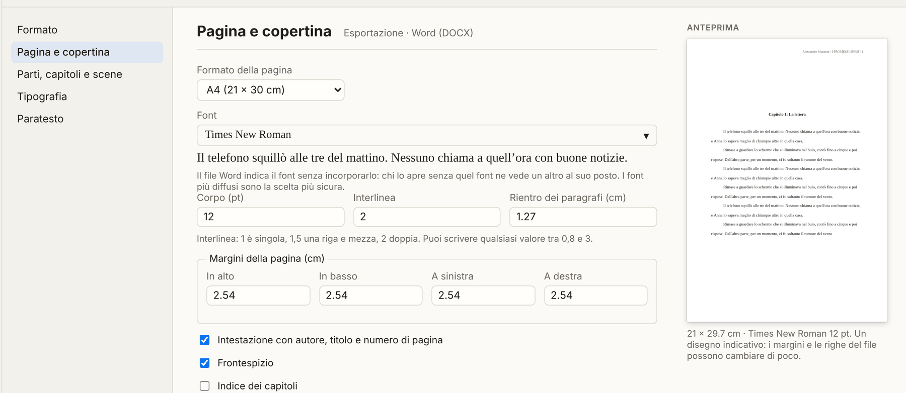

*Esempio:* per mandare il manoscritto a un editore scegli **Word (DOCX)** e **Manoscritto standard**: Times New Roman 12, interlinea doppia, intestazione con autore, titolo e numero di pagina, frontespizio. Per una copia da leggere sul tablet scegli **EPUB**.

### Approfondimento

- Il progetto non viene mai toccato: l'esportazione lavora su una copia del testo. I commenti vengono tolti.
- **DOCX** è creato direttamente da Dante. Il file indica il font senza incorporarlo: chi lo apre senza quel font ne vede un altro, per questo i font più diffusi sono la scelta più sicura.
- **PDF** è composto da [Typst](https://typst.app), incluso nell'app: non c'è niente da installare. Usa i font del computer, più Libertinus Serif e New Computer Modern quando il font scelto manca.
- **EPUB 3**: un file per ogni parte, capitolo e pagina di apertura o chiusura, con indice dei capitoli dentro le parti. Il carattere e la dimensione li sceglie in buona parte chi legge; si può modificare il foglio di stile (CSS). Il libro mantiene lo stesso identificativo tra un'esportazione e l'altra (`export.epubId` in `dante.yaml`).
- **Tabelle e immagini** passano in tutti i formati. In Word la tabella occupa la larghezza del testo e la riga di intestazione si ripete a ogni pagina. Nel PDF le immagini sono lette dalla cartella del progetto: vanno bene PNG, JPEG, GIF, SVG e WebP. In Word ed EPUB i formati che non accettano (WebP, SVG e altri) sono convertiti in PNG. Nel Markdown esportato le immagini restano riferimenti ai file del progetto. **Note a piè di pagina**: `^[testo]`, oppure `[^1]` nel testo e `[^1]: testo` in un paragrafo a parte della stessa scena. In Word e nel PDF vanno a piè di pagina e si numerano da sole; nell'EPUB stanno alla fine del capitolo, con il numero che porta alla nota e torna indietro; nel Markdown restano scritte come `^[testo]`. Il loro testo conta tra parole e caratteri del libro.
- **Copertina**: l'immagine scelta viene copiata nella cartella **Allegati** dentro **Ricerca**, come le immagini del testo, e `dante.yaml` ne tiene il percorso sotto `cover.image`, insieme a `cover.show` (titolo, sottotitolo, autori), `cover.textColor` e `cover.outlineColor`. JPEG, PNG, WebP e GIF restano come sono; gli altri formati sono convertiti in PNG. In Word ed EPUB la copertina diventa un'immagine PNG di 1200 × 1800 pixel; nel PDF l'immagine riempie la prima pagina e i testi sono disegnati sopra.
- I titoli usano il `title` di ogni capitolo o scena; `published_title` lo sostituisce solo nell'esportazione, utile se il titolo di lavoro è diverso da quello definitivo.
- Le righe vuote del separatore sono paragrafi vuoti in Word, spazi di una riga in PDF ed EPUB e `&nbsp;` in Markdown, come le righe vuote del testo. Il segno a capo è salvato in `dante.yaml` sotto `export.docx.lineSign`.
- Tutte le impostazioni di esportazione sono salvate in `dante.yaml` sotto `export`. Un nuovo progetto parte dalle ultime usate.

## 18. Libri game

Un libro game è fatto di paragrafi numerati: il lettore non legge in ordine, ma salta da un paragrafo all'altro secondo le scelte che fa. Dante può lavorare su un libro game invece che su un romanzo. È un modulo spento di base: si accende progetto per progetto e non cambia nulla negli altri.

Dante legge, scrive, controlla, rimescola ed esporta il libro. I paragrafi restano file Markdown, uno per paragrafo, apribili con qualsiasi editor di testo.

### Come si fa

**Preparare il progetto**

- **Accendere il modulo**: apri **Impostazioni** > **Libro game** e spunta **Questo progetto è un libro game**. In **Cartella dei paragrafi** scrivi la cartella, dentro il progetto, che contiene i paragrafi (per esempio `Paragrafi`).
- **Tipi di box**: in **Impostazioni** > **Libro game** > **Tipi di box** ogni libro ha i suoi: emoji, nome, colore, testo proposto e la proprietà del paragrafo a cui il box si collega. Di base sono sei: 🤔 scelta, ❤️ carattere, ✏️ oggetto, ✅ incontro, 😢 fine, 🆗 corretto.
- **Lunghezze e pagine**: **Paragrafo corto sotto** dice sotto quale lunghezza un paragrafo è corto, nell'unità del romanzo (parole o caratteri spazi inclusi). La pagina è quella delle impostazioni **Pagine**. **Ogni paragrafo inizia su una pagina nuova** conta le pagine come in un libro game stampato; spenta, conta il testo di seguito. È la stessa scelta di **Tra un paragrafo e l'altro** nell'esportazione: cambiando l'una cambia anche l'altra.

**Leggere il libro**

- **L'albero**: al posto di capitoli e scene mostra i paragrafi in ordine di numero. Accanto a ogni paragrafo ci sono il numero (con un lucchetto se è fisso, un'ancora se è relativo a un altro), il titolo, un triangolo di avviso se c'è qualcosa da controllare (passa con il mouse per leggere cosa) e la lunghezza, in azzurro se il paragrafo è corto e in rosso se supera una pagina. I paragrafi ancora vuoti hanno il titolo in corsivo grigio. In cima, una riga riassume il libro: quanti paragrafi, quanti vuoti, quanti orfani (nessuno ci arriva), quanti vicoli ciechi (non portano da nessuna parte e non sono finali) e quante pagine.
- **Da dove si arriva e dove si va**: con **Mostra sotto ogni paragrafo dell'albero da dove si arriva e dove porta** compare sotto ogni paragrafo una riga con i numeri che ci portano (←) e quelli a cui rimanda (→). Un clic su un numero apre quel paragrafo.
- **Il pannello Paragrafo**: in **Proprietà**, sopra le altre sezioni, mostra numero e tipo, lunghezza e pagine, i paragrafi da cui si arriva e quelli a cui porta (ognuno si apre con un clic) e gli avvisi. Il numero si cambia scrivendone un altro: Dante aggiorna anche l'alias e tutti i rimandi che portano a quel paragrafo, e rifiuta un numero già usato. Accanto si sceglie se il numero è **libero** o **fisso**, e sotto si segna se il paragrafo è un finale. La nota del paragrafo (proprietà `note`) si scrive nel campo **Sinossi**. Sopra il testo, il divisore mostra numero e titolo.

  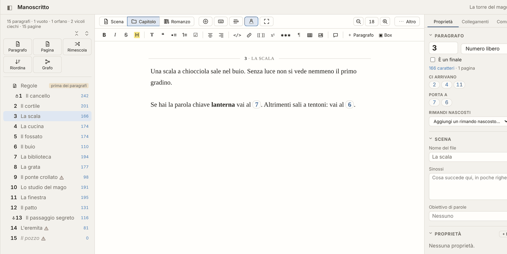

- **Nell'editor** i rimandi come `[[Il cortile|2]]` si vedono come il solo numero, e i box (scelte, parole chiave, finali e gli altri) come riquadri colorati. Le righe `:::` che aprono e chiudono un box si nascondono e ricompaiono quando il cursore ci passa sopra. Elenchi e tabelle dentro un callout (`> [!note]`) si vedono come nel resto del testo; in una tabella dentro un callout Tab e Invio funzionano come nelle altre tabelle.

**Scrivere**

- **Collegare un paragrafo**: scrivi `[[` e poi il numero o una parte del titolo. L'elenco mostra i paragrafi che corrispondono; Invio inserisce il rimando in grassetto, come `**[[Il cortile|2]]**`, e corregge l'articolo davanti («al 2», «all'8», «l'11»). Le prime due voci servono a creare un paragrafo nuovo: **Nuovo paragrafo «titolo» al primo numero libero (N)** lo crea e ci mette il rimando (compare solo se il titolo non esiste ancora), **Nuovo paragrafo «titolo» con altre scelte…** apre la finestra in cui scegliere numero fisso o relativo e rimando nascosto. Se hai scritto un titolo nuovo, Invio subito lo crea; per collegare un paragrafo che esiste già scendi nell'elenco con la freccia. Con **Alt+Invio** invece di Invio il rimando diventa nascosto: non va nel testo ma nella proprietà `rimandi nascosti` del paragrafo.
- **Nuovo paragrafo**: Cmd+Invio / Ctrl+Invio, oppure il pulsante **＋ Paragrafo** nella barra di formattazione, apre la finestra **Nuovo paragrafo** e mette il rimando dove c'è il cursore. Nella finestra scegli il titolo (che diventa il nome del file), il numero (**primo numero libero**, **fisso** o **relativo a** un altro paragrafo più uno scarto) e se il rimando va nel testo o tra quelli nascosti. Un testo selezionato diventa il titolo proposto. Anche il pulsante **Paragrafo** in cima all'albero apre la stessa finestra, ma crea solo il paragrafo, senza rimando, e lo apre.
- **Box**: il pulsante **Box** nella barra di formattazione elenca i tipi di box del libro. Il box si inserisce al cursore con la sua emoji e il suo testo. Per i tipi legati a una proprietà (come ✏️ e la proprietà `parole chiave`) Dante chiede il valore, propone quelli già usati nel libro e lo scrive anche nella proprietà del paragrafo. Un box di fine (😢) segna il paragrafo come finale.
- **Relativi e rimandi nascosti nel pannello**: nel pannello Paragrafo il tipo di numero può essere anche **relativo**: si sceglie il paragrafo a cui è legato e lo scarto, e il numero diventa quello del paragrafo più lo scarto. Quando il numero di un paragrafo cambia, quelli relativi a lui si spostano con lui. Sotto, **Rimandi nascosti** elenca quelli del paragrafo, con × per toglierli e un elenco per aggiungerne.
- **Regole e altre pagine**: un file della cartella dei paragrafi senza numero (le regole, un'introduzione, i ringraziamenti) è una pagina, con un foglio al posto del numero. Per crearne una premi **Pagina** in cima all'albero: Dante chiede il titolo e la apre (con il clic destro > **Rinomina** lo cambi). Di base va prima dei paragrafi; nel pannello Paragrafo (voce **Nell'esportazione va**) o con il clic destro > **Metti dopo i paragrafi** va in fondo, ed è così che l'esportazione la metterà.

*Esempio:* nel paragrafo 1 scrivi «Se vuoi entrare vai al **[[Il cortile|2]]**». Nell'albero il paragrafo 2 non è più orfano, e nel suo pannello compare 1 tra i paragrafi da cui si arriva.

Rinominando un paragrafo (dal divisore o dal nome del file) cambia il nome del file e i rimandi che portano lì tengono il loro numero.

Mentre il modulo è acceso l'albero non si riordina trascinando e non si dividono le scene: l'ordine viene dai numeri, e i file non vengono mai rinominati né ricevono numeri nel nome.

**Numerare**

- **Rimescolare la numerazione**: il pulsante **Rimescola** in cima all'albero apre una finestra con l'anteprima: per ogni paragrafo il numero di prima e quello di dopo. I paragrafi fissi (con il lucchetto) e il paragrafo iniziale restano dove sono, i relativi si spostano insieme alla loro ancora; fra tante prove Dante sceglie quella in cui un paragrafo e quelli a cui rimanda sono più lontani. **Nuova proposta** rifà il sorteggio. Premendo **Rimescola** Dante salva un'istantanea di ogni file che tocca, cambia i numeri e aggiorna in tutto il libro rimandi, alias e articoli («al 7» diventa «all'8»). Sotto l'anteprima, **Numeri scritti come testo** elenca i numeri di paragrafo scritti a mano nel testo («torna al paragrafo 3»): il rimescolamento non li tocca, quindi conviene trasformarli in rimandi con `[[` prima.

  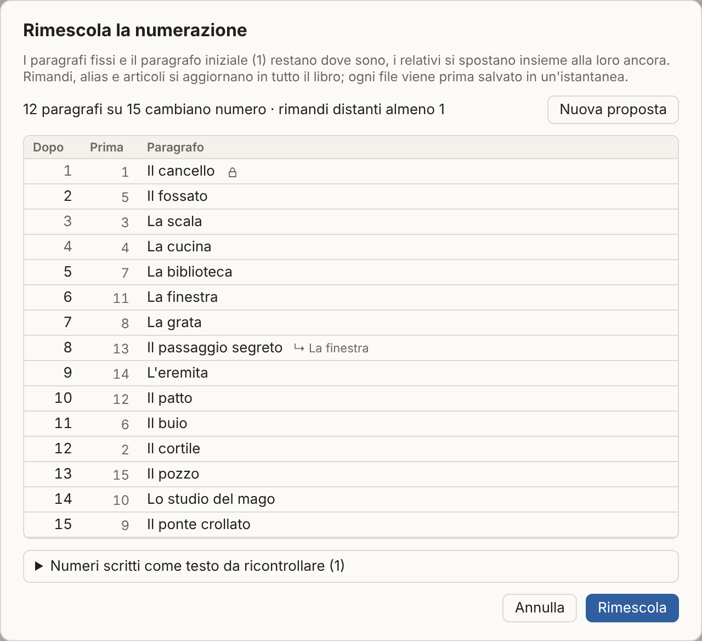

- **Riordinare in ordine di lettura**: il pulsante **Riordina** usa la stessa finestra, ma invece di sorteggiare numera i paragrafi in sequenza nell'ordine in cui il lettore li incontra: il paragrafo iniziale, poi quelli a cui rimanda nell'ordine in cui compaiono nel testo (i rimandi nascosti dopo), poi i loro, e così via. I fissi restano dove sono, i relativi seguono la loro ancora, i paragrafi che nessuno raggiunge vanno in fondo. Serve per lavorare sul libro in ordine prima di rimescolarlo.
- **Tornare indietro**: nella stessa finestra, **Operazioni precedenti** elenca i rimescolamenti fatti. **Solo la numerazione** rimette i numeri di allora, con rimandi e articoli, e lascia il testo scritto dopo; **Tutto** riporta ogni file com'era prima dell'operazione. Un singolo paragrafo si può sempre ripristinare dalle sue istantanee.

**Controllare**

- **La sezione Libro game**: quando il modulo è acceso, nella barra a sinistra compare la sezione **Libro game** (l'icona del dado), con tre schede. **Paragrafi** è una tabella di tutti i paragrafi: numero, titolo, tipo (fisso, relativo, finale, da scrivere), lunghezza, da quali paragrafi si arriva, verso quali si va e avvisi. Un clic sul nome di una colonna ordina per quella colonna (un secondo clic inverte l'ordine); il campo di ricerca filtra per titolo, numero o note, e l'elenco **Mostra** tiene solo i paragrafi con avvisi, da scrivere, finali, fissi, relativi o con un avviso preciso. Un clic su un titolo o su un numero apre il paragrafo. **Controlli** raccoglie gli avvisi di tutto il libro, raggruppati per tipo, e lo stato di gioco (vedi sotto). **Registro** elenca, per ogni proprietà dei box (`carattere`, `parole chiave`, `incontri`), tutti i valori usati con i paragrafi in cui compaiono, e segnala i **possibili doppioni**: valori quasi uguali, come «luna» e «Lunna», che forse sono un errore di battitura.
- **Stato di gioco**: Dante legge ciò che il lettore ottiene e ciò che gli viene chiesto in due modi. Nelle proprietà dei box un valore assegna qualcosa al lettore («studioso») e lo stesso valore con il punto interrogativo segna il paragrafo che chiede se ce l'ha («studioso?»); il valore conta in qualunque proprietà sia scritto, quindi «riflessi» tra le parole chiave risponde a «riflessi?» tra i caratteri. Nel testo, una frase come «Segna la parola chiave **lavanda**» o «Cerchia la caratteristica **studioso**» assegna, e una come «Se hai la parola chiave **lavanda**» o «Se possiedi uno **scudo piccolo**» chiede; se la frase nomina più valori («Se hai cerchiato **studioso** o **riflessivo**») ne basta uno. Seguendo i rimandi dal paragrafo iniziale, Dante segnala i valori **chiesti ma mai assegnati** (forse scritti in modo diverso dove si danno), quelli **chiesti prima di poterli avere** (si assegnano solo in paragrafi da cui non si passa prima di arrivare lì: la strada che li richiede non si potrà mai prendere) e, solo come informazione, quelli **assegnati ma mai chiesti**.
- **Barra di stato**: sotto il testo, **Libro game** dice quanti problemi trovano i controlli (in rosso se ce ne sono); passando sopra col mouse si vede il dettaglio, un clic apre la scheda **Controlli**.
- **Grafo**: il pulsante **Grafo** in cima all'albero scrive la nota **Grafo del libro game** nella cartella del progetto e la apre. La nota contiene lo schema dei paragrafi in Mermaid (un formato di diagrammi che si scrive come testo e si legge anche in altri programmi): frecce piene per i rimandi nel testo, tratteggiate per quelli nascosti, in blu l'inizio, in rosso i finali, in arancione i paragrafi irraggiungibili. **A tutto schermo** mostra il grafo su tutta la finestra: la rotella ingrandisce, trascinando si sposta, un clic su un paragrafo lo apre, Esc chiude. Premendo di nuovo **Grafo** lo schema si aggiorna e il testo scritto intorno resta. Qualsiasi blocco ```` ```mermaid ```` in una nota o in una scena viene disegnato allo stesso modo.

  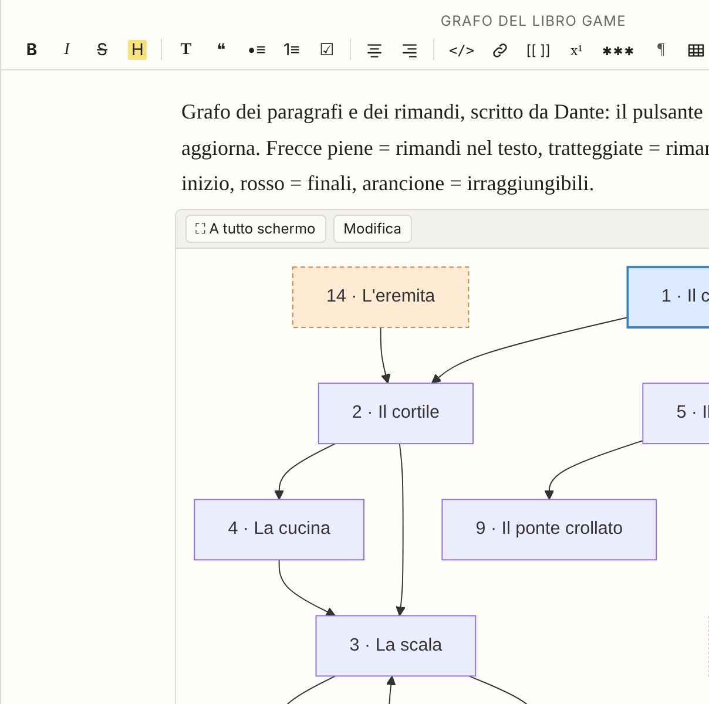

- **Statistiche**: in un libro game le pagine sono contate come nella riga in cima all'albero, quindi tengono conto di **Ogni paragrafo inizia su una pagina nuova**.

**Esportare**

In **Esporta**, quando il progetto è un libro game, le scelte su parti, capitoli e scene lasciano il posto alla sezione **Libro game**. I paragrafi escono in ordine di numero, con il numero come titolo; regole e altre pagine senza numero escono prima o dopo i paragrafi con il loro titolo. Si sceglie:

- **Titolo del paragrafo**: solo il numero, oppure numero e titolo per una copia di lavoro; **Prima del numero** aggiunge un segno, come `§ `; poi allineamento e dimensione del numero.
- **Tra un paragrafo e l'altro**: una pagina nuova, una riga vuota o un simbolo (per esempio ✦). La pagina nuova vale anche per la stima delle pagine.
- **Testo dei paragrafi**: giustificato o allineato a sinistra, il rientro della prima riga, lo spazio dopo ogni capoverso e la dimensione del testo dentro i box (0 = come il resto). Font, dimensione e interlinea del testo restano quelli di **Pagina e testo**.
- **Numero del paragrafo**: in grassetto o no, in corsivo o no, e con un font suo (vuoto = quello del testo).
- **Box**: riquadri nel colore del loro tipo, riquadri grigi per la stampa in bianco e nero, oppure testo normale.
- **Rimandi cliccabili**: nel Word, nel PDF e nell'EPUB un clic sul numero di un rimando porta al paragrafo, così chi legge su schermo non deve cercarlo. **Rimandi in grassetto** li lascia in grassetto come sono scritti.

Nel Markdown i rimandi restano numeri e i box restano tra righe `::: {custom-style="box"}`. Se il libro ha rimandi rotti, numeri doppi o rimandi con il numero sbagliato, la sezione li elenca: un clic apre il paragrafo da correggere.

**Callout.** Un blocco che comincia con `> [!note]` o `> [!warning]` si vede con il nome in una pillola colorata e lo sfondo dello stesso colore; il marcatore torna testo quando il cursore è sulla sua riga. Vale anche nei romanzi. Nell'esportazione diventa un riquadro dello stesso colore con il titolo in grassetto (il testo dopo `[!note]`, o il nome del tipo se manca) in Word, PDF ed EPUB, anche quando i box del libro game sono senza riquadro; in Markdown resta un callout.

**Libri game in inglese.** Se la lingua del romanzo è l'inglese, lo stato di gioco si legge da frasi come «Note the keyword **lantern**», «Circle the trait **careful**» e «If you have the keyword **lantern**»; i numeri scritti come testo sono quelli dopo «to», «section» o «paragraph» («turn to 12»); i tipi di box di base scrivono nelle proprietà `traits`, `keywords` ed `encounters`; la nota del grafo si chiama «Gamebook graph»; gli articoli davanti ai rimandi si correggono solo nei libri in italiano. Le proprietà del paragrafo (`numero`, `numero_tipo` e le altre) restano le stesse in ogni lingua, perché sono il formato dei file.

### Approfondimento

- Un paragrafo è una nota Markdown nella cartella dei paragrafi. Il nome del file è il titolo e non cambia mai; il numero sta nella proprietà `numero`, ripetuto in `aliases` come elenco con il trattino. `numero_tipo` può essere `libero` (il rimescolamento può cambiarlo), `fisso`, o `relativo` con `ancora` (il titolo di un altro paragrafo) e `scarto`. `finale: true` segna un finale, `note` è la nota del paragrafo. Una pagina senza numero con `posizione: dopo` va dopo i paragrafi.
- I rimandi sono collegamenti `[[Titolo|N]]`, di solito in grassetto. I rimandi che il lettore non vede (per esempio un numero da calcolare) vanno nella proprietà `rimandi nascosti`: contano per orfani e vicoli ciechi ma non compaiono nel testo.
- Un box è un blocco tra la riga `::: {custom-style="box"}` e la riga `:::`; il tipo lo dà l'emoji con cui comincia la prima riga del contenuto. È il formato dei blocchi con stile di Pandoc, quindi un'esportazione in Word con Pandoc dà ai box lo stile «box».
- Gli avvisi sono: orfano, vicolo cieco, irraggiungibile dal paragrafo iniziale, numero doppio, collegamento senza numero, rimando a un paragrafo che non c'è, box di finale in un paragrafo non segnato come finale (un paragrafo con `finale: true` senza box di fine va bene: il finale può essere raccontato nel testo), numero del rimando diverso da quello del paragrafo.
- Lo stato di gioco considera ciò che il lettore *può* avere arrivando a un paragrafo: i valori assegnati su almeno un percorso dal paragrafo iniziale, compreso il paragrafo stesso. Nel testo una frase chiede se contiene «se», «hai», «possiedi» o «avevi» e parla della scheda («parola chiave», «caratteristica», «tratto», «segnato», «cerchiato», «scheda», «tra le note», «tra gli oggetti»), oppure se ha un valore in grassetto dopo «hai» o «possiedi»; contano solo i valori che il libro assegna da qualche parte. Un valore con il trattino davanti («-studioso») toglie qualcosa e non è considerato. Due valori sono possibili doppioni se differiscono al massimo di due lettere e di meno del 30% della lunghezza; un valore e lo stesso con il punto interrogativo non lo sono mai.
- In `dante.yaml` tutto sta sotto `gamebook:` (`enabled`, `start`, `short`, `onePerPage`, `showLinks`, `boxes`, e `export` con `heading`, `prefix`, `align`, `size`, `separator`, `symbol`, `links`, `bold`, `boxes`, `justify`, `indent`, `spacing`, `boxSize`, `numberBold`, `numberItalic`, `numberFont`). Nel Word i numeri dei paragrafi sono segnalibri (`p12`) e i rimandi collegamenti interni; nel PDF e nell'EPUB sono etichette e link allo stesso nome; la cartella è `folders.manuscript`. In un romanzo `gamebook:` non viene scritto.

## 19. Copie di sicurezza

Una copia di sicurezza è un file zip con tutto il progetto, tenuto sul computer fuori dalla cartella del romanzo. Serve se la cartella si rovina, per esempio per un problema di sincronizzazione con Drive o Dropbox, o se un file viene cancellato per sbaglio fuori da Dante.

### Come si fa

- Dante crea una copia da solo quando chiudi il progetto o esci da Dante, se qualcosa è cambiato dall'ultima.
- Le copie sono nella cartella **Documenti/Dante backup**, in una sottocartella per ogni romanzo. Di ogni romanzo restano le 10 più recenti; le più vecchie si cancellano da sole.
- In **Impostazioni → Copie di sicurezza** puoi scegliere un'altra cartella, quante copie tenere, se crearle alla chiusura, e vedere quando è stata fatta l'ultima. **Crea una copia ora** ne fa una subito, **Mostra le copie** apre la cartella.
- **Per riprendere un progetto**: in **Impostazioni** > **Copie di sicurezza**, sotto **Riprendere una copia**, c'è l'elenco delle copie con data e ora. **Apri questa copia** la estrae in una cartella nuova accanto a quella del romanzo, chiamata come il romanzo con «(copia del…)», e la apre. Il romanzo di adesso non viene toccato e resta tra i progetti recenti: confronta le due cartelle con calma e tieni quella giusta. Se Dante non riesce ad aprire il romanzo, fai a mano: apri lo zip (doppio clic), sposta la cartella che contiene dove vuoi e aprila con **Apri cartella…** dalla schermata iniziale.
- **Nel browser** Dante non può scrivere fuori dalla cartella del romanzo: in **Impostazioni** > **Copie di sicurezza** c'è **Scarica una copia di sicurezza (zip)**, da premere ogni tanto e conservare in un posto sicuro.

### Approfondimento

- Il nome di ogni copia è il nome della cartella del progetto con data e ora, per esempio `Il mio romanzo 2026-10-26 18-02-11.zip`. Dentro c'è la cartella del progetto com'era.
- Restano fuori la cartella `export` (si rifà dal romanzo), il cestino `.trash`, le cartelle `.obsidian` e `.git` e i file di presenza dei coautori. Le istantanee in `.dante/snapshots` ci sono.
- Due romanzi con lo stesso nome di cartella hanno sottocartelle diverse («Il mio romanzo», «Il mio romanzo 2»): un file `.dante-backup-of` nella sottocartella dice a quale progetto appartiene.
- La copia si scrive prima con un nome provvisorio e prende il suo nome solo quando è completa, quindi uno zip con il nome giusto non è mai a metà.
- La cartella scelta vale per tutti i progetti di questo computer, come le altre impostazioni dell'applicazione. Una cartella sincronizzata (Drive, Dropbox, iCloud) va bene come seconda protezione, ma tiene la copia sullo stesso servizio che potrebbe aver causato il problema.

## 20. Aggiornamenti

### Come si fa

1. A ogni avvio Dante controlla se c'è una nuova versione, e poi di nuovo ogni sei ore se resta aperto. Se non c'è, compare per qualche secondo in basso a destra **Dante 1.… è aggiornato**; se il controllo non riesce (per esempio senza connessione) lo dice nello stesso punto. Quando c'è una nuova versione compare un riquadro in basso a destra: **È disponibile Dante 1.…**.

   
2. Per sapere cosa cambia premi **Novità**: il riquadro elenca le novità di ogni versione uscita dopo quella installata, in italiano o in inglese secondo la lingua di Dante. Lo stesso elenco è nella pagina [Novità](novita.md) e nella pagina della versione su GitHub.
3. Premi **Aggiorna e riavvia**. Dante salva il testo aperto, scarica la nuova versione, la installa e si riapre. Su Windows compare per qualche secondo la finestra dell'installatore.
4. Con **Ricordamelo più tardi** il riquadro sparisce e torna al prossimo avvio. Con **Salta questa versione** Dante non te la propone più: aspetta la successiva. Se cambi idea, **Cerca aggiornamenti** nelle Impostazioni la mostra comunque.

In **Impostazioni** > **Aggiornamenti e assistenza** scegli anche il **canale**:

- **Stabile**, la scelta di base: ricevi solo le versioni ufficiali, quando le novità sono già state provate.
- **Beta**: ricevi prima le novità, in versioni ancora in prova (per esempio *1.1.0-beta.1*), che possono avere qualche difetto. Se installi una beta, Dante resta su questo canale finché non lo cambi.

Tornando da Beta a Stabile Dante non torna indietro: resti sulla beta che hai finché non esce una versione stabile più recente.

Per controllare a mano, sul Mac scegli **Dante** > **Cerca aggiornamenti…** nella barra dei menu; ovunque puoi aprire **Impostazioni** > **Aggiornamenti e assistenza** e premere **Cerca aggiornamenti**. Lì c'è anche il numero della versione installata, utile quando segnali un problema, e la casella per non cercare aggiornamenti all'avvio.

La copia portatile per Windows non si aggiorna da sola: scarica il nuovo zip e sostituisci la cartella, tenendo la sottocartella `dante-data`.

### Approfondimento

- Le versioni seguono il versionamento semantico: 1.0.1 corregge solo difetti, 1.1.0 porta funzioni nuove (prima come beta 1.1.0-beta.1, -beta.2…), 2.0.0 cambierebbe qualcosa di non compatibile. Come escono è spiegato in [Rilasci di Dante](rilascio.md).
- Ogni versione è una release di GitHub con un file `latest.json` che elenca i file firmati per ogni sistema. Il canale Stabile legge quello dell'ultima release ufficiale; il canale Beta legge l'elenco delle release e prende la versione più alta, beta o stabile. La copia installata confronta il numero con il proprio.
- Le copie 0.1.x cercano gli aggiornamenti nella vecchia pagina di anteprima *preview*, che riceve il `latest.json` di ogni nuova stabile: così passano alla 1.0 e da lì scelgono il canale.
- I file dell'aggiornamento sono firmati, e Dante controlla la firma prima di installare: rifiuta un file non firmato o modificato.
- Cosa viene sostituito: su Mac l'app in Applicazioni, su Windows il programma installato (con l'installatore, che mostra solo una barra di avanzamento), su Linux l'AppImage o il pacchetto .deb/.rpm (per i pacchetti il sistema chiede la password di amministratore). I progetti e le impostazioni non vengono toccati.
- Dante non cerca aggiornamenti nella copia portatile, perché lì non c'è un'installazione da sostituire. Il controllo all'avvio non mostra niente; dal menu dice che questa copia non si aggiorna da sola.
- Senza connessione la ricerca all'avvio fallisce in silenzio; quella dalle Impostazioni mostra l'errore.

## 21. Dante nel browser

Dante esiste anche come versione web, per chi non può o non vuole installare l'app, per esempio su un Mac fermo a Catalina. È lo stesso programma, con alcuni limiti elencati sotto. L'app resta la versione principale: se puoi installarla, usa quella.

### Come si fa

1. Apri **https://dante.lucadj.eu/app/** con **Chrome**, **Edge** o **Brave**. Safari e Firefox aprono Dante, ma non possono lavorare sulle cartelle del computer: lì funzionano solo il progetto di esempio e la prova di un'importazione da Word, che non viene salvata.
2. Per avere Dante come un'app, con una finestra propria e l'icona nel Dock o nel menu Start, premi l'icona **Installa** a destra nella barra degli indirizzi (in Chrome: un monitor con una freccia). È facoltativo, ma comodo.
3. Premi **Apri cartella…** e scegli la cartella del romanzo, oppure **Nuovo progetto** e scegli dove crearlo. Il browser chiede il permesso di modificare la cartella: rispondi **Consenti** o, se c'è, **Consenti a ogni visita**, così la volta dopo il progetto si riapre dai recenti senza altre domande.

   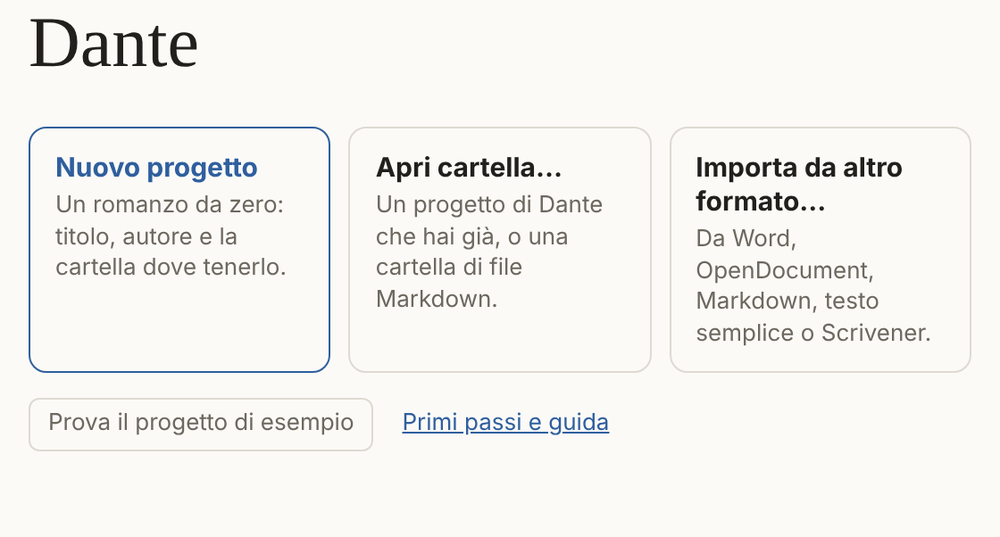

4. Da qui Dante funziona come l'app: il testo viene salvato nei file della cartella mentre scrivi.
5. Dopo la prima apertura Dante funziona anche **senza connessione**. Quando c'è rete e una versione nuova, compare il riquadro dell'aggiornamento come nell'app (capitolo 20): **Aggiorna e riavvia** ricarica Dante con la nuova versione.

Se chiudi la scheda subito dopo aver scritto, il browser può chiedere se vuoi davvero uscire: scegli **Resta** (o Annulla), aspetta un secondo e chiudi di nuovo. In quel momento Dante sta ancora scrivendo le ultime parole.

**Cosa non c'è, o funziona diversamente, nel browser:**

- **Niente PDF**: Word, EPUB e Markdown sì, il PDF per ora solo nell'app.
- **Spostare capitoli e parti è più lento**: il browser non sa rinominare le cartelle, quindi Dante copia i file nella nuova posizione e poi cancella la vecchia. Non chiudere il browser mentre lo fa; se succede, Dante completa lo spostamento alla prossima apertura. Chi collabora via Drive o Dropbox riceve più modifiche del solito.
- **Le modifiche fatte da fuori** (un coautore, Obsidian, un'altra app) compaiono dopo qualche secondo, oppure quando torni sulla scheda di Dante, non subito come nell'app.
- **Niente "mostra nel Finder" né "apri con l'app predefinita"**: Dante dice in quale cartella si trova il file e offre di scaricarne una copia. Le esportazioni finiscono nella cartella `export` del progetto, oppure dove scegli con **Salva in un'altra posizione…**.
- **Cmd+W (Ctrl+W) chiude la scheda del browser**, non il pannello né il progetto: usa invece **Alt+Cmd+W** (su Windows e Linux Ctrl+Alt+W).
- **Un progetto si apre in una sola scheda alla volta**: se è già aperto altrove, Dante lo dice. Due schede sullo stesso progetto scriverebbero una sopra l'altra.
- **Immagini da un indirizzo web**: molti siti non permettono al browser di scaricarle. In quel caso salva l'immagine sul computer e trascinala in Dante.
- **Doppio clic su `Titolo.dante`**: funziona solo con Dante installato dal browser (punto 2) e chiede un clic in più per dare il permesso sulla cartella.

### Approfondimento

- **Privacy**: il testo, le note, le impostazioni e il tuo nome non lasciano mai il computer. Il browser lavora direttamente sui file della cartella scelta; non c'è un server di Dante, né account, né statistiche di visita. In rete vanno solo le richieste dei file del programma e del file `version.json` che dice se c'è una versione nuova, verso GitHub Pages, che come ogni sito vede l'indirizzo IP e il tipo di browser. Il download di un'immagine da un indirizzo web avviene solo quando lo chiedi.
- **Come funziona offline**: un *service worker* conserva nel browser tutti i file della versione scaricata, come un blocco unico. Una versione nuova viene scaricata intera e prende il posto della vecchia solo con **Aggiorna e riavvia** (o alla prossima apertura con nessuna finestra di Dante aperta), così non si mescolano mai file di due versioni.
- **Dove restano le cose**: le impostazioni dell'applicazione in `localStorage`, le cartelle autorizzate (le "maniglie" che il browser dà a Dante) in IndexedDB, entrambi nel profilo del browser. Dante chiede al browser di non cancellarli quando manca spazio. Nel caso peggiore si perdono le impostazioni e l'elenco dei recenti, non il romanzo, che è nella cartella.
- **Quali cartelle**: Chrome rifiuta alcune cartelle di sistema e la cartella Inizio o Documenti nel loro insieme; una sottocartella di progetto va bene, comprese quelle di Google Drive, Dropbox, OneDrive e iCloud Drive.
- **Spostamenti interrotti**: mentre copia una cartella, Dante scrive in `.dante/moving.json` da dove a dove sta spostando. All'apertura successiva, se il file c'è, completa la copia o la cancellazione dell'originale e lo toglie.
- **Modifiche da fuori**: il browser non avvisa quando un file cambia, quindi Dante ricontrolla la cartella (nomi, dimensioni e date dei file) ogni pochi secondi e quando la scheda torna in primo piano. Le cartelle `.dante`, `export` e `.trash` sono escluse, come nell'app.
- **Due schede**: Dante "tiene" la cartella aperta con un blocco del browser (*Web Locks*); una seconda scheda o finestra dello stesso browser non può aprirla finché la prima non chiude il progetto o la scheda.
- **macOS Catalina**: l'ultima versione di Chrome, Edge e Brave per macOS 10.15 è basata su Chromium 128 (2024) e non riceve più aggiornamenti di sicurezza. Dante ci funziona, ma è bene saperlo, perché lo stesso browser serve anche per navigare. Su Catalina Brave pubblica ancora la sua ultima versione; Chrome già installato resta alla 128.
- **Due versioni**: in `/app/` c'è l'ultima versione ufficiale, in `/beta/` l'ultima versione di prova, la stessa dell'anteprima dell'app. Installate dal browser sono due app distinte (la seconda si chiama *Dante beta*), ma condividono le impostazioni e l'elenco dei recenti; un romanzo aperto in una non si apre nell'altra finché non lo chiudi.
- **Indirizzo**: Dante sta su un dominio proprio, `dante.lucadj.eu`, così nessun'altra pagina pubblicata con GitHub Pages può leggere i suoi dati nel browser. Fino a ottobre 2026 l'indirizzo era `lucadj77.github.io/dante/`, che ora porta al sito: per il browser è un altro sito, quindi chi lo usava ritrova i romanzi nelle cartelle ma deve riaprirle e rifare le impostazioni.

## 22. Aprire il progetto in Obsidian

### Come si fa

In Obsidian scegli **Apri cartella come vault** e seleziona la cartella del progetto. Scene e schede si leggono e si modificano normalmente, anche dal telefono se la cartella è sincronizzata. Quando torni in Dante, le modifiche ci sono già.

Due accortezze:

- Per spostare, rinominare o unire scene e capitoli usa Dante: in Obsidian bisogna rispettare a mano i numeri all'inizio dei nomi.
- Non cancellare i segni strani tra parentesi graffe: sono commenti e revisioni (capitolo 16).

### Approfondimento

| Cosa | In Dante | In Obsidian |
| --- | --- | --- |
| Scene e note | testo formattato | uguale |
| Proprietà | pannello Proprietà | pannello Proprietà, stessi valori |
| Collegamenti `[[…]]` e alias | uguale | uguale |
| Righe vuote tra paragrafi | riga con un ¶ chiaro | riga vuota in lettura; in modifica può comparire `&nbsp;` |
| Commenti e revisioni | nuvolette, sottolineato e barrato | segni CriticMarkup visibili: `{++ … ++}`, `{-- … --}`, `{>> … <<}` |
| Titoli "Capitolo 3" | calcolati da Dante | non compaiono: si vede il nome del file |
| Viste | tabelle, bacheche, linee del tempo | file YAML in `Viste/` |
| Istantanee, presenze, registro | gestiti da Dante | file in `.dante/`, da lasciare stare |

Obsidian crea la sua cartella `.obsidian/`, che Dante ignora. Un file rinominato in Obsidian senza prefisso numerico finisce in fondo al suo capitolo.

Anche un assistente di intelligenza artificiale che lavora sui file (Claude Code, Codex, Cursor e simili) può leggere e modificare un progetto di Dante. Perché rispetti le stesse regole (numeri nei nomi, note cartella, collegamenti, commenti e revisioni, file in `.dante/` da non toccare), dagli la skill in [`skills/dante`](../skills/dante/SKILL.md): un file di istruzioni in inglese, valido per romanzi e libri game in qualsiasi lingua, con tre file di approfondimento (impostazioni, formattazione, libri game) e uno script che mostra il manoscritto in ordine, con parole e caratteri spazi inclusi, e segnala i problemi di struttura. In Claude Code basta copiare la cartella `skills/dante` in `.claude/skills/` del progetto o della tua cartella utente; nelle app di Claude si carica la cartella compressa in zip tra le skill; con altri assistenti si incolla o si allega `SKILL.md`.
