# Dante, guida all'uso

Aggiornata al 26 ottobre 2026.

Ogni capitolo della guida ha due parti. **Come si fa** spiega in pochi passi come usare una funzione, senza termini tecnici. **Approfondimento** spiega cosa succede nei file del romanzo, per chi vuole capire meglio o lavorare anche fuori da Dante. Per iniziare basta leggere le prime parti dei capitoli 1-5.

Le immagini e gli esempi vengono dal **progetto di esempio**, che si apre dalla schermata iniziale con **Prova il progetto di esempio**: sono i primi capitoli dei *Promessi sposi*, con le schede dei personaggi e dei luoghi, alcune viste, un commento e una revisione di una coautrice, Anna. Aprilo e prova ogni passo mentre leggi: le modifiche non vengono salvate da nessuna parte. Le scorciatoie sono scritte come su Mac (Cmd); su Windows e Linux si usa Ctrl.

## Indice

1. [Cos'è Dante](#1-cosè-dante)
2. [Installazione e primo avvio](#2-installazione-e-primo-avvio)
3. [Importare un romanzo da Word](#3-importare-un-romanzo-da-word)
4. [L'area di lavoro](#4-larea-di-lavoro)
5. [Scrivere](#5-scrivere)
6. [Organizzare il manoscritto](#6-organizzare-il-manoscritto)
7. [Istantanee](#7-istantanee)
8. [Proprietà, titolo e sinossi](#8-proprietà-titolo-e-sinossi)
9. [Bibbia, Ricerca e Laboratorio](#9-bibbia-ricerca-e-laboratorio)
10. [Scrivere in più persone](#10-scrivere-in-più-persone)
11. [Viste](#11-viste)
12. [Statistiche e obiettivi](#12-statistiche-e-obiettivi)
13. [Esportare in Word, PDF ed EPUB](#13-esportare-in-word-pdf-ed-epub)
14. [Aprire il progetto in Obsidian](#14-aprire-il-progetto-in-obsidian)
15. [Scorciatoie da tastiera](#15-scorciatoie-da-tastiera)
16. [Pannelli affiancati](#16-pannelli-affiancati)
17. [Aggiornamenti](#17-aggiornamenti)
18. [Dante nel browser](#18-dante-nel-browser)
19. [Copie di sicurezza](#19-copie-di-sicurezza)

## 1. Cos'è Dante

### Come si fa

Dante ha un solo obiettivo: aiutarti a scrivere il tuo romanzo.

Il romanzo è diviso in scene, raccolte in capitoli e, se vuoi, in parti: puoi scrivere una scena alla volta o leggere tutto il libro di fila. Accanto al testo hai le schede dei personaggi e dei luoghi, le ricerche e gli appunti. Quando hai finito, Dante prepara il libro in Word, PDF o ebook.

Tutto quello che scrivi viene salvato in automatico senza dover usare un pulsante Salva. Anche chiudendo la finestra subito dopo aver scritto, Dante salva prima le ultime parole. Se non riesce a scrivere un file (una cartella scollegata o in sola lettura), lo dice sopra il testo, tiene quello che hai scritto e riprova ogni pochi secondi.

**Un esempio.** Nel progetto di esempio il romanzo è diviso così: un'**Introduzione** (che Dante tratta come un prologo), il **Capitolo 1: I bravi** con quattro scene (*La passeggiata*, *L'incontro*, *Un vaso di terra cotta*, *Perpetua*) e il **Capitolo 2: Renzo**, con altre quattro. Nella Bibbia ci sono le schede di Renzo, Lucia, don Abbondio, Perpetua, don Rodrigo e Agnese, e quelle dei luoghi.

### Approfondimento

Un progetto di Dante è una normale cartella sul computer. Ogni scena è un file di testo in formato Markdown, ossia un semplice file di testo con alcuni caratteri per impostare la formattazione, leggibile anche con il semplice Blocco Note. Ciò ti assicura il pieno controllo sui tuoi file senza essere legato a un programma specifico.

Ogni capitolo (o parte) è una cartella, e le impostazioni del romanzo sono raccolte nel file `dante.yaml`.

Per questo lo stesso progetto si apre anche in Obsidian o in qualsiasi editor di testo, si sincronizza con Dropbox o Google Drive e si può salvare con qualunque sistema di backup. Se un altro utente modifica un file, Dante se ne accorge e mostra la versione nuova.

## 2. Installazione e primo avvio

### Come si fa

1. Installa Dante (vedi l'approfondimento per il tuo sistema), oppure aprilo nel browser senza installare nulla (capitolo 18). Chi prova Dante per la prima volta trova i passi uno per uno nella pagina [Provare Dante](beta.md).
2. All'apertura scegli una di queste strade:
   - **Nuovo progetto**: scrivi il titolo, scegli dove salvarlo e premi Crea. Dante crea una cartella con il titolo del romanzo.
   - **Apri cartella…**: apre un progetto già esistente, anche creato su un altro computer.
   - **Importa da Word…**: crea un progetto da un romanzo già scritto in Word (capitolo 3).
   - **Prova il progetto di esempio**: i primi capitoli dei *Promessi sposi* (di *Pride and Prejudice* se l'interfaccia è in inglese), per fare pratica senza rischi. Le modifiche restano in memoria e spariscono quando chiudi il progetto.

   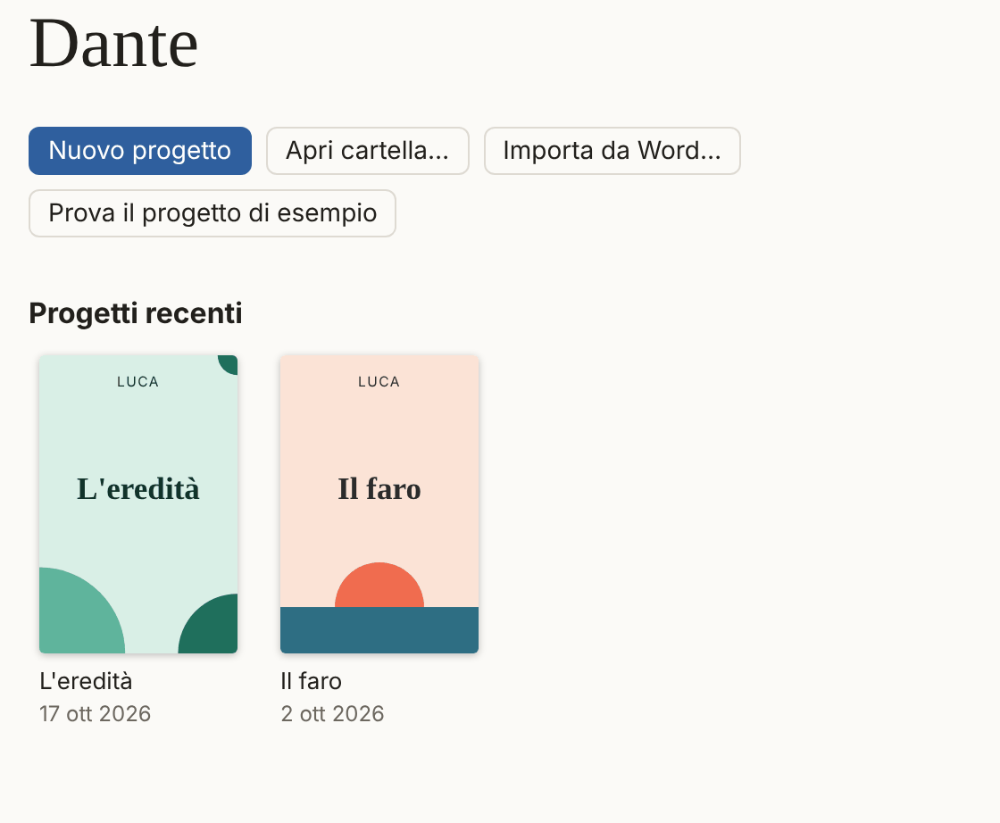

   Con **Nuovo progetto** compare questo modulo. La copertina è un disegno semplice che Dante prepara con il titolo e gli autori: scegli una forma e dei colori, o lasciala com'è.

   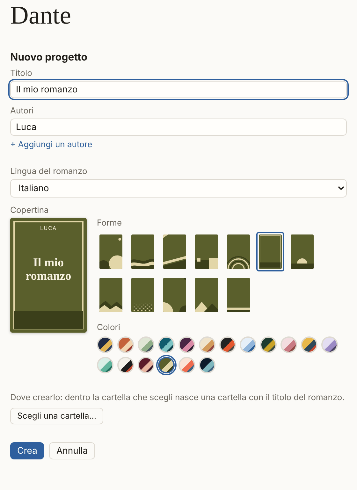
3. Apri le **Impostazioni** (l'ingranaggio nella barra a sinistra) e scrivi **il tuo nome**: serve a firmare commenti e revisioni e a contare le parole che scrivi ogni giorno.
4. Controlla **titolo**, **autore** e **lingua del romanzo**: la lingua decide, per esempio, la sillabazione e i nomi delle cartelle.

I progetti aperti di recente restano elencati nella schermata iniziale. Per tornarci, usa **Chiudi progetto** nella barra a sinistra. Dante ricorda la dimensione e la posizione della finestra e la riapre com'era.

Ogni progetto contiene anche un file con il titolo del romanzo e l'estensione **.dante** (per esempio `Il mio romanzo.dante`). Un **doppio clic** su quel file apre Dante con il romanzo già caricato; se Dante è già aperto, passa a quel romanzo dopo aver salvato il testo. Il file si può rinominare, ma deve restare nella cartella principale del progetto. Funziona con Dante installato, non con la copia portatile né avviato da `npm run tauri dev`.

### Approfondimento

- **Windows**: l'installatore viene preparato automaticamente su GitHub ed è pubblicato nella versione di anteprima (insieme alla copia portatile, ai pacchetti Linux e al .dmg per Mac) *preview* del repository.
- **macOS**: nella versione di anteprima *preview* ci sono due file: `Dante-<commit>-mac-apple-silicon.dmg` per i Mac con chip M1 o successivi (dal 2020) e `Dante-<commit>-mac-intel.dmg` per quelli precedenti. Per sapere quale hai, apri il menu Apple > Informazioni su questo Mac: se vedi "Chip Apple" scegli apple-silicon, se vedi "Intel" scegli intel. Serve macOS 10.15 (Catalina) o successivo; su Catalina installa prima gli aggiornamenti di Safari fino alla 15.6 (Preferenze di Sistema > Aggiornamento Software). Il motore che Catalina dà alle app è rimasto quello di Safari 13, troppo vecchio per Dante: su Catalina Dante si riavvia da solo all'apertura per usare quello di Safari aggiornato (una soluzione ancora in prova). Se Dante non riesce ad avviarsi, al posto della finestra vuota mostra un rapporto da copiare e mandare a chi segue Dante, con la versione di macOS e di Safari aggiunte in fondo; lo stesso rapporto si copia in qualunque momento da Impostazioni > Segnalare un problema. Apri il .dmg e trascina Dante nella cartella Applicazioni. L'app non è firmata da Apple (serve un Apple Developer account, 99 $ l'anno), quindi la prima volta macOS la blocca: chiudi l'avviso, poi vai in Impostazioni di Sistema > Privacy e sicurezza e premi **Apri comunque** accanto al messaggio su Dante. Sulle versioni di macOS precedenti a Sequoia basta anche tasto destro sull'app > Apri. Serve una volta sola per ogni .dmg scaricato; le versioni successive arrivano con l'aggiornamento automatico (capitolo 17). Con Dante in Applicazioni funziona il doppio clic sui file .dante. Per lavorare sul codice resta `npm run tauri dev`.
- Le impostazioni si dividono in due gruppi. Quelle del **romanzo** (titolo, struttura, numerazione, tipi, obiettivi, esportazione) sono salvate in `dante.yaml` dentro il progetto e viaggiano con lui. Quelle dell'**applicazione** (lingua dell'interfaccia, tema, carattere dell'editor, il tuo nome) restano sul computer e valgono per tutti i progetti.
- Un nuovo progetto nasce con le cartelle principali già pronte, chiamate nella lingua del romanzo (capitolo 6).
- **File di avvio**: Dante scrive `Titolo.dante` nella cartella principale quando crea o apre un progetto che non ne ha uno (lo riconosce da qualunque nome con quell'estensione, quindi un file rinominato non viene duplicato). Il contenuto è solo una nota: conta la cartella in cui si trova. Gli installatori registrano l'estensione: tipo di documento sul Mac, registro su Windows, tipo MIME `application/x-dante-project` con i pacchetti .deb e .rpm su Linux. Con la copia portatile e l'AppImage l'associazione manca, ma *Apri con* sul file funziona. Una seconda copia di Dante avviata dal doppio clic passa il file a quella già aperta e si chiude. Obsidian non mostra il file, perché non è un formato che conosce.

## 3. Importare un romanzo da Word

### Come si fa

1. Nella schermata iniziale scegli **Importa da Word…** e seleziona il file `.docx`.
2. Si apre l'anteprima: in alto quante parti, capitoli, scene e parole ha trovato Dante; a sinistra il documento come lo legge, con un'etichetta sulle righe che diventano parte, capitolo o scena e sui punti in cui comincia una nuova scena; a destra il risultato, capitolo per capitolo. Un clic su un capitolo o una scena a destra mostra a sinistra dove comincia.
3. In alto, accanto a ogni livello di titolo del documento, scegli cosa diventa: parti, capitoli, scene con titolo, oppure titoli lasciati nel testo. Accanto a **Righe vuote** scegli se una riga vuota (o due di fila) separa le scene. Se nel documento le scene sono separate da `***` non serve cambiare niente; se Dante divide in scene paragrafi che stanno insieme, scegli **Non aprono scene** (le righe vuote spariscono) oppure **Restano righe vuote, senza nuove scene** (ogni riga vuota tra due paragrafi resta una riga vuota del testo, capitolo 5).
4. Se una riga è letta male, fai clic su di essa e scegli cos'è: **Titolo di parte**, **Titolo di capitolo**, **Titolo di scena**, **Separatore di scene**, **Testo** oppure **Ometti**. Con **Anche le righe simili** spuntata la scelta vale per tutte le righe dello stesso tipo: per esempio tutte quelle con solo un numero, o tutte quelle che iniziano con "Capitolo" seguito da un numero. **Come la legge Dante** annulla la scelta. Le righe che hai scelto tu hanno un pallino accanto all'etichetta. Anche una riga vuota, che nell'anteprima è una sottile striscia tra due paragrafi, si può scegliere con un clic: segnata come **Testo** resta una riga vuota del testo, senza aprire una scena.
5. Premi **Continua**, scegli titolo, autori e dove creare il progetto, e premi **Importa**. **Torna all'anteprima** riapre l'anteprima con le scelte fatte.

Il file Word non viene modificato: Dante ne legge una copia.

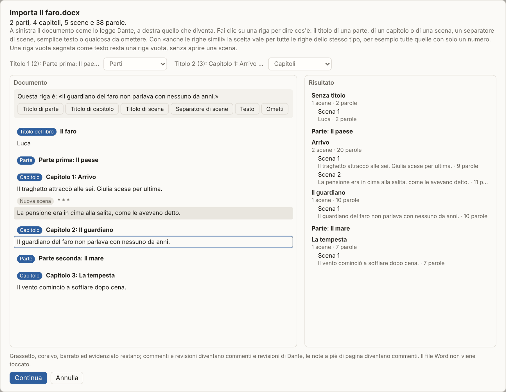

**Un esempio.** Nel documento qui sopra i titoli con lo stile Titolo 1 sono «Parte prima: Il paese» e «Parte seconda: Il mare», quelli con lo stile Titolo 2 sono «Capitolo 1: Arrivo» e così via. Dante propone **Parti** per il primo livello e **Capitoli** per il secondo. Dentro il Capitolo 1 una riga con `***` separa due scene, quindi il capitolo diventa due scene. Se invece i capitoli del tuo documento fossero scritti con lo stile Titolo 1, sceglieresti **Capitoli** nel primo menu.

**Aggiungere un file Word a un progetto già iniziato.** Se il romanzo è diviso in più file Word, crea il progetto dal primo e poi aggiungi gli altri uno alla volta: nel manoscritto premi **Importa**, nel gruppo **Aggiungi** sopra l'albero, e scegli il file. Si apre la stessa anteprima; sotto puoi scegliere **Dove va** (in fondo al manoscritto o in fondo a una parte, se il progetto ne ha) e, se il file comincia con del testo prima del primo titolo, spuntare **Il testo prima del primo titolo continua il capitolo…**: quel testo diventa altre scene dell'ultimo capitolo invece di un capitolo nuovo, utile quando un capitolo comincia in un file e finisce nel successivo. Premi **Importa**: quello che c'era resta com'era, il nuovo testo arriva dopo.

*Esempio:* un file in cui il testo scorre senza titoli e le sezioni sono divise da un numero su una riga da solo ("1", "2", "3"…). Dante riconosce i numeri che crescono e ne fa dei capitoli; nell'anteprima compaiono come **Titolo 2**. Se quelle sezioni per te sono scene, scegli **Scene con titolo** accanto a **Titolo 2**; se vuoi tenerle come capitoli senza il numero come titolo, lasciale così e rinominale poi nell'albero.

### Approfondimento

- La struttura viene dagli stili Titolo 1, Titolo 2, Titolo 3 di Word. Dante propone da solo una divisione: con tre livelli, parti, capitoli e scene; con due, parti e capitoli se il primo livello si chiama "Parte…", altrimenti capitoli e scene; con uno, capitoli. Riconosce anche capitoli scritti senza stile, come "Capitolo primo", oppure un numero centrato ("1", "IV") con il titolo sotto: in quel caso il numero si toglie, perché lo aggiunge Dante. Senza stili né numeri centrati, le righe con solo un numero (in cifre o romano, anche con il punto o in grassetto) diventano capitoli quando contano in avanti: ognuna segue la precedente o ricomincia da 1, con al massimo un'eccezione ogni cinque. Il conteggio può partire da qualsiasi numero, perché un file può essere il seguito di un altro.
- Le scelte riga per riga dell'anteprima valgono più delle regole generali: una riga segnata come titolo diventa titolo qualunque sia il suo stile, una segnata come testo resta nel testo anche se è un titolo di Word o una riga di `***`. Le righe simili sono quelle corte (fino a 80 caratteri) uguali a parte i numeri e l'eventuale titolo dopo il numero ("Capitolo 3" e "Capitolo IV: La casa").
- Aggiungendo un file a un progetto, i nuovi capitoli e le nuove parti prendono numeri d'ordine dopo quelli esistenti; un nome già usato riceve un numero ("Capitolo 2"). Se il file ha delle parti e il progetto no, Dante attiva le parti e scrive `kind: chapter` nella nota cartella dei capitoli che c'erano, perché restino capitoli.
- Quando le righe vuote separano le scene, una riga vuota che lascerebbe una scena di uno o due paragrafi (prima o dopo di sé) non apre una scena: resta una riga vuota del testo, perché quasi sempre è solo uno stacco. Se invece è davvero una scena, fai clic sulla riga vuota nell'anteprima e scegli **Separatore di scene**.
- Dentro un capitolo, una riga con soli simboli (`***`, `* * *`, `#`, `§` e simili) apre una nuova scena.
- Le righe vuote dentro uno stesso paragrafo di Word (due a capo di fila) non lo dividono: il paragrafo resta uno, anche quando è centrato.
- "Capitolo 3: Casa" diventa un capitolo con titolo "Casa", perché i numeri li aggiunge Dante (capitolo 6).
- Grassetto, corsivo, barrato ed evidenziato restano. I commenti di Word diventano commenti di Dante e le revisioni diventano revisioni da accettare o rifiutare, firmate col nome di chi le aveva fatte (capitolo 10). Le note a piè di pagina diventano commenti.
- Lo stile Titolo e le proprietà del documento danno titolo e autore del romanzo.

## 4. L'area di lavoro

### Come si fa

La finestra ha quattro zone, da sinistra a destra:

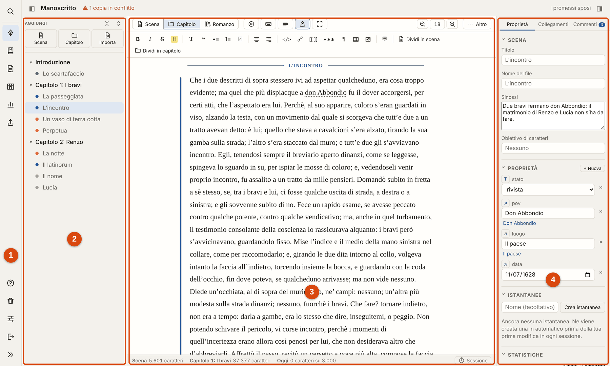

1. **La barra delle sezioni**, con un'icona per ciascuna: Manoscritto, Bibbia, Ricerca, Laboratorio, Viste, Statistiche, Esportazione, Impostazioni, oltre a Cerca e Chiudi progetto. Passando col mouse su un'icona compare il nome; allargando la barra i nomi restano visibili.
2. **Il pannello a sinistra**: nel Manoscritto è l'albero di parti, capitoli e scene; nelle altre sezioni è l'elenco di note e file.
3. **L'editor** al centro, dove scrivi.
4. **Il pannello a destra**, con tre schede: **Proprietà** (dati della scena o nota, istantanee, statistiche), **Collegamenti** (le note che rimandano a questa e viceversa) e **Commenti**.

In alto, accanto al nome della sezione, compaiono gli avvisi (nell'immagine, **1 copia in conflitto**, capitolo 10); a destra c'è il titolo del romanzo.

I due pannelli laterali si nascondono e si riaprono dai pulsanti in alto; si allargano trascinandone il bordo, e un doppio clic sul bordo li riporta alla larghezza normale. Cmd+ e Cmd− ingrandiscono e riducono il testo, Cmd+0 lo riporta come prima.

### Approfondimento

Ogni sezione corrisponde a una cartella del progetto (Manoscritto, Bibbia, Ricerca, Laboratorio, Viste); Statistiche, Esportazione e Impostazioni leggono e scrivono `dante.yaml` e i dati in `.dante/`. Lo stato dell'albero (rami aperti o chiusi) è ricordato dal computer, non dal progetto.

## 5. Scrivere

### Come si fa

- **Cosa vedere**: in alto, sotto **Mostra**, scegli se vedere solo la **Scena** selezionata, tutto il **Capitolo**, tutta la **Parte** o tutto il **Romanzo**, una scena dopo l'altra. Con le frecce passi da una scena alla successiva.
- **Formattare**: seleziona il testo e usa la barra che compare sopra la selezione (grassetto, corsivo, evidenziato, commento…), oppure le scorciatoie (capitolo 15). La **barra di formattazione** fissa si mostra o nasconde dal suo pulsante.

  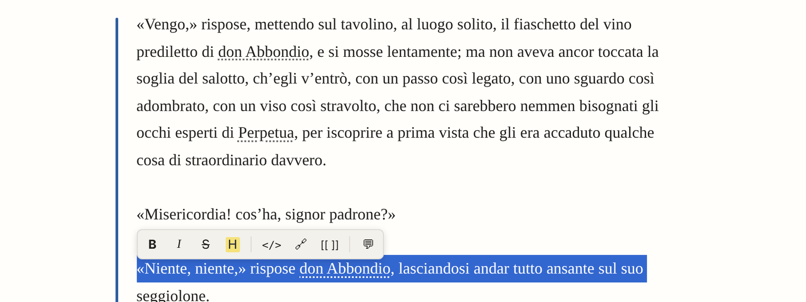

  *Prova:* apri la scena **Perpetua**, seleziona «Misericordia! cos'ha, signor padrone?» e premi **I** nella barra: la frase diventa corsiva. Cmd+Z la riporta com'era.
- **Allineare un paragrafo**: metti il cursore nel paragrafo e usa i pulsanti di allineamento della barra di formattazione (centrato o a destra), oppure Cmd+Maiusc+E e Cmd+Maiusc+R. Un secondo clic sullo stesso pulsante lo riporta all'allineamento di base: a sinistra mentre scrivi, giustificato o a sinistra in esportazione secondo il profilo. Su una riga vuota il pulsante apre un paragrafo già allineato. Invio alla fine di un paragrafo allineato ne apre uno normale; Backspace all'inizio toglie l'allineamento. L'allineamento si vede nell'editor ed è rispettato in Word, PDF, EPUB e Markdown; dall'importazione da Word restano i paragrafi centrati e a destra. Nel file il paragrafo è racchiuso in `<span style="display:block;text-align:center">…</span>` (o `text-align:right`): Dante nasconde il tag, la vista Markdown lo mostra, e Obsidian mostra il paragrafo allineato con corsivi e grassetti intatti.
- **Righe vuote**: in Markdown due o più righe vuote tra due paragrafi valgono come una sola, quindi lo spazio in più che vedi mentre scrivi sparisce in esportazione e in Obsidian. Per lasciare davvero una riga vuota, senza aprire una nuova scena, premi il pulsante **¶** della barra di formattazione o Alt+Invio: dopo il paragrafo in cui sei compare una riga con un **¶** chiaro, che nel libro sarà una riga vuota. Il **¶** non si stampa; per toglierla, metti il cursore sulla riga e cancellala come una riga qualsiasi.

  *Esempio:* alla fine di un paragrafo («…e la porta si chiuse.») premi Alt+Invio e continua a scrivere il paragrafo successivo. In Word, PDF ed EPUB tra i due paragrafi c'è una riga bianca e la scena resta una. Per una pausa più forte, con il separatore (per esempio `* * *`), usa invece il pulsante **Separatore di scena**.
- **Cercare nella scena**: Cmd+F apre una barra sopra il testo. Scrivi la parola: Invio (o Cmd+G) passa alla successiva, Maiusc+Invio (o Maiusc+Cmd+G) torna alla precedente, **tutte** le seleziona tutte. Le caselle limitano la ricerca alle maiuscole scritte così o alle parole intere. Il campo **Sostituisci con** cambia la parola solo in questa scena; per cambiarla in tutto il romanzo usa **Sostituisci** (capitolo 9). Esc chiude la barra.

  *Prova:* apri la scena **Perpetua**, premi Cmd+F e scrivi «padrone»: la prima volta che compare è evidenziata, Invio passa alla seguente.
- **Dividere**: con il cursore nel punto giusto, **Dividi in scena** (Cmd+Invio) sposta il testo che segue in una nuova scena; **Dividi in capitolo** (Cmd+Maiusc+Invio) apre un nuovo capitolo da quel punto, con le scene che seguono.
- **Modalità di scrittura**:
  - **Macchina da scrivere**: la riga su cui scrivi resta al centro della finestra.
  - **Focus**: tutto è attenuato tranne il paragrafo che stai scrivendo.

    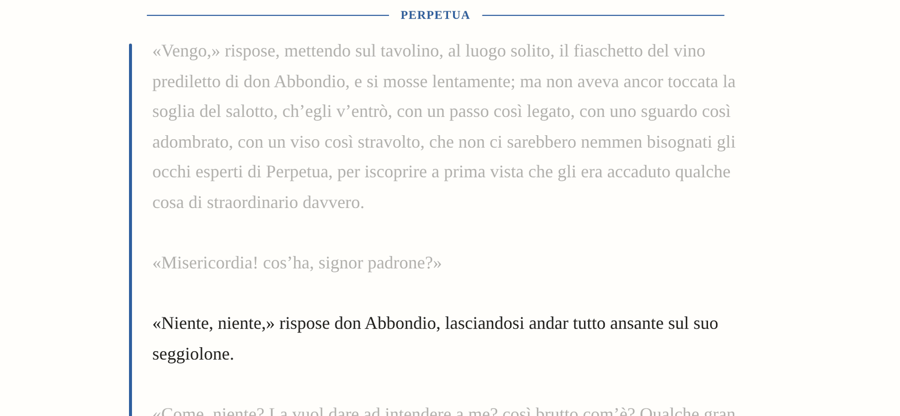
  - **Riga**: ombreggia leggermente la riga su cui si trova il cursore, così l'occhio la ritrova subito. Si accende e si spegne con il suo tasto, e la scelta resta per le volte successive.
  - **Schermo intero**: resta solo il testo. Porta il mouse al bordo in alto per far uscire le barre (modalità e formattazione), al bordo sinistro per l'indice, al bordo destro per il pannello laterale; si nascondono di nuovo quando il mouse se ne va, ma restano aperti mentre scrivi in un loro campo. I pannelli affiancati tornano quando esci. Esc per uscire.
- **Elenchi**: i pulsanti della barra di formattazione (o Cmd+Maiusc+8, Cmd+Maiusc+7 e Cmd+Maiusc+9) iniziano un elenco puntato, numerato o di caselle di spunta. Il testo di ogni voce rientra dopo il punto, il numero o la casella, e le righe che vanno a capo si allineano sotto la prima, non sotto il punto. Una voce che inizia con qualche spazio in più (quattro vanno sempre bene) sta dentro la precedente e rientra di un livello. In Word, PDF ed EPUB gli elenchi hanno lo stesso rientro; in Markdown restano elenchi Markdown.
- **Tabelle**: il pulsante **Tabella** della barra di formattazione inserisce una tabella di tre colonne. Scrivi nella prima cella; **Tab** passa alla cella successiva (dopo l'ultima aggiunge una riga), **Maiusc+Tab** torna indietro, **Invio** aggiunge una riga sotto e, su una riga vuota alla fine, esce dalla tabella. Mentre il cursore è nella tabella compare sopra una barra: **Riga** aggiunge una riga sopra o sotto quella del cursore o la elimina, **Colonna** fa lo stesso con le colonne (a sinistra, a destra, elimina), **Allinea** allinea la colonna del cursore a sinistra, al centro o a destra (premuto di nuovo, toglie l'allineamento). **+ Didascalia** scrive `Tabella: ` sotto la tabella e ci porta il cursore, oppure porta il cursore alla didascalia che c'è già. Mentre la modifichi la tabella è scritta con lettere tutte della stessa larghezza, e le colonne si rimettono in fila da sole a ogni Tab, Invio, comando della barra e quando il cursore esce dalla tabella.

  *Esempio:* premi **Tabella** e scrivi «Personaggio», Tab, «Chi è», Tab, «Prima scena», Tab, «Renzo», Tab, «filatore di seta», e così via. Mentre scrivi la vedi così, con la barra sopra:

  

  Quando il cursore esce dalla tabella, la vedi come sarà nel libro, con la didascalia sotto:

  
- **Immagini**: premi il pulsante **Immagine** della barra di formattazione e scegli il file, oppure incolla un'immagine (Cmd+V) o trascinala nel testo. Dante la copia nella cartella **Allegati** dentro **Ricerca** e la mostra nel punto in cui si trova il cursore. Porta il mouse sull'immagine per cambiarne la larghezza (**200**, **400**, **600** pixel o **1:1**, la dimensione originale) e l'allineamento (a sinistra, al centro, a destra). Un clic sull'immagine mostra il testo che la inserisce, per modificarlo a mano.
- **Dialoghi e tipografia**: se attivi la correzione mentre scrivi, Dante mette da solo le virgolette o le lineette del dialogo, l'apostrofo tipografico e i puntini di sospensione. Cmd+Z annulla una correzione che non volevi.

### Approfondimento

- Il testo è Markdown: `*corsivo*`, `**grassetto**`, `==evidenziato==`, `~~barrato~~`. L'editor nasconde questi simboli tranne dove si trova il cursore, come in Obsidian. Il pulsante **Markdown** mostra il file com'è, simboli e proprietà comprese.
- Un'immagine si scrive come in Obsidian: `![[foto.jpg]]`, oppure `![[foto.jpg|300]]` per una larghezza di 300 pixel (`|300x200` fissa anche l'altezza); funziona anche ``. L'immagine può stare in qualsiasi cartella del progetto: con `![[nome.jpg]]` Dante la cerca per nome, come Obsidian. Se incolli o trascini nel testo l'indirizzo web di un'immagine, Dante la scarica in **Ricerca/Allegati** e la inserisce da lì. Un indirizzo scritto a mano (``) si vede nell'editor ma non passa nell'esportazione finché non premi **⤓** sulla barra dell'immagine, che la scarica nel progetto; un file fuori dal progetto non si vede, perché chi apre il progetto da un altro computer non lo avrebbe: va copiato nel progetto, come fa il pulsante **Immagine**. L'allineamento usa lo stesso tag dei paragrafi allineati. In esportazione un'immagine da sola in un paragrafo diventa una figura, con il suo allineamento; un'immagine dentro una frase resta nella riga, centrata sulle lettere come nell'editor. Un'immagine più larga della pagina viene ridotta alla larghezza del testo; un'immagine che non si trova viene saltata. Le immagini non contano nelle parole e nei caratteri.
- **Didascalie**, come le scrive Pandoc: la descrizione di un'immagine che sta da sola nel suo paragrafo (`![[casa.png|La casa al mare|300]]`) è la sua didascalia e compare sotto l'immagine. Per una tabella premi **+ Didascalia** nella barra sopra la tabella, oppure scrivi tu, dopo una riga vuota sotto la tabella, una riga che inizia con `Tabella:` (oppure solo `:`), per esempio `Tabella: Le fasi del romanzo`; nell'editor si vede centrata sotto la tabella, senza la parola iniziale. Le didascalie passano in Word, PDF ed EPUB sotto la figura o la tabella, in corsivo, e contano nelle parole dell'esportazione.
- **Note incorporate**, come in Obsidian: `![[Nota]]` su una riga da sola mostra il testo della nota in un riquadro, in sola lettura; `![[Nota#Titolo]]` mostra solo quella sezione (con le sue sottosezioni), `![[Nota#^id]]` solo il paragrafo che finisce con `^id`. Un clic sul nome in alto apre la nota, un clic nel testo mostra la riga com'è scritta. In esportazione il testo della nota prende il posto della riga, comprese le note che incorpora a sua volta; una nota che incorpora sé stessa viene saltata. Dentro una frase `![[Nota]]` resta un collegamento. Le parole delle note incorporate contano nell'esportazione, non nelle statistiche della scena.
- Una riga vuota è scritta nel file come un paragrafo che contiene solo `&nbsp;` (uno spazio che non va a capo), con una riga vuota sopra e una sotto. Obsidian, Pandoc e i browser la mostrano come una riga vuota. Dante legge allo stesso modo una riga con solo `<br>` o con solo uno spazio non separabile, come li scrivono altre app. In esportazione diventa un paragrafo vuoto in Word, uno spazio di una riga in PDF ed EPUB, e resta `&nbsp;` in Markdown; non conta nelle parole né nei caratteri. Un separatore di scena (`***`, `---`) dentro una scena, invece, nel libro è stampato come separatore.
- Le citazioni (righe che iniziano con `>`) si vedono con una linea a sinistra, senza il `>`. Le tabelle (`| A | B |` con sotto una riga `|---|---|`) si vedono come tabelle; un clic in una cella mostra la tabella com'è scritta, per modificarla. Dentro una tabella un collegamento con alias si scrive `[[nota\|alias]]`, come in Obsidian. Le tabelle passano in Word, PDF, EPUB e Markdown, con l'allineamento delle colonne.
- La correzione tipografica si imposta in **Esportazione → Tipografia**, perché vale sia per il testo esportato sia, se vuoi, mentre scrivi. Ci sono gli stili di dialogo di diversi paesi: «caporali» italiani, « spaziati » francesi, “virgolette alte” americane, „ basse“ tedesche, lineetta italiana (— Vieni — disse), raya spagnola (—Ven —dijo—) e altri. Nell'elenco quello comune nella lingua del romanzo è segnato come tale. Un nuovo progetto parte con **Come scritti nel testo**: i dialoghi escono come li hai scritti, finché non scegli uno stile.
- Qualunque sia il modo in cui hai scritto i dialoghi, lo stile scelto li converte: le battute scritte con caporali o virgolette diventano lineette, e quelle aperte da una lineetta o da un trattino a inizio paragrafo diventano virgolette. Per esempio `- Vieni - disse lui - è tardi.` diventa «Vieni» disse lui «è tardi.».
- Trattini e lineette nella narrazione restano come li hai scritti, così come i trattini dentro le parole (socio-economico) e le lineette fra numeri (1990–2000). In una battuta aperta da una lineetta contano come chiusura e riapertura solo le lineette dello stesso tipo: un inciso fra trattini dentro una battuta aperta da lineetta resta com'è.
- Se una scena viene cambiata da un altro programma mentre la stai modificando, la tua versione resta e un avviso propone di ricaricare l'altra.

## 6. Organizzare il manoscritto

### Come si fa

Tutto si fa dall'albero nella sezione Manoscritto.

- **Aggiungere**: i pulsanti **Nuova scena**, **Nuovo capitolo** e **Nuova parte** aggiungono un elemento dopo quello selezionato (una nuova parte va in fondo al romanzo). Il clic destro su un elemento offre anche **Nuova scena dopo questa** e **Nuova scena dentro**.
- **Rinominare**: doppio clic sul nome, oppure F2.

  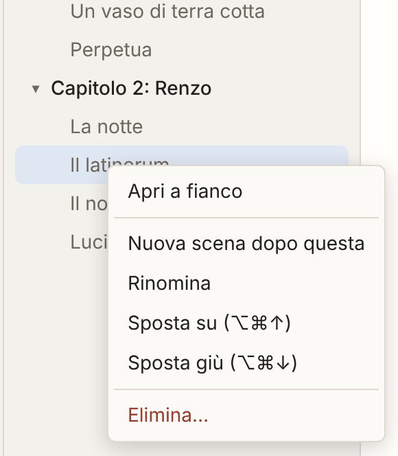
- **Spostare**: trascina scene e capitoli dove vuoi, anche da un capitolo all'altro. Con Alt+Cmd+↑ e Alt+Cmd+↓ sposti l'elemento selezionato di un posto.
- **Unire scene**: tieni premuto Cmd e clicca le scene da unire, poi premi **Fondi** nella barra sopra l'albero (o dal clic destro). Il testo finisce nella prima scena, in ordine di lettura.
- **Eliminare**: clic destro → **Elimina…**, oppure Cmd+Backspace. L'elemento va nel **Cestino** e si può recuperare.
- **Cestino**: si apre con l'icona del cestino in basso nella barra a sinistra, sopra le Impostazioni. Elenca ciò che è stato eliminato, dal più recente, con il posto da cui viene. **Rimetti a posto** lo riporta lì; se nel frattempo quel posto è stato preso, l'elemento torna accanto con un «2» nel nome. **Elimina per sempre** e **Svuota il cestino** lo cancellano davvero, dopo una conferma. Nel cestino finiscono anche le scene fuse in un'altra e le copie in conflitto scartate (capitolo 10).
- **Prologo, epilogo, interludio**: seleziona il capitolo e, nel pannello Proprietà, scegli il **Tipo** (prologo ed epilogo non hanno numero) oppure spunta **Senza numero (come un interludio)**. Nel progetto di esempio l'**Introduzione** è un prologo: per questo il primo capitolo vero si chiama «Capitolo 1».

  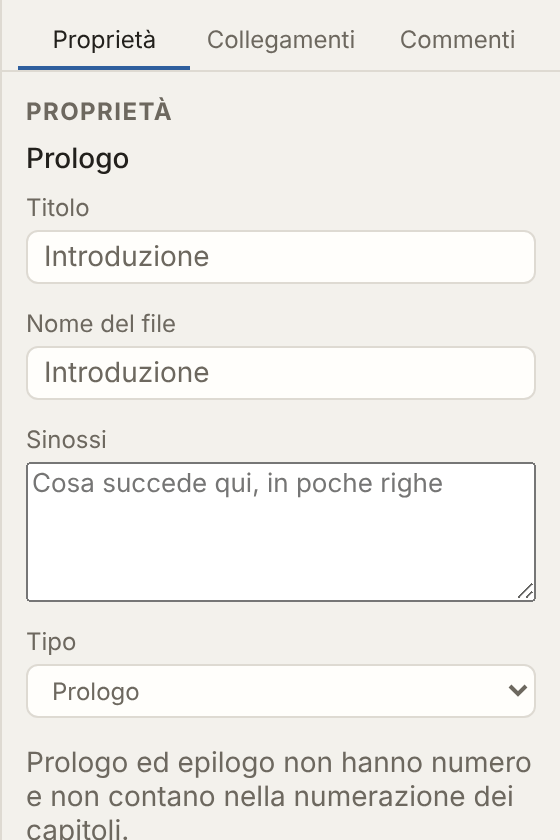
- **Numerazione e titoli dei capitoli**: in **Impostazioni → Struttura** scegli se raggruppare i capitoli in parti, l'etichetta ("Capitolo"), lo stile del numero (1, 2, 3 · I, II, III · Uno, due, tre · Primo, secondo, terzo · nessuno), cosa mettere tra numero e titolo e se ricominciare la numerazione in ogni parte. L'anteprima mostra il risultato.

  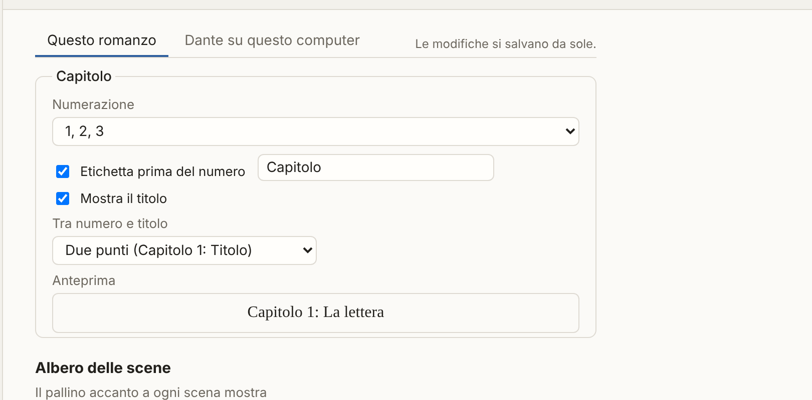

  *Esempio:* con numerazione **Primo, secondo, terzo** e **Tra numero e titolo** su «a capo», nell'albero e nel libro esportato il capitolo diventa «Capitolo primo» con «I bravi» sotto.

Una scena finita fuori da qualsiasi capitolo è segnata nell'albero come **fuori dai capitoli**: trascinala nel capitolo giusto.

### Approfondimento

Sul disco il manoscritto è fatto così:

```text
Il mio romanzo/
├── dante.yaml                  impostazioni del romanzo
├── Bibbia/  Ricerca/  Laboratorio/  Viste/  Modelli/
├── .dante/                     istantanee, presenze, registro di scrittura
├── .trash/                     elementi eliminati
└── Manoscritto/
    ├── 000 Prologo/
    │   ├── 000 Prologo.md      nota cartella: kind: prologue
    │   └── 010 La chiamata.md  scena
    ├── 010 Ritorno/            una parte (se le parti sono attive)
    │   ├── 010 Ritorno.md
    │   └── 010 Arrivo/         un capitolo
    │       ├── 010 Arrivo.md
    │       └── 020 La casa.md
    └── 900 Epilogo/
```

- **Prefissi numerici**: il numero all'inizio del nome (010, 020…) decide solo l'ordine e non compare nei titoli. I numeri vanno di 10 in 10 per lasciare spazio. Quando sposti qualcosa, Dante rinomina il minor numero possibile di file e aggiorna i collegamenti che puntavano a ciò che si è spostato.
- **Nota cartella**: un capitolo o una parte tiene le sue proprietà in una nota con lo stesso nome della cartella (`010 Arrivo/010 Arrivo.md`). La proprietà `kind` vale `part`, `chapter`, `prologue` o `epilogue`; `numbered: false` toglie il numero. Per questo una scena non può avere lo stesso nome del suo capitolo.
- **Numeri visibili**: "Capitolo 3: La lettera" è calcolato al momento dalle impostazioni in `dante.yaml`, non dal prefisso né dal testo del file.
- **Cestino**: è la cartella `.trash` del progetto, la stessa che usa Obsidian. Dante annota in `.dante/trash.json` da dove viene ogni elemento, per poterlo rimettere a posto; un file messo nel cestino da Obsidian o a mano, di cui Dante non conosce l'origine, torna nel Laboratorio. Il cestino è nella cartella del romanzo, quindi lo vedono e lo svuotano anche i coautori.
- **Fusione**: le scene unite oltre alla prima vanno nel cestino, e i collegamenti che puntavano a loro portano alla prima. Una scena con una copia in conflitto va sistemata prima (capitolo 10).
- **Scena fuori dai capitoli**: se resta lì, l'esportazione la aggiunge in coda al capitolo precedente.

## 7. Istantanee

### Come si fa

Un'istantanea è una copia di una scena com'era in un certo momento, da riprendere se una modifica non ti convince.

- Dante ne crea una da solo prima della tua prima modifica a una scena, ogni volta che apri il progetto.
- Per crearne una tu, apri il pannello **Proprietà**, scrivi un nome (facoltativo) sotto **Istantanee** e premi **Crea istantanea**.
- **Confronta** mostra cosa è cambiato tra l'istantanea e il testo attuale.

  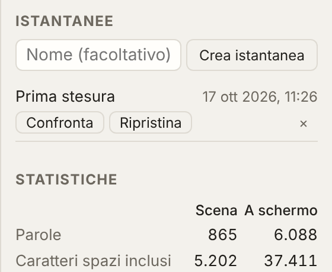

  *Esempio:* nella scena **Perpetua** crea un'istantanea chiamata «Prima stesura», poi aggiungi qualche parola dopo «La vita!». **Confronta** mostra in rosso barrato ciò che c'era solo nell'istantanea e in verde ciò che c'è solo ora:

  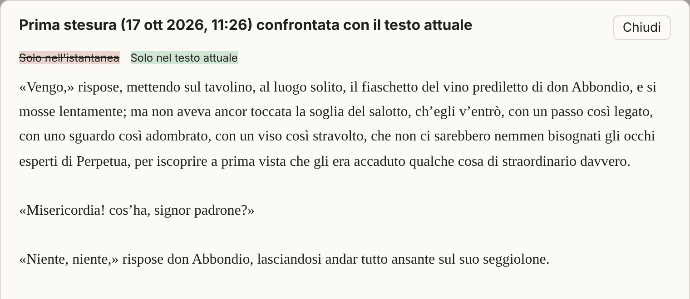
- **Ripristina** rimette l'istantanea al posto del testo. Il testo attuale viene salvato prima come istantanea, quindi non si perde niente.
- Per fare pulizia, in Impostazioni, **Elimina le istantanee vecchie** cancella quelle automatiche precedenti a una data; quelle con un nome restano sempre.

### Approfondimento

Le istantanee sono file in `.dante/snapshots/` e seguono la loro scena quando viene spostata o rinominata. Riguardano una scena alla volta: per conservare l'intero romanzo ci sono le copie di sicurezza (capitolo 19).

## 8. Proprietà, titolo e sinossi

### Come si fa

Le proprietà sono le informazioni su una scena o una nota: punto di vista, data della storia, stato della revisione, luogo, e così via. Le vedi e le modifichi nel pannello **Proprietà** a destra.

- **Titolo e nome del file**: il **Titolo** è quello che compare ovunque (albero, intestazioni, esportazione); il **Nome del file** è il nome sul disco. Se il titolo è vuoto, vale il nome del file.
- **Sinossi**: poche righe su cosa succede nella scena o nel capitolo. Compare anche nelle viste (capitolo 11).

  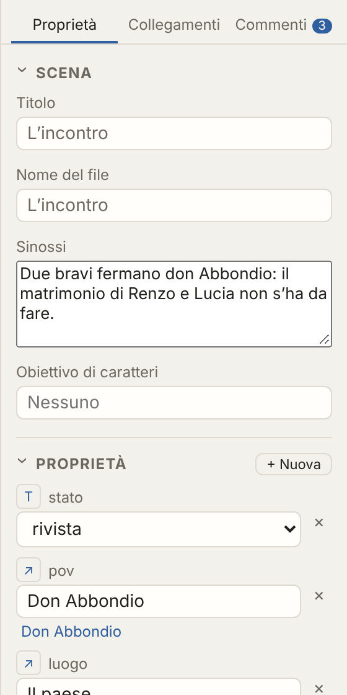

  Qui sopra le proprietà della scena **L'incontro**: lo **stato** è un menu (idea, bozza, rivista, finita), **pov** e **luogo** sono collegamenti alle schede di don Abbondio e del paese (il nome blu sotto il campo apre la scheda), la **data** è quella in cui si svolge la scena nella storia.
- **Aggiungere una proprietà**: scrivi il nome in fondo al pannello e premi **Aggiungi proprietà**.
- **Dare un tipo a una proprietà**: clicca il simbolo prima del nome e scegli se è un testo, un numero, una data, una casella, un elenco o un collegamento a una nota. Per un testo o un elenco puoi indicare i valori ammessi: comparirà un menù a tendina. Da quel momento la proprietà funziona così in tutte le note del progetto.

  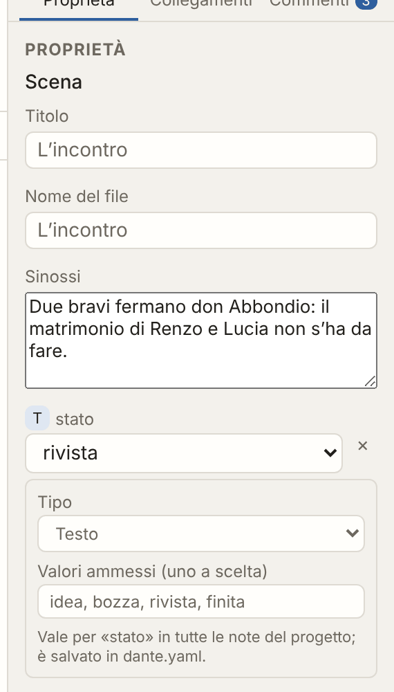

  *Esempio:* vuoi segnare in quale stagione si svolge ogni scena. Scrivi «stagione» in fondo al pannello e premi **Aggiungi proprietà**, poi clicca la **T** accanto al nome e scrivi nei valori ammessi «primavera, estate, autunno, inverno». Da quel momento, in ogni scena, «stagione» è un menu con quei quattro valori, e una vista può raggruppare le scene per stagione.

Tutte le proprietà con un tipo sono elencate in **Impostazioni → Proprietà con un tipo**.

### Approfondimento

Le proprietà sono il frontmatter YAML in testa a ogni file, come in Obsidian. Per capitoli e parti stanno nella nota cartella (capitolo 6).

```yaml
---
title: L’incontro
synopsis: "Due bravi fermano don Abbondio: il matrimonio di Renzo e Lucia non s’ha da fare."
stato: rivista
pov: "[[Don Abbondio]]"
luogo: "[[Il paese]]"
data: 1628-11-07
---
```

Una sinossi che contiene i due punti va tra virgolette, come qui sopra: altrimenti il file non si legge più correttamente, né in Dante né in Obsidian. Dante le aggiunge da solo quando scrivi la sinossi nel pannello.

Alcune proprietà hanno un significato per Dante e hanno nomi inglesi, uguali in ogni lingua:

| Proprietà | Dove | A cosa serve |
| --- | --- | --- |
| `title` | scena, nota cartella | titolo mostrato ovunque |
| `synopsis` | scena, nota cartella | sinossi |
| `kind` | nota cartella | `part`, `chapter`, `prologue` o `epilogue` |
| `numbered` | nota cartella | `false` toglie il numero |
| `published_title` | scena, nota cartella | titolo usato solo nell'esportazione |
| `type` | nota della Bibbia | tipo della nota; se manca, vale quello della cartella |
| `aliases` | qualsiasi nota | altri nomi per collegare la nota e contarla nelle statistiche |

Le proprietà con un tipo sono definite in `dante.yaml`:

```yaml
properties:
  stato:
    kind: text
    values: [idea, bozza, rivista, finita]
  pov:
    kind: link
    note_type: character
  data: date
```

| Tipo | Simbolo | Campo nel pannello | Scritto nel file come |
| --- | --- | --- | --- |
| testo (`text`) | T | testo, o menù se ha valori ammessi | testo |
| numero (`number`) | # | numero | `42` |
| data (`date`) | ◷ | calendario | `2026-10-15` |
| casella (`checkbox`) | ☑ | casella | `true` / `false` |
| elenco (`list`) | ≡ | interruttori per i valori ammessi | lista YAML |
| collegamento (`link`) | ↗ | suggerimenti, anche solo di un tipo di nota | `"[[Nome]]"` |

Un valore che non rispetta la definizione resta com'è ed è segnalato nel pannello. I nuovi progetti in italiano definiscono già età (numero), data (data), luogo (collegamento a un luogo) e proprietario (collegamento a un personaggio).

## 9. Bibbia, Ricerca e Laboratorio

### Come si fa

- **Bibbia**: le schede di personaggi, luoghi, oggetti, eventi, gruppi e trame, raggruppate per tipo. Premi **Nuovo: Personaggio** (o il tipo che ti serve), scrivi il nome e premi Crea: la scheda nasce già con le proprietà suggerite per quel tipo. Con **Filtra** trovi una scheda tra tante.

  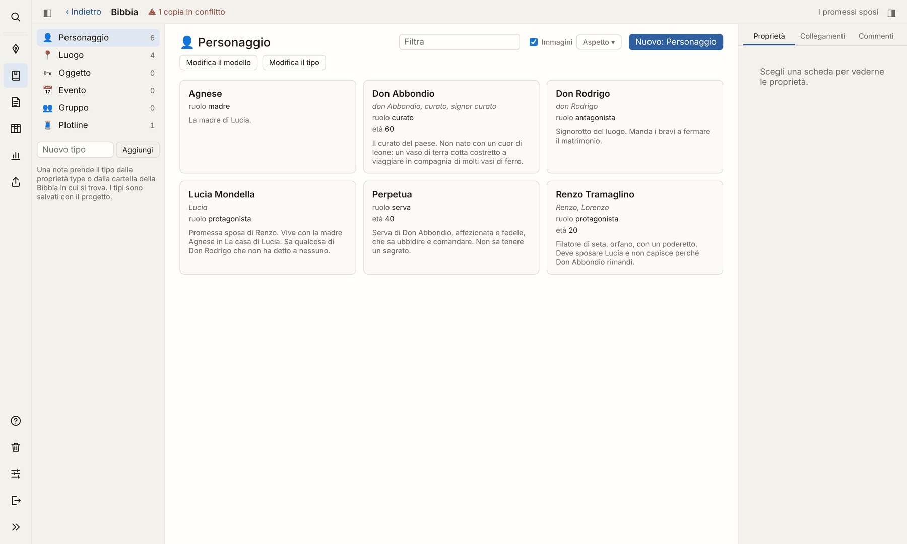
- **Tipi della Bibbia**: puoi aggiungerne di nuovi (per esempio "Creatura") e, per ogni tipo, **Modifica il tipo** (nome, icona, proprietà suggerite) e **Modifica il modello**, cioè il testo da cui parte ogni nuova scheda.
- **Ricerca**: un archivio per note, immagini, PDF e pagine web raccolti per il romanzo. **Aggiungi file…** copia file dal computer; immagini, PDF e HTML si aprono dentro Dante, gli altri con il programma predefinito.
- **Laboratorio**: lo spazio per bozze, scalette e idee che non fanno parte del manoscritto. Funziona come la Ricerca.
- **Collegamenti**: scrivi `[[` nel testo e Dante suggerisce le note del progetto, anche per alias. Funziona anche al contrario: se selezioni «Corrado» e lo chiudi tra `[[ ]]` (o scrivi `[[Corrado]]`) e Corrado è un alias di «Corrado Olivieri», Dante riconosce il personaggio e collega la sua scheda. Un collegamento a una nota che non esiste ancora appare più chiaro.
- **Clic su un collegamento**: si apre un piccolo menu con **Apri nell'editor**, **Apri nel pannello** e **Anteprima**.

  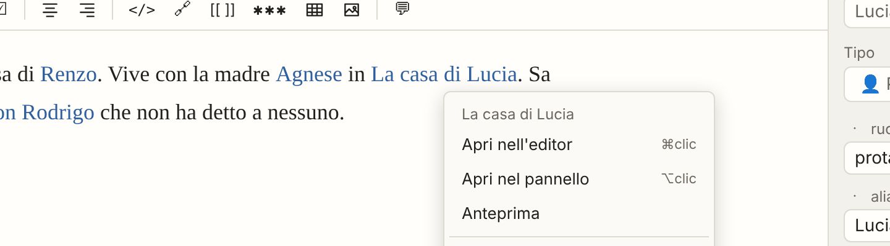

   L'anteprima è una finestrella sopra il testo che mostra la nota, per leggerla al volo senza lasciare la scena; si chiude con Esc o facendo clic altrove. **Modifica il collegamento** mette il cursore dentro le parentesi.

  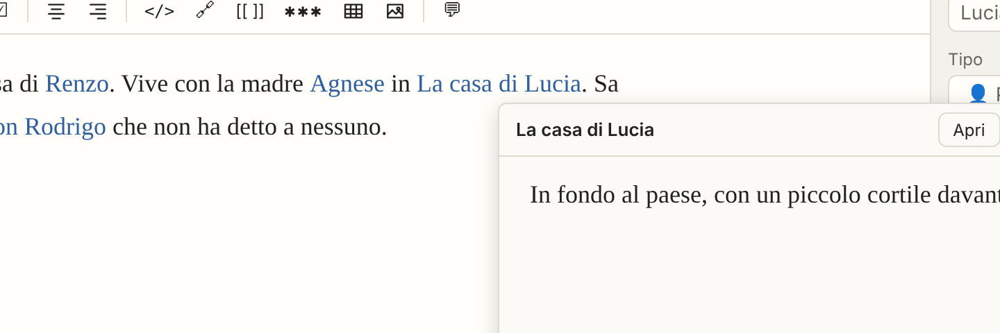

   Le scorciatoie restano: Cmd+clic apre subito nell'editor, Alt+clic (Option su Mac) nel pannello.
- **Collegamento a una nota che non c'è**: il clic chiede se crearla e dove, come scheda di un tipo della Bibbia (personaggio, luogo…), nella Ricerca o nel Laboratorio. La nota nuova si apre nel pannello a fianco, così la scena resta sotto gli occhi.
- **Chi rimanda a chi**: la scheda **Collegamenti** del pannello destro mostra le note che rimandano a quella aperta (con la riga che le contiene) e quelle a cui rimanda.
- **Cercare**: Cmd+Maiusc+F (o la lente in alto a sinistra) cerca nei nomi, negli alias e nel testo di tutte le note, con un'anteprima di ogni risultato. Il menu sotto la casella limita la ricerca a una sezione.

  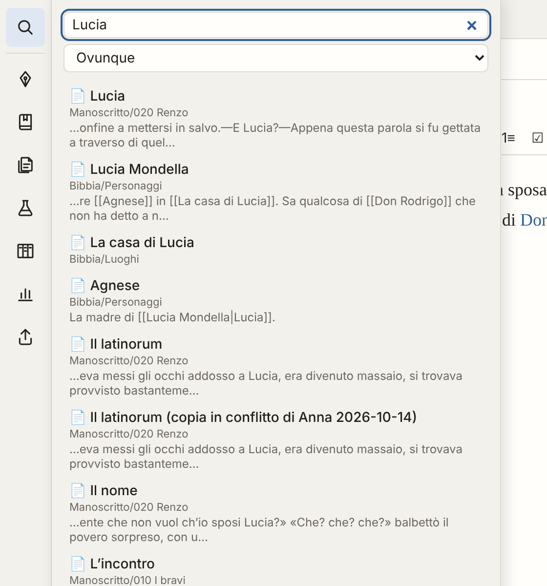
- **Trova e sostituisci in tutto il progetto**: Alt+Cmd+F, oppure la scheda **Sostituisci** in cima alla ricerca. Scrivi la parola da cercare e quella nuova: sotto compaiono tutte le occorrenze, nota per nota, con la parola vecchia barrata e la nuova accanto. Togli la spunta a quelle da lasciare come sono, oppure usa **Nessuna** e spunta solo quelle che ti servono. Un clic su una riga apre la nota con la parola selezionata. **Sostituisci** cambia quelle spuntate; subito dopo **Annulla la sostituzione** rimette tutto com'era. Con **Solo parole intere** «Renzo» non trova «Renzino»; senza **Maiuscole e minuscole** la parola nuova prende le maiuscole di quella vecchia («RENZO» diventa «LORENZO»). Il menu sotto limita la sostituzione a una sezione.

  *Esempio:* per cambiare nome a un personaggio, cerca «Renzo» e sostituisci con «Lorenzo» nel Manoscritto. Prima di cambiare una scena Dante ne salva un'istantanea chiamata «Prima di sostituire «Renzo»», da riprendere se serve (capitolo 7). Per cambiare anche il nome della scheda, rinominala: i collegamenti si aggiornano da soli.

**Un esempio completo.** Apri la scheda di **Lucia Mondella** nella Bibbia. Nel testo, «La casa di Lucia» è blu perché è un collegamento: un clic e scegli **Anteprima** per leggerla senza lasciare la scheda. Ora apri la scena **Lucia** nel Manoscritto e scrivi `[[Agn`: Dante suggerisce **Agnese**; premi Invio e il collegamento è fatto. Nella scheda di Agnese, la scheda **Collegamenti** del pannello destro ora elenca anche la scena **Lucia**.

### Approfondimento

- Il tipo di una nota viene dalla proprietà `type` oppure, se manca, dalla cartella della Bibbia in cui si trova (`Bibbia/Personaggi/`). I tipi sono definiti in `dante.yaml` sotto `types`, ognuno con nome, cartella, icona e proprietà suggerite.
- Il modello di un tipo è il file `Modelli/<nome del tipo>.md`; `{{title}}` e `{{date}}` vengono sostituiti con il nome della nota e la data del giorno.
- I collegamenti sono wikilink come in Obsidian: `[[Lucia Mondella]]` o `[[Lucia Mondella|la promessa sposa]]`. Quando rinomini o sposti una nota, Dante aggiorna tutti i collegamenti che la riguardano.
- Gli alias si scrivono nella proprietà `aliases` della nota: `[[` li suggerisce e le statistiche contano anche quelli.
- Un collegamento chiuso a mano su un alias viene riscritto come `[[Corrado Olivieri|Corrado]]`: nel testo si legge sempre «Corrado», e il collegamento funziona anche in Obsidian, che non risolve gli alias da solo. Succede solo quando l'alias appartiene a una sola nota e nessuna nota si chiama così; maiuscole e minuscole non contano. Cmd+Z annulla la riscrittura insieme alle parentesi. Un `[[Corrado]]` scritto prima, o fuori da Dante, porta comunque alla scheda dentro Dante.
- Eliminare un tipo non cancella le sue note, che restano dove sono con le loro proprietà. Quello che si elimina dalle sezioni va in `.trash`.
- Le pagine HTML aperte in Dante non eseguono i loro script.
- **Sostituisci** cambia solo il testo delle note. Restano come sono le proprietà in testa al file, il nome della nota dentro un collegamento (`[[Renzo Tramaglino|Renzo]]` cambia solo l'alias dopo `|`), le immagini e i file incorporati, gli indirizzi dei link, i tag HTML, il testo dei commenti `{>>…<<}` e i blocchi di codice. Le revisioni (`{++…++}`, `{--…--}`) sono testo e vengono cambiate. Se una nota cambia tra la ricerca e la sostituzione, Dante cerca di nuovo e salta le occorrenze che non ci sono più. **Annulla la sostituzione** salta le note modificate dopo la sostituzione e le elenca.

## 10. Scrivere in più persone

### Come si fa

1. **Condividere**: metti la cartella del progetto in Dropbox o Google Drive e condividila con chi lavora con te. Ognuno la apre con **Apri cartella…**.
2. **Firmarsi**: ognuno scrive il proprio nome in **Impostazioni → Il tuo nome**.
3. **Commentare**: seleziona il testo e premi 💬 (o Cmd+Alt+M), scrivi il commento e premi Cmd+Invio. Nel testo il commento appare come una nuvoletta.
4. **Proporre modifiche**: attiva **Revisioni** nella barra in alto. Da quel momento quello che scrivi appare sottolineato e quello che cancelli barrato, con il tuo nome, finché qualcuno non decide.
5. **Decidere**: la scheda **Commenti** del pannello destro elenca commenti e modifiche del testo mostrato. Per ciascuno puoi **Rispondi**, **Risolvi** (chiude la discussione), **Accetta** o **Rifiuta**; in cima ci sono **Accetta tutte** e **Rifiuta tutte**.

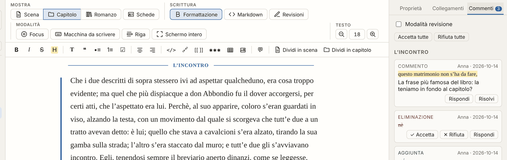

**Un esempio.** Nella scena **L'incontro** del progetto di esempio Anna ha lasciato un commento su «questo matrimonio non s'ha da fare» (il testo è evidenziato in giallo) e ha proposto di scrivere «né» al posto di «nè»: la vecchia parola è barrata in rosso, la nuova sottolineata in verde. Nella scheda **Commenti** premi **Accetta** sull'aggiunta e sull'eliminazione: nel testo resta solo «né». Al commento puoi rispondere con **Rispondi**, oppure chiuderlo con **Risolvi** quando la questione è decisa.

Se un'altra persona sta già lavorando su una scena, per te quella scena è in sola lettura e un avviso dice chi la sta modificando. **Modifica comunque** sblocca la scena, ma le modifiche rischiano di sovrapporsi.

Se Dropbox o Drive creano una **copia in conflitto** (succede quando due persone modificano lo stesso file nello stesso momento), in alto compare un avviso. Aprendolo vedi le due versioni a confronto e scegli: **Tieni il file**, **Usa la copia**, oppure **Unisci come revisioni** per decidere le differenze una per una.

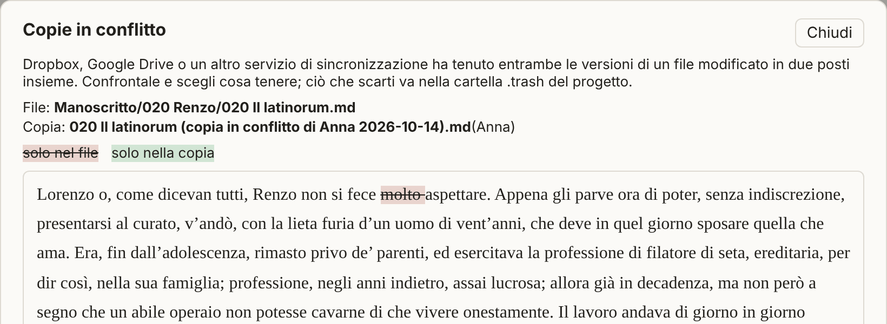

### Approfondimento

- Commenti e revisioni sono scritti nel testo con [CriticMarkup](https://github.com/CriticMarkup/CriticMarkup-toolkit), seguiti da una firma con nome e data:

```markdown
{==questo matrimonio non s’ha da fare,==}{>>@Anna 2026-10-14: La frase più famosa del libro: la teniamo in fondo al capitolo?<<}{>>@Luca 2026-10-15: sì<<}
{--nè--}{>>@Anna 2026-10-14<<}{++né++}{>>@Anna 2026-10-14<<} domani, nè mai.
```

Si legge così: `{== ==}` racchiude il testo commentato, `{>> <<}` contiene il commento (o la firma di una revisione), `{-- --}` è il testo da togliere e `{++ ++}` quello da aggiungere. Ogni risposta è un altro `{>> <<}` in coda.

- In Obsidian questi segni si vedono così come sono; Dante li nasconde e disegna il testo come un programma di videoscrittura. Il pulsante **Markdown** li mostra.
- In modalità revisione, scrivere dentro una propria aggiunta la modifica direttamente; scrivere dentro l'aggiunta di un altro o in un testo evidenziato modifica il testo senza creare una nuova revisione.
- **Risolvi** toglie la discussione dal file. Nell'esportazione i commenti spariscono e le revisioni in sospeso vengono accettate o rifiutate, come scegli.
- **Presenza**: ogni copia di Dante scrive in `.dante/presence/<nome>.json` cosa sta modificando, e lo aggiorna ogni minuto. Chi apre per primo una scena la tiene; una presenza non aggiornata da tre minuti (per esempio dopo che il computer si è spento) non conta più.
- **Copie in conflitto**: Dante riconosce i nomi usati da Dropbox ("copia in conflitto di Anna…"), Google Drive ("(1)" accanto all'originale), Syncthing e servizi simili, e le tiene fuori dall'albero. Quello che scarti va in `.trash`; prima di unire, un'istantanea conserva il file com'era. Le revisioni nate da un'unione sono firmate da chi ha scritto la copia.
- Il registro delle parole scritte è un file per persona, `.dante/sessions/<nome>.json`, così due persone non scrivono mai lo stesso file.

## 11. Viste

### Come si fa

Una vista mostra scene, capitoli o schede della Bibbia in un colpo d'occhio, come **Tabella**, **Lista**, **Schede**, **Bacheca** o **Linea del tempo**.

1. Nella sezione **Viste**, la prima volta, premi **Crea le viste di partenza**: avrai una bacheca delle scene per stato e una tabella delle scene. Oppure premi **Nuova vista** e dalle un nome.
2. In alto scegli come mostrarla (tabella, lista, schede, bacheca, linea del tempo).
3. Con **⚙ Impostazioni** scegli cosa elencare (scene, capitoli e parti, tutte le note o un tipo della Bibbia), da quali cartelle, con quali condizioni (**Solo se**), come ordinare, come raggruppare e quali campi mostrare.

Il progetto di esempio ha già quattro viste. La **Bacheca** mette le scene in colonne secondo lo stato:

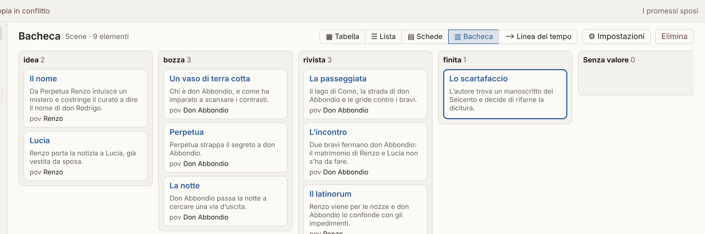

La tabella **Scene** elenca capitolo, stato, punto di vista, data e parole di ogni scena; qui con le impostazioni aperte sopra:

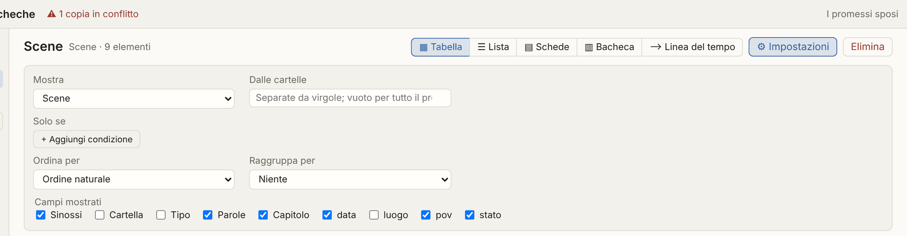

Il **Tempo della storia** mette le scene sulla linea del tempo secondo la proprietà «data»: si vede subito che il capitolo 1 si svolge il 7 novembre 1628 e il capitolo 2 il giorno dopo.

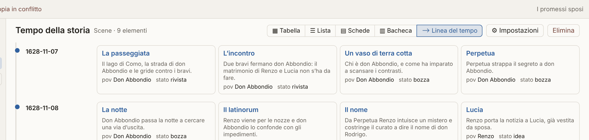

*Esempio:* vuoi vedere solo le scene raccontate da Renzo. Apri la tabella **Scene**, premi **⚙ Impostazioni**, poi **+ Aggiungi condizione**, scegli «pov» e scrivi «Renzo». Restano le tre scene del capitolo 2 in cui il punto di vista è il suo.

Dalla vista puoi anche modificare le note:

- **Tabella**: clic su un'intestazione per ordinare; clic su una cella per cambiare il valore nella nota.
- **Bacheca**: trascina una scheda in un'altra colonna per cambiarne la proprietà (per esempio da "bozza" a "rivista"); **Nuova colonna** aggiunge un gruppo.
- **Linea del tempo**: trascina un elemento in un altro momento per cambiarne la data. Le note senza data sono elencate sotto.

### Approfondimento

Ogni vista è un file YAML nella cartella `Viste/`, quindi si sincronizza con il progetto e si può scrivere a mano:

```yaml
type: kanban            # table, list, cards, kanban, timeline
items: scene            # scene, chapter, note, o un tipo come character
source: Manoscritto     # cartelle da cui prendere le note; vuoto = tutto il progetto
filter:
  pov: Renzo            # tutte le condizioni devono valere; una lista = uno qualsiasi dei valori
sort: -date             # il meno inverte l'ordine; vuoto = ordine del manoscritto
group_by: stato         # colonne della bacheca, o gruppi degli altri tipi
groups: [idea, bozza, rivista, finita]   # in quest'ordine, anche se vuoti
fields: [pov, words]    # campi mostrati; anche name, folder, type, words, chapter
date: data              # solo linea del tempo: la proprietà con la data
end: fino_a             # solo linea del tempo: fine, facoltativa
```

- Quando cambi le impostazioni dall'app il file viene riscritto subito, senza gli eventuali commenti scritti a mano.
- Le righe dei capitoli leggono e scrivono le proprietà della nota cartella e contano le parole delle loro scene. In una bacheca raggruppata per capitolo, spostare una scena la sposta davvero in quel capitolo.
- Se un raggruppamento usa una proprietà con valori ammessi, le colonne sono quei valori.
- Date ammesse nella linea del tempo: `1987`, `1987-03`, `1987-03-12`, anni negativi, oppure numeri semplici come il giorno della storia.
- Ogni elemento mostra la sinossi sotto il nome, a meno che il file della vista dica `synopsis: false`.
- Copie in conflitto, modelli e le viste stesse non compaiono mai.

## 12. Statistiche e obiettivi

### Come si fa

La sezione **Statistiche** mostra:

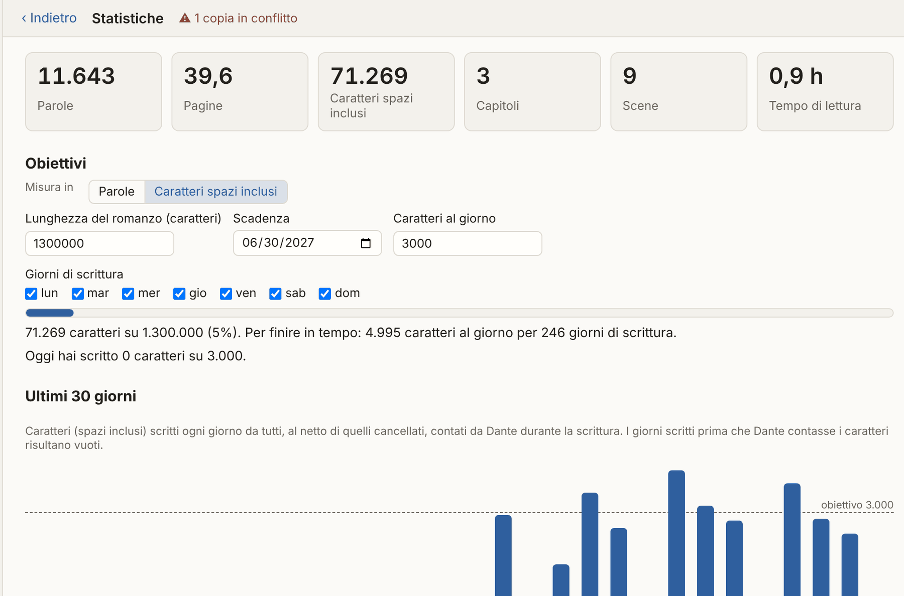

- **Totali**: parole, pagine, capitoli, scene e tempo di lettura del romanzo.
- **Obiettivi**: scrivi la lunghezza che vuoi raggiungere, la scadenza, le parole al giorno e i tuoi giorni di scrittura. Dante dice a che punto sei, quante parole al giorno servono per finire in tempo, quante ne hai scritte oggi e da quanti giorni di fila raggiungi l'obiettivo. I giorni non spuntati sono di riposo e non interrompono la serie.
- **Ultimi 30 giorni**: un grafico delle parole scritte ogni giorno, e una tabella per ogni persona che lavora al progetto.
- **Lunghezza**: quanto è lunga ogni scena, ogni capitolo o ogni parte, con la quota sul totale, una barra, la media, la mediana, la più breve e la più lunga. Due gruppi di pulsanti sopra la tabella scelgono la misura (**Parole** o **Caratteri spazi inclusi**) e il livello (**Scene**, **Capitoli**, **Parti**; Parti compare solo se il romanzo ha parti). La scelta resta per le volte successive.
- **Citazioni**: quante volte le scene nominano ogni personaggio, luogo o altra scheda della Bibbia, con la prima e l'ultima scena in cui compare, e le schede mai nominate.
- **Parole più usate**: senza articoli, preposizioni e altre parole comunissime.

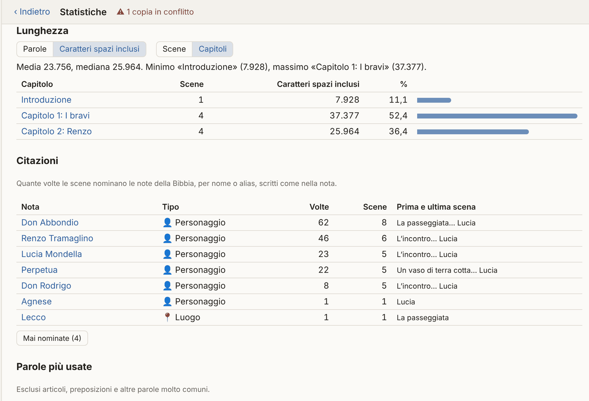

*Esempio:* nel progetto di esempio la tabella **Citazioni** dice che don Abbondio è nominato 62 volte in 8 scene, Lucia 23 volte, Agnese una sola volta, nella scena *Lucia*. **Lunghezza** al livello Capitoli mostra che il Capitolo 1 da solo è più della metà del testo (52%).

Le parole scritte oggi compaiono anche nel pannello a destra mentre scrivi. Per contarle, Dante ha bisogno del tuo nome nelle impostazioni.

Per le scene singole, il pannello **Proprietà** mostra parole, caratteri e tempo di lettura.

### Approfondimento

- **Pagine**: di base una pagina è una cartella editoriale da 1.800 caratteri spazi inclusi. In **Impostazioni → Pagine** si può contare invece in parole (250 è un valore diffuso). In `dante.yaml`: `pages: {unit: characters, size: 1800}`.
- **Obiettivi** in `dante.yaml`: `goals: {words, deadline, daily, days}`, dove `days` elenca i giorni di scrittura da 1 (lunedì) a 7 (domenica). Le parole necessarie sono distribuite solo su quei giorni.
- **Registro di scrittura**: Dante conta, mentre scrivi, le parole aggiunte e cancellate e i minuti passati a scrivere, giorno per giorno, in `.dante/sessions/<nome>.json`. Parole scritte con altri programmi non entrano nel registro, ma entrano nei totali.
- **Citazioni**: contano il nome della scheda e i suoi alias scritti esattamente come nella nota, maiuscole comprese.
- **Lunghezza**: al livello Parti, prologo, epilogo e capitoli fuori dalle parti finiscono in un'unica riga "Fuori dalle parti", che non entra in media e mediana. Al livello Scene la colonna Dove indica il capitolo (o la parte) della scena. Misura e livello sono impostazioni del computer (`statsUnit`, `statsLevel`), non di `dante.yaml`: ognuno sceglie la sua.

## 13. Esportare in Word, PDF ed EPUB

### Come si fa

1. Apri la sezione **Esportazione**.
2. Scegli il **Formato**: **Word (DOCX)** da mandare ad agenti ed editori o per continuare a lavorarci; **PDF** pronto da leggere o stampare; **EPUB** per i lettori di ebook e i negozi online; **Markdown** per avere tutto il romanzo in un unico file di testo, da aprire con qualsiasi editor.
3. Scegli **Cosa esportare**: tutto il romanzo o una sua parte.
4. Scegli l'**Impaginazione**: **Manoscritto standard** (il formato che si invia a editori e agenti) oppure **Libro impaginato** (da leggere e stampare).
5. Se vuoi, regola il resto: formato della pagina, font, corpo, interlinea, rientro, cosa mettere prima di parti, capitoli e scene, frontespizio, intestazione, dialoghi e tipografia, dedica, esergo, ringraziamenti e gli altri testi intorno al romanzo.
6. Decidi cosa fare delle **Revisioni in sospeso**: accettarle o rifiutarle tutte nel file esportato.
7. Premi **Esporta**. Alla fine Dante dice quante parole e pagine ha esportato e offre **Apri il file** e **Mostra nella cartella**.

Le scelte restano salvate nel progetto: la volta dopo basta premere Esporta.

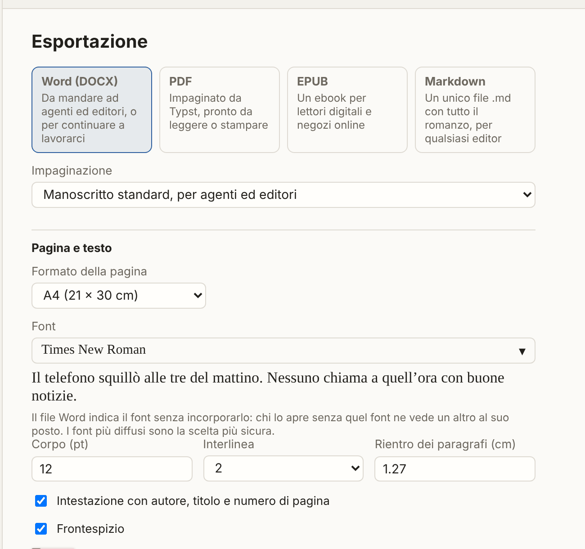

*Esempio:* per mandare il manoscritto a un editore scegli **Word (DOCX)** e **Manoscritto standard**: Times New Roman 12, interlinea doppia, intestazione con autore, titolo e numero di pagina, frontespizio. Per una copia da leggere sul tablet scegli **EPUB**.

### Approfondimento

- Il progetto non viene mai toccato: l'esportazione lavora su una copia del testo. I commenti vengono tolti.
- **DOCX** è creato direttamente da Dante. Il file indica il font senza incorporarlo: chi lo apre senza quel font ne vede un altro, per questo i font più diffusi sono la scelta più sicura.
- **PDF** è composto da [Typst](https://typst.app), incluso nell'app: non c'è niente da installare. Usa i font del computer, più Libertinus Serif e New Computer Modern quando il font scelto manca.
- **EPUB 3**: un file per ogni parte, capitolo e pagina di apertura o chiusura, con indice dei capitoli dentro le parti. Il carattere e la dimensione li sceglie in buona parte chi legge; si può modificare il foglio di stile (CSS). Il libro mantiene lo stesso identificativo tra un'esportazione e l'altra (`export.epubId` in `dante.yaml`).
- **Tabelle e immagini** passano in tutti i formati. In Word la tabella occupa la larghezza del testo e la riga di intestazione si ripete a ogni pagina. Nel PDF le immagini sono lette dalla cartella del progetto: vanno bene PNG, JPEG, GIF, SVG e WebP. In Word ed EPUB i formati che non accettano (WebP, SVG e altri) sono convertiti in PNG. Nel Markdown esportato le immagini restano riferimenti ai file del progetto.
- I titoli usano il `title` di ogni capitolo o scena; `published_title` lo sostituisce solo nell'esportazione, utile se il titolo di lavoro è diverso da quello definitivo.
- Tutte le impostazioni di esportazione sono salvate in `dante.yaml` sotto `export`. Un nuovo progetto parte dalle ultime usate.

## 14. Aprire il progetto in Obsidian

### Come si fa

In Obsidian scegli **Apri cartella come vault** e seleziona la cartella del progetto. Scene e schede si leggono e si modificano normalmente, anche dal telefono se la cartella è sincronizzata. Quando torni in Dante, le modifiche ci sono già.

Due accortezze:

- Per spostare, rinominare o unire scene e capitoli usa Dante: in Obsidian bisogna rispettare a mano i numeri all'inizio dei nomi.
- Non cancellare i segni strani tra parentesi graffe: sono commenti e revisioni (capitolo 10).

### Approfondimento

| Cosa | In Dante | In Obsidian |
| --- | --- | --- |
| Scene e note | testo formattato | uguale |
| Proprietà | pannello Proprietà | pannello Proprietà, stessi valori |
| Collegamenti `[[…]]` e alias | uguale | uguale |
| Righe vuote tra paragrafi | riga con un ¶ chiaro | riga vuota in lettura; in modifica può comparire `&nbsp;` |
| Commenti e revisioni | nuvolette, sottolineato e barrato | segni CriticMarkup visibili: `{++ … ++}`, `{-- … --}`, `{>> … <<}` |
| Titoli "Capitolo 3" | calcolati da Dante | non compaiono: si vede il nome del file |
| Viste | tabelle, bacheche, linee del tempo | file YAML in `Viste/` |
| Istantanee, presenze, registro | gestiti da Dante | file in `.dante/`, da lasciare stare |

Obsidian crea la sua cartella `.obsidian/`, che Dante ignora. Un file rinominato in Obsidian senza prefisso numerico finisce in fondo al suo capitolo.

Anche un assistente di intelligenza artificiale che lavora sui file (Claude Code, Codex, Cursor e simili) può leggere e modificare un progetto di Dante. Perché rispetti le stesse regole (numeri nei nomi, note cartella, collegamenti, commenti e revisioni, file in `.dante/` da non toccare), dagli la skill in [`skills/dante`](../skills/dante/SKILL.md): un file di istruzioni in inglese, con uno script che mostra il manoscritto in ordine e segnala i problemi di struttura. In Claude Code basta copiare la cartella `skills/dante` in `.claude/skills/` del progetto o della tua cartella utente; con altri assistenti si incolla o si allega `SKILL.md`.

## 15. Scorciatoie da tastiera

### Come si fa

Su Mac si usa Cmd, su Windows Ctrl; anche le etichette dei pulsanti nell'app si adattano al sistema. Passando col mouse su un pulsante, il suggerimento mostra la sua scorciatoia.

**Scrittura**

| Scorciatoia | Azione |
| --- | --- |
| Cmd+Invio | Dividi in scena: il testo dopo il cursore va in una nuova scena |
| Cmd+Maiusc+Invio | Dividi in capitolo: apre un nuovo capitolo dal cursore |
| Alt+Invio | riga vuota tra due paragrafi, senza nuova scena |
| Cmd+B | grassetto |
| Cmd+I | corsivo |
| Cmd+Maiusc+X | barrato |
| Cmd+Maiusc+H | evidenziato |
| Cmd+Alt+M | commento sul testo selezionato |
| Cmd+K | link |
| Cmd+E | codice |
| Cmd+Maiusc+7 | elenco numerato |
| Cmd+Maiusc+8 | elenco puntato |
| Cmd+Maiusc+9 | casella di spunta |
| Cmd+Maiusc+. | citazione |
| Cmd+Maiusc+E | centra il paragrafo (di nuovo: torna a sinistra) |
| Cmd+Maiusc+R | allinea il paragrafo a destra (di nuovo: torna a sinistra) |
| Cmd+clic | segue un collegamento sulla riga che stai modificando |
| Cmd+Z | annulla, anche una correzione tipografica automatica |
| Cmd+Invio (in un commento) | aggiunge il commento o la risposta |

**Albero del manoscritto**

| Scorciatoia | Azione |
| --- | --- |
| Invio | apre la scena; apre o chiude un capitolo |
| F2 o doppio clic | rinomina |
| Alt+Cmd+↑ / ↓ | sposta su o giù di un posto |
| Freccia destra / sinistra | apre o chiude un capitolo o una parte |
| Cmd+clic | aggiunge una scena alla scelta, per fonderle |
| Cmd+Backspace o Canc | sposta nel cestino |

**Finestra**

| Scorciatoia | Azione |
| --- | --- |
| Cmd+F | cerca nella scena o nella nota |
| Cmd+G / Maiusc+Cmd+G | occorrenza successiva / precedente |
| Cmd+Maiusc+F | apre e chiude la ricerca nel progetto |
| Alt+Cmd+F | trova e sostituisci in tutto il progetto |
| Cmd++ / Cmd+− / Cmd+0 | ingrandisce, riduce, ripristina il testo |
| Esc | esce da schermo intero, chiude ricerca e finestre, annulla una modifica in corso |
| Cmd+\\ (tastiera italiana: Cmd+ù) | apre un pannello a fianco, scegliendo con la ricerca cosa mostrare |
| Alt+Cmd+\\ | scambia il pannello con ciò che mostra la sezione |
| Alt+Cmd+← / Alt+Cmd+→ | sposta il cursore tra la sezione e i pannelli |
| Cmd+W | chiude il pannello che ha il cursore |

### Approfondimento

Da verificare: con la tastiera italiana Cmd+Maiusc+7/8/9 e Cmd+Maiusc+. potrebbero non funzionare, perché Maiusc con quei tasti produce altri caratteri (/, (, ) e :). In quel caso si usano i pulsanti della barra di formattazione.

## 16. Pannelli affiancati

### Come si fa

Accanto al testo puoi tenere aperte fino a due cose in più: un'altra scena, un capitolo, la scheda di un personaggio, una nota, un'immagine o una vista come la linea del tempo. Ogni pannello si può modificare, e resta aperto anche quando cambi sezione.

- **Aprire a fianco.** Tieni premuto **Alt** (Option su Mac) mentre fai clic: su un link `[[Lucia Mondella]]` nel testo, su una scena nell'albero, su una scheda della Bibbia, su una nota, su una vista o su un risultato della ricerca. Puoi anche usare la voce **Apri a fianco** del menu del tasto destro, il pulsante ⧉ nella scheda Collegamenti, oppure trascinare una voce sul bordo destro della finestra.
- **Schede della scena.** Il pulsante **Schede** nella barra del Manoscritto apre un pannello che mostra le schede della Bibbia nominate nella scena che stai scrivendo (per nome o alias) o collegate con `[[…]]`. Scrivi «Agnese» e la sua scheda compare tra le linguette in alto; passando a un'altra scena le linguette cambiano.

  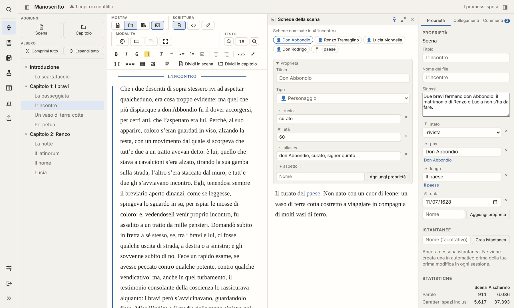

  *Esempio:* nella scena **L'incontro** il pannello mostra le linguette di don Abbondio, Renzo, Lucia, don Rodrigo e del paese: sono le schede nominate nel testo o nelle proprietà. Un clic su una linguetta mostra quella scheda, che puoi anche modificare.
- **Il pannello successivo.** La prossima cosa aperta a fianco prende il posto del pannello non fissato. Con la puntina 📌 il pannello resta e il nuovo se ne apre accanto.
- **I pulsanti del pannello.** ⤢ porta il contenuto al centro, nella sua sezione; ⇄ lo scambia con ciò che c'è al centro; × chiude il pannello. Trascina il bordo sinistro per allargarlo, doppio clic per dare al testo e ai pannelli la stessa larghezza.
- **Il pannello a destra** (Proprietà, Collegamenti, Commenti) mostra ciò che ha il cursore: la scena al centro o il contenuto del pannello in cui hai fatto clic.
- **Le viste a fianco** evidenziano la scena che stai scrivendo, e un clic su una voce la apre al centro.

La stessa scena può stare al centro e in un pannello: ciò che scrivi in uno compare subito nell'altro.

### Approfondimento

- Ogni file aperto ha un solo documento in memoria, condiviso da tutti gli editor che lo mostrano: il salvataggio, le istantanee automatiche e il ricaricamento dopo una modifica sul disco passano da lì, quindi due editor dello stesso file non si sovrascrivono.
- Prima di rinominare o spostare file, Dante scrive ciò che gli editor hanno ancora in memoria; i pannelli seguono le voci rinominate e si chiudono da soli se la voce viene eliminata.
- La disposizione dei pannelli è salvata su questo computer, per ogni progetto, e non nella cartella del romanzo: lo schermo di un coautore non cambia.
- Su Mac Cmd+W non chiude più la finestra: il menu dell'app lo usa per chiudere il pannello.
- Fanno eccezione Esporta, Impostazioni e Statistiche, che usano tutta la larghezza: lì i pannelli sono nascosti, non chiusi.

## 17. Aggiornamenti

### Come si fa

1. A ogni avvio Dante controlla se c'è una nuova versione, e poi di nuovo ogni sei ore se resta aperto. Se non c'è, compare per qualche secondo in basso a destra **Dante 0.1.… è aggiornato**; se il controllo non riesce (per esempio senza connessione) lo dice nello stesso punto. Quando c'è una nuova versione compare un riquadro in basso a destra: **È disponibile Dante 0.1.…**.

   
2. Per sapere cosa cambia premi **Novità**: il riquadro elenca le novità di ogni versione uscita dopo quella installata, in italiano o in inglese secondo la lingua di Dante. Lo stesso elenco è nella pagina [Novità](novita.md) e nella pagina della versione su GitHub.
3. Premi **Aggiorna e riavvia**. Dante salva il testo aperto, scarica la nuova versione, la installa e si riapre. Su Windows compare per qualche secondo la finestra dell'installatore.
4. Con **Più tardi** il riquadro sparisce e torna al prossimo avvio.

Per controllare a mano, sul Mac scegli **Dante** > **Check for Updates…** nella barra dei menu; ovunque puoi aprire **Impostazioni** > **Aggiornamenti** e premere **Cerca aggiornamenti**. Lì c'è anche il numero della versione installata, utile quando segnali un problema, e la casella per non cercare aggiornamenti all'avvio.

La copia portatile per Windows non si aggiorna da sola: scarica il nuovo zip e sostituisci la cartella, tenendo la sottocartella `dante-data`.

### Approfondimento

- Ogni versione pubblicata nell'anteprima *preview* ha un numero proprio, `0.1.<numero della compilazione su GitHub>`, che cresce a ogni modifica unita in main. La copia installata lo confronta con quello scritto in `latest.json`, un file della stessa pagina di anteprima.
- I file dell'aggiornamento sono firmati con una chiave che solo il repository conosce (il segreto `TAURI_SIGNING_PRIVATE_KEY` di GitHub). Dante verifica la firma con la chiave pubblica scritta in `tauri.conf.json` e rifiuta un file non firmato o modificato. Se la chiave privata andasse persa, le copie installate non potrebbero più aggiornarsi da sole e andrebbero reinstallate a mano una volta.
- Cosa viene sostituito: su Mac l'app in Applicazioni (con il file `.app.tar.gz`), su Windows il programma installato (con l'installatore, che mostra solo una barra di avanzamento), su Linux l'AppImage o il pacchetto .deb/.rpm (per i pacchetti il sistema chiede la password di amministratore). I progetti e le impostazioni non vengono toccati.
- Dante non cerca aggiornamenti nella copia portatile né quando è avviato con `npm run tauri dev` (anche dal file *Avvia Dante.command*, che scarica già le modifiche con `git pull`), perché in quei casi non c'è un'installazione da sostituire. Lì il controllo all'avvio non mostra niente; dal menu dice che questa copia non si aggiorna da sola.
- Senza connessione la ricerca all'avvio fallisce in silenzio; quella dalle Impostazioni mostra l'errore.
- Le novità si scrivono a mano in `docs/novita.md` e `docs/whats-new.md`, sotto **Prossima versione** / **Next version**, nella stessa modifica che introduce la funzione. Quando la compilazione su main pubblica una versione, `.github/news.py` sposta quelle righe sotto il titolo `0.1.N · data` (con un commit su main), le mette nella pagina della versione e le scrive in `latest.json`, da cui le legge il riquadro dell'aggiornamento.

## 18. Dante nel browser

Dante esiste anche come versione web, per chi non può o non vuole installare l'app, per esempio su un Mac fermo a Catalina. È lo stesso programma, con alcuni limiti elencati sotto. L'app resta la versione principale: se puoi installarla, usa quella.

### Come si fa

1. Apri **https://lucadj77.github.io/dante/** con **Chrome**, **Edge** o **Brave**. Safari e Firefox aprono Dante, ma non possono lavorare sulle cartelle del computer: lì funzionano solo il progetto di esempio e la prova di un'importazione da Word, che non viene salvata.
2. Per avere Dante come un'app, con una finestra propria e l'icona nel Dock o nel menu Start, premi l'icona **Installa** a destra nella barra degli indirizzi (in Chrome: un monitor con una freccia). È facoltativo, ma comodo.
3. Premi **Apri cartella…** e scegli la cartella del romanzo, oppure **Nuovo progetto** e scegli dove crearlo. Il browser chiede il permesso di modificare la cartella: rispondi **Consenti** o, se c'è, **Consenti a ogni visita**, così la volta dopo il progetto si riapre dai recenti senza altre domande.
4. Da qui Dante funziona come l'app: il testo viene salvato nei file della cartella mentre scrivi.
5. Dopo la prima apertura Dante funziona anche **senza connessione**. Quando c'è rete e una versione nuova, compare il riquadro dell'aggiornamento come nell'app (capitolo 17): **Aggiorna e riavvia** ricarica Dante con la nuova versione.

Se chiudi la scheda subito dopo aver scritto, il browser può chiedere se vuoi davvero uscire: scegli **Resta** (o Annulla), aspetta un secondo e chiudi di nuovo. In quel momento Dante sta ancora scrivendo le ultime parole.

**Cosa non c'è, o funziona diversamente, nel browser:**

- **Niente PDF**: Word, EPUB e Markdown sì, il PDF per ora solo nell'app.
- **Spostare capitoli e parti è più lento**: il browser non sa rinominare le cartelle, quindi Dante copia i file nella nuova posizione e poi cancella la vecchia. Non chiudere il browser mentre lo fa; se succede, Dante completa lo spostamento alla prossima apertura. Chi collabora via Drive o Dropbox riceve più modifiche del solito.
- **Le modifiche fatte da fuori** (un coautore, Obsidian, un'altra app) compaiono dopo qualche secondo, oppure quando torni sulla scheda di Dante, non subito come nell'app.
- **Niente "mostra nel Finder" né "apri con l'app predefinita"**: Dante dice in quale cartella si trova il file e offre di scaricarne una copia. Le esportazioni finiscono nella cartella `export` del progetto, oppure dove scegli con **Salva in un'altra posizione…**.
- **Cmd+W chiude la scheda del browser**, non il pannello: per chiudere il pannello usa **Alt+Cmd+W** (su Windows e Linux Alt+Ctrl+W).
- **Un progetto si apre in una sola scheda alla volta**: se è già aperto altrove, Dante lo dice. Due schede sullo stesso progetto scriverebbero una sopra l'altra.
- **Immagini da un indirizzo web**: molti siti non permettono al browser di scaricarle. In quel caso salva l'immagine sul computer e trascinala in Dante.
- **Doppio clic su `Titolo.dante`**: funziona solo con Dante installato dal browser (punto 2) e chiede un clic in più per dare il permesso sulla cartella.

### Approfondimento

- **Privacy**: il testo, le note, le impostazioni e il tuo nome non lasciano mai il computer. Il browser lavora direttamente sui file della cartella scelta; non c'è un server di Dante, né account, né statistiche di visita. In rete vanno solo le richieste dei file del programma e del file `version.json` che dice se c'è una versione nuova, verso GitHub Pages, che come ogni sito vede l'indirizzo IP e il tipo di browser. Il download di un'immagine da un indirizzo web avviene solo quando lo chiedi.
- **Come funziona offline**: un *service worker* conserva nel browser tutti i file della versione scaricata, come un blocco unico. Una versione nuova viene scaricata intera e prende il posto della vecchia solo con **Aggiorna e riavvia** (o alla prossima apertura con nessuna finestra di Dante aperta), così non si mescolano mai file di due versioni.
- **Dove restano le cose**: le impostazioni dell'applicazione in `localStorage`, le cartelle autorizzate (le "maniglie" che il browser dà a Dante) in IndexedDB, entrambi nel profilo del browser. Dante chiede al browser di non cancellarli quando manca spazio. Nel caso peggiore si perdono le impostazioni e l'elenco dei recenti, non il romanzo, che è nella cartella.
- **Quali cartelle**: Chrome rifiuta alcune cartelle di sistema e la cartella Inizio o Documenti nel loro insieme; una sottocartella di progetto va bene, comprese quelle di Google Drive, Dropbox, OneDrive e iCloud Drive.
- **Spostamenti interrotti**: mentre copia una cartella, Dante scrive in `.dante/moving.json` da dove a dove sta spostando. All'apertura successiva, se il file c'è, completa la copia o la cancellazione dell'originale e lo toglie.
- **Modifiche da fuori**: il browser non avvisa quando un file cambia, quindi Dante ricontrolla la cartella (nomi, dimensioni e date dei file) ogni pochi secondi e quando la scheda torna in primo piano. Le cartelle `.dante`, `export` e `.trash` sono escluse, come nell'app.
- **Due schede**: Dante "tiene" la cartella aperta con un blocco del browser (*Web Locks*); una seconda scheda o finestra dello stesso browser non può aprirla finché la prima non chiude il progetto o la scheda.
- **macOS Catalina**: l'ultima versione di Chrome, Edge e Brave per macOS 10.15 è basata su Chromium 128 (2024) e non riceve più aggiornamenti di sicurezza. Dante ci funziona, ma è bene saperlo, perché lo stesso browser serve anche per navigare. Su Catalina Brave pubblica ancora la sua ultima versione; Chrome già installato resta alla 128.
- **Pubblicazione**: a ogni modifica unita in `main` la compilazione su GitHub prepara la versione web (`npm run build:web`, con `VITE_DANTE_WEB=1`) con lo stesso numero `0.1.N` dell'app, scrive `version.json` con le novità e la pubblica su GitHub Pages (`.github/workflows/builds.yml`, lavoro *web*). Per provarla in locale: `DANTE_BASE=/dante npm run build:web` e servire la cartella `build` all'indirizzo `/dante/`.
- **Indirizzo**: tutto ciò che sta sotto `lucadj77.github.io` è per il browser lo stesso sito. Se un giorno quell'account pubblicasse altre pagine con GitHub Pages, quelle potrebbero leggere i dati di Dante nel browser. Un dominio proprio (per esempio `dante.<dominio>.it`) toglie il problema e si collega a GitHub Pages senza cambiare il resto.

## 19. Copie di sicurezza

Una copia di sicurezza è un file zip con tutto il progetto, tenuto sul computer fuori dalla cartella del romanzo. Serve se la cartella si rovina, per esempio per un problema di sincronizzazione con Drive o Dropbox, o se un file viene cancellato per sbaglio fuori da Dante.

### Come si fa

- Dante crea una copia da solo quando chiudi il progetto o esci da Dante, se qualcosa è cambiato dall'ultima.
- Le copie sono nella cartella **Documenti/Dante backup**, in una sottocartella per ogni romanzo. Di ogni romanzo restano le 10 più recenti; le più vecchie si cancellano da sole.
- In **Impostazioni → Copie di sicurezza** puoi scegliere un'altra cartella, quante copie tenere, se crearle alla chiusura, e vedere quando è stata fatta l'ultima. **Crea una copia ora** ne fa una subito, **Mostra le copie** apre la cartella.
- **Per riprendere un progetto**: apri lo zip (doppio clic), sposta la cartella che contiene dove vuoi e aprila con **Apri cartella…** dalla schermata iniziale. Conviene non sovrascrivere la cartella rovinata finché non hai controllato che la copia sia quella giusta.
- **Nel browser** Dante non può scrivere fuori dalla cartella del romanzo: in Impostazioni c'è **Scarica una copia di sicurezza (zip)**, da premere ogni tanto e conservare in un posto sicuro.

### Approfondimento

- Il nome di ogni copia è il nome della cartella del progetto con data e ora, per esempio `Il mio romanzo 2026-10-26 18-02-11.zip`. Dentro c'è la cartella del progetto com'era.
- Restano fuori la cartella `export` (si rifà dal romanzo), il cestino `.trash`, le cartelle `.obsidian` e `.git` e i file di presenza dei coautori. Le istantanee in `.dante/snapshots` ci sono.
- Due romanzi con lo stesso nome di cartella hanno sottocartelle diverse («Il mio romanzo», «Il mio romanzo 2»): un file `.dante-backup-of` nella sottocartella dice a quale progetto appartiene.
- La copia si scrive prima con un nome provvisorio e prende il suo nome solo quando è completa, quindi uno zip con il nome giusto non è mai a metà.
- La cartella scelta vale per tutti i progetti di questo computer, come le altre impostazioni dell'applicazione. Una cartella sincronizzata (Drive, Dropbox, iCloud) va bene come seconda protezione, ma tiene la copia sullo stesso servizio che potrebbe aver causato il problema.
