# Dante, user guide

Updated on 11 November 2026.

Every chapter of the guide has two parts. **How to** explains in a few steps how to use a feature, without technical terms. **In depth** explains what happens in the files of the novel, for those who want to understand more or to work outside Dante too. To begin, the first parts of chapters 1-5 are enough, or the page [First steps](first-steps.md), which also opens inside Dante from the **Help** icon (chapter 20).

The pictures and the examples come from the **sample project** of the Italian interface: the first chapters of *I promessi sposi* (*The Betrothed*), with the cards of characters and places, some views, a comment and a revision by a co-author, Anna. For this reason the pictures show the commands in Italian. With the interface in English, **Try the sample project** on the start screen opens the first chapters of *Pride and Prejudice*, built the same way: open it and try each step as you read, with a scene of your choice where the guide names one. The changes are not saved anywhere. Shortcuts are written first as on a Mac and then as on Windows and Linux, for example Cmd+F / Ctrl+F; those that are the same everywhere, such as Alt+Enter, are written once.

## Contents

1. [What Dante is](#1-what-dante-is)
2. [Installing and first launch](#2-installing-and-first-launch)
3. [Importing a novel from Word or Scrivener](#3-importing-a-novel-from-word-or-scrivener)
4. [The workspace](#4-the-workspace)
5. [Writing](#5-writing)
6. [Organising the manuscript](#6-organising-the-manuscript)
7. [Snapshots](#7-snapshots)
8. [Properties, title and synopsis](#8-properties-title-and-synopsis)
9. [Story Bible and Notes](#9-story-bible-and-notes)
10. [Writing with other people](#10-writing-with-other-people)
11. [Tables and boards](#11-tables-and-boards)
12. [Statistics and goals](#12-statistics-and-goals)
13. [Exporting to Word, PDF and EPUB](#13-exporting-to-word-pdf-and-epub)
14. [Opening the project in Obsidian](#14-opening-the-project-in-obsidian)
15. [Keyboard shortcuts](#15-keyboard-shortcuts)
16. [Side-by-side panels](#16-side-by-side-panels)
17. [Updates](#17-updates)
18. [Dante in the browser](#18-dante-in-the-browser)
19. [Backup copies](#19-backup-copies)
20. [Help inside Dante](#20-help-inside-dante)
21. [Appearance and spelling](#21-appearance-and-spelling)
22. [Gamebooks](#22-gamebooks)

## 1. What Dante is

### How to

Dante has one aim: to help you write your novel.

The novel is divided into scenes, gathered in chapters and, if you like, in parts: you can write one scene at a time or read the whole book in a row. Beside the text you have the cards of characters and places, your research and your notes. When you have finished, Dante prepares the book in Word, PDF or as an ebook.

Everything you write is saved automatically, with no Save button to press. Even if you close the window right after writing, Dante saves the last words first. If it cannot write a file (a disconnected or read-only folder), it says so above the text, keeps what you wrote and tries again every few seconds.

**An example.** In the sample project the novel is divided like this: an **Introduzione** (which Dante treats as a prologue), **Capitolo 1: I bravi** with four scenes (*La passeggiata*, *L'incontro*, *Un vaso di terra cotta*, *Perpetua*) and **Capitolo 2: Renzo**, with four more. The Story Bible holds the cards of Renzo, Lucia, don Abbondio, Perpetua, don Rodrigo and Agnese, and those of the places.

### In depth

A Dante project is an ordinary folder on the computer. Each scene is a text file in Markdown format, that is a plain text file with a few characters that set the formatting, readable even with Notepad. This gives you full control over your files, without being tied to one program.

Each chapter (or part) is a folder, and the settings of the novel are gathered in the file `dante.yaml`.

For this reason the same project also opens in Obsidian or in any text editor, syncs with Dropbox or Google Drive and can be saved with any backup system. If someone else changes a file, Dante notices and shows the new version.

## 2. Installing and first launch

### How to

1. Install Dante (see In depth for your system), or open it in the browser without installing anything (chapter 18). Those who try Dante for the first time find the steps one by one in the page [Trying Dante](beta.md) (in Italian).
2. When it opens, choose one of these ways:
   - **New project**: write the title, choose where to save it and press Create. Dante creates a folder named after the novel.
   - **Open folder…**: opens an existing project, also one created on another computer.
   - **Import from another format…**: creates a project from a novel already written elsewhere. You then choose from what: a Word, OpenDocument, RTF, Markdown or text document, or a Scrivener project with its synopses (chapter 3).
   - **Try the sample project**: the first chapters of *Pride and Prejudice* (of *I promessi sposi* if the interface is in Italian), to practise without risk. The changes stay in memory and vanish when you close the project.

   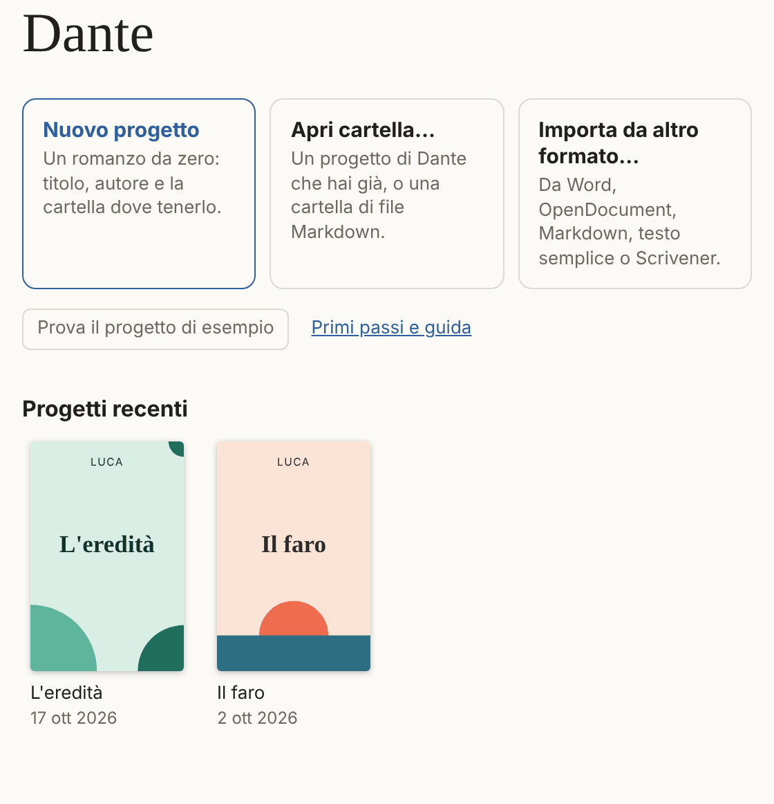

   With **New project** this form appears: title, **subtitle** (if there is one), authors, language and cover. The cover is a simple drawing that Dante prepares with the title and the authors: choose a shape and some colours, leave it as it is, or press **Use a picture of yours…** and choose a photo or a drawing from the computer. Everything can be changed later in **Settings** (chapter 13).

   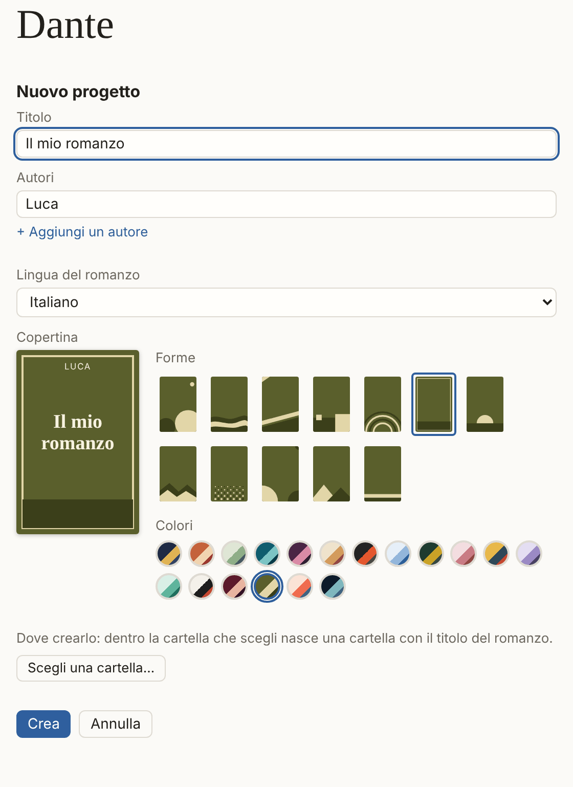
3. Open **Settings** (the gear in the bar on the left). On the left is the list of pages, in two groups: **This novel**, with the choices saved in the project, and **Dante on this computer**, with those that hold for every project; the box **Search the settings** at the top finds the right page from a word. In the page **You** of the second group write **your name**: it signs comments and revisions and counts the words you write each day. There is no button to save: every change saves itself after a moment.
4. In the tab **This novel** check **title**, **author** and **language of the novel** (Italian, English, Spanish or French, from a menu): the language decides, for example, the hyphenation and the names of the folders.

A new project already has the property **status** for the scenes (idea, draft, revised, done), the **point of view** linked to the characters and two views ready in the section **Tables and boards**: a board of the scenes by status and a table of the scenes (chapter 11). The first scene, empty, shows in grey three lines on how to begin, which vanish as soon as you write.

The projects opened recently stay listed on the start screen. To go back there, use **Close project** in the bar on the left, or Cmd+W / Ctrl+W with the cursor in the text. Dante remembers the size and the position of the window and reopens it as it was.

Every project also holds a file with the title of the novel and the extension **.dante** (for example `My novel.dante`). A **double click** on that file opens Dante with the novel already loaded; if Dante is already open, it moves to that novel after saving the text. The file can be renamed, but it must stay in the main folder of the project. It works with Dante installed, not with the portable copy.

### In depth

- **Where to download it**: the installer and the portable copy for Windows, the packages for Linux and the .dmg for Mac are in the Download section of [dante.lucadj.eu](https://dante.lucadj.eu), which leads to the latest published version. The files have the version number in their name, for example `Dante-setup-1.2.0.exe`.
- **macOS**: there are two files: `Dante-<version>-mac-apple-silicon.dmg` for Macs with an M1 chip or later (from 2020) and `Dante-<version>-mac-intel.dmg` for earlier ones. To know which one you have, open the Apple menu > About This Mac: if you see "Chip Apple" choose apple-silicon, if you see "Intel" choose intel. macOS 10.15 (Catalina) or later is needed; on Catalina first install the Safari updates up to 15.6 (System Preferences > Software Update). The engine that Catalina gives to apps is still that of Safari 13, too old for Dante: on Catalina Dante restarts by itself when it opens, to use the engine of the updated Safari (a solution still on trial). If Dante cannot start, in place of the empty window it shows a report to copy and send to those who look after Dante, with the versions of macOS and Safari added at the end; the same report can be copied at any time from Settings > Updates and support > Report a problem. Open the .dmg and drag Dante into the Applications folder. The app is not signed by Apple, so the first time macOS blocks it: close the warning, then go to System Settings > Privacy & Security and press **Open Anyway** beside the message about Dante. On versions of macOS before Sequoia a right click on the app > Open is enough. It is needed once for each .dmg you download; later versions arrive with the automatic update (chapter 17). With Dante in Applications the double click on .dante files works.
- The settings are in two groups. Those of the **novel** (title, structure, numbering, types, goals, export) are saved in `dante.yaml` inside the project and travel with it. Those of the **application** (interface language, theme, interface size, look of the text in the editor, spell checker, your name) stay on the computer and hold for every project.
- A new project is born with its main folders ready, named in the language of the novel (chapter 6).
- **Launch file**: Dante writes `Title.dante` in the main folder when it creates or opens a project that has none (it recognises it by any name with that extension, so a renamed file is not duplicated). Its content is only a note: what counts is the folder it is in. The installers register the extension: document type on the Mac, registry on Windows, MIME type `application/x-dante-project` with the .deb and .rpm packages on Linux. With the portable copy and the AppImage the association is missing, but *Open with* on the file works. A second copy of Dante started by the double click hands the file to the one already open and closes. Obsidian does not show the file, because it is not a format it knows.

## 3. Importing a novel from Word or Scrivener

### How to

1. On the start screen choose **Import from another format…**, then **Word, OpenDocument, RTF, Markdown or text**, and select the file (`.docx`, `.odt`, `.rtf`, `.md` or `.txt`).
2. The preview opens: at the top how many parts, chapters, scenes, words and characters with spaces Dante found; on the left the document as Dante reads it, with a label on the lines that become a part, a chapter or a scene and on the points where a new scene begins; on the right the result, chapter by chapter. A click on a chapter or a scene on the right shows on the left where it begins.
3. At the top, beside each heading level of the document, choose what it becomes: parts, chapters, titled scenes, or headings left in the text. Beside **Empty lines** choose whether one empty line (or two in a row) separates the scenes. If the scenes of the document are separated by `***` there is nothing to change; if Dante splits into scenes paragraphs that belong together, choose **Do not start scenes** (the empty lines vanish) or **Stay as blank lines, no new scenes** (each empty line between two paragraphs stays a blank line of the text, chapter 5).
4. If a line is read wrongly, click it and choose what it is: **Part title**, **Chapter title**, **Scene title**, **Scene break**, **Text** or **Leave out**. With **Also the lines like it** ticked the choice holds for all the lines of the same kind: for example all those with only a number, or all those that begin with "Chapter" followed by a number. **As Dante reads it** undoes the choice. The lines you chose yourself have a dot beside the label. An empty line too, which in the preview is a thin strip between two paragraphs, can be chosen with a click: marked as **Text** it stays a blank line of the text, without starting a scene.
5. Press **Continue**, choose title, authors and where to create the project, and press **Import**. **Back to the preview** reopens the preview with the choices made.

The Word file is not changed: Dante reads a copy of it.

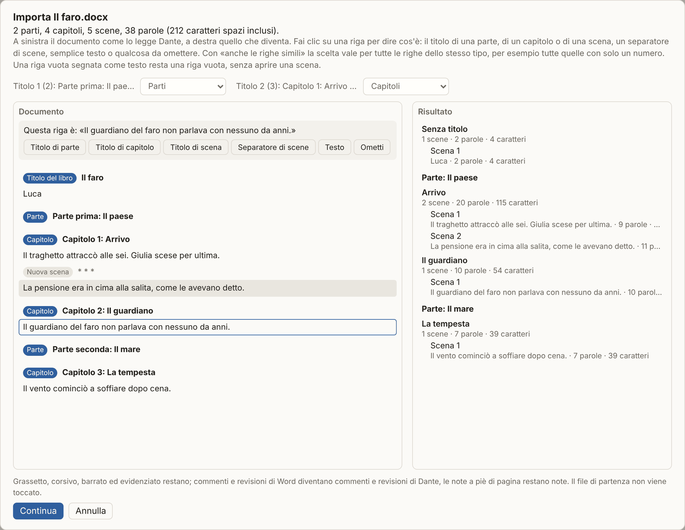

**An example.** In the document above the headings with the style Heading 1 are «Parte prima: Il paese» and «Parte seconda: Il mare», those with the style Heading 2 are «Capitolo 1: Arrivo» and so on. Dante proposes **Parts** for the first level and **Chapters** for the second. Inside chapter 1 a line with `***` separates two scenes, so the chapter becomes two scenes. If the chapters of your document were written with the style Heading 1 instead, you would choose **Chapters** in the first menu.

**Adding a Word file to a project already begun.** If the novel is split over several Word files, create the project from the first and then add the others one at a time: in the manuscript press **Import**, in the **Add** group above the tree, and choose the file. The same preview opens; below it you can choose **Where it goes** (at the end of the manuscript or at the end of a part, if the project has any) and, if the file begins with some text before the first heading, tick **The text before the first heading continues the chapter…**: that text becomes more scenes of the last chapter instead of a new chapter, useful when a chapter begins in one file and ends in the next. Press **Import**: what was there stays as it was, the new text comes after it.

**From Scrivener.** On the start screen choose **Import from another format…**, then **Scrivener**, and select the `.scriv` project. If the Mac does not let you choose it (it happens when Scrivener is not installed) open the folder of the project and choose the `.scrivx` file it holds; on Windows always choose the `.scrivx` file. In the browser choose a zip of the project (on the Mac: right click on the project > Compress). A zip backup made by Scrivener is fine too (in its backup command, with the option to compress as zip). If Dante says that the file is empty, that `.scriv` is a copy without content, often left by Dropbox, iCloud or Drive: look for the real project, for example among Scrivener's recent projects.

The same preview as for Word opens: the folders of the **Draft** become chapters, or parts and chapters if they are one inside the other, and the texts become scenes with their title. The synopsis of each text and of each folder becomes the synopsis of the scene or of the chapter.

The rest of the project enters Dante too. On the screen of the new project, under **Where the other Scrivener folders go**, choose for each folder whether to put it in the **Story Bible** (and with which type: Characters, Places…), among the **Notes** in Research or in the Laboratory, or not to import it. Dante already proposes a choice: a folder named like a type of the Story Bible (for example *Characters* or *Personaggi*, *Places* or *Luoghi*) goes in the folder of that type, and so the characters become cards. Everything else goes in Research. The subfolders stay those of Scrivener: the texts become notes with their synopsis, while PDFs and images are copied as they are. The Trash, the side notes of the documents, the labels and the statuses are not imported, and the Scrivener project is not changed.

*Example:* a Scrivener project with the Draft divided into folders "Chapter 1", "Chapter 2"… and, inside each, one text per scene. In the preview the folders are **Heading 1** and the texts **Heading 2**: Dante proposes **Chapters** and **Titled scenes**, so you only need to press **Continue**.

*Example:* a file where the text runs without headings and the sections are divided by a number on a line of its own ("1", "2", "3"…). Dante recognises the growing numbers and makes chapters of them; in the preview they appear as **Heading 2**. If those sections are scenes for you, choose **Titled scenes** beside **Heading 2**; if you want to keep them as chapters without the number as a title, leave them so and rename them later in the tree.

### In depth

- The structure comes from the Word styles Heading 1, Heading 2, Heading 3. Dante proposes a division by itself: with three levels, parts, chapters and scenes; with two, parts and chapters if the first level is called "Part…", otherwise chapters and scenes; with one, chapters. It also recognises chapters written without a style, such as "Chapter one", or a centred number ("1", "IV") with the title below: in that case the number is removed, because Dante adds it. Without styles or centred numbers, the lines with only a number (in digits or Roman, also with a full stop or in bold) become chapters when they count forward: each follows the one before or starts again from 1, with at most one exception in five. The count can start from any number, because a file can be the continuation of another.
- The line-by-line choices of the preview count more than the general rules: a line marked as a title becomes a title whatever its style, one marked as text stays in the text even if it is a Word heading or a line of `***`. The lines like it are the short ones (up to 80 characters) that are the same apart from the numbers and a title after the number, if any ("Chapter 3" and "Chapter IV: The house").
- When a file is added to a project, the new chapters and parts take order numbers after the existing ones; a name already in use receives a number ("Chapter 2"). If the file has parts and the project does not, Dante turns parts on and writes `kind: chapter` in the folder note of the chapters that were there, so that they stay chapters.
- When empty lines separate the scenes, an empty line that would leave a scene of one or two paragraphs (before or after it) does not start a scene: it stays a blank line of the text, because it is almost always just a pause. If it really is a scene, click the empty line in the preview and choose **Scene break**.
- Inside a chapter, a line with symbols only (`***`, `* * *`, `#`, `§` and the like) starts a new scene.
- The empty lines inside one Word paragraph (two line breaks in a row) do not split it: the paragraph stays one, also when it is centred.
- "Chapter 3: Home" becomes a chapter with the title "Home", because Dante adds the numbers (chapter 6).
- Bold, italic, strikethrough and highlight are kept. Word comments become Dante comments and tracked changes become revisions to accept or reject, signed with the name of who made them (chapter 10). Word's footnotes and endnotes become footnotes (`^[text]`).
- The Title style and the properties of the document give the title and the author of the novel. **Other formats**: an OpenDocument file (`.odt`, that of LibreOffice) is read like a Word file, with headings, bold, italic, strikethrough, highlight, centred or right-aligned paragraphs and footnotes, but without comments and tracked changes. An RTF file gives the paragraphs with their formatting, without headings: lines such as "Chapter 3" are recognised all the same. A Markdown file gives its headings (`#`, `##`…) and the text as written; a text file one line per paragraph. **Import** in the manuscript accepts all these formats too.
- **Scrivener**: Dante reads the index of the project in the `.scrivx` file and the text of each document from its RTF file (`Files/Data/<id>/content.rtf` in Scrivener 3, `Files/Docs/<id>.rtf` in earlier versions), with bold, italic, strikethrough, highlight and centred or right-aligned paragraphs. The synopses come from `synopsis.txt` and end up in the property `synopsis`. The items outside the Draft (except the Trash) become `.md` files, grouped by the item at the top of the binder. Each group goes where you choose: `Story Bible/<type>/`, `Research/<group>/` or `Laboratory/<group>/`. Scrivener's Research goes straight into `Research/`. The proposed choice is the Story Bible when the name of the group is that of a type, or of its folder, in one of Dante's languages; PDFs and images are copied with their extension (`content.<ext>`). If a name is already in use, the new file takes a number. Scrivener's comments and footnotes are not imported. Each item of the Draft becomes a heading, one level lower at each folder: with more than three levels the extra ones stay headings in the text.

## 4. The workspace

### How to

The window has four areas, from left to right:

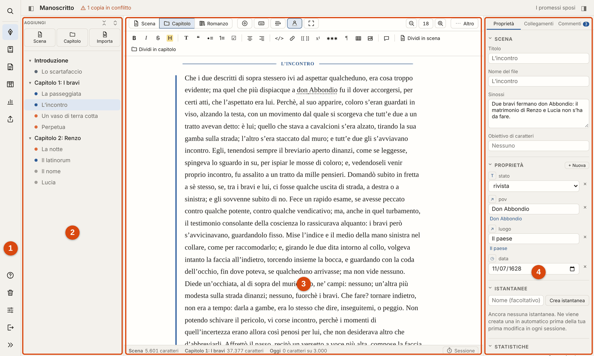

1. **The bar of the sections**, with an icon for each: Manuscript, Story Bible, Notes, Tables and boards, Statistics, Export, Settings, as well as Search, Help, Trash and Close project. In a wide window the name is beside each icon; **Hide names**, at the bottom of the bar, narrows it to the icons alone (as in the pictures of this guide, and as it starts in a narrow window), and then the name appears when you move the mouse over an icon. **Show names** brings them back.
2. **The panel on the left**: in the Manuscript it is the tree of parts, chapters and scenes; in the other sections it is the list of notes and files.
3. **The editor** in the middle, where you write.
4. **The panel on the right**, with three tabs: **Properties** (data of the scene or note, snapshots, statistics), **Links** (the notes that point to this one and the other way round) and **Comments**.

At the top, beside the name of the section, the warnings appear (in the picture, **1 conflict copy**, chapter 10); on the right is the title of the novel.

The two side panels hide and reopen from the buttons at the top; they widen by dragging their edge, and a double click on the edge brings them back to the normal width. Cmd+ and Cmd− (Ctrl+ and Ctrl− on Windows and Linux) enlarge and reduce the text, Cmd+0 / Ctrl+0 brings it back as before.

### In depth

Each section matches a folder of the project: Manuscript, Story Bible, Views for **Tables and boards** and, for **Notes**, the two folders Research and Laboratory, which stay separate on disk and in Obsidian; Statistics, Export and Settings read and write `dante.yaml` and the data in `.dante/`. The state of the tree (branches open or closed) is remembered by the computer, not by the project.

## 5. Writing

### How to

- **What to see**: at the top left choose whether to see only the selected **Scene**, the whole **Chapter**, the whole **Part** or the whole **Novel**, one scene after the other. The arrows move from one scene to the next.
- **The bar at the top**: after the choice of what to see come the writing modes (Focus, Typewriter, Line, Full screen), the zoom and the **More** menu. **More** turns on and off the **formatting bar**, the **cards of the scene** beside the text (chapter 16), the **revisions** (chapter 10) and the **text as in the file**, with the Markdown symbols. When the revisions or the text as in the file are on, a label in the bar reminds you; a click turns it off. In a narrow window the labels of the buttons hide and the icons stay: the name shows when the mouse passes over them.
- **Formatting**: select the text and use the bar that appears above the selection (bold, italic, highlight, comment…), or the shortcuts (chapter 15). The fixed **formatting bar** is shown or hidden from the **More** menu. For a **footnote** press the **x¹** button of the fixed bar and write the note between the brackets, right where its number goes: `^[text of the note]`. In the text it stays small and grey; in the exported book it becomes a number with the note at the foot of the page.

  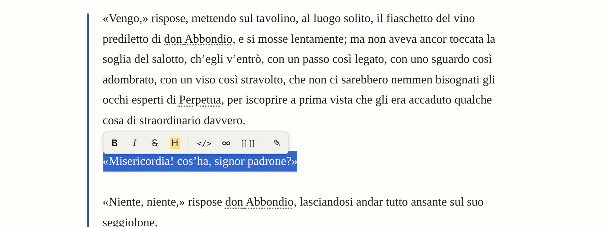

  *Try it:* open a scene, select a sentence and press **I** in the bar: the sentence becomes italic. Cmd+Z / Ctrl+Z brings it back as it was.
- **Aligning a paragraph**: put the cursor in the paragraph and use the alignment buttons of the formatting bar (centre or right), or Cmd+Shift+E / Ctrl+Shift+E and Cmd+Shift+R / Ctrl+Shift+R. A second click on the same button brings it back to the basic alignment: left while you write, justified or left in the export according to the profile. On an empty line the button starts a paragraph already aligned. Enter at the end of an aligned paragraph starts a normal one; Backspace at the beginning removes the alignment. The alignment shows in the editor and is respected in Word, PDF, EPUB and Markdown; from a Word import the centred and right-aligned paragraphs are kept. In the file the paragraph is wrapped in `<span style="display:block;text-align:center">…</span>` (or `text-align:right`): Dante hides the tag, the Markdown view shows it, and Obsidian shows the paragraph aligned with italics and bold intact.
- **Starting a new line**: Enter begins a new paragraph. Between one paragraph and the next you see only the space, not one more line to stop on: the arrows go straight from one paragraph to the other and Backspace at the beginning of a paragraph joins it to the one before. Pressing Enter twice in a row (or Enter at the beginning of a paragraph) leaves an empty paragraph, which in the book is a blank line and in the editor shows as a pale **¶**. Shift+Enter starts a new line inside the same paragraph, for example in the lines of a poem. In lists, quotations and tables Enter does what it always does: a new item, a new row. If you prefer to see the empty lines as they are in the file, untick **A single Enter starts a new paragraph** in **Settings → Writing**; the Markdown view always shows them.

  *Try it:* at the end of a paragraph press Enter and write: the new paragraph begins below, separated by the usual space. Now press Enter twice and write again: between the two a **¶** appears, the blank line you will see in the book.
- **Blank lines**: in Markdown two or more empty lines between two paragraphs count as one, so an extra empty line in the file vanishes in the export and in Obsidian (which is why Dante does not show it). To really leave a blank line, without starting a new scene, press the **¶** button of the formatting bar or Alt+Enter: after the paragraph you are in a line with a pale **¶** appears, which in the book will be a blank line. The **¶** is not printed; to remove the line, put the cursor on it and delete it like any other line.

  *Example:* at the end of a paragraph ("…and the door closed.") press Alt+Enter and go on writing the next paragraph. In Word, PDF and EPUB there is a blank line between the two paragraphs and the scene stays one. For a stronger pause, with the separator (for example `* * *`), use the **Scene separator** button instead.
- **Searching in the scene**: Cmd+F / Ctrl+F opens a bar above the text. Write the word: Enter (or Cmd+G / Ctrl+G) goes to the next one, Shift+Enter (or Shift+Cmd+G / Ctrl+Shift+G) goes back to the one before, **all** selects them all. The boxes limit the search to capitals as written or to whole words. The field **Replace with** changes the word in this scene only; to change it in the whole novel use **Replace** (chapter 9). Esc closes the bar.

  *Try it:* open a scene, press Cmd+F / Ctrl+F and write a word that occurs several times: the first occurrence is highlighted, Enter goes to the following one.
- **Splitting**: with the cursor at the right point, **Split into scene** (Cmd+Enter / Ctrl+Enter) moves the text that follows into a new scene; **Split into chapter** (Cmd+Shift+Enter / Ctrl+Shift+Enter) starts a new chapter from that point, with the scenes that follow.
- **Writing modes**:
  - **Typewriter**: the line you are writing on stays in the middle of the window.
  - **Focus**: everything is dimmed except the paragraph you are writing.

    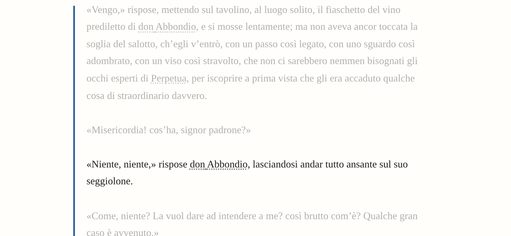
  - **Line**: lightly shades the line where the cursor is, so that the eye finds it at once. It turns on and off with its button, and the choice stays for the next times.
  - **Full screen**: only the text is left. Bring the mouse to the top edge to show the bars (modes and formatting), to the left edge for the tree, to the right edge for the side panel; they hide again when the mouse leaves, but stay open while you write in one of their fields. The side-by-side panels come back when you leave. Esc to leave.
- **Lists**: the buttons of the formatting bar (or Cmd+Shift+8 / Ctrl+Shift+8, Cmd+Shift+7 / Ctrl+Shift+7 and Cmd+Shift+9 / Ctrl+Shift+9) begin a bulleted list, a numbered list or a list of checkboxes. The text of each item is indented after the bullet, the number or the box, and the lines that wrap align under the first, not under the bullet. An item that begins with a few more spaces (four are always fine) sits inside the one before and is indented one level. In Word, PDF and EPUB the lists have the same indent; in Markdown they stay Markdown lists.
- **Tables**: the **Table** button of the formatting bar inserts a table of three columns. Write in the first cell; **Tab** goes to the next cell (after the last it adds a row), **Shift+Tab** goes back, **Enter** adds a row below and, on an empty row at the end, leaves the table. While the cursor is in the table a bar appears above it: **Row** adds a row above or below that of the cursor or deletes it, **Column** does the same with the columns (left, right, delete), **Align** aligns the column of the cursor left, centre or right (pressed again, it removes the alignment). **+ Caption** writes `Table: ` under the table and takes the cursor there, or takes the cursor to the caption that is already there. While you edit it the table is written with letters all of the same width, and the columns line up again by themselves at every Tab, Enter, command of the bar and when the cursor leaves the table.

  *Example:* press **Table** and write "Character", Tab, "Who", Tab, "First scene", Tab, "Renzo", Tab, "silk weaver", and so on. While you write you see it like this, with the bar above:

  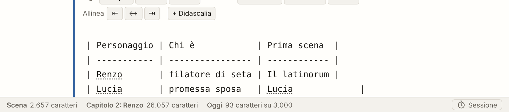

  When the cursor leaves the table, you see it as it will be in the book, with the caption below:

  
- **Images**: press the **Image** button of the formatting bar and choose the file, or paste an image (Cmd+V / Ctrl+V) or drag it into the text. Dante copies it into the folder **Attachments** inside **Research** and shows it where the cursor is. Move the mouse over the image to change its width (**200**, **400**, **600** pixels or **1:1**, the original size) and its alignment (left, centre, right). A click on the image shows the text that inserts it, to change it by hand.
- **Status bar**: under the text a line shows the words of the scene with the cursor (with its goal, if it has one), those of the selected text, of the chapter or of what is on screen, and those written today against the goal of the day. If the project measures in characters (chapter 12), the bar counts characters with spaces instead of words. It hides from **More** > **Status bar**.
- **Writing session**: press **Session** on the right of the status bar, choose how many minutes (from 10 to 90) and, if you like, how many words to reach, then **Start**. The bar shows the time left and the words written since you began; at the end Dante says how many words you wrote. **End** closes it early. The words added count, less those deleted, as in the statistics; in a project that measures in characters, the session asks for and counts characters.

  *Example:* a 25-minute session with 500 words to reach. While you write the bar shows "18:42 · 312 words of 500"; when the time is up "Goal reached: 534 words in 25 min." appears, or "Session over" if you did not get there.
- **Dialogue and typography**: if you turn on the correction while you write, Dante puts in the quotation marks or the dashes of the dialogue, the typographic apostrophe and the ellipsis by itself. Cmd+Z / Ctrl+Z undoes a correction you did not want.

### In depth

- The text is Markdown: `*italic*`, `**bold**`, `==highlight==`, `~~strikethrough~~`. The editor hides these symbols except where the cursor is, as in Obsidian. **More** > **Text as in the file** shows the file as it is, symbols and properties included.
- An image is written as in Obsidian: `![[photo.jpg]]`, or `![[photo.jpg|300]]` for a width of 300 pixels (`|300x200` also fixes the height); `` works too. The image can be in any folder of the project: with `![[name.jpg]]` Dante looks for it by name, like Obsidian. If you paste or drag into the text the web address of an image, Dante downloads it into **Research/Attachments** and inserts it from there. An address written by hand (``) shows in the editor but does not reach the export until you press **⤓** on the bar of the image, which downloads it into the project; a file outside the project does not show, because those who open the project from another computer would not have it: it must be copied into the project, as the **Image** button does. The alignment uses the same tag as aligned paragraphs. In the export an image alone in a paragraph becomes a figure, with its alignment; an image inside a sentence stays in the line, centred on the letters as in the editor. An image wider than the page is reduced to the width of the text; an image that cannot be found is skipped. Images do not count in words and characters.
- **Captions**, as Pandoc writes them: the description of an image that is alone in its paragraph (`![[house.png|The house by the sea|300]]`) is its caption and appears under the image. For a table press **+ Caption** in the bar above the table, or write yourself, after an empty line under the table, a line that begins with `Table:` (or just `:`), for example `Table: The stages of the novel`; in the editor it shows centred under the table, without the opening word. Captions reach Word, PDF and EPUB under the figure or the table, in italic, and count in the words of the export.
- **Embedded notes**, as in Obsidian: `![[Note]]` on a line of its own shows the text of the note in a box, read-only; `![[Note#Heading]]` shows only that section (with its subsections), `![[Note#^id]]` only the paragraph that ends with `^id`. A click on the name at the top opens the note, a click in the text shows the line as it is written. In the export the text of the note takes the place of the line, including the notes it embeds in turn; a note that embeds itself is skipped. Inside a sentence `![[Note]]` stays a link. The words of embedded notes count in the export, not in the statistics of the scene.
- **When you leave more empty lines than usual** (only if you unticked **A single Enter starts a new paragraph**): if between two paragraphs you leave more empty lines than you usually do (for example two instead of one), as soon as you begin to write the new paragraph a box appears: **Do you want a real blank line?** It explains that in the exported book the extra lines would vanish. **Insert blank line** turns it into a real blank line (like Alt+Enter), **No** leaves everything as it is, **Don't ask again** turns the question off; it turns on again in **Settings → Dante on this computer**. Dante learns your habit from all the scenes of the novel: as long as they are too few to learn it, it does not ask.
- In the file the paragraphs stay separated by an empty line, as Markdown requires: Enter writes it for you and the editor hides it. Extra empty lines that a file already had (written in another app) are hidden the same way, because they do not count in the book. An empty line at the beginning or at the end of the scene and those inside a code block stay visible.
- A blank line is written in the file as a paragraph that holds only `&nbsp;` (a non-breaking space), with an empty line above and one below. Obsidian, Pandoc and browsers show it as a blank line. Dante reads in the same way a line with only `<br>` or with only a non-breaking space, as other apps write them. In the export it becomes an empty paragraph in Word, a space of one line in PDF and EPUB, and stays `&nbsp;` in Markdown; it counts neither in words nor in characters. A scene separator (`***`, `---`) inside a scene, instead, is printed in the book as a separator.
- Quotations (lines that begin with `>`) show with a line on the left, without the `>`. Tables (`| A | B |` with a line `|---|---|` below) show as tables; a click in a cell shows the table as it is written, to edit it. Inside a table a link with an alias is written `[[note\|alias]]`, as in Obsidian. Tables reach Word, PDF, EPUB and Markdown, with the alignment of the columns. A quotation that begins with `> [!note] Title` (a callout) has its name in a coloured pill in the editor and becomes a coloured box with the title in bold in the exported book.
- The typographic correction is set in **Export → Typography**, because it holds both for the exported text and, if you like, while you write. There are the dialogue styles of several countries: Italian «guillemets», French « spaced » ones, American “curly quotes”, German „low“ ones, the Italian dash (— Vieni — disse), the Spanish raya (—Ven —dijo—) and others. In the list the one common in the language of the novel is marked as such. A new project always starts with **As typed in the text**, even if you chose a style for another novel: the dialogue comes out as you wrote it, until you choose a style for this novel.
- Whatever way you wrote the dialogue, the chosen style converts it: the lines written with guillemets or quotation marks become dashes, and those opened by a dash or a hyphen at the beginning of a paragraph become quotation marks. For example `- Come - he said - it is late.` becomes “Come” he said “it is late.”
- Hyphens and dashes in the narration stay as you wrote them, like the hyphens inside words (socio-economic) and the dashes between numbers (1990–2000). In a line of dialogue opened by a dash only dashes of the same kind count as closing and reopening: an aside between hyphens inside a line opened by a dash stays as it is.
- If a scene is changed by another program while you are editing it, your version stays and a warning offers to reload the other one.

## 6. Organising the manuscript

### How to

Everything is done from the tree in the Manuscript section.

- **Adding**: the buttons **New scene**, **New chapter** and **New part** add an item after the selected one (a new part goes at the end of the novel). A right click on an item also offers **New scene after this** and **New scene inside**.
- **Renaming**: double click on the name, or F2.

  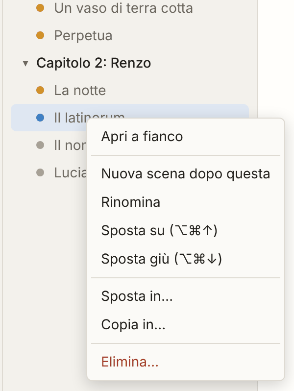
- **Moving**: drag scenes and chapters where you like, also from one chapter to another. Alt+Cmd+↑ / Ctrl+Alt+↑ and Alt+Cmd+↓ / Ctrl+Alt+↓ move the selected item by one place. After a move, a split or a merge, **Undo** appears at the bottom of the tree (or Cmd+Z / Ctrl+Z with the tree active): it puts scenes, chapters and text back as they were. It stays until you make another change to the structure; a merge can no longer be undone if you have written in the merged scene in the meantime.
- **Moving or copying without dragging**: right click → **Move to…** or **Copy to…**. A window opens with the sections at the top (**Manuscript**, **Story Bible**, **Research**, **Laboratory**) and below it the tree of the destination, with a box to look for a chapter or a scene by name when the manuscript is long. In the Manuscript click a scene or a chapter and choose **Where**: **Before**, **After**, **Inside, at the start** or **Inside, at the end**; in the other sections choose the folder. Then press **Move** or **Copy** (or double click the destination). It also works with several scenes chosen with Cmd+click / Ctrl+click, which stay in reading order, and with whole chapters and parts.

  *Example:* to put aside a scene you are not sure about, right click → **Move to…** → **Laboratory** → **Move**. You find it in **Notes**, in the Laboratory, without the number before its name. When you want to take it up again, right click on the note → **Move to…** → **Manuscript**, write the name of the chapter in the box, click it and choose **Inside, at the end**.
- **Joining scenes**: hold Cmd (Ctrl on Windows and Linux) and click the scenes to join, then press **Merge** in the bar above the tree (or from the right click). The text ends up in the first scene, in reading order. With several scenes chosen the right click also offers **Set a property on the scenes…**: choose the property and the value (for example status: revised) and Dante writes it in all of them.
- **Deleting**: right click → **Delete…**, or Cmd+Backspace / Ctrl+Backspace. The item goes to the **Trash** and can be recovered.
- **Trash**: it opens from the bin icon at the bottom of the bar on the left, above Settings. It lists what was deleted, the most recent first, with the place it comes from. **Put back** takes it back there; if that place has been taken in the meantime, the item returns beside it with a "2" in its name. **Delete for good** and **Empty the trash** really delete it, after a confirmation. The trash also receives the scenes merged into another and the discarded conflict copies (chapter 10).
- **Prologue, epilogue, interlude**: select the chapter and, in the Properties panel, choose the **Type** (prologue and epilogue have no number) or tick **No number (like an interlude)**. In the sample project the **Introduzione** is a prologue: this is why the first real chapter is called «Capitolo 1».

  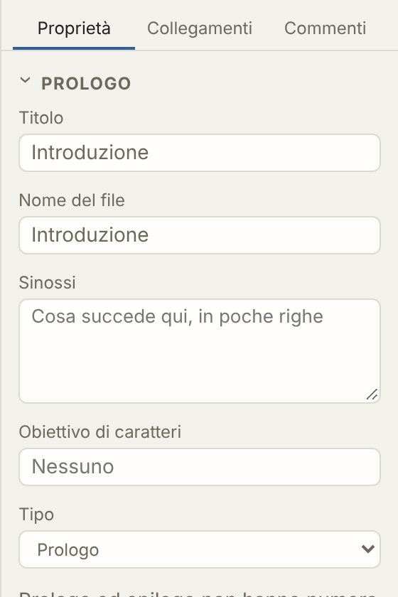
- **Numbering and titles of the chapters**: in **Settings → Structure** choose whether to group the chapters into parts, the label ("Chapter"), the style of the number (1, 2, 3 · I, II, III · One, two, three · First, second, third · none), what to put between number and title and whether to restart the numbering in each part. The preview shows the result.

  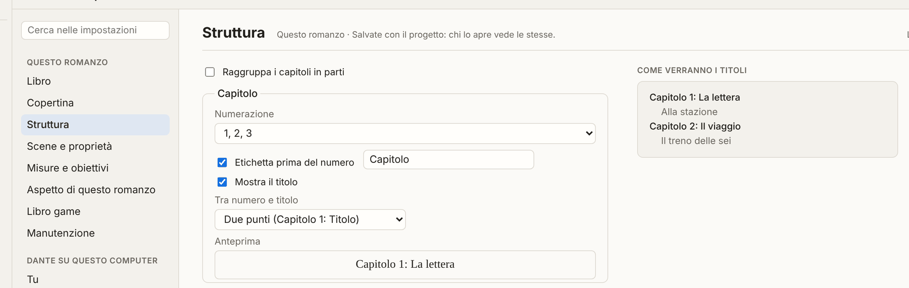

  *Example:* with the numbering **First, second, third** and **Between number and title** on "Line break", in the tree and in the exported book the chapter becomes "Chapter the first" with its title below.

A scene that ended up outside any chapter is marked in the tree as **outside chapters**: drag it into the right chapter.

- **Status in the tree**: beside each scene a coloured dot says how far along it is, according to the property **status** (chapter 8): grey for idea, orange for draft, blue for revised, green for done. Moving the mouse over the dot shows "Stage: draft" (or the value the scene has). A value that is not among the expected ones has an empty circle.
- **Colouring the tree by another property**: in **Settings** > **Scenes and properties** > **Scene tree** choose which property decides the colour of the dot, for example **pov** to see at a glance whose point of view each scene has. Each value has its own colour (up to eight, then the colours repeat) and moving the mouse over the dot shows, for example, "Pov: Renzo". The scenes without that property have no dot. To go back to the status choose **the stage of work** again.

  *Try it:* in the sample project choose **pov**: the scenes of different characters take different colours.
- **Word or character goals**: you can give a scene or a chapter a **Word goal** (or a **Character goal**, if the project measures in characters) in the Properties panel. The tree then shows a small bar to the right of the name, which turns green when the goal is reached; moving the mouse over it shows the words written and those to reach.
- **Template of new scenes**: in **Settings** > **Scenes and properties** > **New scenes**, the button **Edit the template of new scenes** opens the template (it creates it the first time, with the status "idea"). Every new scene starts from there, with the same properties and the same text, for example a few questions to keep in mind. The scenes created by splitting one (Cmd+Enter / Ctrl+Enter) keep the text that follows the cursor instead.

  *Example:* in the template write the properties `status: idea` and `pov:` and, in the text, "Who wants what? What stands in the way?". Every new scene is born with the status "idea", the field of the point of view ready and the two questions, to delete when you begin to write.

### In depth

On disk the manuscript is made like this:

```text
My novel/
├── dante.yaml                  settings of the novel
├── Story Bible/  Research/  Laboratory/  Views/  Templates/
├── .dante/                     snapshots, presence, writing log
├── .trash/                     deleted items
└── Manuscript/
    ├── 000 Prologue/
    │   ├── 000 Prologue.md     folder note: kind: prologue
    │   └── 010 The call.md     scene
    ├── 010 Return/             a part (if parts are on)
    │   ├── 010 Return.md
    │   └── 010 Arrival/        a chapter
    │       ├── 010 Arrival.md
    │       └── 020 The house.md
    └── 900 Epilogue/
```

- **Dot of the tree**: the chosen property is saved in `dante.yaml` as `tree.dot` (empty for the status), so it holds for everyone who works on the novel. The colours of the other values follow the order of the values expected for the property, if it has any (chapter 8), then the order in which they appear in the manuscript; capitals do not count, and of a link such as `[[Renzo Tramaglino|Renzo]]` the name shown is read.
- **Numeric prefixes**: the number at the beginning of the name (010, 020…) decides only the order and does not appear in the titles. The numbers go in tens to leave room. When you move something, Dante renames as few files as possible and updates the links that pointed to what moved. If Dante is closed halfway through a reordering, the next time the project opens it finishes it or brings everything back, and tells you which.
- **Folder note**: a chapter or a part keeps its properties in a note with the same name as the folder (`010 Arrival/010 Arrival.md`). The property `kind` is `part`, `chapter`, `prologue` or `epilogue`; `numbered: false` removes the number. For this reason a scene cannot have the same name as its chapter.
- **Visible numbers**: "Chapter 3: The letter" is worked out on the spot from the settings in `dante.yaml`, not from the prefix or from the text of the file.
- **Trash**: it is the `.trash` folder of the project, the same one Obsidian uses. Dante notes in `.dante/trash.json` where each item comes from, to be able to put it back; a file put in the trash by Obsidian or by hand, whose origin Dante does not know, goes back to the Laboratory. The trash is in the folder of the novel, so co-authors see it and empty it too.
- **Move to… and Copy to…**: a scene or a chapter that leaves the manuscript loses its numeric prefix (`030 Arrival.md` becomes `Arrival.md`), one that enters takes the number of the chosen place, renaming as few other files as possible. The properties stay. If the folder already holds a file with the same name, the new one takes a "2". When moving, the links are updated and the snapshots and the history of comments follow the scene. A copy has the text and the properties of the original but neither its snapshots nor its history, and the existing links go on leading to the original. Copying a chapter copies everything it holds, with the folder note renamed like the new folder. Only notes and folders go into the manuscript, not images or PDFs. In a gamebook the paragraphs follow their number, so in the Manuscript you choose only the folder.
- **Merging**: the joined scenes other than the first go to the trash, and the links that pointed to them lead to the first. A scene with a conflict copy must be settled first (chapter 10).
- **Scene outside chapters**: if it stays there, the export adds it at the end of the chapter before.

## 7. Snapshots

### How to

A snapshot is a copy of a scene as it was at a certain moment, to take up again if a change does not convince you.

- Dante takes one by itself before your first change to a scene, every time you open the project.
- To take one yourself, open the **Properties** panel, write a name (optional) under **Snapshots** and press **Take snapshot**.
- **Compare** shows what changed between the snapshot and the current text.

  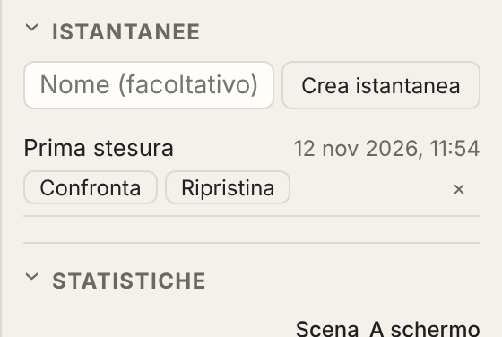

  *Example:* in a scene take a snapshot called "First draft", then add a few words. **Compare** shows in red struck through what was only in the snapshot and in green what is only there now:

  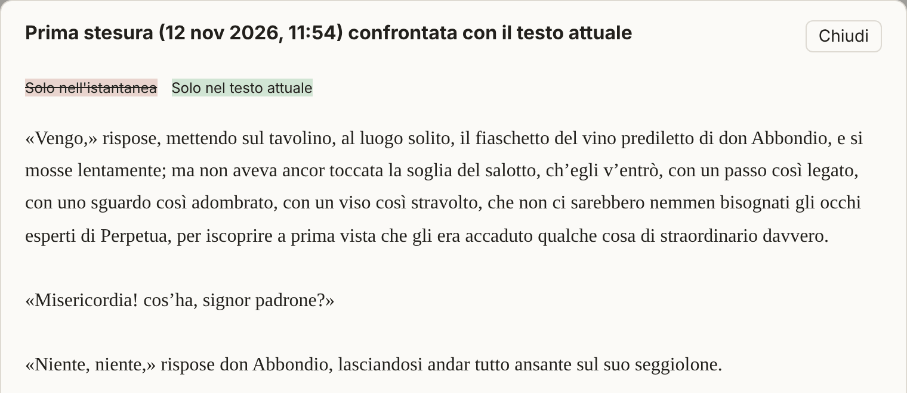
- **Restore** puts the snapshot back in place of the text. The current text is saved as a snapshot first, so nothing is lost.
- **The whole manuscript at once**: in **Settings** > **Upkeep**, under **Snapshot of the whole manuscript**, write a name (for example "First draft") and press **Take snapshot**. Every scene is saved as it is at that moment: you find it under that name among the snapshots of each scene, to compare it, and from the same list **Restore** takes every scene back to it. The current text of the scenes that change is saved first; scenes written later stay as they are and deleted ones do not come back (they are in the Trash).
- To tidy up, in **Settings** > **Upkeep**, **Delete old snapshots** deletes the automatic ones taken before a date; those with a name always stay.

### In depth

The snapshots are files in `.dante/snapshots/` and follow their scene when it is moved or renamed. They concern one scene at a time: to keep the whole novel there are the backup copies (chapter 19).

## 8. Properties, title and synopsis

### How to

The properties are the information about a scene or a note: point of view, date in the story, stage of the revision, place, and so on. You see and change them in the **Properties** panel on the right.

The panel is divided into sections: the scene (title, file name, synopsis, goal), **Properties**, **Snapshots** and **Statistics**. A click on the title of a section closes or reopens it, and Dante remembers how you left it.

- **Title and file name**: the **Title** is the one that appears everywhere (tree, headings, export); the **File name** is the name on disk. If the title is empty, the file name counts.
- **Synopsis**: a few lines on what happens in the scene or in the chapter. It also appears in the views (chapter 11).
- **Word goal** (or **Character goal**): how many words, or how many characters with spaces, the scene or the chapter must have, according to the measure chosen in Statistics. Leave it empty if you do not need it; with a goal the tree and the status bar show how far you are (chapters 5 and 6).

  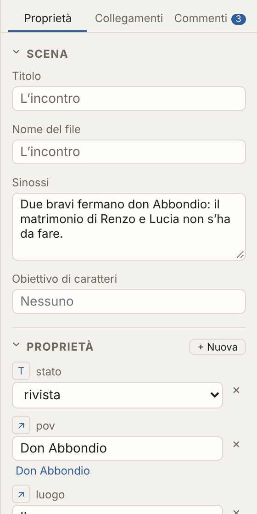

  Above, the properties of the scene **L'incontro**: the **status** is a menu (idea, draft, revised, done), **pov** and **place** are links to the cards of don Abbondio and of the village (the blue name under the field opens the card), the **date** is when the scene takes place in the story.
- **Adding a property**: press **+ New** beside the title of the **Properties** section. A box opens: write the name (Dante suggests those already used in the novel), choose the type and, for a scene, **This scene only** or **Every scene of the novel**, then press **Add property**.
- **For every scene**: the property enters the template of new scenes and appears, empty, in every scene, with the label **every scene**. It is written in the file of a scene only when you give it a value, so the other scenes stay as they are.
- **Changing a property**: the small box with the symbol before the name (**T**, **#**, **↗**…) is a button. Moving the mouse over it shows the type; a click opens the definition: type, allowed values, name and, if it is the property that colours the dots of the tree, their colours. You can choose whether it is a text, a number, a date, a checkbox, a list or a link to a note. For a text or a list you can give the allowed values: a drop-down menu will appear. From then on the property works that way in all the notes of the project.
- **Renaming a property in the whole novel**: in the definition, write the new name in **Name in the whole novel** and press **Rename**. Dante changes the name in all the scenes and notes, in the tables and boards and in the settings. If a note already has a property with the new name, there the two stay separate and Dante tells you. The status and the properties that Dante reads by name (title, synopsis, goal, type, aliases) cannot be renamed.
- **Colours of the dots**: opening the definition of the property that colours the dots of the tree (the status, or the one chosen in Settings), under **Colours of the dot in the tree** you see each value with its colour. A click on the small square of the colour changes it; **Usual colour** goes back to the one before.

  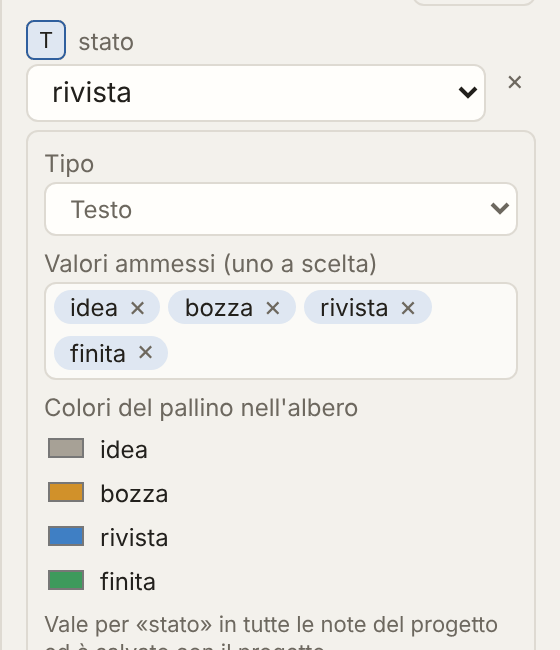

  *Example:* you want to note in which season each scene takes place. Press **+ New**, write "season", choose **Text** and **Every scene of the novel**, then **Add property**. Click the **T** beside the name and write "spring, summer, autumn, winter" in the allowed values. From then on, in every scene, "season" is a menu with those four values, and a view can group the scenes by season. If you later prefer to call it "period", you rename it from the same definition.

All the properties with a type are listed in **Settings → Scenes and properties**, under **Note properties**.

### In depth

The properties are the YAML frontmatter at the top of each file, as in Obsidian. For chapters and parts they are in the folder note (chapter 6). The goal is the property `goal` (for example `goal: 3000`), read in words or in characters according to `goals.unit` in `dante.yaml`; the status shown in the tree is the property `status` (`stato` in a novel in Italian) and the colour depends on the position of the value among the allowed ones: the first grey, the last green. The template of new scenes is the file `Templates/Scene.md` (`Modelli/Scena.md` in Italian); `{{title}}` and `{{date}}` become the title of the scene and the date of the day, as in the templates of the Story Bible.

```yaml
---
title: The meeting
synopsis: "Two bravoes stop don Abbondio: the wedding of Renzo and Lucia must not take place."
status: revised
pov: "[[Don Abbondio]]"
place: "[[The village]]"
date: 1628-11-07
---
```

A synopsis that contains a colon goes between quotation marks, as above: otherwise the file can no longer be read correctly, in Dante or in Obsidian. Dante adds them by itself when you write the synopsis in the panel.

Some properties have a meaning for Dante and have English names, the same in every language:

| Property | Where | What it is for |
| --- | --- | --- |
| `title` | scene, folder note | title shown everywhere |
| `synopsis` | scene, folder note | synopsis |
| `kind` | folder note | `part`, `chapter`, `prologue` or `epilogue` |
| `numbered` | folder note | `false` removes the number |
| `published_title` | scene, folder note | title used only in the export |
| `type` | note of the Story Bible | type of the note; if missing, that of the folder counts |
| `aliases` | any note | other names to link the note and to count it in the statistics |

The properties with a type are defined in `dante.yaml`:

```yaml
properties:
  status:
    kind: text
    values: [idea, draft, revised, done]
  pov:
    kind: link
    note_type: character
  date: date
```

| Type | Symbol | Field in the panel | Written in the file as |
| --- | --- | --- | --- |
| text (`text`) | T | text, or a menu if it has allowed values | text |
| number (`number`) | # | number | `42` |
| date (`date`) | ◷ | calendar | `2026-10-15` |
| checkbox (`checkbox`) | ☑ | checkbox | `true` / `false` |
| list (`list`) | ≡ | switches for the allowed values | YAML list |
| link (`link`) | ↗ | suggestions, also of one type of note only | `"[[Name]]"` |

A value that does not respect the definition stays as it is and is flagged in the panel.

The properties **for every scene** are those of the template of new scenes (`Templates/Scene.md`): the panel shows those a scene does not have yet. The colours chosen for the dots are in `dante.yaml`, by property and value:

```yaml
tree:
  dot: pov
  colors:
    pov:
      lucia mondella: "#d064a6"
```

Renaming a property rewrites only its name at the top of the files, leaving value, position and comments; in the tables and boards filters, sorting, grouping, columns and dates change. New projects in English already define age (number), date (date), place (link to a place) and owner (link to a character).

## 9. Story Bible and Notes

### How to

- **Story Bible**: the cards of characters, places, objects, events, groups and plotlines, grouped by type. Press **New Character** (or the type you need), write the name and press Create: the card is born with the properties suggested for that type. With **Filter** you find a card among many. With a right click on a card, or with the buttons at the top of the open card, **Move to…** and **Copy to…** take it to another folder of the Story Bible, to Research, to the Laboratory or into the manuscript (chapter 6). Each card shows at the top the first image of the note: that of a property (for example `portrait: "[[Lucia.jpg]]"`) or, if there is none, the first in the text. Untick **Pictures** to see the cards without them. With **Look** beside it choose how to show them: **Across the top of the card** or **Beside the title**; **Cropped to fill the space** or **Whole**; which part to keep when it is cropped (**Top** is good for portraits, which do not lose their head that way); and the **Size**. The choices hold for all the cards and stay on this computer.

  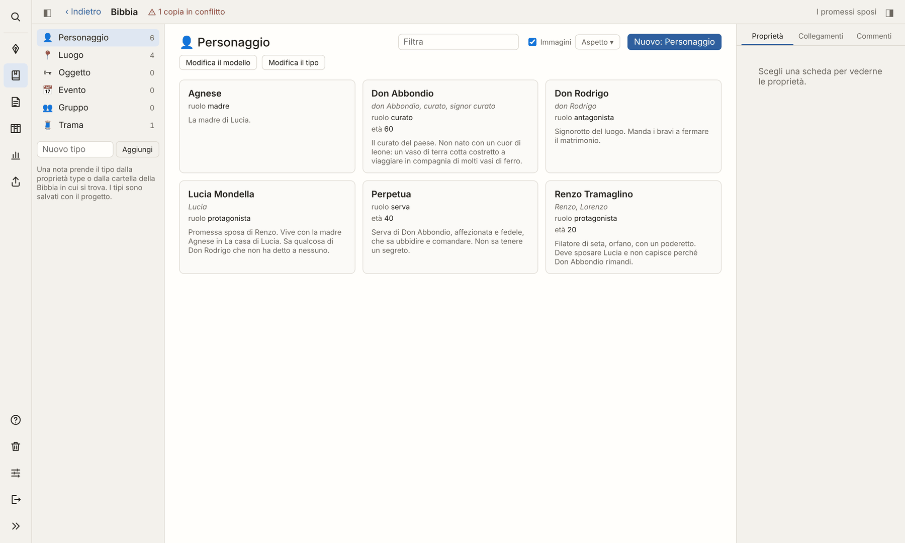
- **Types of the Story Bible**: you can add new ones (for example "Creature") and, for each type, **Edit type** (name, icon, suggested properties) and **Edit template**, that is the text every new card starts from.
- **Notes**: everything that is neither manuscript nor Story Bible, in two folders shown one below the other. **Research** is the archive for the notes, images, PDFs and web pages gathered for the novel; the **Laboratory** is the space for drafts, outlines and ideas. **New note** creates one in the Laboratory, **Add files…** copies files from the computer into Research; to move a note from one folder to the other drag it, or use the right click → **Move to…** or **Copy to…**, which take notes, files and folders to the Story Bible or to a precise point of the manuscript too (chapter 6). Images, PDFs and HTML open inside Dante, the other files with the default program.
- **Links**: write `[[` in the text and Dante suggests the notes of the project, also by alias. It works the other way round too: if you select "Corrado" and close it between `[[ ]]` (or write `[[Corrado]]`) and Corrado is an alias of "Corrado Olivieri", Dante recognises the character and links his card. A link to a note that does not exist yet looks paler.
- **Click on a link**: a small menu opens with **Open in the editor**, **Open in a pane** and **Preview**.

  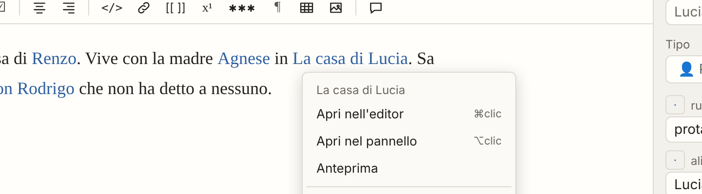

   The preview is a small window above the text that shows the note, to read it at a glance without leaving the scene; it closes with Esc or with a click elsewhere. **Edit the link** puts the cursor inside the brackets.

  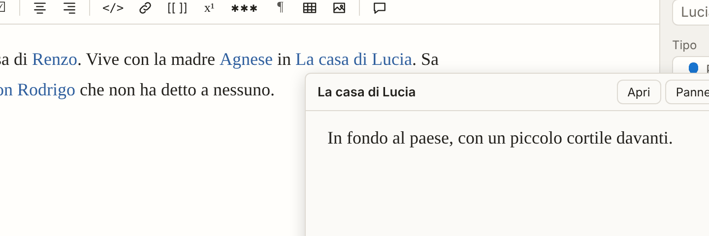

   The shortcuts stay: Cmd+click / Ctrl+click opens at once in the editor, Alt+click (Option on a Mac) in the pane.
- **Link to a note that is not there**: the click asks whether to create it and where, as a card of a type of the Story Bible (character, place…), in Research or in the Laboratory. The new note opens in the pane beside, so the scene stays in front of you.
- **Who points to whom**: the **Links** tab of the right panel shows the notes that point to the open one (with the line that holds them) and those it points to.
- **Names of the Story Bible**: when in the text you write the name or an alias of a card of the Story Bible without making a link of it (for example "Lucia"), Dante underlines it with dots. A right click on the name opens the menu of the recognised card: **Open in the editor**, **Open in a pane**, **Preview** and **Turn into a link**. Shift + right click opens the usual menu (cut, copy, spelling). The **Names** button in the bar at the top (the icon with a person above a dotted line) turns the underlines on and off; a note at the bottom of the menu reminds you of it. The **Links** tab has one more section too: in a scene, **Named in the text** lists the cards named without a link; in a card of the Story Bible, **Named in the scenes** lists the scenes that name it.
- **Searching**: Cmd+Shift+F / Ctrl+Shift+F (or the lens at the top left) searches the names, the aliases and the text of all the notes, with a preview of each result. The menu under the box limits the search to one section.

  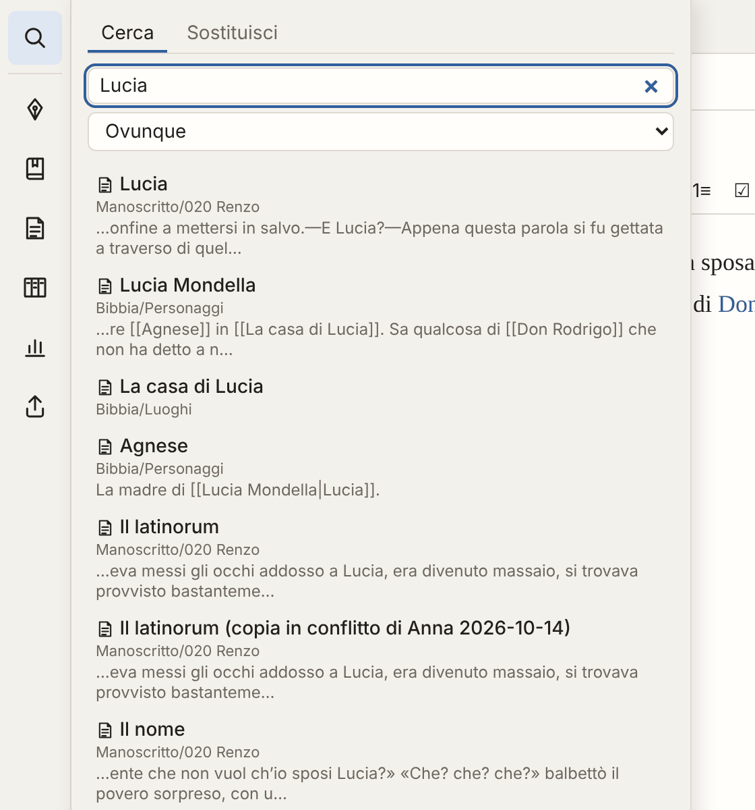
- **Find and replace in the whole project**: Alt+Cmd+F / Ctrl+Alt+F, or the **Replace** tab at the top of the search. Write the word to look for and the new one: below appear all the occurrences, note by note, with the old word struck through and the new one beside it. Untick those to leave as they are, or use **None** and tick only those you need. A click on a line opens the note with the word selected. **Replace** changes the ticked ones; right after, **Undo the replacement** puts everything back as it was. With **Whole words only** "Renzo" does not find "Renzino"; without **Match case** the new word takes the capitals of the old one ("RENZO" becomes "LORENZO"). The menu below limits the replacement to one section.

  *Example:* to change the name of a character, search for "Renzo" and replace with "Lorenzo" in the Manuscript. Before changing a scene Dante saves a snapshot of it called "Before replacing “Renzo”", to take up again if needed (chapter 7). To change the name of the card too, rename it: the links update by themselves.

**A complete example.** Open the card of **Lucia Mondella** in the Story Bible. In the text, «La casa di Lucia» is blue because it is a link: one click and choose **Preview** to read it without leaving the card. Now open the scene **Lucia** in the Manuscript and write `[[Agn`: Dante suggests **Agnese**; press Enter and the link is made. In the card of Agnese, the **Links** tab of the right panel now also lists the scene **Lucia**.

### In depth

- The type of a note comes from the property `type` or, if it is missing, from the folder of the Story Bible it is in (`Story Bible/Characters/`). The types are defined in `dante.yaml` under `types`, each with name, folder, icon and suggested properties.
- The template of a type is the file `Templates/<name of the type>.md`; `{{title}}` and `{{date}}` are replaced with the name of the note and the date of the day.
- The links are wikilinks as in Obsidian: `[[Lucia Mondella]]` or `[[Lucia Mondella|the betrothed]]`. When you rename or move a note, Dante updates all the links that concern it.
- The aliases are written in the property `aliases` of the note: `[[` suggests them and the statistics count them too.
- The names recognise whole words, written with the same capitals as the name or the alias: "Marta" is not found in "Martina", and a place called "Home" does not underline every "home". Names inside links, comments and code do not count, nor does a name that two cards share. The name of the open card is not underlined in its own card.
- The image of a card comes from an embedded image (`![[photo.jpg]]` or ``) or from a property that holds an image; the excerpt under the title skips images and links to web addresses.
- A link closed by hand on an alias is rewritten as `[[Corrado Olivieri|Corrado]]`: in the text you always read "Corrado", and the link also works in Obsidian, which does not resolve aliases by itself. It happens only when the alias belongs to one note only and no note has that name; capitals do not count. Cmd+Z / Ctrl+Z undoes the rewriting together with the brackets. A `[[Corrado]]` written earlier, or outside Dante, leads to the card inside Dante all the same.
- Deleting a type does not delete its notes, which stay where they are with their properties. What is deleted from the sections goes to `.trash`.
- The HTML pages opened in Dante do not run their scripts.
- **Replace** changes only the text of the notes. The properties at the top of the file, the name of the note inside a link (`[[Renzo Tramaglino|Renzo]]` changes only the alias after `|`), embedded images and files, the addresses of links, HTML tags, the text of comments `{>>…<<}` and code blocks stay as they are. The revisions (`{++…++}`, `{--…--}`) are text and are changed. If a note changes between the search and the replacement, Dante searches again and skips the occurrences that are no longer there. **Undo the replacement** skips the notes changed after the replacement and lists them.

## 10. Writing with other people

### How to

1. **Sharing**: put the folder of the project in Dropbox or Google Drive and share it with those who work with you. Each one opens it with **Open folder…**.
2. **Signing**: the first time you open a project without having given your name yet, Dante asks for it; you change it in **Settings → You**.
3. **Commenting**: select the text and press the speech bubble in the bar (or Cmd+Alt+M / Ctrl+Alt+M), write the comment and press Cmd+Enter / Ctrl+Enter. In the text the comment appears as a speech bubble.
4. **Proposing changes**: choose **More** > **Track changes as revisions** in the bar at the top (your name is needed in Settings); while they are on, the label **Revisions on** stays in the bar. From then on what you write appears underlined and what you delete struck through, with your name, until someone decides.
5. **Deciding**: the **Comments** tab of the right panel lists the comments and the changes of the text shown. For each you can **Reply**, **Resolve** (closes the discussion), **Accept** or **Reject**; at the top are **Accept all** and **Reject all**.
6. **Reading again what was decided**: at the top of the **Comments** tab, **History** shows what happened to closed comments and changes: who accepted, rejected or resolved, when, who had proposed the change, the text before and after and the discussion. By default you see the open scene; **The whole novel** shows everything, and you can filter by person and by dates. A click on the name of the scene opens it.

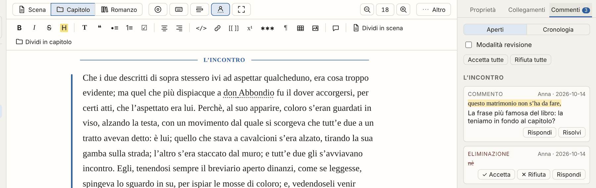

**An example.** In the scene **L'incontro** of the sample project Anna left a comment on «questo matrimonio non s'ha da fare» (the text is highlighted in yellow) and proposed writing «né» in place of «nè»: the old word is struck through in red, the new one underlined in green. In the **Comments** tab press **Accept** on the addition and on the deletion: only «né» is left in the text. You can answer the comment with **Reply**, or close it with **Resolve** when the question is settled.

If another person is already working on a scene, for you that scene is read-only and a warning says who is editing it. **Edit anyway** unlocks the scene, but the changes risk overlapping.

If Dropbox or Drive create a **conflict copy** (it happens when two people change the same file at the same moment), a warning appears at the top. Opening it you see the two versions side by side and choose: **Keep the file**, **Use the copy**, or **Merge as revisions** to decide the differences one by one.

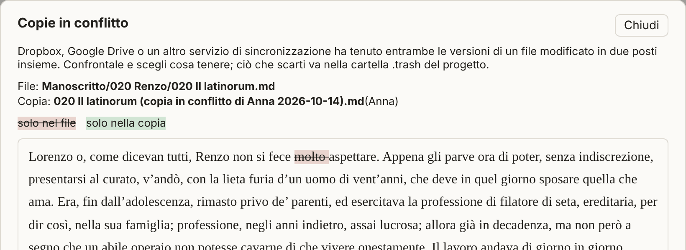

### In depth

- Comments and revisions are written in the text with [CriticMarkup](https://github.com/CriticMarkup/CriticMarkup-toolkit), followed by a signature with name and date:

```markdown
{==this wedding must not take place,==}{>>@Anna 2026-10-14: The most famous line of the book: do we keep it at the end of the chapter?<<}{>>@Luca 2026-10-15: yes<<}
{--nè--}{>>@Anna 2026-10-14<<}{++né++}{>>@Anna 2026-10-14<<} domani, nè mai.
```

It reads like this: `{== ==}` wraps the commented text, `{>> <<}` holds the comment (or the signature of a revision), `{-- --}` is the text to remove and `{++ ++}` the text to add. Each reply is another `{>> <<}` at the end.

- In Obsidian these marks show as they are; Dante hides them and draws the text like a word processor. **More** > **Text as in the file** shows them.
- In revision mode, writing inside an addition of your own changes it directly; writing inside someone else's addition or in a highlighted text changes the text without creating a new revision.
- **Resolve** removes the discussion from the file. In the export the comments vanish and the pending revisions are accepted or rejected, as you choose. Words and characters are always counted as if the pending revisions were accepted.
- **Presence**: every copy of Dante writes in `.dante/presence/<name>.json` what it is editing, and updates it every minute. Whoever opens a scene first holds it; a presence not updated for three minutes (for example after the computer was turned off) no longer counts.
- **Conflict copies**: Dante recognises the names used by Dropbox ("Anna's conflicted copy…"), Google Drive ("(1)" beside the original), Syncthing and similar services, and keeps them out of the tree. What you discard goes to `.trash`; before merging, a snapshot keeps the file as it was. The revisions born from a merge are signed by whoever wrote the copy.
- The log of the words written is one file per person, `.dante/sessions/<name>.json`, so two people never write the same file.
- The **History** too is one file per person, `.dante/history/<name>.jsonl`, one line for each decision. It fills from when you use this version: the decisions taken before are not there. If you move or rename a scene, its history follows it.

## 11. Tables and boards

### How to

A view shows scenes, chapters or cards of the Story Bible at a glance, as a **Table**, a **List**, **Cards**, a **Board** or a **Timeline**.

1. In the section **Tables and boards** a new project already has a board of the scenes by status and a table of the scenes. In a project that has none, press **Create the starting views**; for another view press **New view** and give it a name.
2. At the top choose how to show it (table, list, cards, board, timeline).
3. With **⚙ Settings** choose what to list (scenes, chapters and parts, all the notes or a type of the Story Bible), from which folders, with which conditions (**Only when**), how to sort, how to group and which fields to show. At the bottom is **Delete this view**.

The sample project already has four views. The **Board** puts the scenes in columns according to the status:

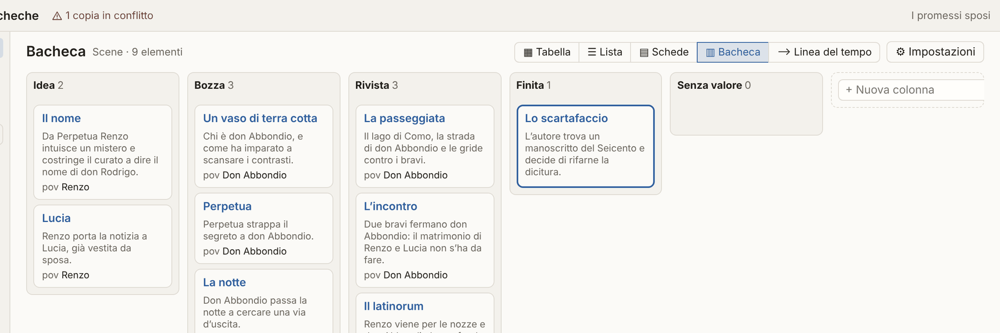

The table **Scenes** lists chapter, status, point of view, date and length of each scene (in words or in characters with spaces, according to the measure of the project; among the fields there are both **Words** and **Characters**); here with the settings open above it:

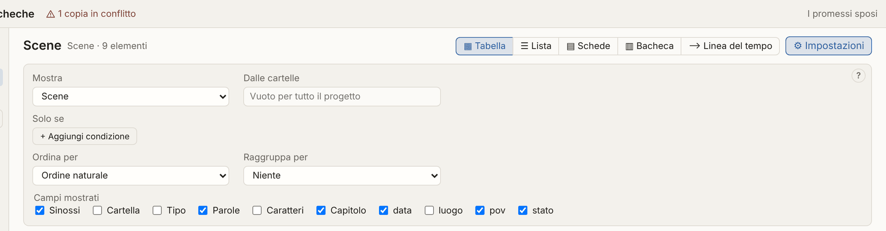

**Story time** puts the scenes on the timeline according to the property "date": you see at once that chapter 1 takes place on 7 November 1628 and chapter 2 the day after.

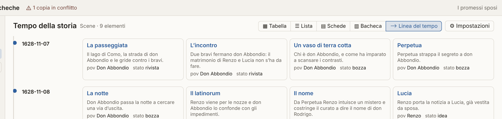

*Example:* you want to see only the scenes told by Renzo. Open the table **Scenes**, press **⚙ Settings**, then **+ Add condition**, choose "pov" and write "Renzo". The three scenes of chapter 2 where the point of view is his are left.

From the view you can also change the notes:

- **Table**: click a header to sort; click a cell to change the value in the note. Drag the right edge of a header to widen or narrow the column; double click the edge to go back to the automatic widths.
- **Board**: drag a card to another column to change its property (for example from "draft" to "revised"); **New column** adds a group.
- **Timeline**: drag an item to another moment to change its date. The notes without a date are listed below. If it is grouped, drag the right edge of the title of a column to change the width of all the columns; double click the edge to go back to the automatic one.

### In depth

Each view is a YAML file in the folder `Views/`, so it syncs with the project and can be written by hand:

```yaml
type: kanban            # table, list, cards, kanban, timeline
items: scene            # scene, chapter, note, or a type such as character
source: Manuscript      # folders to take the notes from; empty = the whole project
filter:
  pov: Renzo            # all the conditions must hold; a list = any one of the values
sort: -date             # the minus reverses the order; empty = order of the manuscript
group_by: status        # columns of the board, or groups of the other kinds
groups: [idea, draft, revised, done]   # in this order, even if empty
fields: [pov, words]    # fields shown; also name, folder, type, words, characters, chapter
date: date              # timeline only: the property with the date
end: until              # timeline only: end, optional
widths: {name: 320, pov: 140, lane: 260}   # widths in pixels chosen by dragging; lane = columns of the timeline
```

- When you change the settings from the app the file is rewritten at once, without any comments written by hand.
- The rows of the chapters read and write the properties of the folder note and count the words and the characters of their scenes. In a board grouped by chapter, moving a scene really moves it into that chapter.
- If a grouping uses a property with allowed values, the columns are those values.
- Dates allowed in the timeline: `1987`, `1987-03`, `1987-03-12`, negative years, or plain numbers such as the day of the story.
- Each item shows the synopsis under the name, unless the file of the view says `synopsis: false`.
- Conflict copies, templates and the views themselves never appear.

## 12. Statistics and goals

### How to

The section **Statistics** shows:

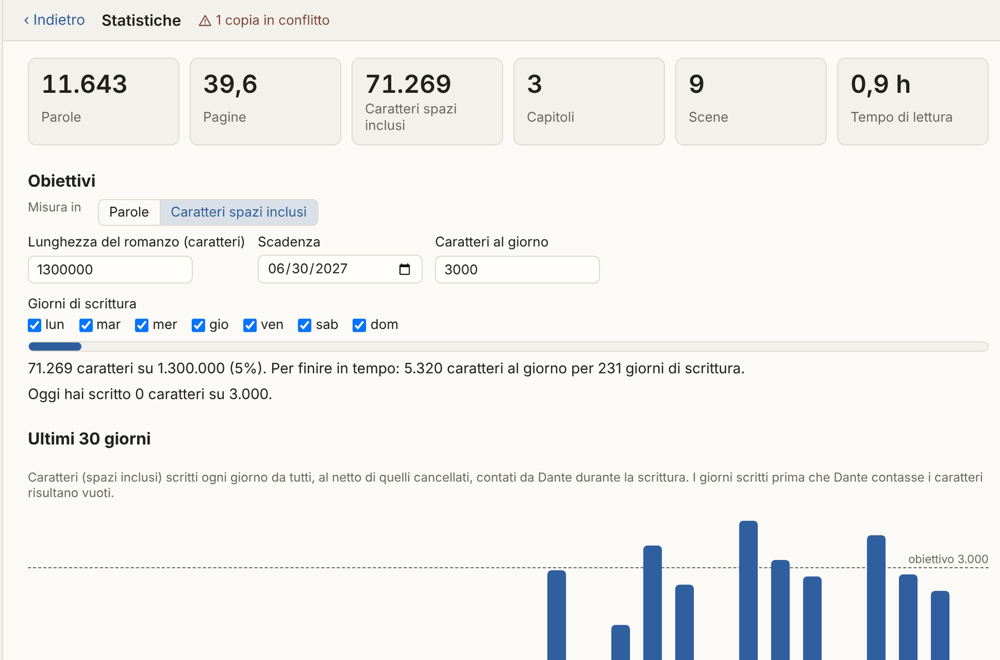

- **Totals**: words, pages, chapters, scenes and reading time of the novel.
- **Measure in**: **Words** or **Characters with spaces**. It is the measure of goals, status bar, tree, panel, sessions and chart of the last 30 days, and holds for the whole project. New projects in Italian start from characters, as is usual in Italian publishing; those in other languages, and those created earlier, stay in words until you change. At the change, the goal of the novel and that of the day are converted with the ratio between characters and words of your manuscript (about 6 characters per word), rounded. If scenes or chapters have a goal of their own, Dante lists them with the value they would have and converts them all with **Convert these goals**; **Leave them as they are** keeps them written as before.

  *Example:* a novel of 80,000 words with 500 words a day, moved to characters with a manuscript of 6.1 characters per word, becomes a novel of 488,000 characters with 3,050 characters a day.
- **Goals**: write the length you want to reach, the deadline, the words (or the characters) per day and your writing days. Dante says how far you are, how many words a day are needed to finish in time, how many you wrote today and for how many days in a row you have reached the goal. The days not ticked are rest days and do not break the streak.
- **Last 30 days**: a chart of the words written each day, and a table for each person who works on the project.
- **Length**: how long each scene, each chapter or each part is, with its share of the total, a bar, the average, the median, the shortest and the longest. Two groups of buttons above the table choose the measure (**Words** or **Characters with spaces**) and the level (**Scenes**, **Chapters**, **Parts**; Parts appears only if the novel has parts). Until you choose, the measure is that of the project; then the choice stays for the next times.
- **Mentions**: how many times the scenes name each character, place or other card of the Story Bible, with the first and the last scene where it appears, and the cards never named.
- **Most used words**: without articles, prepositions and other very common words.
- **Style**: a few numbers on how the text is written, to find the passages to read again: the average length of the sentences, the **long sentences** (more than 40 words), the **adverbs** in -ly and the most used ones, the share of text in **dialogue** and the **close repetitions**, that is the same word used again within 30 words. Below are the closest repetitions and the longest sentences, with the scene: a click opens the scene right at that point and selects the passage, from the first to the second time the repeated word appears, or the whole long sentence. For a repetition the search bar also opens with the word, so Enter goes to the other times it appears. They are estimates made on the words alone, not rules. The thresholds (a sentence is long above 40 words, a repetition comes back within 30 words) and the reading speed (230 words a minute) are changed for each novel in **Settings** > **Measures and goals** > **Statistics on style**; in `dante.yaml` they are under `style`.

  *Example:* in the sample project the longest sentence is in *Lo scartafaccio* and exceeds 130 words: Manzoni imitates the style of the seventeenth century. A repetition made on purpose, such as "hush, hush" or "always and always", is not counted.

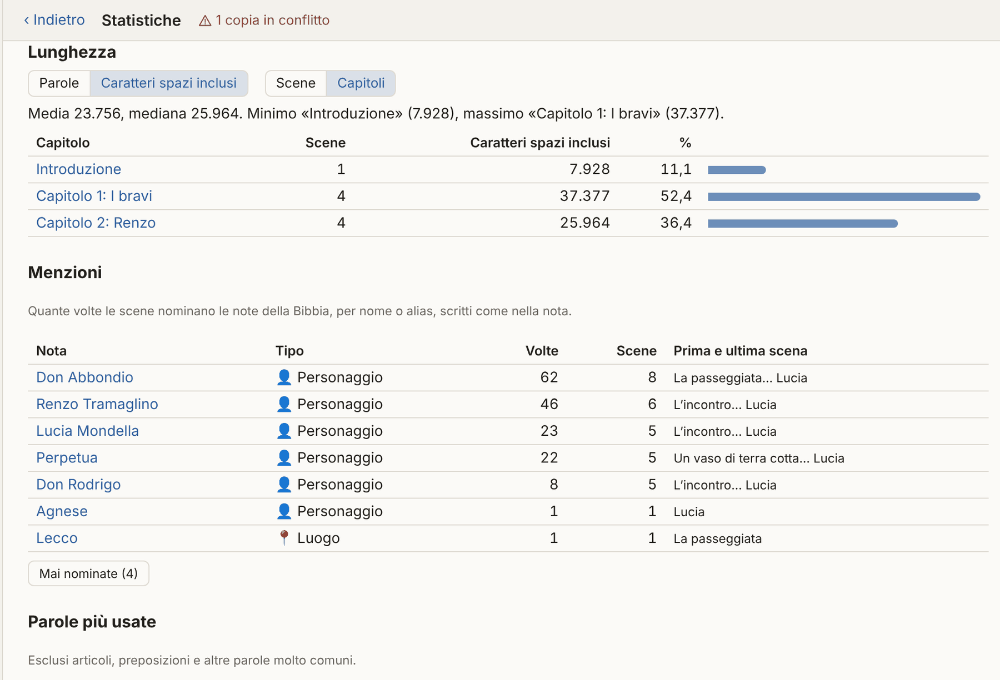

*Example:* in the sample project the table **Mentions** says that don Abbondio is named 62 times in 8 scenes, Lucia 23 times, Agnese only once, in the scene *Lucia*. **Length** at the level Chapters shows that chapter 1 alone is more than half of the text (52%).

The words written today also appear in the panel on the right while you write. To count them, Dante needs your name in the settings.

For single scenes, the **Properties** panel shows words, characters and reading time.

### In depth

- **Pages**: by default a page is a standard page of 1,800 characters with spaces. In **Settings → Measures and goals** you can count in words instead (250 is a common value). In `dante.yaml`: `pages: {unit: characters, size: 1800}`.
- **Goals** in `dante.yaml`: `goals: {unit, words, deadline, daily, days}`, where `unit` is `words` or `characters` (without `unit` words are counted: this is the case of the projects created before the choice existed), `words` and `daily` are in the chosen measure and `days` lists the writing days from 1 (Monday) to 7 (Sunday). The words or the characters needed are spread over those days only.
- **Writing log**: Dante counts, while you write, the words and the characters added and deleted and the minutes spent writing, day by day, in `.dante/sessions/<name>.json`. Words written with other programs do not enter the log, but they enter the totals. Characters are counted from version 1.1: in the days before, the chart in characters stays empty.
- **Mentions**: they count the name of the card and its aliases written exactly as in the note, capitals included.
- **Style**: the sentences end at a full stop, a question or exclamation mark or an ellipsis; the adverbs are recognised by their ending (-mente in Italian and Spanish, -ly in English, -ment in French), leaving out the common words that end the same way without being adverbs, such as "family" or "only". The dialogue is the text between guillemets or quotation marks, or that of the lines opened by a dash, where the following dashes alternate speech and narration. The repetitions count words of at least four letters, without the very common words and without those repeated at once or with only one word in between.
- **Going to the exact point**: the statistics read the text without comments and Markdown, so to find the passage in the scene Dante counts the words: "the third time *friend* appears, up to the next". If in the meantime you changed the scene, or the word also appears inside a comment, the selection may fall on another occurrence nearby; if the word is no longer there, the scene opens on the first.
- **Sessions**: the timer of the status bar writes nothing in the project; the words it counts are those of today's writing log.
- **Length**: at the level Parts, prologue, epilogue and chapters outside the parts end up in one row "Outside the parts", which does not enter the average and the median. At the level Scenes the column Where shows the chapter (or the part) of the scene. Measure and level are settings of the computer (`statsUnit`, `statsLevel`), not of `dante.yaml`: each person chooses their own.

## 13. Exporting to Word, PDF and EPUB

### How to

1. Open the section **Export**.
2. Choose the **Format**: **Word (DOCX)** to send to agents and publishers or to go on working on it; **PDF** ready to read or print; **EPUB** for ebook readers and online shops; **Markdown** to have the whole novel in one text file, to open with any editor.
3. Choose **What to export**: the whole novel or a part of it.
4. Choose the **Layout**: **Standard manuscript** (the format sent to publishers and agents) or **Typeset book** (for reading and printing).
5. If you like, adjust the rest: page size, font, size, line spacing, indent, what to put before parts, chapters and scenes, title page, header, dialogue and typography, dedication, epigraph, acknowledgements and the other texts around the novel. In Word and in PDF **Table of contents** adds, after the opening pages, the contents of parts and chapters with the page numbers; on opening the file, Word asks to update the fields: answer Yes, that is how the contents are filled in. When the choices suit you, write a name in **Name of the profile** and press **Save profile**: from **Saved profile** you get them all back at once, for example "For the publisher" and "For print".
6. Decide what to do with the **Pending revisions**: accept or reject them all in the exported file.
7. Press **Export**. At the end Dante says how many words (or characters, if the project measures in characters) and pages it exported and offers **Open the file** and **Show in folder**.

The choices stay saved in the project: next time you only need to press Export.

**Between one scene and the next.** In the menu of the scenes choose what separates two scenes of the same chapter: **Blank line**, **Two blank lines** or a **Scene separator** written by you. In the text of the separator each `\n` starts a new line, as the note under the field reminds you: `\n* * *\n` puts three asterisks between two blank lines, `\n\n` leaves two blank lines. If you really need the sequence `\n` in your separator, write another sign in **Line sign** (for example `|`); leaving that field empty the separator stays on one line.

**Cover.** With **Open the book with the cover** the Word file, the PDF and the EPUB begin with the cover of the project, the same one that appears among the recent projects. It is prepared in **Settings** > **This novel** > **Cover**:

- **Use a picture of yours…** chooses a photo or a drawing from the computer. The picture fills the whole cover (if it does not have the proportions of a book, 2:3, the extra edges are cut) and takes the place of the shapes. **Back to shapes** removes it.
- **Shapes** and **Colours** draw a simple cover instead. The colours also decide the default colour of the texts.
- **Texts on the cover**: untick **Title**, **Subtitle** or **Authors** not to show them, for example if the title is already in the picture.
- **Text colour** changes the colour of title, subtitle and authors; **Back to the default colour** takes up that of the chosen colours again.
- **Outline around the text** adds a border around the letters, of the colour you choose beside it: it helps to read the title over a photo with light and dark areas.

*Try it:* in the sample project choose a picture, remove the subtitle, set the text white with a black outline and look at the preview.

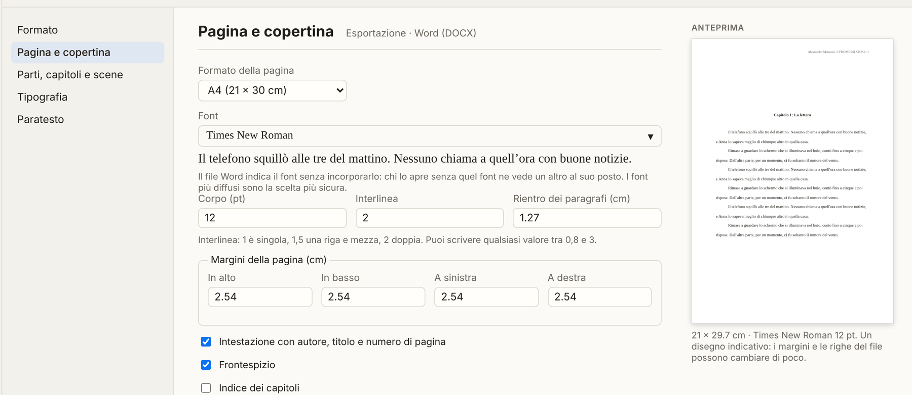

*Example:* to send the manuscript to a publisher choose **Word (DOCX)** and **Standard manuscript**: Times New Roman 12, double line spacing, header with author, title and page number, title page. For a copy to read on a tablet choose **EPUB**.

### In depth

- The project is never touched: the export works on a copy of the text. The comments are removed.
- **DOCX** is created directly by Dante. The file names the font without embedding it: those who open it without that font see another one, which is why the most common fonts are the safest choice.
- **PDF** is typeset by [Typst](https://typst.app), included in the app: there is nothing to install. It uses the fonts of the computer, plus Libertinus Serif and New Computer Modern when the chosen font is missing.
- **EPUB 3**: one file for each part, chapter and opening or closing page, with a table of contents of the chapters inside the parts. The typeface and the size are largely chosen by the reader; the style sheet (CSS) can be changed. The book keeps the same identifier from one export to the next (`export.epubId` in `dante.yaml`).
- **Tables and images** reach every format. In Word the table takes the width of the text and the header row repeats on every page. In the PDF the images are read from the folder of the project: PNG, JPEG, GIF, SVG and WebP are fine. In Word and EPUB the formats they do not accept (WebP, SVG and others) are converted to PNG. In the exported Markdown the images stay references to the files of the project. **Footnotes**: `^[text]`, or `[^1]` in the text and `[^1]: text` on a paragraph of its own in the same scene. In Word and in the PDF they go at the foot of the page and number themselves; in the EPUB they stand at the end of the chapter, with a number that leads to the note and back; in Markdown they stay written as `^[text]`. Their text counts among the words and characters of the book.
- **Cover**: the chosen picture is copied into the folder **Attachments** inside **Research**, like the images of the text, and `dante.yaml` keeps its path under `cover.image`, together with `cover.show` (title, subtitle, authors), `cover.textColor` and `cover.outlineColor`. JPEG, PNG, WebP and GIF stay as they are; the other formats are converted to PNG. In Word and EPUB the cover becomes a PNG image of 1200 × 1800 pixels; in the PDF the picture fills the first page and the texts are drawn over it.
- The headings use the `title` of each chapter or scene; `published_title` replaces it only in the export, useful if the working title is different from the final one.
- The blank lines of the separator are empty paragraphs in Word, spaces of one line in PDF and EPUB and `&nbsp;` in Markdown, like the blank lines of the text. The line sign is saved in `dante.yaml` under `export.docx.lineSign`.
- All the export settings are saved in `dante.yaml` under `export`. A new project starts from the last ones used.

## 14. Opening the project in Obsidian

### How to

In Obsidian choose **Open folder as vault** and select the folder of the project. Scenes and cards are read and changed normally, also from the phone if the folder is synced. When you go back to Dante, the changes are already there.

Two precautions:

- To move, rename or join scenes and chapters use Dante: in Obsidian the numbers at the beginning of the names must be respected by hand.
- Do not delete the odd marks between curly brackets: they are comments and revisions (chapter 10).

### In depth

| What | In Dante | In Obsidian |
| --- | --- | --- |
| Scenes and notes | formatted text | the same |
| Properties | Properties panel | Properties panel, same values |
| Links `[[…]]` and aliases | the same | the same |
| Blank lines between paragraphs | line with a pale ¶ | blank line when reading; when editing `&nbsp;` may appear |
| Comments and revisions | bubbles, underlined and struck through | CriticMarkup marks visible: `{++ … ++}`, `{-- … --}`, `{>> … <<}` |
| Headings "Chapter 3" | worked out by Dante | they do not appear: you see the file name |
| Views | tables, boards, timelines | YAML files in `Views/` |
| Snapshots, presence, log | handled by Dante | files in `.dante/`, to leave alone |

Obsidian creates its own folder `.obsidian/`, which Dante ignores. A file renamed in Obsidian without a numeric prefix ends up at the end of its chapter.

An artificial intelligence assistant that works on files (Claude Code, Codex, Cursor and the like) can read and change a Dante project too. So that it respects the same rules (numbers in the names, folder notes, links, comments and revisions, files in `.dante/` not to touch), give it the skill in [`skills/dante`](../skills/dante/SKILL.md): a file of instructions in English, valid for novels and gamebooks in any language, with three in-depth files (settings, formatting, gamebooks) and a script that shows the manuscript in order, with words and characters with spaces, and flags problems of structure. In Claude Code it is enough to copy the folder `skills/dante` into `.claude/skills/` of the project or of your user folder; in the Claude apps you upload the folder compressed as a zip among the skills; with other assistants you paste or attach `SKILL.md`.

## 15. Keyboard shortcuts

### How to

On a Mac you use Cmd, on Windows and Linux Ctrl; Alt is the key that on the Mac is also called Option. The tables give both versions. In the app the tooltips of the buttons show only that of the system you are using. Moving the mouse over a button, the tooltip shows its shortcut.

**Writing**

| Mac | Windows and Linux | Action |
| --- | --- | --- |
| Cmd+Enter | Ctrl+Enter | Split into scene: the text after the cursor goes into a new scene (in a gamebook: new paragraph, chapter 22) |
| Alt+Enter (in a `[[` list) | Alt+Enter (in a `[[` list) | in a gamebook, links the paragraph with a hidden reference |
| Cmd+Shift+Enter | Ctrl+Shift+Enter | Split into chapter: starts a new chapter from the cursor |
| Enter | Enter | new paragraph; twice in a row, a blank line that shows in the book |
| Shift+Enter | Shift+Enter | new line in the same paragraph |
| Alt+Enter | Alt+Enter | blank line between two paragraphs, without a new scene |
| Cmd+B | Ctrl+B | bold |
| Cmd+I | Ctrl+I | italic |
| Cmd+Shift+X | Ctrl+Shift+X | strikethrough |
| Cmd+Shift+H | Ctrl+Shift+H | highlight |
| Cmd+Alt+M | Ctrl+Alt+M | comment on the selected text |
| Cmd+K | Ctrl+K | link |
| Cmd+E | Ctrl+E | code |
| Cmd+Shift+7 | Ctrl+Shift+7 | numbered list |
| Cmd+Shift+8 | Ctrl+Shift+8 | bulleted list |
| Cmd+Shift+9 | Ctrl+Shift+9 | checkbox |
| Cmd+Shift+. | Ctrl+Shift+. | quotation |
| Cmd+Shift+E | Ctrl+Shift+E | centres the paragraph (again: back to the left) |
| Cmd+Shift+R | Ctrl+Shift+R | aligns the paragraph right (again: back to the left) |
| Cmd+click | Ctrl+click | follows a link on the line you are editing |
| Cmd+Z | Ctrl+Z | undo, also an automatic typographic correction |
| Cmd+Enter (in a comment) | Ctrl+Enter (in a comment) | adds the comment or the reply |

**Tree of the manuscript**

| Mac | Windows and Linux | Action |
| --- | --- | --- |
| Enter | Enter | opens the scene; opens or closes a chapter |
| F2 or double click | F2 or double click | renames |
| Alt+Cmd+↑ / ↓ | Ctrl+Alt+↑ / ↓ | moves up or down by one place |
| Right / left arrow | Right / left arrow | opens or closes a chapter or a part |
| Cmd+click | Ctrl+click | adds a scene to the choice, to merge them |
| Cmd+Backspace or Delete | Ctrl+Backspace or Delete | moves to the trash |

**Window**

| Mac | Windows and Linux | Action |
| --- | --- | --- |
| Cmd+F | Ctrl+F | searches in the scene or in the note |
| Cmd+G / Shift+Cmd+G | Ctrl+G / Ctrl+Shift+G | next / previous occurrence |
| Cmd+Shift+F | Ctrl+Shift+F | opens and closes the search in the project |
| Alt+Cmd+F | Ctrl+Alt+F | find and replace in the whole project |
| Cmd++ / Cmd+− / Cmd+0 | Ctrl++ / Ctrl+− / Ctrl+0 | enlarges, reduces, resets the text |
| Esc | Esc | leaves full screen, closes search and windows, cancels a change in progress |
| Cmd+\\ | Ctrl+\\ | opens a pane beside, choosing with the search what to show |
| Alt+Cmd+\\ | Ctrl+Alt+\\ | swaps the pane with what the section shows |
| Alt+Cmd+← / Alt+Cmd+→ | Ctrl+Alt+← / Ctrl+Alt+→ | moves the cursor between the section and the panes |
| Cmd+W | Ctrl+W | closes the pane that has the cursor; if the cursor is not in a pane, closes the project and goes back to the start screen |

### In depth

Cmd+Shift+7/8/9 and Cmd+Shift+. (Ctrl+Shift+7/8/9 and Ctrl+Shift+.) also work with keyboards where Shift with those keys writes other characters: Dante looks at the key pressed, not at the character. On an Italian keyboard Cmd+\\ is Cmd+ù. On the Mac Cmd+? opens the help (chapter 20).

## 16. Side-by-side panels

### How to

Beside the text you can keep up to two more things open: another scene, a chapter, the card of a character, a note, an image or a view such as the timeline. Each pane can be edited, and stays open when you change section too.

- **Opening beside.** Hold **Alt** (Option on a Mac) while you click: on a link `[[Lucia Mondella]]` in the text, on a scene in the tree, on a card of the Story Bible, on a note, on a view or on a result of the search. You can also use the item **Open beside** of the right-click menu, the ⧉ button in the Links tab, or drag an item onto the right edge of the window.
- **Cards of the scene.** **More** > **Cards of the scene** in the bar of the Manuscript opens a pane that shows the cards of the Story Bible named in the scene you are writing (by name or alias) or linked with `[[…]]`. Write "Agnese" and her card appears among the tabs at the top; moving to another scene the tabs change.

  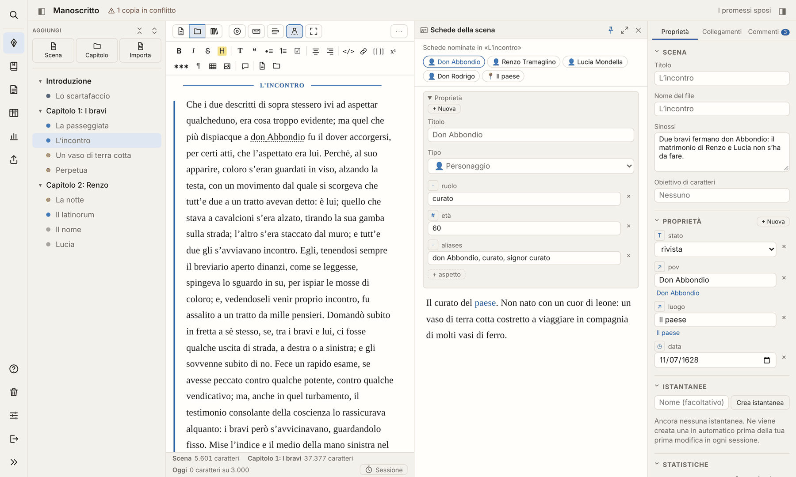

  *Example:* in the scene **L'incontro** the pane shows the tabs of don Abbondio, Renzo, Lucia, don Rodrigo and of the village: they are the cards named in the text or in the properties. A click on a tab shows that card, which you can also edit.
- **The next pane.** The next thing opened beside takes the place of the pane that is not pinned. With the pin 📌 the pane stays and the new one opens beside it.
- **The buttons of the pane.** ⤢ takes the content to the middle, in its section; ⇄ swaps it with what is in the middle; × closes the pane. Drag the left edge to widen it, double click to give the text and the panes the same width.
- **The panel on the right** (Properties, Links, Comments) shows what has the cursor: the scene in the middle or the content of the pane you clicked in.
- **The views beside** highlight the scene you are writing, and a click on an item opens it in the middle.

The same scene can be in the middle and in a pane: what you write in one appears at once in the other.

### In depth

- Each open file has one document in memory, shared by all the editors that show it: saving, automatic snapshots and reloading after a change on disk go through it, so two editors of the same file do not overwrite each other.
- Before renaming or moving files, Dante writes what the editors still hold in memory; the panes follow the renamed items and close by themselves if the item is deleted.
- The layout of the panes is saved on this computer, for each project, and not in the folder of the novel: the screen of a co-author does not change.
- On a Mac Cmd+W does not close the window: the menu of the app uses it to close the pane or, if the cursor is not in a pane, the project. Before closing, Dante writes everything you wrote and, if the settings ask for it, makes the backup, as with the button to close the project.
- Export, Settings and Statistics are exceptions, because they use the whole width: there the panes are hidden, not closed.

## 17. Updates

### How to

1. At every launch Dante checks whether there is a new version, and then again every six hours if it stays open. If there is none, **Dante 1.… is up to date** appears for a few seconds at the bottom right; if the check fails (for example without a connection) it says so in the same place. When there is a new version a box appears at the bottom right: **Dante 1.… is available**.

   
2. To know what changes press **What's new**: the box lists the news of every version released after the installed one, in Italian or in English according to Dante's language. The same list is in the page [What's new](whats-new.md) and in the page of the version on GitHub.
3. Press **Update and restart**. Dante saves the open text, downloads the new version, installs it and reopens. On Windows the window of the installer appears for a few seconds.
4. With **Remind me later** the box vanishes and comes back at the next launch. With **Skip this version** Dante no longer proposes it: it waits for the next one. If you change your mind, **Check for updates** in Settings shows it anyway.

In **Settings** > **Updates and support** you also choose the **channel**:

- **Stable**, the default choice: you receive only the official versions, when the news has already been tried.
- **Beta**: you receive the news earlier, in versions still on trial (for example *1.1.0-beta.1*), which may have some defects. If you install a beta, Dante stays on this channel until you change it.

Going back from Beta to Stable Dante does not go backwards: you stay on the beta you have until a more recent stable version comes out.

To check by hand, on the Mac choose **Dante** > **Check for Updates…** in the menu bar; everywhere you can open **Settings** > **Updates and support** and press **Check for updates**. There you also find the number of the installed version, useful when you report a problem, and the box not to check for updates at launch.

The portable copy for Windows does not update by itself: download the new zip and replace the folder, keeping the subfolder `dante-data`.

### In depth

- The versions follow semantic versioning: 1.0.1 only fixes defects, 1.1.0 brings new features (first as beta 1.1.0-beta.1, -beta.2…), 2.0.0 would change something incompatible. How they come out is explained in [Rilasci di Dante](rilascio.md) (in Italian).
- Each version is a GitHub release with a file `latest.json` that lists the signed files for each system. The Stable channel reads that of the latest official release; the Beta channel reads the list of releases and takes the highest version, beta or stable. The installed copy compares the number with its own.
- The 0.1.x copies look for updates in the old *preview* page, which receives the `latest.json` of every new stable: so they move to 1.0 and from there choose the channel.
- The update files are signed, and Dante checks the signature before installing: it refuses a file that is not signed or was changed.
- What is replaced: on a Mac the app in Applications, on Windows the installed program (with the installer, which shows only a progress bar), on Linux the AppImage or the .deb/.rpm package (for the packages the system asks for the administrator password). The projects and the settings are not touched.
- Dante does not look for updates in the portable copy, because there is no installation to replace. There the check at launch shows nothing; from the menu it says that this copy does not update by itself.
- Without a connection the check at launch fails silently; the one from Settings shows the error.

## 18. Dante in the browser

Dante also exists as a web version, for those who cannot or do not want to install the app, for example on a Mac stuck on Catalina. It is the same program, with some limits listed below. The app stays the main version: if you can install it, use that.

### How to

1. Open **https://dante.lucadj.eu/app/** with **Chrome**, **Edge** or **Brave**. Safari and Firefox open Dante, but cannot work on the folders of the computer: there only the sample project and the trial of an import from Word, which is not saved, work.
2. To have Dante like an app, with a window of its own and the icon in the Dock or in the Start menu, press the **Install** icon on the right of the address bar (in Chrome: a monitor with an arrow). It is optional, but handy.
3. Press **Open folder…** and choose the folder of the novel, or **New project** and choose where to create it. The browser asks for permission to change the folder: answer **Allow** or, if it is there, **Allow on every visit**, so that next time the project reopens from the recent ones without more questions.

   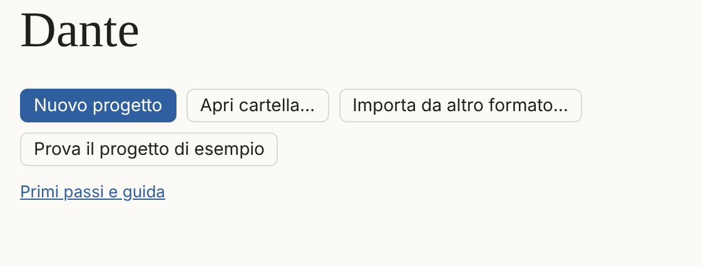

4. From here Dante works like the app: the text is saved in the files of the folder while you write.
5. After the first opening Dante also works **without a connection**. When there is a network and a new version, the update box appears as in the app (chapter 17): **Update and restart** reloads Dante with the new version.

If you close the tab right after writing, the browser may ask whether you really want to leave: choose **Stay** (or Cancel), wait a second and close again. At that moment Dante is still writing the last words.

**What is missing, or works differently, in the browser:**

- **No PDF**: Word, EPUB and Markdown yes, the PDF for now only in the app.
- **Moving chapters and parts is slower**: the browser cannot rename folders, so Dante copies the files to the new position and then deletes the old one. Do not close the browser while it does so; if it happens, Dante completes the move at the next opening. Those who collaborate through Drive or Dropbox receive more changes than usual.
- **The changes made from outside** (a co-author, Obsidian, another app) appear after a few seconds, or when you go back to Dante's tab, not at once as in the app.
- **No "show in Finder" or "open with the default app"**: Dante says in which folder the file is and offers to download a copy. The exports end up in the `export` folder of the project, or where you choose with **Save somewhere else…**.
- **Cmd+W (Ctrl+W) closes the browser tab**, not the pane or the project: use **Alt+Cmd+W** instead (Ctrl+Alt+W on Windows and Linux).
- **A project opens in one tab at a time**: if it is already open elsewhere, Dante says so. Two tabs on the same project would write over each other.
- **Images from a web address**: many sites do not let the browser download them. In that case save the image on the computer and drag it into Dante.
- **Double click on `Title.dante`**: it works only with Dante installed from the browser (step 2) and asks for one more click to give permission on the folder.

### In depth

- **Privacy**: the text, the notes, the settings and your name never leave the computer. The browser works directly on the files of the chosen folder; there is no Dante server, no account, no visit statistics. Only the requests for the files of the program and for the file `version.json` that says whether there is a new version go over the network, to GitHub Pages, which like any site sees the IP address and the kind of browser. The download of an image from a web address happens only when you ask for it.
- **How it works offline**: a *service worker* keeps in the browser all the files of the downloaded version, as one block. A new version is downloaded whole and takes the place of the old one only with **Update and restart** (or at the next opening with no Dante window open), so files of two versions never mix.
- **Where things stay**: the settings of the application in `localStorage`, the authorised folders (the "handles" the browser gives Dante) in IndexedDB, both in the profile of the browser. Dante asks the browser not to delete them when space is short. In the worst case the settings and the list of recent projects are lost, not the novel, which is in the folder.
- **Which folders**: Chrome refuses some system folders and the Home or Documents folder as a whole; a project subfolder is fine, including those of Google Drive, Dropbox, OneDrive and iCloud Drive.
- **Interrupted moves**: while it copies a folder, Dante writes in `.dante/moving.json` from where to where it is moving. At the next opening, if the file is there, it completes the copy or the deletion of the original and removes it.
- **Changes from outside**: the browser does not warn when a file changes, so Dante checks the folder again (names, sizes and dates of the files) every few seconds and when the tab comes back to the front. The folders `.dante`, `export` and `.trash` are excluded, as in the app.
- **Two tabs**: Dante "holds" the open folder with a browser lock (*Web Locks*); a second tab or window of the same browser cannot open it until the first closes the project or the tab.
- **macOS Catalina**: the last version of Chrome, Edge and Brave for macOS 10.15 is based on Chromium 128 (2024) and no longer receives security updates. Dante works there, but it is good to know, because the same browser is also used to browse. On Catalina Brave still publishes its last version; a Chrome already installed stays at 128.
- **Two versions**: in `/app/` there is the latest official version, in `/beta/` the latest trial version, the same as the beta of the app. Installed from the browser they are two separate apps (the second is called *Dante beta*), but they share the settings and the list of recent projects; a novel open in one does not open in the other until you close it.
- **Address**: Dante is on a domain of its own, `dante.lucadj.eu`, so no other page published with GitHub Pages can read its data in the browser. Until October 2026 the address was `lucadj77.github.io/dante/`, which now leads to the site: for the browser it is another site, so those who used it find their novels in the folders but must reopen them and redo the settings.

## 19. Backup copies

A backup copy is a zip file with the whole project, kept on the computer outside the folder of the novel. It is needed if the folder gets damaged, for example by a syncing problem with Drive or Dropbox, or if a file is deleted by mistake outside Dante.

### How to

- Dante makes a copy by itself when you close the project or quit Dante, if something has changed since the last one.
- The copies are in the folder **Documents/Dante backup**, in a subfolder for each novel. Of each novel the 10 most recent stay; the oldest are deleted by themselves.
- In **Settings → Backups** you can choose another folder, how many copies to keep, whether to make them on closing, and see when the last one was made. **Make a backup now** makes one at once, **Show the backups** opens the folder.
- **To take up a project again**: in **Settings** > **Backups**, under **Going back to a backup**, is the list of the backups with date and time. **Open this backup** takes it out into a new folder beside the novel's, named after the novel with "(backup of…)", and opens it. The novel as it is now is not touched and stays among the recent projects: compare the two folders calmly and keep the right one. If Dante cannot open the novel, do it by hand: open the zip (double click), move the folder it holds where you like and open it with **Open folder…** from the start screen.
- **In the browser** Dante cannot write outside the folder of the novel: in **Settings** > **Backups** there is **Download a backup (zip)**, to press now and then and keep in a safe place.

### In depth

- The name of each copy is the name of the folder of the project with date and time, for example `My novel 2026-10-26 18-02-11.zip`. Inside is the folder of the project as it was.
- The `export` folder (it is made again from the novel), the trash `.trash`, the folders `.obsidian` and `.git` and the presence files of the co-authors are left out. The snapshots in `.dante/snapshots` are there.
- Two novels with the same folder name have different subfolders ("My novel", "My novel 2"): a file `.dante-backup-of` in the subfolder says which project it belongs to.
- The copy is first written with a temporary name and takes its name only when it is complete, so a zip with the right name is never half done.
- The chosen folder holds for all the projects of this computer, like the other settings of the application. A synced folder (Drive, Dropbox, iCloud) is fine as a second protection, but it keeps the copy on the same service that may have caused the problem.

## 20. Help inside Dante

### How to

The **Help** icon (the question mark in the bar on the left, above the trash) opens a window with three tabs:

- **First steps**: seven steps to begin, from creating the project to the export.
- **Full guide**: this guide, with the list of the chapters on the left. A click on a reference ("chapter 7") leads to the chapter.

  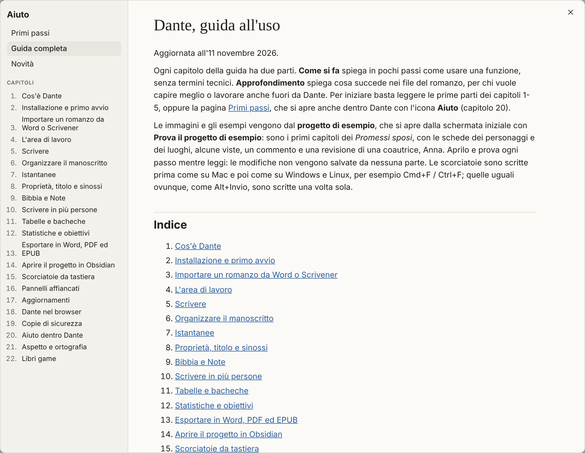

- **What's new**: what changes in each version.

It can be read without a connection too, because it is inside Dante. From the start screen you get there with **First steps and guide**; on the Mac also from the menu **Help** > **Dante Help** (Cmd+?). Esc closes the window.

### In depth

- The pages travel inside the app: the guide inside Dante is that of the installed version.
- With the interface in Italian the tabs show the Italian pages; with any other language, the English ones.
- The links to other pages of the repository (for example [Trying Dante](beta.md)) open on GitHub in the browser.
- **Error messages**: when something fails (a file that cannot be written, a full disk, a folder that vanished, no connection) Dante says so with a simple sentence. The technical message stays hidden behind **Details**, to copy if you report the problem.

## 21. Appearance and spelling

How Dante and the text look while you write. They are choices of this computer: they hold for every project, unless you give a novel a look of its own, and change neither the files nor the export, which has its own settings (chapter 13).

### How to

Open **Settings**: in the list on the left, under **Dante on this computer**, are the pages **Appearance**, **The text in the editor** and **Writing**.

- **Theme** (page **Appearance**): you choose it from five small drawings of the window, each in its own colours. **System** (light or dark like the computer, and it changes with it), **Light (paper)**, **Sepia** (warm paper, to write for a long time by day), **Dark**, **Night** (almost black with softer text, to write in the dark).

  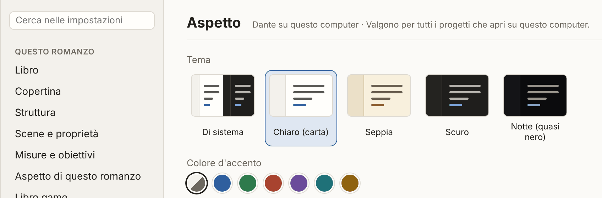

- **Accent colour**: the colour of active buttons, links and selections. The first circle leaves that of the theme; the others are blue, green, brick red, purple, teal and amber, in a lighter version in the dark themes.
- **Interface size**: enlarges or shrinks the whole window of Dante, from 80% to 200%: menus, tree, panels, buttons, windows and their text. It is useful if your sight is poor or you work on a very large screen. The text in the editor grows by the same measure, besides its **Font size** (which stays separate and also changes with Cmd/Ctrl + and −).
- **The text in the editor** (the page with this name):
  - **Editor font**: five ready choices, or **Another installed font…**, which lists the book fonts present on the computer and with **Other…** accepts the name of any installed font.
  - **Font size** and **Line width** (in characters).
  - **Line spacing**: the space between the lines of a paragraph, from 1.4 to 2.4; 1.7 is the usual one.
  - **Space between paragraphs**: an empty line, half a line or a little. In the file an empty line stays between two paragraphs all the same: only how tall it is on screen changes.
- **A single Enter starts a new paragraph** (page **Writing**): on by default. The empty line that separates the paragraphs in the file is written by Dante and does not show (chapter 5). Off, the editor shows the empty lines as they are in the file, and **Ask about extra empty lines** appears.
  - **First-line indent**: none, small, medium or large, as in printed books.
  - **Justified text, as in a book**: aligns the paragraphs on the right too and breaks lines with hyphenation.
- Beside it is a **sample** of the text, which changes with every choice.
- **Spelling** (page **Writing**): **Underline words the spelling checker does not know** turns the checker on or off while you write.
- **A different look for a novel**: in **Settings** > **Look of this novel** tick **Use a different look for this novel**. The theme, accent colour, font and text layout you choose there hold only when you open that novel; the others keep the look of the computer. Unticking it takes the novel back to the look of the computer. Interface size, language and spelling stay the same for every novel.

*Example:* if the menus and the labels of the panels look small to you, choose **Interface size: 125%**. Everything grows at once; if the text of the editor then looks too large, lower its **Font size**.

*Example:* for a page like that of a printed novel choose **Sepia**, **Space between paragraphs: A little**, **Indent: Medium** and **Justified text**. The paragraphs draw closer, each begins indented and the margins are straight.

### In depth

- **Interface size**: Dante enlarges its window as a browser does with the zoom, so everything keeps its proportions. In the browser version the setting is not there: you use the zoom of the browser (in Chrome and Edge the item **Zoom** of the ⋮ or ··· menu), which the browser remembers for the site. On macOS 10.15 (Catalina) and earlier the system does not let apps enlarge their window: macOS 11 or later is needed; there the screen zoom of macOS is left (System Preferences > Accessibility > Zoom). There are no keyboard shortcuts: Cmd/Ctrl + and − already change the text of the editor, and Option+Cmd + and − are those of the screen zoom of macOS.
- Indent and space between paragraphs concern only the paragraphs of text: headings, lists, quotations, tables and centred or right-aligned paragraphs stay as they are.
- The hyphenation of justified text uses the language of the novel; where the system does not have the rules of that language, the justified lines may have wider spaces.
- **Spelling checker**: it is that of the system (macOS, Windows, Linux or the browser), with its dictionaries and the words you taught it; the system chooses the dictionary. Dante marks the text with the language of the novel, which the system can use to choose the right dictionary. On the Mac a right click on an underlined word gives the suggestions and **Learn Spelling**; the languages are chosen in System Settings > Keyboard > Text Input > Edit > Spelling. On Windows the languages are those installed in Settings > Time & language. Dante keeps from the checker the names and aliases of the Story Bible's cards, and the **Words of this novel** added in Settings > Writing: they are written in `dante.yaml` under `dictionary`, so they are the same on every computer and for those who write with you. Capitals count: "Renzo" does not cover "renzo".
- **Look of a novel**: the choices stay on this computer, with the other settings of Dante, and not in the project: those who write with you in the same folder keep their own look, and on another computer the novel opens with the look of that computer. To recognise the novel even if you move or rename the folder, Dante writes the file `.dante/id` in the project, which holds only a random code. A copy of the folder made by hand has the same code, and so the same look. Making the text larger with Cmd/Ctrl + and − also changes the look of the novel, when it has one.
- In the settings file of the app: `theme`, `accent`, `uiZoom` (1 = 100%), `fontFamily`, `fontSize`, `lineWidth`, `lineHeight`, `paragraphGap`, `indent`, `justify`, `spellcheck`.

## 22. Gamebooks

A gamebook is made of numbered paragraphs: the reader does not read in order, but jumps from one paragraph to another according to the choices made. Dante can work on a gamebook instead of a novel. It is a module that is off by default: it is turned on project by project and changes nothing in the others.

Dante reads, writes, checks, shuffles and exports the book. The paragraphs stay Markdown files, one per paragraph, that open with any text editor.

### How to

**Setting up**

- **Turning the module on**: open **Settings** > **Gamebook** and tick **This project is a gamebook**. In **Paragraphs folder** write the folder, inside the project, that holds the paragraphs (for example `Paragraphs`).
- **Box types**: in **Settings** > **Gamebook** > **Box types** each book has its own: emoji, name, colour, starting text and the property of the paragraph the box is linked to. By default there are six: 🤔 choice, ❤️ trait, ✏️ item, ✅ encounter, 😢 ending, 🆗 confirmed.
- **Lengths and pages**: **Short paragraph under** says below which length a paragraph is short, in the unit of the novel (words or characters with spaces). The page is that of the **Pages** settings. **Each paragraph starts on a new page** counts the pages as in a printed gamebook; off, it counts the text run on. It is the same choice as **Between paragraphs** in the export: changing one changes the other too.

**Reading the book**

- **The tree**: in place of chapters and scenes it shows the paragraphs in order of number. Beside each paragraph are the number (with a padlock if it is fixed, an anchor if it is relative to another), the title, a warning triangle if there is something to check (move the mouse over it to read what) and the length, in light blue if the paragraph is short and in red if it exceeds one page. The paragraphs still empty have their title in grey italic. At the top, a line sums up the book: how many paragraphs, how many empty, how many orphans (no paragraph leads there), how many dead ends (they lead nowhere and are not endings) and how many pages.
- **Where you come from and where you go**: with **Show under each paragraph in the tree where it comes from and where it leads** a line appears under each paragraph with the numbers that lead there (←) and those it refers to (→). A click on a number opens that paragraph.
- **The Paragraph panel**: in **Properties**, above the other sections, it shows number and type, length and pages, the paragraphs you come from and those it leads to (each opens with a click) and the warnings. The number is changed by writing another: Dante also updates the alias and all the references that lead to that paragraph, and refuses a number already in use. Beside it you choose whether the number is **free** or **fixed**, and below you mark whether the paragraph is an ending. The note of the paragraph (property `note`) is written in the field **Synopsis**. Above the text, the divider shows number and title.

  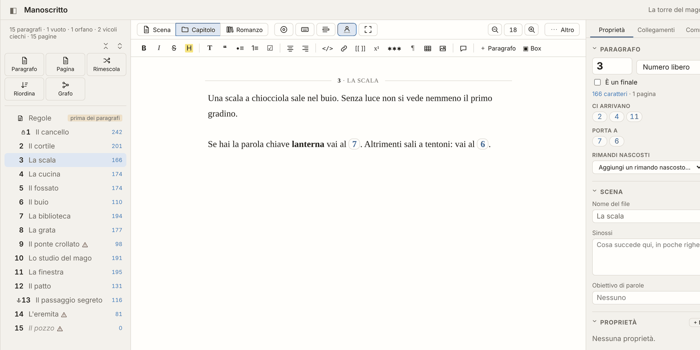

- **In the editor** references such as `[[The courtyard|2]]` show as the number alone, and the boxes (choices, keywords, endings and the others) as coloured frames. The lines `:::` that open and close a box hide and come back when the cursor passes over them. Lists and tables inside a callout (`> [!note]`) show as in the rest of the text; in a table inside a callout Tab and Enter work as in the other tables.

**Writing**

- **Linking a paragraph**: write `[[` and then the number or a part of the title. The list shows the paragraphs that match; Enter inserts the reference in bold, such as `**[[The courtyard|2]]**`. The first two items create a new paragraph: **New paragraph “title” with the first free number (N)** creates it and puts the reference there (it appears only if the title does not exist yet), **New paragraph “title” with other choices…** opens the window where you choose a fixed or relative number and a hidden reference. If you wrote a new title, Enter creates it at once; to link a paragraph that already exists go down the list with the arrow. With **Alt+Enter** instead of Enter the reference becomes hidden: it does not go in the text but in the property `rimandi nascosti` of the paragraph.
- **New paragraph**: Cmd+Enter / Ctrl+Enter, or the **＋ Paragraph** button in the formatting bar, opens the **New paragraph** window and puts the reference where the cursor is. In the window choose the title (which becomes the file name), the number (**First free number**, **Fixed** or **Relative to** another paragraph plus an offset) and whether the reference goes in the text or among the hidden ones. A selected text becomes the proposed title. The **Paragraph** button at the top of the tree opens the same window too, but creates only the paragraph, without a reference, and opens it.
- **Boxes**: the **Box** button in the formatting bar lists the box types of the book. The box is inserted at the cursor with its emoji and its text. For the types linked to a property (such as ✏️ and the property `keywords`) Dante asks for the value, proposes those already used in the book and writes it in the property of the paragraph too. An ending box (😢) marks the paragraph as an ending.
- **Relative numbers and hidden references in the panel**: in the Paragraph panel the type of number can also be **relative**: you choose the paragraph it is tied to and the offset, and the number becomes that of the paragraph plus the offset. When the number of a paragraph changes, those relative to it move with it. Below, **Hidden references** lists those of the paragraph, with × to remove them and a list to add more.
- **Rules and other pages**: a file of the paragraphs folder without a number (the rules, an introduction, the acknowledgements) is a page, with a sheet in place of the number. To create one press **Page** at the top of the tree: Dante calls it "New page" (with right click > **Rename** you give it its title) and opens it. By default it goes before the paragraphs; in the Paragraph panel (item **In the export it goes**) or with right click > **Put after the paragraphs** it goes at the end, and that is where the export will put it.

*Example:* in paragraph 1 write "If you want to go in, turn to **[[The courtyard|2]]**". In the tree paragraph 2 is no longer an orphan, and in its panel 1 appears among the paragraphs you come from.

Renaming a paragraph (from the divider or from the file name) changes the name of the file, and the references that lead there keep their number.

While the module is on the tree is not reordered by dragging and scenes are not split: the order comes from the numbers, and the files are never renamed and never receive numbers in their name.

**Numbering**

- **Shuffling the numbers**: the **Shuffle** button at the top of the tree opens a window with the preview: for each paragraph the number before and the one after. The fixed paragraphs (with the padlock) and the opening paragraph stay where they are, the relative ones move together with their anchor; among many attempts Dante chooses the one where a paragraph and those it refers to are furthest apart. **Try again** draws again. Pressing **Shuffle** Dante saves a snapshot of every file it touches, changes the numbers and updates the references and the aliases in the whole book. Under the preview, **Numbers written as text** lists the paragraph numbers written by hand in the text ("go back to paragraph 3"): the shuffle does not touch them, so it is better to turn them into references with `[[` first.

  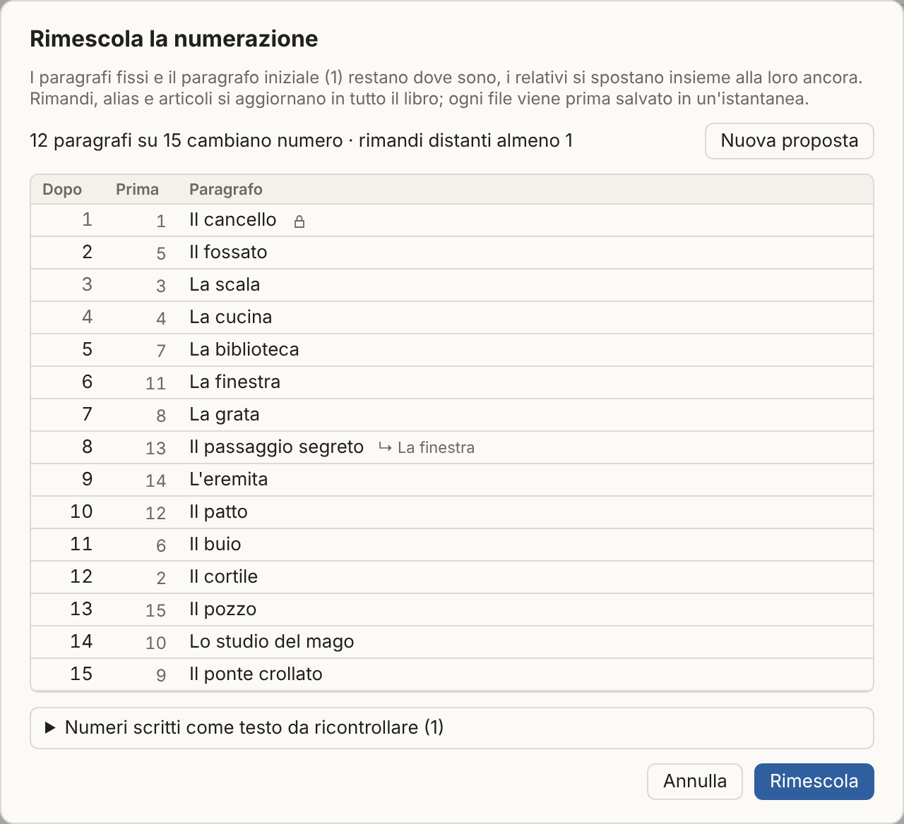

- **Reordering in reading order**: the **Reorder** button uses the same window, but instead of drawing it numbers the paragraphs in sequence in the order the reader meets them: the opening paragraph, then those it refers to in the order they appear in the text (the hidden references after), then theirs, and so on. The fixed ones stay where they are, the relative ones follow their anchor, the paragraphs nobody reaches go at the end. It is useful to work on the book in order before shuffling it.
- **Going back**: in the same window, **Earlier operations** lists the shuffles made. **Numbers only** puts back the numbers of that time, with the references, and leaves the text written afterwards; **Everything** brings each file back as it was before the operation. A single paragraph can always be restored from its snapshots.

**Checking**

- **The Gamebook section**: when the module is on, the section **Gamebook** (the dice icon) appears in the bar on the left, with three tabs. **Paragraphs** is a table of all the paragraphs: number, title, type (fixed, relative, ending, to write), length, from which paragraphs you arrive, towards which you go and warnings. A click on the name of a column sorts by that column (a second click reverses the order); the search field filters by title, number or notes, and the list **Show** keeps only the paragraphs with warnings, to write, endings, fixed, relative or with a precise warning. A click on a title or on a number opens the paragraph. **Checks** gathers the warnings of the whole book, grouped by kind, and the game state (see below). **Register** lists, for each property of the boxes (`traits`, `keywords`, `encounters`), all the values used with the paragraphs where they appear, and flags the **possible duplicates**: values almost the same, such as "moon" and "mooon", which may be a typing mistake.
- **Game state**: Dante reads what the reader obtains and what is asked of them in two ways. In the properties of the boxes a value gives something to the reader ("careful") and the same value with a question mark marks the paragraph that asks whether they have it ("careful?"); the value counts in whatever property it is written, so "reflexes" among the keywords answers "reflexes?" among the traits. In the text, a sentence such as "Note the keyword **lantern**" or "Circle the trait **careful**" gives, and one such as "If you have the keyword **lantern**" asks; if the sentence names several values one is enough. Following the references from the opening paragraph, Dante flags the values **asked for but never given** (perhaps written differently where they are given), those **asked for before they can be had** (they are given only in paragraphs you do not pass through before getting there: the path that requires them can never be taken) and, only as information, those **given but never asked for**.
- **Status bar**: under the text, **Gamebook** says how many problems the checks find (in red if there are any); moving the mouse over it shows the detail, a click opens the **Checks** tab.
- **Graph**: the **Graph** button at the top of the tree writes the note **Gamebook graph** in the folder of the project and opens it. The note holds the diagram of the paragraphs in Mermaid (a format of diagrams that is written as text and can be read in other programs too): solid arrows for the references in the text, dashed for the hidden ones, the beginning in blue, the endings in red, the unreachable paragraphs in orange. **Full screen** shows the graph on the whole window: the wheel zooms, dragging moves it, a click on a paragraph opens it, Esc closes. Pressing **Graph** again updates the diagram and the text written around it stays. Any ```` ```mermaid ```` block in a note or in a scene is drawn the same way.

  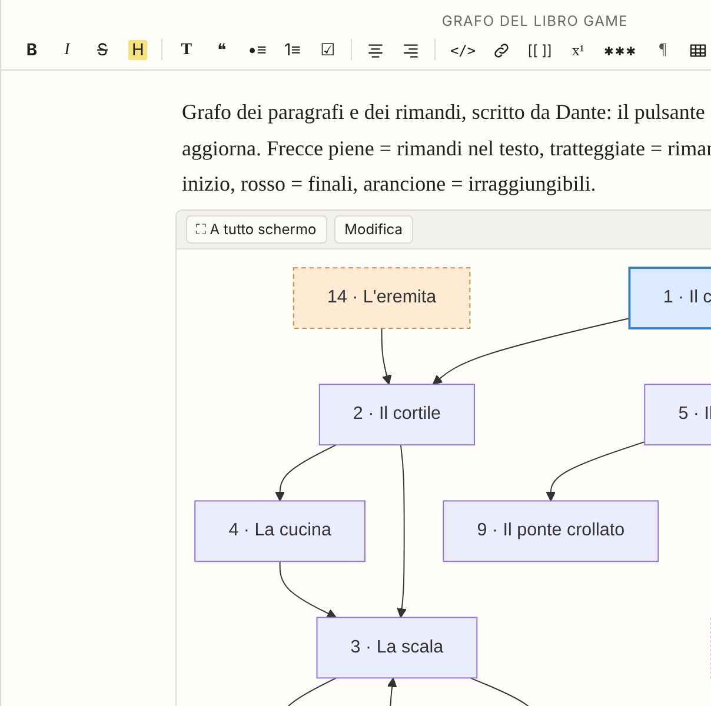

- **Statistics**: in a gamebook the pages are counted as in the line at the top of the tree, so they take **Each paragraph starts on a new page** into account.

**Exporting**

In **Export**, when the project is a gamebook, the choices on parts, chapters and scenes give way to the section **Gamebook**. The paragraphs come out in order of number, with the number as heading; rules and other pages without a number come out before or after the paragraphs with their title. You choose:

- **Paragraph heading**: the number alone, or number and title for a working copy; **Before the number** adds a sign, such as `§ `; then alignment and size of the number.
- **Between paragraphs**: a new page, a blank line or a symbol (for example ✦). The new page also holds for the estimate of the pages.
- **Paragraph text**: justified or aligned left, the first-line indent, the space after each paragraph of text and the size of the text inside the boxes (0 = as the rest). Font, size and line spacing of the text stay those of **Page and text**.
- **Paragraph number**: in bold or not, in italics or not, and with a font of its own (empty = that of the text).
- **Boxes**: frames in the colour of their type, grey frames for black and white print, or plain text.
- **Clickable references**: in Word, PDF and EPUB a click on the number of a reference leads to the paragraph, so those who read on screen do not have to look for it. **References in bold** leaves them in bold as they are written.

In Markdown the references stay numbers and the boxes stay between lines `::: {custom-style="box"}`. If the book has broken references, double numbers or references with the wrong number, the section lists them: a click opens the paragraph to correct.

**Callouts.** A block that begins with `> [!note]` or `> [!warning]` shows with its name in a coloured pill and a background of the same colour; the marker turns back into text when the cursor is on its line. It holds in novels too. In the export it becomes a frame of the same colour with the title in bold (the text after `[!note]`, or the name of the type if it is missing) in Word, PDF and EPUB, also when the boxes of the gamebook have no frame; in Markdown it stays a callout.

**Gamebooks in Italian.** If the language of the novel is Italian, the game state is read from sentences such as «Segna la parola chiave **lavanda**», «Cerchia la caratteristica **studioso**» and «Se hai la parola chiave **lavanda**»; the default box types write in the properties `carattere`, `parole chiave` and `incontri`; the note of the graph is called «Grafo del libro game»; and Dante corrects the article before a reference («al 2», «all'8», «l'11»), also after a shuffle. In English the numbers written as text are those after "to", "section" or "paragraph" ("turn to 12"). The properties of the paragraph (`numero`, `numero_tipo` and the others) stay the same in every language, because they are the format of the files.

### In depth

- A paragraph is a Markdown note in the paragraphs folder. The file name is the title and never changes; the number is in the property `numero`, repeated in `aliases` as a list with a hyphen. `numero_tipo` can be `libero` (free: the shuffle can change it), `fisso` (fixed), or `relativo` (relative) with `ancora` (the title of another paragraph) and `scarto` (the offset). `finale: true` marks an ending, `note` is the note of the paragraph. A page without a number with `posizione: dopo` goes after the paragraphs.
- The references are links `[[Title|N]]`, usually in bold. The references the reader does not see (for example a number to work out) go in the property `rimandi nascosti`: they count for orphans and dead ends but do not appear in the text.
- A box is a block between the line `::: {custom-style="box"}` and the line `:::`; the type is given by the emoji that begins the first line of the content. It is the format of Pandoc's styled blocks, so an export to Word with Pandoc gives the boxes the style "box".
- The warnings are: orphan, dead end, unreachable from the opening paragraph, double number, link without a number, reference to a paragraph that is not there, ending box in a paragraph not marked as an ending (a paragraph with `finale: true` without an ending box is fine: the ending can be told in the text), number of the reference different from that of the paragraph.
- The game state considers what the reader *can* have when arriving at a paragraph: the values given on at least one path from the opening paragraph, the paragraph itself included. In the text only the values that the book gives somewhere count. A value with a hyphen before it ("-careful") takes something away and is not considered. Two values are possible duplicates if they differ by at most two letters and by less than 30% of the length; a value and the same with a question mark never are.
- In `dante.yaml` everything is under `gamebook:` (`enabled`, `start`, `short`, `onePerPage`, `showLinks`, `boxes`, and `export` with `heading`, `prefix`, `align`, `size`, `separator`, `symbol`, `links`, `bold`, `boxes`, `justify`, `indent`, `spacing`, `boxSize`, `numberBold`, `numberItalic`, `numberFont`). In Word the numbers of the paragraphs are bookmarks (`p12`) and the references internal links; in PDF and EPUB they are labels and links to the same name; the folder is `folders.manuscript`. In a novel `gamebook:` is not written.
